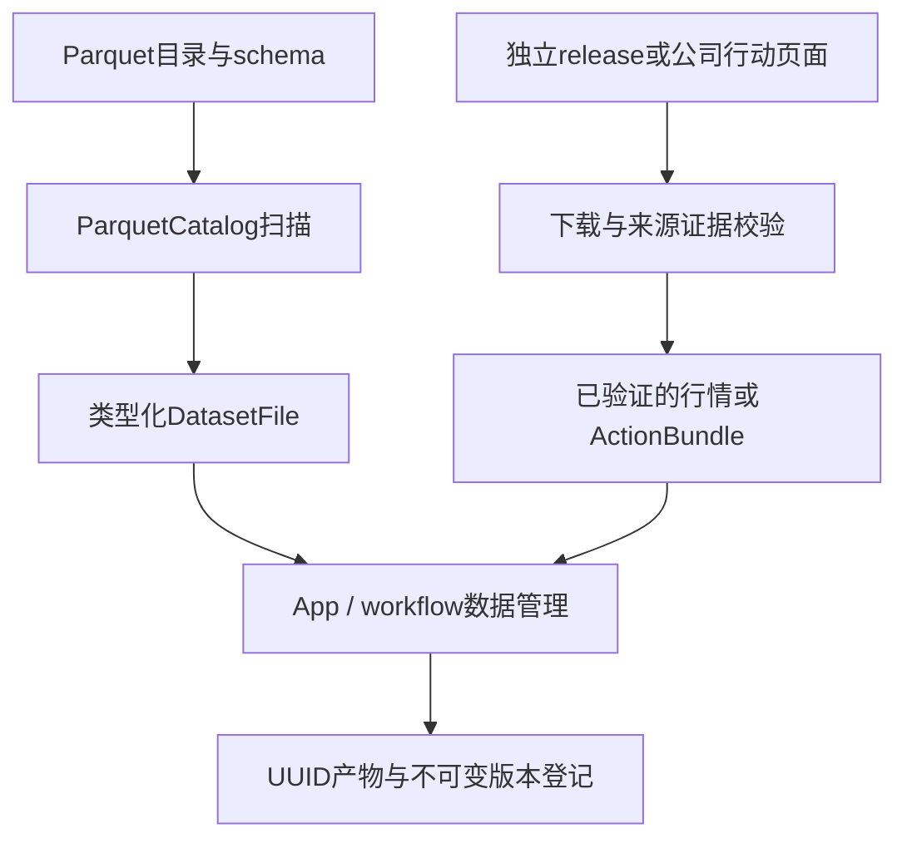
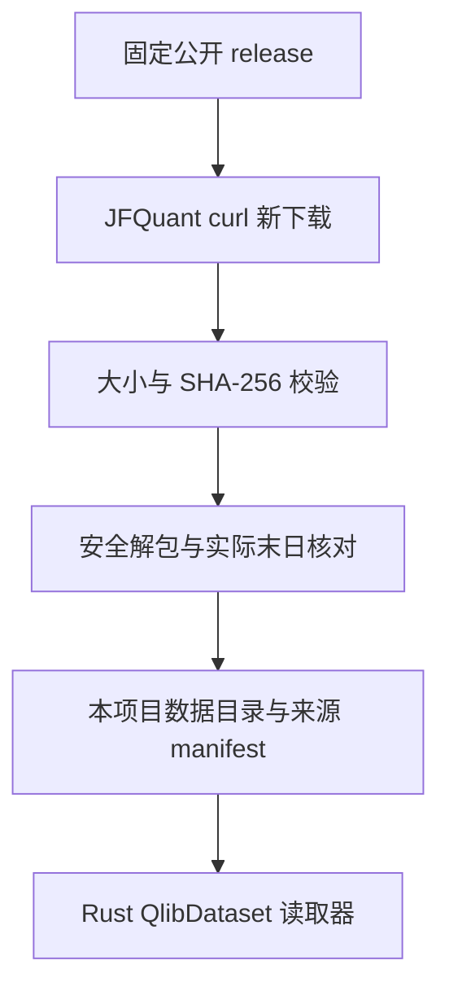
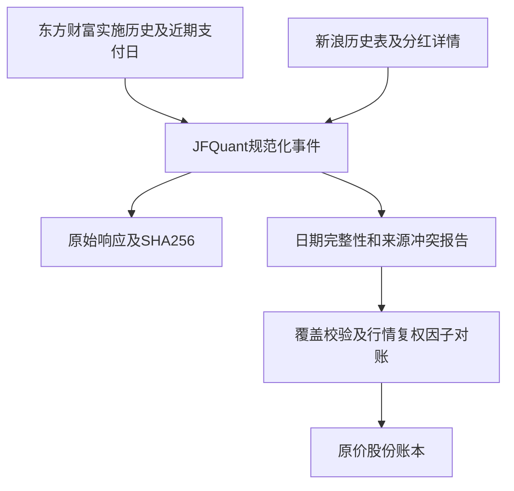
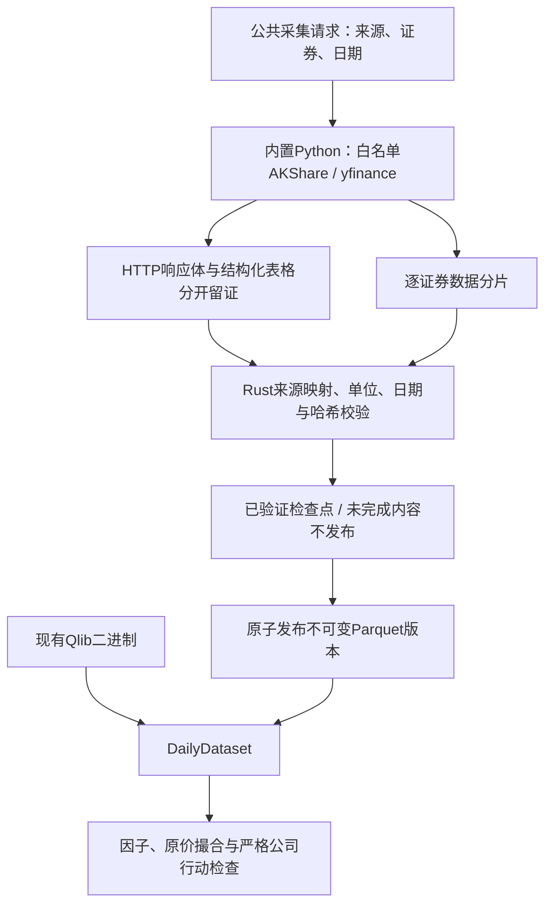
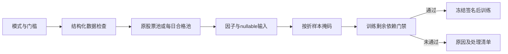
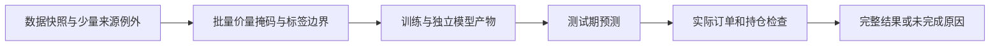
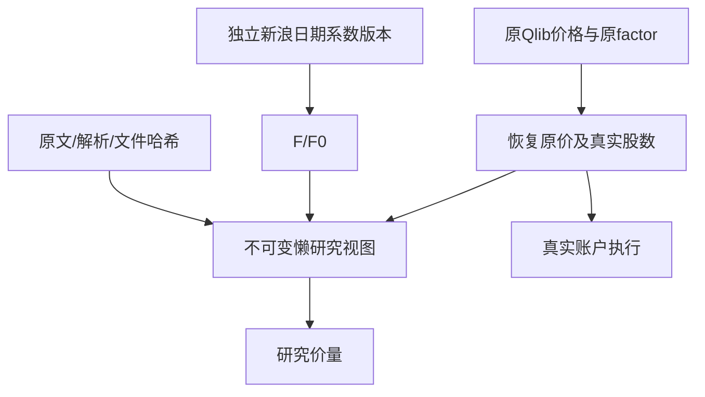
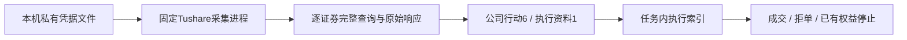
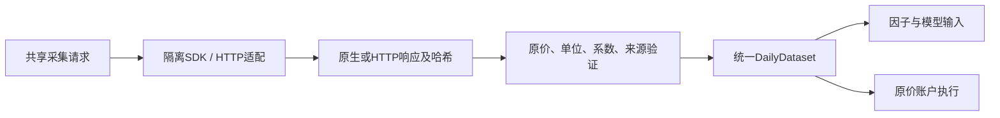
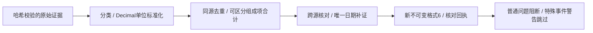

# analytics-storage

目录导航：[全部组件](../README.md) · [src：文件、获取、解析与证据](src/README.md)

## 职责

analytics-storage 负责本地 Parquet 目录发现、footer 元数据读取，以及独立下载、校验公开日行情。`qlib` 模块只是 Rust 二进制格式读取器，不依赖 Qlib Python 包，不查找其他项目或用户级缓存。DuckDB 查询由 engine 负责。

## 公共接口

| 接口 | 契约 |
|---|---|
| ParquetCatalog::open | 要求路径已存在；可传目录或单个 Parquet 文件 |
| ParquetCatalog::root | 返回 catalog 根路径 |
| ParquetCatalog::scan | 递归扫描 parquet 文件，按路径排序，返回行数、叶列类型和可空性 |
| validate_required_market_columns | 校验行情表必需列和逻辑类型 |
| acquisition::fetch_release / complete_release | 新目录下载固定 release，校验完整大小和 SHA-256，再解包并写来源凭证 |
| acquisition::verify_archive / extract_archive | 哈希校验；只允许 qlib_bin 内普通文件/目录，拒绝链接、重复成员、路径穿越和超过8 GiB的解包内容 |
| qlib::QlibDataset | 显式根目录、实际交易日历、历史成分区间、按日历偏移读取 nullable 日字段 |

标准行情 schema：

| 列 | 类型 | 允许 null |
|---|---|---|
| instrument_id | Utf8 | 由输入契约决定 |
| trade_date | Date | 由输入契约决定 |
| open/high/low/close | Float64 | 是 |
| volume/amount | Float64 | 是 |
| adj_open/adj_high/adj_low/adj_close | Float64 | 是 |
| is_trading | Boolean | 是 |
| listing_date | Date | 是 |

## 数据流



## 构建

    cargo check -p analytics-storage
    cargo nextest run -p analytics-storage
    RUSTDOCFLAGS="-D warnings" cargo doc -p analytics-storage --no-deps

## 验收

    cargo nextest run -p analytics-storage
    cargo test --doc -p analytics-storage

验收覆盖嵌套目录、非 Parquet 文件忽略、footer 行数、列类型映射和行情必需列错误定位。StorageError::Schema 会指出第一个缺失或类型错误的列。

## 独立数据获取

```bash
jfquant data download --tag 2026-10-12
jfquant jobs wait TASK_UUID
```

数据来自 [investment_data 固定版本公开资源](https://github.com/chenditc/investment_data/releases/tag/2026-10-12)。下载器调用系统 `curl`（HTTP/1.1、超时、慢速检测、重试），使用本项目自己的 `.jfquant/staging/TASK_UUID` 临时目录；目标目录已存在时拒绝覆盖。下载 manifest 和压缩包后核对大小与 SHA-256，验证实际日历末日，再原子重命名。没有数据源凭证、没有读取 JFQlib 或 `~/.qlib` 的逻辑。

中断后在匹配owner/tag的原检查点恢复，由公共服务回收curl和验证完整归档：

```bash
jfquant data download --tag 2026-10-12 --resume ORIGINAL_TASK_UUID
jfquant jobs wait TASK_UUID
```

这些业务命令需先选定工作区；默认立即返回task_id，继续依赖产物前使用jobs wait。新版本在验证、原子发布和登记完成后可用。

生成的 `jfquant_source.json` 保留 release URL、原始上游 manifest、SHA-256、大小、源码提交信息和 `independent_download` 标志。校验保证下载内容匹配上游公布的包，不保证第三方历史行情完全准确或历史数据修订不存在。

`QlibDataset` 读取 `calendars/day.txt` 和 `instruments/csi500.txt`；成分区间首尾包含对应交易日。`features/<lowercase symbol>/<field>.day.bin` 为 little-endian float32，首值为非负整数日历偏移，后续为日数据，非有限值转为 null；拒绝截断、非法偏移、超出实际日历和非法标识符。预测日历不参与读取。价格和成交量已经过上游归一化，单位还原由研究适配器负责。



验收：`cargo nextest run -p analytics-storage`，覆盖归档大小/哈希错误、链接拒绝、二进制偏移、空值和历史成分日历对齐。真实下载为联网手工验收，不在单元测试中重复下载。

## 公开公司行动与原价恢复

```bash
jfquant data actions --market MARKET_VERSION
jfquant jobs wait TASK_UUID
jfquant data versions
# 每步用上一步发布的公司行动版本ID；提交后显式等待完成。
jfquant data supplement --actions ACTION_VERSION --method enrich --start 2013-01-01 --end 2026-10-12
jfquant jobs wait TASK_UUID
jfquant data supplement --actions ENRICHED_VERSION --method details --start 2013-01-01 --end 2026-10-12
jfquant jobs wait TASK_UUID
jfquant data supplement --actions DETAILED_VERSION --method payments --start 2013-01-01 --end 2026-10-12
jfquant jobs wait TASK_UUID
```

`data actions`默认走巨潮优先采集（见下文），普通分红不必手动串联补充命令。以下Rust接口保留用于显式证据补采：`corporate_actions::fetch_public`独立请求东方财富RPT_SHAREBONUS_DET已实施历史和F10 PageAjax到账日期。`enrich_public`用新浪历史表补退市股票和显式红股上市日。`fetch_details`按明确日期区间下载新浪详情，只把纯现金方案“红利起始日”用于到账日，混合送转方案的通用“到账日”不推断为现金发放日；股票只用明确“上市日”。`fetch_pay_dates`再按阿思达克现金行中单独标明的“派送日”补混合方案现金日，要求股票代码、登记日、除权日与分红金额一致，不把其送股行派送日当现金日。这些Rust补采请求由本项目调用curl、最多4个worker；每次发布新版本，仅允许恢复身份匹配的未完成暂存目录，保存原始响应与SHA256，派生目录验证并复制原有证据。不读取其他项目缓存；默认巨潮路径使用本项目内置、锁定版本的AKShare适配。

接口：`ActionBundle::read / require_coverage`，schema_version=6（格式5只读）；downloader固定来源映射、downloaded_at UTC、queried_symbols、actions、failures和raw_sha256。事件格式遵循core `CorporateAction`；JSON拒绝未知字段。原始每10股数量转换成每旧股，缺失pay_date/listing_date保留null，失败与空历史分开；校验数量/分页、股票身份和日期。公开来源相互冲突记录到failures，不能静默选一边。coverage.json、details_coverage.json和payment_coverage.json列出缺字段及失败；“下载成功”不代表“可执行回测”。源HTML若改版或编码异常则拒绝。



`qlib::raw_price(normalized, factor)`恢复不复权价格：`normalized_price / normalized_factor`，并按A股分价位四舍五入；空值、非有限值或非正因子返回null。上游把价格和factor除以相同首日复权收盘，因此比例消除归一化尺度；float32存储不能等同原始逐笔精度。依据固定提交的[Qlib归一化代码](https://github.com/microsoft/qlib/blob/b87a2c294d364a33fb739359886acffe8ec907d1/scripts/data_collector/yahoo/collector.py)及[investment_data适配](https://github.com/chenditc/investment_data/blob/b8c129b4d9b838f050eac8b1135111b3b79fc894/qlib/normalize.py)，仅核读格式，不调用它们的运行设施。

公开源：[阿思达克现金派送记录](https://quotes.aastocks.com/sc/cnhk/analysis/dividend.aspx?shsymbol=600004)、[东方财富分红](https://data.eastmoney.com/yjfp/)、[F10分红融资](https://emweb.securities.eastmoney.com/PC_HSF10/BonusFinancing/Index?type=web&code=SH600000)、[新浪历史及详情入口](https://money.finance.sina.com.cn/corp/go.php/vISSUE_ShareBonus/stockid/600000.phtml)。旧支付日、送股上市日、退市股与来源冲突仍可能不完整，应据公司实施公告补充并保留依据，不能用复权因子反推事件种类/到账日。

验收：`cargo nextest run -p analytics-storage`。合成provider fixture核对每10股单位、派息/除息日期不同、混合方案不猜现金日、身份/分页错误、空页面/改版拒绝、上市日期提取及现金行/送股行的派送日分离；真实联网下载不在测试中重复执行。所有下载产物位于已忽略data/，禁止提交。

采集器只解码分红表/详情表的GBK区段，不因页面广告的混合编码误报整张表失败；真正表内编码或字段问题仍拒绝。修复解析器后可以重读**本项目自己下载**、哈希校验过的原始响应，避免重复联网：

```bash
jfquant data supplement --actions ACTION_VERSION --method repair --start 2013-01-01 --end 2026-10-12
jfquant jobs wait TASK_UUID
```

`repair_from_evidence`仅重新核验失败的证券，保留已有支付日、来源与实际下载时间，repair_coverage.json单列重解析时间与仍冲突的证券。它不是用其他项目缓存替代独立采集；新增事件仍须补齐结算日期。源文件的证券ID、事件ID与证据文件名在创建worker前验证，拒绝非法标识符和路径。

`repair_pay_dates`按请求区间重读本项目的哈希验证过的阿思达克页面，保留实际下载时间，payment_coverage.json记录处理时间和saved_evidence_only。区间外的历史占位日期不会阻止区间内的有效现金记录；区间内仍须满足登记日<除息日<=派送日，绝不把1900-01-01当到账日。

```bash
jfquant data supplement --actions ACTION_VERSION --method repair-payments --start 2013-01-01 --end 2026-10-12
jfquant jobs wait TASK_UUID
```

### 本次公开数据实测（2026-10-13）

行情历史股票池有1802只证券。四路公开来源累计规范化27297条记录；除权日在2013-01-01—2026-10-12区间的17266条，新浪详情补8934个现金日及1797个上市日，阿思达克补1378个现金日，重解析另补12个。该除权区间仍缺80个现金日、12个股票上市日。执行准入还包括期末已经登记、未来除权的权益，共检查17274条，缺80个现金日、13个上市日，99条缺字段或日期不合法；另有60只证券的来源冲突或不完整历史。**未达到原价回测准入条件**。数据和逐条失败清单保存在忽略的data目录，实际条件以execution_readiness.json为准，不能只看事件数量。

缺日期不一定只是采集失败。例如[中银绒业2019年重整专项意见（巨潮）](https://static.cninfo.com.cn/finalpage/2019-12-19/1207176343.PDF)明确每10股转增13.61股不向原股东分配、也不进行除权；新浪历史表却列为已实施且除权日为空。不得补猜除权日或把这些股份发给普通持仓。其他重整、股权分置及差异化分红也需实施公告确认对象和精确数量。当前模块用类型化事件处理普通及特殊行动；普通事件缺必要条款或存在实质冲突继续阻断；已识别但无法模拟的特殊事件警告并跳过，实际持仓估值错误仍失败。当前严格保留显示精度差异造成的来源冲突，不静默选择某个数值。

## 平台任务、取消与检查点

网络统一经过`transport::curl`，无shell拼接，stdout/stderr并行读取；TaskContext取消时kill并wait回收子进程，原生库句柄不进入网络线程。长传输每5秒发进度，超时/HTTP失败回传任务错误，JSON改版或解析失败不发布数据。公开JSON查询入口为`transport::json`。

`acquisition::fetch_release_resumable(tag, staging, output)`接受明确暂存目录，只恢复owner.json身份及tag匹配的本项目下载；manifest和完整归档核验后原子发布，已有完成目标拒绝覆盖。`corporate_actions::fetch_public_resumable`检查owner中的完整证券列表，并重用每证券检查点中经过SHA256核对的历史/结算响应；取消保留暂存目录但不写完成bundle。子worker显式继承TaskContext。

`corporate_actions::retry_public`只重新下载失败证券，复制并验证旧证据；跨来源冲突不会因为只重查某个来源而被清除。后续新浪/阿思达克补充阶段在身份匹配的未完成暂存目录恢复，已完成版本拒绝覆盖。结构化入口由workflow和CLI共享，不在运行时调用Cargo。

验收增加本地HTTP非JSON、拒绝连接、在传输中取消并回收进程，以及公司行动取消后保持owner、离线恢复有效检查点、篡改证据和证券列表不匹配拒绝。网络测试不下载公开数据。

后续历史、详情和现金日期补充现在也使用owner.json及receipts/检查点：owner冻结源bundle哈希、方法与日期区间，页面收据冻结URL与内容SHA256。同一未完成目录可恢复，完成后的actions.json目录拒绝覆盖；继承的旧证据不会自动作为本次新采集的页面检查点。App在staging中执行，结束后再rename为新版本。

ActionBundle另允许显式身份`JFQuant analytics-workflow synthetic-demo-v1`，仅供本地演示生成器；公开采集身份保持原值。合成数据不能与真实行情混用，也不标称独立下载。

## 公共平台入口与验收

仅通过App与jfquant data命令使用数据任务；storage保留采集/解析公共模块，不提供独立旧二进制。版本ID来自data versions，已有本项目数据可data register PATH登记并等待；目标目录由后台分配UUID，不创建旧OUTPUT别名。工作区解析为--workspace、JFQUANT_WORKSPACE或App保存的选择。

取消回收curl子进程，保留受验证的检查点；下载的resume引用原任务UUID，身份及tag必须一致，已完整压缩包无需重新联网即可验证/解包/注册。不通过兼容请求转换恢复。来源失败、数据缺项及内容去重规则保持不变；修复任务的新coverage位于本次data/actions-TASK_UUID中，即使版本ID与既有内容相同。

开发检查使用cargo nextest run -p analytics-storage；公共服务集成使用cargo nextest run -p analytics-cli。测试以本地HTTP服务和归档覆盖断网、超时、取消、哈希错误、不安全解包、标准恢复及busy、证据重解析/失败重试；真实下载单独手工验收。数据/证据/安装包不提交Git。

## 双源采集与统一日行情

`collector::CollectionRequest / Provider / collect / collect_actions` 使用包内 CPython 3.12，AKShare 1.19.1、yfinance 1.7.0，依赖和发行包 SHA256 在组件旁锁定。Rust 服务监督单任务子进程，JSON Lines 协议7承载进度、证券分片、完成或稳定错误；取消、超时和异常均回收进程。owner、证券文件及证据哈希匹配后才恢复，成功证券不重复下载。详见 [采集包](./collectors/README.md)。

`daily::DailyDataset` 同时读取 Qlib 和规范 Parquet，提供交易日历、历史成员、归一化因子字段及独立 `raw_field`。规范格式5含 `daily_manifest.json` 和 `bars/SHxxxxxx.parquet`；实际价格、后复权价格、股数及人民币成交额分别保存，缺失值保留 null。`field` 采用固定价量重基准规则，`raw_field` 只接收已经验证的原价。Yahoo 标为 `split_adjusted_candidate`，不能用于严格撮合。



开发期先运行 `crates/app/packaging/build-collector.sh`，随后执行 nextest。开发构建可用 `JFQUANT_COLLECTOR_RUNTIME` 指定已经构建的解释器；发布构建只定位包内环境，不搜索系统 Python。公司行动采集成功不代表数据就绪：缺支付/上市日期、无法解释配股、未知历史覆盖均阻止训练。日线采集限定已结束的交易日，日历来自显式记录的 AKShare/新浪接口，不由存活股票的报价推断。

采集检查点冻结代码、依赖锁及解释器锁签名；恢复前重新检查行情、结构化证据及每份 HTTP 响应体。公司行动版本同时冻结完成消息和依赖来源证据。规范行情写入前、读取后均拒绝不一致 OHLC、非法日期或身份，保留 null；协议读取限制单行内存，诊断持久化失败不能发布版本。

`DailyDataset::validate_factor_basis` 在研究前核验独立系数和原价锚点；供应商后复权报价仅留证，不参与正式价量生成。新规范行情必须有独立系数或经过验证的价格指数身份，缺项不进入训练。

采集进程必须先通过 `ready` 代码/SDK/解释器版本握手，Rust才接受证券分片；错误运行环境不会先写出检查点再在完成阶段失败。

## 显式系数与规范行情5

adjustment模块定义AdjustmentSource、AdjustmentRecord、AdjustmentBasis和AdjustmentAnchor。规范行情5保存adjustments/ID.json、原价bars和首个原价收盘锚点；DailyDataset提供adjustment_factors、raw_volume、price_inputs及来源校验。研究价量由原价与F/F0生成，供应商后复权仅留证。Qlib当前读取保持，规范1不转换。接口与复现见[采集包](collectors/README.md)。

## 公司行动6与公告证据

ActionBundle发布格式6，格式5只读；规范行情为5，采集协议10。旧动作/规范行情/检查点不转换，Qlib当前读取保持。ordinary的公共金额是实际持有人权益；EventTerms的Reference独立核验除权。特殊事件或仅供历史核验的Historical条款都须有实施证据；后者不能进入实际账户。

新增内置announcements采集：固定CNINFO查询及static.cninfo.com.cn PDF路径，验证分页、证券、日期、状态和附件身份；pypdf5.9.0锁定在依赖中，记录PDF、逐页提取文本哈希和候选字段。预案、风险提示及无法确定实施身份的文档不能直接修订。扫描PDF无文本时保留待复核，不OCR猜数值。

corporate_actions::review::RevisionRequest包含原哈希、完整替换事件、每字段原文引用/单位和原因；verified_documents复核元数据检查点、HTTP正文、PDF和文本哈希。修订保留原事件及失败原因，输出到新目录，不覆盖旧版本。原始表、普通日期补充及失败项重试继续可用；配股表单独留证并标明待实施条款核实。

## 为什么需要本组件

下载成功不足以证明研究输入可靠。供应商字段、单位、证券身份和历史覆盖都可能不一致。存储层保留原文、哈希和结构化候选，分别核验来源与转换；公司行动按事件类别证明覆盖，不能用分红接口成功代表全部事件。

设计依据：2026-10-14接受的当前组件职责、可复现实验与用户研究需求、组件接口及测试。未在代码或证据中确认的历史取舍不推定为既有设计理由；来源、法规或数据格式变化时重新评估。

## 三级研究模式：为什么允许筛选

决定日期2026-10-14，依据是用户接受的三级模式计划。正常预热空值、来源缺失和错误数据是不同问题：全部拒绝会浪费可用样本，全部放行又会混淆因子和真实权益。默认严格检查；另外提供“允许部分数据缺失”和“只用数据合格的股票”。模式是研究输入的一部分，不能作为训练失败后自动切换的兜底。

第二档保持原成员，纯缺失传播null；第三档派生每日合格成员，不改原始成员或证据。不能看到后来缺价而倒删早期股票。账户仍采用原价、整数股、T+1和连续权益；未裁定冲突、损坏、基准缺项及剩余必要依赖仍阻断。默认有效因子比例0表示至少一项有效，最低有标签样本1只表示可执行，不表示样本在统计上充分。所选因子整列无有效值不会被自动删除。




日期化读取补充：restrict_reads只选择与研究必需日期相交的供应商绑定，不改目录或文件。research_field/research_raw_field/research_raw_volume在放宽读取时逐绑定处理NotFound，只将该代码有效区间置null；后续代码文件缺失不会清空旧代码的有效历史。所有解析、权限和非法值错误仍阻断。回归测试覆盖后续别名缺文件、早期成员不变及完整年度账本。

## 2026-10-14：直接代码读取与分阶段研究

为什么调整：普通市场代码无需先登记身份；独立目录、审核和权威名录下载增加了研究前置负担。特殊历史代码仍需在快照内明确区间，不能将旧证券行情或权益接到另一证券。训练使用价量和标签，到账／交付日期保留为证据，AKQuant普通事件仅要求除权日处理所需条款；已识别不支持事件警告跳过。

当前格式：模板10、需求3、准入5、股票池3、公司行动6、规范行情5、系数3、采集10、服务16、研究结果16；快照内来源映射1、训练产物3。工作区和任务记录1、GTJA191公式v4及默认178项顺序保持。旧格式明确拒绝，不自动转换。

来源映射位于快照source_map.json，普通证券可用空exceptions。每个例外含市场代码、资产类别、适用区间及provider/symbol/coverage定位。冲突拒绝；SHT00018只能读取自身旧文件，不自动绑定SH600018。原Qlib文件不改写；显式重新登记冻结文件内容和映射。worker内缓存字段，取消检查以证券和固定批次执行。



验收：nextest覆盖来源日期边界、三档掩码、训练／回测分离及模型保留；Clippy、Rustdoc、格式、组件文档和包内CLI共同检查。生成数据、模型、运行记录和安装包不提交。另一台Apple Silicon/macOS14实机验收继续待完成。

## 独立系数与组合视图的理由和边界

东方财富报价接口失效时，新浪日期系数仍可能可用。`collect_quotes`、`collect_coefficients`、`collect_actions`可以独立提交、取消和恢复；仅报价快照缺复权依据时仍不具备验证口径准入资格。`CoefficientBundle`格式1保存完整系数、原文和HTTP/协议证据哈希，损坏/部分分片不注册为完整系数版本。采集协议10。

`MarketView`格式1明确组合原Qlib快照和独立新浪系数。原factor用于恢复原价和真实股数，新F/F0用于研究OHLC和反向成交量缩放；金额保持真实元、VWAP由真实金额/股数乘倍率。覆盖前缺系数不使用未来值。两个factor不能互换：原factor含供应商归一化比例，直接覆盖会改变撮合价及真实股数。

组合不改源二进制，不做全量转换；冻结原文件树哈希、恢复规则、单位、系数bundle/原文哈希和首个原价收盘锚点。该原价明确标注“由Qlib恢复”，不冒充本轮独立下载。首版懒视图组合支持原Qlib基底，规范Parquet继续使用其已登记显式依据。未经核验的AKShare后复权报价或Yahoo候选不能通过provider开关进入训练。



## 为什么接入Tushare执行资料

行情可供训练不等于资料足以维护真实股份账户。Tushare结构化`dividend`补充每股税前分红、登记、除权、派息及红股上市日期；只接纳实施记录，预案不生成权益。采集沿用固定HTTPS、独立Python子进程、哈希证据和原子发布，不需要新增SDK。`suspend_d`、`stk_limit`、`adj_factor`、`anns_d`分别保存辅助资料和端点权限；权限不足不是空响应。系数仅交叉检查，不覆盖所选行情或原factor。



`credentials`使用本机私有JSON文件（格式1），目录0700、文件0600，原子替换保存，不再请求系统钥匙串授权。读取校验来源、版本、文件所有者与权限并拒绝链接；损坏内容不回显到错误。Token不进入请求文件、检查点、签名、argv或日志；子进程从私有环境取出后立即移除。带认证的响应若回显凭据，拒绝写入证据。

App凭据配置通过同包jfquant的私有stdin管道执行，App与后台读取同一本机私有凭据目录；配置异步完成，Token不写任务、argv或日志。保存采用0600文件及原子替换，读取校验所有者/权限并拒绝符号链接；无钥匙串调用、授权入口或旧凭据自动读取。Tushare权限错误与频率错误可能共用40203，采集按源返回的明确频率提示区分并生成稳定原因；此分类仅用于诊断和有限重试，不能据此把失败当作无事件。

## 默认巨潮分红：减少常规资料的人工作业

AKShare公司行动请求现在优先调用巨潮历史分红；数据默认入口和研究补采复用相同适配器。巨潮给普通分红的登记、除权、派息事实；新浪匹配补充上市日和独立日期化系数。两者职责按字段明确区分，冲突生成问题而非静默覆盖。这样既能使用公开结构化资料，又不需要每笔普通买单都先做全类别人工证明。

正常操作：`jfquant data collect --kind actions --provider akshare --start 2016-01-01 --end 2026-10-12 --instruments SH600018,SH600000,SZ000001`，仍返回任务ID。没有新增来源配置层；AKShare行情入口及Tushare显式选项保持各自用途。


## 通达信优先的采集边界（2026-10-15）

为什么：训练价量、复权系数和账户资料有不同的可用性，不能再由一个下载失败阻断全部补采。`collector::{collect,collect_quotes,collect_coefficients,collect_reference,collect_actions}`共用受监管进程和完整分片校验；独立入口显式选择来源，优先级及备用策略由workflow管理。新增`Provider::Tdxaidata`、`AdjustmentSource::TdxForward`，规范行情5与系数记录3不变。仅原Qlib或来源明确且已核对ForwardFactor规则的TDX资料可显式接受供应商训练口径；AKShare后复权报价不因此取得资格。



原生SDK响应与HTTP证据分型保存；不把SDK清洗后的表当原文。SDK临时目录清理、凭据脱敏和崩溃恢复由Rust负责。构建及联网边界见[采集组件](collectors/README.md)。验收：`cargo nextest run -p analytics-storage`集成44项Python离线fixture；真实账户验证与长期稳定性另行记录。


## 为什么改用本机凭据文件（2026-10-15）

CC Switch使用本地SQLite保存供应商配置，并对含凭据配置采用0600原子写入；JFQuant借鉴本地持久化及权限约束。这里只需少量数据源Key，无需再引入凭据数据库，选择每供应商一个格式1的JSON文件，避免不同来源并发保存互相覆盖。位置为macOS的`~/Library/Application Support/JFQuant/credentials/{tdxaidata,tushare}.json`；其他Unix平台为`~/.jfquant/credentials/`。

文件保存的是明文Key，依靠当前用户目录0700和文件0600控制访问，不声称文件内容加密。App和CLI直接共用文件；更新程序不会改变文件权限。不属于工作区，不参与Git、研究导出、数据快照或打包，也不自动生成凭据备份。写入先创建0600临时文件、sync后原子替换；读取要求当前用户所有、普通单链接文件并限制长度，拒绝符号链接及宽权限。来源名只接受tdxaidata/tushare。

为什么删除钥匙串：内部试用频繁重编译，系统程序身份变化及单次授权会导致后台仍不能读取；这已成为研究前的实际操作障碍。按用户选择删除钥匙串依赖与授权命令，不自动读取或转换旧钥匙串记录；旧项不删除，需在本机重新输入一次到正式入口。明文文件的适用边界是本机个人研究，若以后增加多人或远程托管，再重新评估集中密钥设施。


依据：[CC Switch配置说明](https://github.com/farion1231/cc-switch/blob/main/docs/user-manual/en/5-faq/5.1-config-files.md)、本机CC Switch `database/schema.rs`的providers.settings_config及`config.rs`的atomic_write_private实现。未读取CC Switch用户数据库或凭据。验收覆盖权限、原子替换、不同来源保留、损坏脱敏、符号链接拒绝和独立CLI进程共享；不需要OS授权。

## 历史系数回执兼容（2026-10）

读取 `CoefficientBundle` 与启动当前采集进程使用不同校验入口。当前进程仍严格核对当前代码签名；历史格式1仅接受当前实现或明确核验过的 AKShare/Sina 实现 `cf35c3193de4`（签名 `4311df0d8844c6cbfc9a9318e970ad806af634ec2cba47a4d8a0db9788c503ba`）。该版本的系数解析与原始/结构化绑定格式经 Git 对照兼容，原始响应、HTTP回执、证券、系数记录和哈希仍逐项检查。不改写旧回执；未知实现报 `unsupported_historical_collector`，不扩大到其他供应商。

```sh
DUCKDB_DOWNLOAD_LIB=1 cargo test -p analytics-storage historical_producer
JFQUANT_COEFFICIENT_FIXTURE=/absolute/path/to/coefficients.json \
  DUCKDB_DOWNLOAD_LIB=1 cargo test -p analytics-storage registered_historical_coefficients -- --ignored
```

历史证据 `repair` 成功仅代表处理结束；来源失败、缺文件、覆盖不足仍须检查新版本清单。新版本不得因单次查询成功而隐去未解决的日期或事件类别缺口。

失败补采的保守合并：`repair` 保留原来源失败，本次缺原文/解析失败写入 `repair_coverage.json.reparse_failures`；只有已验证分红原文能解除对应 `history API failed`，不能清除配股待审等独立问题。`retry` 保留旧事件并检查新旧分红的金额、登记日和遗漏，冲突写入失败；旧 typed 特殊事件不被普通分红接口替换。旧接口的重试不继承结构化/全类别覆盖声明，须补齐对应证据后才能通过新的执行准入。

## 通达信公司行动交叉核对

`tdxaidata` 的 `get_divid_factors` 使用原生 `GetCWDATAInStr` 除权参考。核对时读取带SHA256回执的原生GB18030回复，校验Date/Type/Value长度，按日期及每10股金额、送转、配股比例和价格比较。空Value且没有Date不证明历史为空；SDK填充后的列不作为完整性证据。现有适配器只发布参考条款，缺少完整账户事件元数据的结果仍带失败说明，不能直接解除事件覆盖阻断。

同日年度／特别分红可能分别列示，来源金额精度也可能不同；交叉核对须保留组成项和原始精度，不能任取一条或统一放宽容差。匹配日期和金额只提供修订候选；缺失日期需进一步核验，配股参考不会使当前账户引擎支持配股。

```sh
jfquant data collect --kind actions --provider tdxaidata --start 2000-01-04 --end 2026-10-12 \
  --instruments SH600005,SH600008,SH600025,SH600039
```

部分证券返回不完整时任务可标记failed；已捕获的原生请求回执保留在对应staging/raw中，仅用于诊断，不发布为完整数据版本。

## 公司行动格式6与确定性核对

公共接口为 `corporate_actions::reconcile::apply`，通过包内采集进程的固定 `reconcile_actions`
操作调用纯规则 `collectors/jfquant_collectors/reconcile.py`；在线巨潮采集与离线重放使用同一实现。
输入冻结来源版本、证据任务及交易日历；读取和执行前验证版本/文件哈希。历史通达信回执只允许
已审核的协议9实现或当前协议10实现，校验单证券检查点、SDK身份、原生请求区间及原文字节。
批次失败不改变已完整单证券回执；未形成完整回执、空回复和截断表均不取得覆盖资格。



格式6金额和新增股份比例为十进制文本，公告日、登记日、到账日、上市日允许null，普通事件
除权日必需。规范事件每证券/除权日唯一；现金合计后投影Dividend，新增股份合计后投影
`Split(1+合计比例)`。原股份基数不同、组成项身份不明或更正替代关系不明时不合并；跨来源不相加。
新浪仅覆盖一个已区分组成项时记为部分覆盖。精度表当前为空：不存在已审核精度契约的接近金额
仍需实施公告，不按显示位数扩大容差。训练因子null及训练价口径不改变。

`raw/reconciliation-v1.json` 保存规则版本、基础版本哈希、证据哈希、输入组成项与确定性决策；
新版本保留规范事件、稳定问题ID、类别及证据引用。重复重放规范事件/决策一致，任务时间与基础版本
引用可以不同。已核实公告修订保留；`RevisionRequest.resolve_issues` 按稳定ID、原问题序列化哈希及
对应证券/日期/字段证据关闭普通问题，不能用无关修订清除整段历史。旧核对回执归档，旧文件不修改。
未知历史实现、证据篡改、未完成任务或取消不能发布完整版本。

验收：先构建包内运行时，再运行 `DUCKDB_DOWNLOAD_LIB=1 cargo test -p analytics-storage`。
Python fixture涵盖年度＋特别分红、重复、更正、部分覆盖、未知精度、税后金额、唯一/多义日期及
历史特殊事件；Rust覆盖不可变重放、失败批次单证券证据、正文篡改与规范事件篡改。

原始JSON数字字面量和规范值分别存储：`cninfo`保留可与HTTP正文逐项核验的原结构，
`cninfo_decimal_records`仅把三项每10股金额/股份字段投影为原数字文本。Rust用RawValue核对原始
字面量，不能把9.7000无证据地改成9.7或9.70000000000001。格式5版本签名按原始数值格式验证，
`ActionBundle::version_content`避免只读适配改变既有目录签名。

证据任务支持通达信原生参考及公告的完整单证券回执；巨潮主证据由`--actions`版本读取。
公告即使所在批次失败，也只复制已经完整校验的单证券回执、HTTP/PDF/文本与哈希映射，保持
candidate_only，不凭候选文件清除问题或声称覆盖。仍使用原`ReviseActions`字段证据流程。
历史采集实现登记集中在collector的只读兼容表，实时采集握手始终要求当前实现。

证券目录机构ID是不透明键。已核验的数字`99...`机构ID与历史`gssh/gssz`格式均可读取；同时
约束代码、A股类别、机构唯一性、交易所查询列及返回身份，不能凭机构ID前缀把有效记录误报为冲突。
格式6不再调用旧补充/重解析入口；应使用统一核对或公告修订。旧代码仅保留历史兼容用途。
