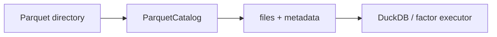

# storage

Local Parquet catalog and market-data schema validation. The catalog reads Parquet footers to return row counts, leaf column names, physical types and nullability. Market validation covers raw and adjusted OHLCV, amount, trading status, and listing date. It does not import CSV/XLSX/JSON in v1.

