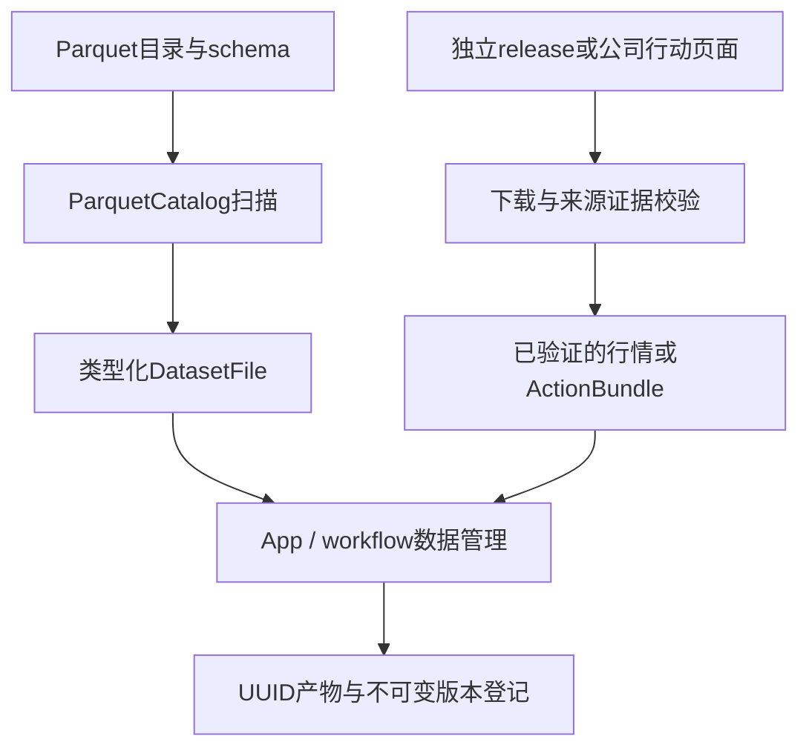
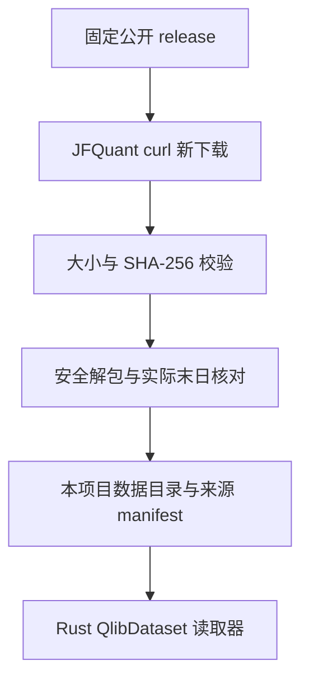
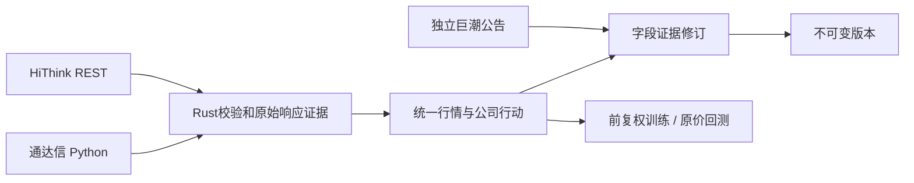

当前采集体系：HiThink（Rust REST主源）、通达信（Python SDK备用）、独立巨潮公告。服务版本见 workflow::service::PROTOCOL_VERSION、采集协议15、来源策略2；接口、价格口径、构建和验收见[采集组件](collectors/README.md)。

## 当前采集契约（2026-10-15）

HiThink 为默认主源，由 Rust 直接调用 REST；通达信备用，维持内置 Python `tdxaidata==1.2.2`；巨潮公告使用独立 `cninfo` 来源。旧来源依赖、配置、权限检查及历史兼容入口已移除；旧数据不迁移、不删除，重新配置来源并采集。

公共来源为 `hithink|tdxaidata|cninfo`，复权选项为 `hithink-forward|tdx-forward|none`。服务版本见 workflow::service::PROTOCOL_VERSION、采集协议15、来源策略2；HiThink 行情格式6，通达信格式5与 Qlib 读取保留。HiThink 训练选择供应商口径（`price_basis=provider`），前复权 OHLC、原始股数及人民币成交额、VWAP null；回测使用原价。训练缓存与 manifest 冻结口径、来源和证据哈希，特征顺序及公式版本保持。

接口、凭据、覆盖范围与复现命令见[采集组件](collectors/README.md)。当前成分不能回填历史，下载成功不代表研究或账户资料完整。

# analytics-storage

## MSCI 官方收盘适配器

`msci::{validate, calendar, collect, signature}` 是 Rust 原生固定来源接口。映射 `msci` 必须等于六位官方代码，仅支持显式 CNY 价格指数；不接受任意 URL、脚本或自动换源。响应代码、币种、STRD、日期和数值均核验，原始 JSON 与收据哈希进入快照。

调用方提供冻结市场的交易日历，指数工作日不能充当 A 股交易日历。内部缺值保留 null 并报告，尾部按最后有效交易日收缩；开高低、成交量和成交额保持 null。不生产历史成员或可撮合行情。沿用 DailyManifest 5、AdjustmentRecord 4、SourceMap 2 及价格指数变换，不增加兼容读取。

验收：`cargo test -p analytics-storage msci --lib`。

目录导航：[全部组件](../README.md) · [src：文件、获取、解析与证据](src/README.md)

## 职责

analytics-storage 负责本地 Parquet 目录发现、footer 元数据读取，以及独立下载、校验公开日行情。`qlib` 模块只是 Rust 二进制格式读取器，不依赖 Qlib Python 包，不查找其他项目或用户级缓存。DuckDB 查询由 engine 负责。

## 公共接口

| 接口 | 契约 |
|---|---|
| ParquetCatalog::open | 要求路径已存在；可传目录或单个 Parquet 文件 |
| ParquetCatalog::root | 返回 catalog 根路径 |
| ParquetCatalog::scan | 递归扫描 parquet 文件，按路径排序，返回行数、叶列类型和可空性 |
| validate_required_market_columns | 校验行情表必需列和逻辑类型 |
| acquisition::fetch_release / complete_release | 新目录下载固定 release，校验完整大小和 SHA-256，再解包并写来源凭证 |
| acquisition::verify_archive / extract_archive | 哈希校验；只允许 qlib_bin 内普通文件/目录，拒绝链接、重复成员、路径穿越和超过8 GiB的解包内容 |
| qlib::QlibDataset | 显式根目录、实际交易日历、历史成分区间、按日历偏移读取 nullable 日字段 |

标准行情 schema：

| 列 | 类型 | 允许 null |
|---|---|---|
| instrument_id | Utf8 | 由输入契约决定 |
| trade_date | Date | 由输入契约决定 |
| open/high/low/close | Float64 | 是 |
| volume/amount | Float64 | 是 |
| adj_open/adj_high/adj_low/adj_close | Float64 | 是 |
| is_trading | Boolean | 是 |
| listing_date | Date | 是 |

## 数据流



## 构建

    cargo check -p analytics-storage
    cargo nextest run -p analytics-storage
    RUSTDOCFLAGS="-D warnings" cargo doc -p analytics-storage --no-deps

## 验收

    cargo nextest run -p analytics-storage
    cargo test --doc -p analytics-storage

验收覆盖嵌套目录、非 Parquet 文件忽略、footer 行数、列类型映射和行情必需列错误定位。StorageError::Schema 会指出第一个缺失或类型错误的列。

## 独立数据获取

```bash
jfquant data download --tag 2026-10-12
jfquant jobs wait TASK_UUID
```

数据来自 [investment_data 固定版本公开资源](https://github.com/chenditc/investment_data/releases/tag/2026-10-12)。下载器调用系统 `curl`（HTTP/1.1、超时、慢速检测、重试），使用本项目自己的 `.jfquant/staging/TASK_UUID` 临时目录；目标目录已存在时拒绝覆盖。下载 manifest 和压缩包后核对大小与 SHA-256，验证实际日历末日，再原子重命名。没有数据源凭证、没有读取 JFQlib 或 `~/.qlib` 的逻辑。

中断后在匹配owner/tag的原检查点恢复，由公共服务回收curl和验证完整归档：

```bash
jfquant data download --tag 2026-10-12 --resume ORIGINAL_TASK_UUID
jfquant jobs wait TASK_UUID
```

这些业务命令需先选定工作区；默认立即返回task_id，继续依赖产物前使用jobs wait。新版本在验证、原子发布和登记完成后可用。

生成的 `jfquant_source.json` 保留 release URL、原始上游 manifest、SHA-256、大小、源码提交信息和 `independent_download` 标志。校验保证下载内容匹配上游公布的包，不保证第三方历史行情完全准确或历史数据修订不存在。

`QlibDataset` 读取 `calendars/day.txt` 和 `instruments/csi500.txt`；成分区间首尾包含对应交易日。`features/<lowercase symbol>/<field>.day.bin` 为 little-endian float32，首值为非负整数日历偏移，后续为日数据，非有限值转为 null；拒绝截断、非法偏移、超出实际日历和非法标识符。预测日历不参与读取。价格和成交量已经过上游归一化，单位还原由研究适配器负责。



验收：`cargo nextest run -p analytics-storage`，覆盖归档大小/哈希错误、链接拒绝、二进制偏移、空值和历史成分日历对齐。真实下载为联网手工验收，不在单元测试中重复下载。

## 行情与公司行动

采集来源限定为 HiThink Rust REST、通达信内置 Python SDK和独立巨潮公告；固定发布的 Qlib 数据读取继续保留。默认与备用规则、凭据位置、REST端点及覆盖范围见[采集组件](collectors/README.md)。

`collector::collect`、`collect_quotes`、`collect_coefficients`、`collect_actions` 是固定采集入口；`DailyDataset`统一读取 HiThink 格式6、通达信格式5及 Qlib。HiThink 保存原价和供应商前复权 OHLC，训练使用前复权、原始股数和人民币金额，VWAP与独立系数为null；回测始终使用原价。通达信独立 ForwardFactor和已有 Qlib单位恢复规则保留，不能套用 HiThink 量额口径。

`ActionBundle`格式6使用十进制文本保存事件金额及股份比例。缺公告、登记、支付、上市日期保持null；事件下载成功不等于账户资料完整。格式5仅保留受支持来源及合成fixture读取；任何废弃来源或混合来源证据均拒绝。

公司行动只有重新采集、固定离线对账和巨潮实施证据修订三个流程。旧网页补采、重解析及恢复入口已删除。`corporate_actions::reconcile::apply`保留事件并精确比较通达信参考，冲突形成带证据的问题；`corporate_actions::review::apply`在原事件哈希和字段证据均匹配后发布新版本，不能仅清除失败标记。详见[公司行动组件](src/corporate_actions/README.md)。



## 任务、协议与旧产物

服务版本见 workflow::service::PROTOCOL_VERSION、Python采集协议15、来源策略2。协议或生产者签名不匹配的检查点不能恢复；旧来源数据、凭据和任务记录保留在用户工作区，但不进入新采集或研究。废弃任务重新采集，缺失事件字段通过巨潮证据修订。

传输经过受监管进程，取消时kill并wait；超时、业务错误、身份/覆盖不足或证据篡改不得发布完整版本。HiThink完整窗口刷新与分段重叠校验、通达信单证券恢复和巨潮分页证据分别验收，不以拼接不同来源字段补齐行情。

## 复现与验收

```bash
crates/app/packaging/build-collector.sh
DUCKDB_DOWNLOAD_LIB=1 cargo test -p analytics-storage
DUCKDB_DOWNLOAD_LIB=1 cargo test -p analytics-workflow -p analytics-cli -p analytics-desktop
DUCKDB_DOWNLOAD_LIB=1 cargo clippy --workspace --all-targets -- -D warnings
```

离线fixture覆盖来源拒绝、代码身份、时区、量额单位、null、重复事件、冲突、业务错误、限流、取消、完整窗口刷新、检查点与证据篡改，并验证巨潮修订和原价回测路径。没有本机 HiThink Key时，线上权限、真实覆盖与接口稳定性保持未验证。数据、模型、运行时及临时产物不提交。

完整证券检查点恢复在Rust监督器核验原始完成记录、SDK身份、行情/复权及HTTP证据后重建派生元数据，跳过空待下载的Python进程，防止空日历覆盖。缺失或篡改证据不会作为成功恢复。验收：`DUCKDB_DOWNLOAD_LIB=1 cargo test -p analytics-storage --lib collector::supervisor_tests`。

HiThink动作读取遵循[官方事件契约](https://fuyao.aicubes.cn/docs/api-reference/corporate-actions/)：没有event_type/登记/支付日期。零现金零送股记录保留为未分类问题，不丢弃普通事件或制造条款。配股识别须匹配同日通达信参考，未知类型保留阻断。业务3002的精确“No adjustment events for thscode=...”为本机实测空响应语义，只接受证券一致的原始响应；原始code及正文哈希保留，泛化的no-data错误不接受为空历史。


历史停复牌优先使用通达信结构化`get_gpjy_value([symbol],["GP29"],start,end)`，同时捕获`GetProDataInStr`和`GetTradeCalendarInStr`原生响应、调用参数及哈希。`GP29`为复牌日和此前停牌的交易日数；Rust `analytics_storage::tdx_status`按独立市场日历回推停牌日区间（可能包含首日日内停牌），不按自然日、不从缺K线猜测。当前`TPFlag`/`IsSTGP`/`IsQuitGP`仅是快照，不能回填历史；GP29更名/ST变更字段尚未转为完整历史ST状态机。复牌后的信息只用于回溯账户核验，不参与信号/股票池选择。

`data refresh --mode actions --workers 3`同步更新这部分辅助证据。完整股票池事件历史仍以HiThink为主；通达信事件日期不完整不会丢失独立状态证据。新采集器签名使旧检查点需重采；已登记行情不改写。`ExecutionData.capabilities`按证券记录`tdxaidata.gp29-status-days-v2`、范围、结构化证据名称和右侧截断警告。读取时从原生响应重新计算并核对日期；计数非整数、日历不足、证券/请求不符或证据篡改拒绝准入。没有复牌记录不能证明停牌不存在，仍缺失的持仓估值继续阻断。

GP29确认停牌日且缺少原始日线/成交量为零时，在日频账户适配中生成独立记录的估值标记`suspension_valuation_marks.json`（原始行情/训练报价不改写），沿用上一有效原价估值；遇已支持除权事件按参考公式调整估值。交给撮合器的估值行成交量为零，受成交量约束，不能产生交易；若同日原行情有正成交量，保留真实原价报价作为日内停牌边界，单独记录`suspension_traded_days.json`，不覆盖成停牌估值。Python行为fixture验证相同信号原本会成交、零成交量估值日不会成交。缺证据报价仍保留缺口，不删除整个证券。巨潮公告路径保留作例外补证，无需逐证券维护公告URL。

验收：`DUCKDB_DOWNLOAD_LIB=1 cargo test -p analytics-storage -p analytics-workflow --lib`；`PYTHONPATH=crates/workflow/research target/collector-build/python/bin/python3 -m unittest discover -s crates/workflow/research/tests`。依赖锁、公式、特征序及研究worker签名不变；更换纯采集代码后运行`bash crates/app/packaging/build-collector.sh`重建并校验内置运行时。

辅助执行数据格式2新增`suspension_day`（不声称全天停牌），保留格式1读取。GP29原生捕获规则仍为v1，Rust解释规则为status-days-v2；`execution.json`记录该估值策略，动作版本/结果签名隔离旧解释。缺少日线仍按日频停牌估值口径披露，不提供盘中停牌分钟级撮合。

最近持续停牌补充使用通达信`get_more_info`的`TPFlag=1`、`HqDate`、`StopJYDate_Recent`三字段组合，捕获固定`GetMoreInfoInStr`原生调用并绑定证券/哈希。仅当快照行情日期覆盖研究截止日、最近停牌日起未见相冲突的GP29复牌记录时，确认最近这一段持续停牌；当前标记单独存在、过期快照和缺失日期均不能回填历史。此证据只用于回溯账户估值，不用于因子或选股；保留更早未知区间。结果清单增加`dated-current-episode-v1`以隔离旧缓存。


状态只读查询由`data inspect-actions`的`stock_status`返回，包含已验证日期、能力范围和结构化证据名称，不把空记录当作完整历史。日频停牌估值仅接受明确零成交量或整行报价缺失；有正成交量的部分OHLC缺失不得改成估值行。无成交量但保留部分报价时保持缺口，无前价锚点也保持缺口，由实际持仓估值判定是否阻断。最近持续停牌解释接受截止日为周末/节假日，仍仅输出认证交易日历中的日期。

公司行动新增格式7的结构化字段证据，旧5/6继续读取。`facts::derive/refresh`从TDX GP41/43和除权原文重放，`review::apply`支持版本2结构化字段与版本1公告引用。字段覆盖、关联边界和复现命令见[公司行动README](src/corporate_actions/README.md)；字段完整与账户引擎支持分别报告。

公司行动写入格式8、修订请求3，支持部分配股事实和外部结构化证据附件；保留旧行动5/6/7和请求1/2读取。资料合法性与执行就绪分别检查，未知不转为不适用，修订继承独立采集证据目录及哈希。

依赖升级：sha2 0.11.1 的摘要经共享固定十六进制格式化器输出，不改变历史文件及树哈希。`cargo test -p analytics-storage sha256_vectors` 验证历史摘要。公告解析升级不重新提取既有证据文本。

## 采集职责边界

采集请求和来源路由留在 `collector`，子进程监督和产物发布分别位于
`collector/process`、`collector/publication`。见 [采集执行边界](src/collector/README.md)。
采集依赖由 `collectors/requirements.in` 和对应哈希锁拥有；研究依赖由 workflow 拥有。
打包同时安装两组锁，采集指纹只包含采集依赖。

## 任务范围验证

DailyDataset::restrict_input_checks 安装按证券/字段/日历位置划分的验证范围；加载的历史及固定
归一化锚点保持原语义。Qlib 和规范 Parquet 的值检查只使用实际依赖，结构/身份错误仍拒绝。
last_valid_close_date 用最后一个有效收盘及价格依据判断尾部，索引最大日期不代表可用尾部。
checked_fields 和 checked_days 供签名阶段复用已冻结的真实字段及日期集；来源别名按各自
有效窗口映射到实际证券。无 scope 的既有读取仍执行完整验证。
验收包含范围外坏值/缺口、未使用字段、基准训练前年份、历史依赖及 native 合成 smoke。

选定公告留存、部分批次恢复与事件修订草稿由 `corporate_actions::evidence` 提供。沿用现有 schema-2 公告与 review 校验，包内 pypdf 提取不依赖源码或用户 Python；失败 HTTP 也保留凭证，选定文档不宣称完整历史。接口与验收见 [公司行动组件](src/corporate_actions/README.md)。

当前证据驱动的任务准入、历史失败追溯与验证命令见本组件 src 下的 README；公司行动状态按任务实际范围计算，采集失败记录不再等同于当前任务阻断。

## Terminal and successor evidence

Reviewed Conversion and Delisting terms can carry `last_trade_date`. Delisting may omit later claim valuations only when that final trading date is explicit; this does not make evidence-only execution ready. Task policy determines whether research liquidation is allowed. Existing revision publication still verifies document bytes, identity, quotes and field evidence. Conversion settlement dates may be proved by later implementation results; this does not backdate the original entitlement announcement. No acquisition failure or coverage claim is deleted by these terms.

Acceptance: `DUCKDB_DOWNLOAD_LIB=1 cargo test -p analytics-storage corporate_actions`.

Announcement PDF extraction is shared between complete CNINFO searches and selected-document capture:64 MiB/PDF,4096 pages,8 MiB extracted text; encrypted or oversized inputs remain failures. Collector progress reports each document and every32 completed pages, preserving the native idle watchdog and cancellation. See `collectors/README.md` and `src/corporate_actions/README.md` for audit/replay contracts.

## 跨证券修订核验

公司行动格式10／修订5支持基于原文的参与方关联，允许已核实后继公告证明交收字段；预览、发布和加载重放使用同一验证器。`review::validate_proposal` 汇总独立字段问题，身份前置失败标为 waiting_identity；`evidence::combine` 保留完整查询范围及部分捕获边界，不将选定公告升级为全历史证据。接口与验收见 corporate_actions/review 的组件 README。

提交只核对行动 manifest 的规范签名（`ActionBundle::snapshot_content`），不在持有服务控制锁时重放全部证据；worker 仍通过 `ActionBundle::read` 与 acquisition 检查核验原始字节。快照身份不是准入结论，证据篡改必须在 worker 阻断，不能用元数据缓存替代完整核验。

离线 `data reconcile-actions --evidence-task TASK` 现同步导入完成分片中的已认证 GP29 停复牌证据。公司行动历史采集失败不使独立停牌证据失效，也不借此解除历史覆盖缺口。原生参数、响应、分片哈希一并冻结，读取重放；源证券之外的附件与冲突的已有状态凭据拒绝发布。此路径不修改原始日线、因子或模型。验收：`cargo test -p analytics-storage status_survives`，验证历史失败保留、估值依据可重放与篡改拒绝。

## 证据驱动补齐（修订5／行动10）

公告停复牌通过既有 RevisionRequest.suspensions 审核；start 含当天开市，resume 不含当天，两个边界分别引用原始文档、原文和含义。只接受明确全天／开市边界，不从出版日期推断，也不将空行情当停牌。发布与 ActionBundle::read 重放引用及HTTP/文件哈希；原历史失败、条款冲突和原行情保持。StatusIndex 每任务构建一次，区分公告全天事实和GP29日内可能边界；全天证明与正成交量冲突则阻断。

不可变 market_supplement.json 视图1依赖原快照和已采集来源目录及哈希，Selection 指定证券、日期、原始字段。重放检查证券、单位、已有值、OHLCV及原始归一化因子，只补空值，研究与执行共用原价事实；不拼接供应商复权价。缺少原口径因子则研究保持不可用。文件字段与 Rust 公共类型见 market_view::supplement；各级依赖均重新核验，原始二进制不变。

验收：`DUCKDB_DOWNLOAD_LIB=1 cargo test -p analytics-storage paired_disclosures`、`DUCKDB_DOWNLOAD_LIB=1 cargo test -p analytics-storage repairs_share`。

补录分别报告 execution_ready（原价事实）与 research_ready（原归一化合同）；本版面向研究和执行同时发布，研究口径未通过时保持阻断。补录成交额／成交量后，仅在相关日期按原有原价×因子合同补算缺失 VWAP，已有 VWAP 不变；供应商价格合同中明确不可用的 VWAP 继续为空。矛盾的公告停复牌边界与全天停牌日正成交量均阻断，不按来源优先级覆盖。

差异化现金分红人工审核沿用修订5：一份完整、已认证的正式实施公告即可；不要求多供应商一致。distribution_conflict 仅在原问题哈希及证券／除息日匹配、现金型 Differential、实际派息与参考现金分别引用并标明相同计量单位、登记／支付日期完整时允许显式关闭。新增分派审核收据1保存原问题，读取重验；其他问题、覆盖和失败记录保留。无通用强制通过开关。验收：`cargo test -p analytics-storage single_official_document`。

## Common index acquisition

Index identity and admissible price-index adjustment now use the shared core catalogue,
including CSI1000/800/A500/all-share/dividend, SSE composite/50/180/STAR50 and SZSE
component/100/ChiNext/ChiNext50, alongside CSI300/500. SH000001 is the SSE composite;
SZ000001 remains a stock. Index quotes must be explicitly listed in `benchmarks` and
never use stock adjustment routes. The TDX native stock-kind check is retained.

HiThink current-member requests use the selected catalogue index code, with no CSI500
fallback. TDX current-member collection remains limited to its existing CSI300/500
implementation; unsupported requests stop before collection. Current-member responses
cover their observed day only and cannot backfill training history. Provider permissions
and actual requested quote coverage still need validation; the HiThink five-year index
history limit is unchanged. Four catalogue-only entries cannot be submitted as native
index quotes or universes until their source identity is implemented and verified.

Acceptance: `DUCKDB_DOWNLOAD_LIB=1 cargo test -p analytics-storage index_routes`.

## 可配置指数采集

`collector::validate_index`、`index_capabilities` 与正常采集共用：当前固定接口只接入
CNY 价格指数。HiThink 接受确切供应商代码（或转换明确的 SH/SZ 代码），TDX 保持交易所代码约束。
这表示接口能力，不证明某个指数或日期可用；历史成分能力均为 false。
`CollectionRequest.index_inputs` 冻结定义，`source_bindings` 冻结对应供应商代码。
行情及成分分别验证，当前成员仅覆盖观察日；查询不补造历史成员或转换币种。

新指数调整记录格式4嵌入配置，读取时核对数据键、供应商来源、价格口径和映射；
格式3明确拒绝，须显式离线迁移；未提供指数配置不能把普通证券认定成指数。
`DailyDataset::index_config` 从所选快照解析定义，不读取可编辑目录。
验收：`cargo test -p analytics-storage runtime_index`；TDX fixture 见 `collectors/tests/test_tdx.py`。

本次指数接入格式已收敛：AdjustmentRecord 仅接受格式4（`index_input` 必填，普通证券及内置目录指数显式为 null，自定义指数冻结完整合同）；SourceMap 仅接受格式2，指数无可下单证券身份；CollectionRequest 必须显式包含 `index_inputs`（可为空对象）。正常读取不升级旧版本、不猜测缺失字段。旧快照只作历史留存，显式离线转换后必须以新内容哈希重新登记，原始响应及采集器身份不得改写成当前版本。服务协议38、采集协议15拒绝旧检查点；格式更新不等于来源准入通过。

## 历史成员原文核验

`membership_history::Request`格式2分开事实与文件。`verify`校验原文SHA256、精确引用（仅归一化空白）、指数名称及官方代码、证券身份及完整性来源，再调用Core。审核是有明确归属的人工判断，不宣称自动理解公告语义。`coverage_source`只能标识实际覆盖来源，单份名单不能证明多日无变更。

原文路径限工作区普通文件，拒绝绝对路径、上跳和符号链接。`capture`仅显式调用时复用有界HTTPS传输下载PDF或UTF-8文本，不跟随重定向或推断覆盖。PDF复用安装包提取器，不需要外部Python或定制脚本。

数据流：原文及引用 → 字节/身份核验 → 重建报告 → Workflow发布。验收：`DUCKDB_DOWNLOAD_LIB=1 cargo test -p analytics-workflow membership_history --lib`。


### 资料与人工核对 v2

`membership_history_material`分开原文完整性、正文提取与事实核验。HTTPS捕获保留原始字节；HTTP 200的防护页、登录页和空正文不是可引用资料。支持text、pdf、png、jpeg；PDF沿用包内pypdf提取正文和内嵌栅格，不增加整页渲染器。`DerivedFrom`绑定原PDF、页码（1起）和图片位置（0起），发布/读取重新提取比对。包内`pypdf[image]`依赖锁定Pillow。

`Transcription`保存原图哈希、原始像素区域`[x,y,width,height]`、内容、审核人、时间、确认及内容收据。收据用于检测绑定变化，不是外部电子签名，也不自动证明原图语义；原图、区域、文字或审核信息变化都必须重新核对。收据同时绑定来源URL、父PDF哈希、页码和图片标识；把相同图片移到另一页也不能沿用旧审核。原始文件、提取文本及人工录入分别保存/返回哈希。名称和代码可由多文件证明，但必须逐证券明确关联并通过日期身份核验。

历史请求仅接受格式2；旧格式转换模块及入口已移除。本地一次性迁移完成后保留原始文件归档和旧任务，缺少的证明、定位、审核或发布时间保持待补。原文篡改仍是当前阻断；未被当前事实引用的旧正文失败保存在追溯区。

验收：`cargo test -p analytics-storage membership_history --lib`。依赖锁复现：`uv pip compile crates/storage/collectors/requirements.in --python-version 3.12 --python-platform aarch64-apple-darwin --generate-hashes -o crates/storage/collectors/requirements.lock`。
