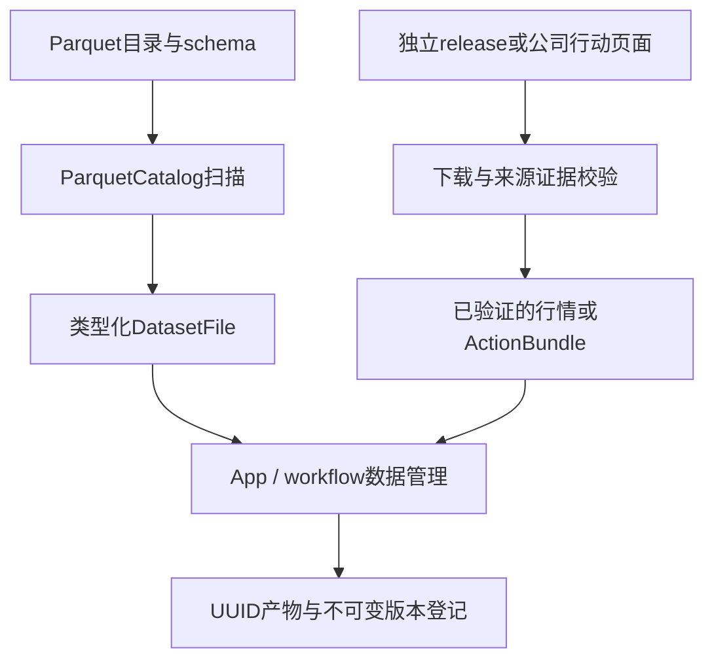
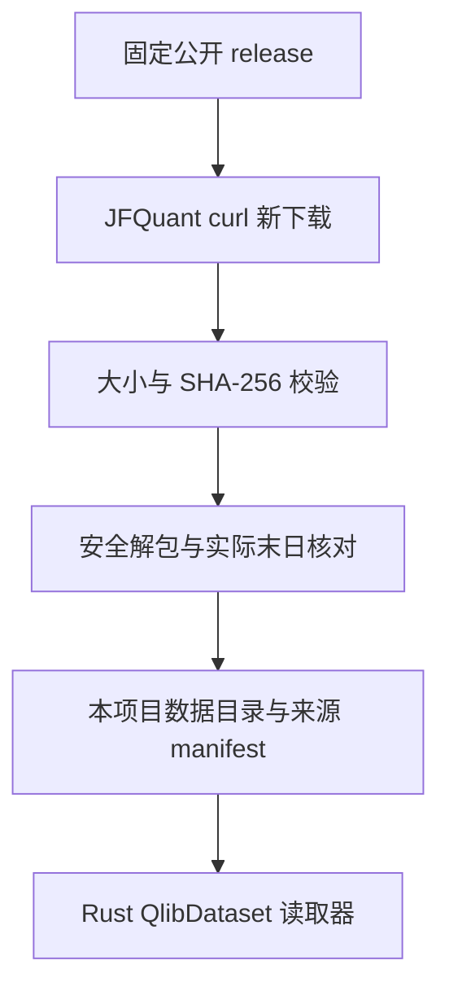
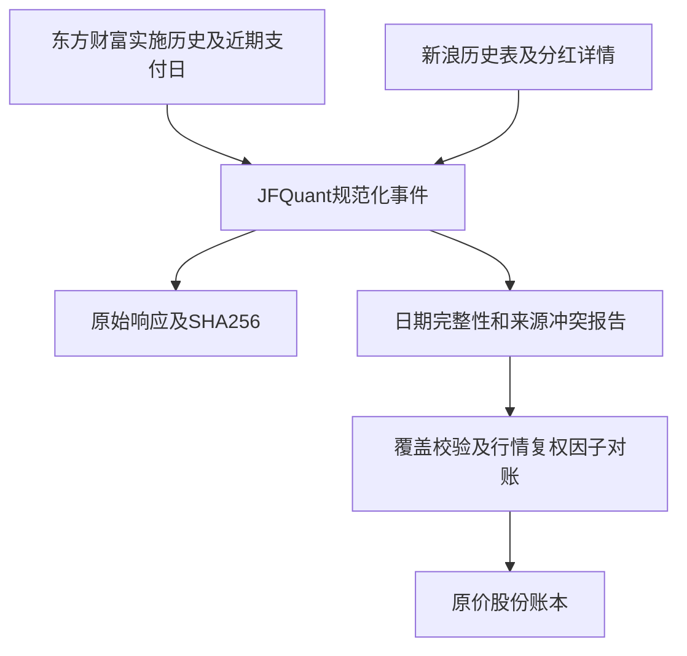

# analytics-storage

目录导航：[全部组件](../README.md) · [src：文件、获取、解析与证据](src/README.md)

## 职责

analytics-storage 负责本地 Parquet 目录发现、footer 元数据读取，以及独立下载、校验公开日行情。`qlib` 模块只是 Rust 二进制格式读取器，不依赖 Qlib Python 包，不查找其他项目或用户级缓存。DuckDB 查询由 engine 负责。

## 公共接口

| 接口 | 契约 |
|---|---|
| ParquetCatalog::open | 要求路径已存在；可传目录或单个 Parquet 文件 |
| ParquetCatalog::root | 返回 catalog 根路径 |
| ParquetCatalog::scan | 递归扫描 parquet 文件，按路径排序，返回行数、叶列类型和可空性 |
| validate_required_market_columns | 校验行情表必需列和逻辑类型 |
| acquisition::fetch_release / complete_release | 新目录下载固定 release，校验完整大小和 SHA-256，再解包并写来源凭证 |
| acquisition::verify_archive / extract_archive | 哈希校验；只允许 qlib_bin 内普通文件/目录，拒绝链接、重复成员、路径穿越和超过8 GiB的解包内容 |
| qlib::QlibDataset | 显式根目录、实际交易日历、历史成分区间、按日历偏移读取 nullable 日字段 |

标准行情 schema：

| 列 | 类型 | 允许 null |
|---|---|---|
| instrument_id | Utf8 | 由输入契约决定 |
| trade_date | Date | 由输入契约决定 |
| open/high/low/close | Float64 | 是 |
| volume/amount | Float64 | 是 |
| adj_open/adj_high/adj_low/adj_close | Float64 | 是 |
| is_trading | Boolean | 是 |
| listing_date | Date | 是 |

## 数据流



## 构建

    cargo check -p analytics-storage
    cargo nextest run -p analytics-storage
    RUSTDOCFLAGS="-D warnings" cargo doc -p analytics-storage --no-deps

## 验收

    cargo nextest run -p analytics-storage
    cargo test --doc -p analytics-storage

验收覆盖嵌套目录、非 Parquet 文件忽略、footer 行数、列类型映射和行情必需列错误定位。StorageError::Schema 会指出第一个缺失或类型错误的列。

## 独立数据获取

```bash
jfquant data download --tag 2026-10-12
jfquant jobs wait TASK_UUID
```

数据来自 [investment_data 固定版本公开资源](https://github.com/chenditc/investment_data/releases/tag/2026-10-12)。下载器调用系统 `curl`（HTTP/1.1、超时、慢速检测、重试），使用本项目自己的 `.jfquant/staging/TASK_UUID` 临时目录；目标目录已存在时拒绝覆盖。下载 manifest 和压缩包后核对大小与 SHA-256，验证实际日历末日，再原子重命名。没有数据源凭证、没有读取 JFQlib 或 `~/.qlib` 的逻辑。

中断后在匹配owner/tag的原检查点恢复，由公共服务回收curl和验证完整归档：

```bash
jfquant data download --tag 2026-10-12 --resume ORIGINAL_TASK_UUID
jfquant jobs wait TASK_UUID
```

这些业务命令需先选定工作区；默认立即返回task_id，继续依赖产物前使用jobs wait。新版本在验证、原子发布和登记完成后可用。

生成的 `jfquant_source.json` 保留 release URL、原始上游 manifest、SHA-256、大小、源码提交信息和 `independent_download` 标志。校验保证下载内容匹配上游公布的包，不保证第三方历史行情完全准确或历史数据修订不存在。

`QlibDataset` 读取 `calendars/day.txt` 和 `instruments/csi500.txt`；成分区间首尾包含对应交易日。`features/<lowercase symbol>/<field>.day.bin` 为 little-endian float32，首值为非负整数日历偏移，后续为日数据，非有限值转为 null；拒绝截断、非法偏移、超出实际日历和非法标识符。预测日历不参与读取。价格和成交量已经过上游归一化，单位还原由研究适配器负责。



验收：`cargo nextest run -p analytics-storage`，覆盖归档大小/哈希错误、链接拒绝、二进制偏移、空值和历史成分日历对齐。真实下载为联网手工验收，不在单元测试中重复下载。

## 公开公司行动与原价恢复

```bash
jfquant data actions --market MARKET_VERSION
jfquant jobs wait TASK_UUID
jfquant data versions
# 每步用上一步发布的公司行动版本ID；提交后显式等待完成。
jfquant data supplement --actions ACTION_VERSION --method enrich --start 2013-01-01 --end 2026-10-12
jfquant jobs wait TASK_UUID
jfquant data supplement --actions ENRICHED_VERSION --method details --start 2013-01-01 --end 2026-10-12
jfquant jobs wait TASK_UUID
jfquant data supplement --actions DETAILED_VERSION --method payments --start 2013-01-01 --end 2026-10-12
jfquant jobs wait TASK_UUID
```

`corporate_actions::fetch_public`独立请求东方财富RPT_SHAREBONUS_DET已实施历史和F10 PageAjax到账日期。`enrich_public`用新浪历史表补退市股票和显式红股上市日。`fetch_details`按明确日期区间下载新浪详情，只把纯现金方案“红利起始日”用于到账日，混合送转方案的通用“到账日”不推断为现金发放日；股票只用明确“上市日”。`fetch_pay_dates`再按阿思达克现金行中单独标明的“派送日”补混合方案现金日，要求股票代码、登记日、除权日与分红金额一致，不把其送股行派送日当现金日。所有请求由本项目Rust调用curl、最多4个worker；每次发布新版本，仅允许恢复身份匹配的未完成暂存目录，保存原始响应与SHA256，派生目录验证并复制原有证据。不读取其他项目缓存，也不执行第三方采集代码。

接口：`ActionBundle::read / require_coverage`，schema_version=1；downloader固定身份、downloaded_at UTC、queried_symbols、actions、failures和raw_sha256。事件格式遵循core `CorporateAction`；JSON拒绝未知字段。原始每10股数量转换成每旧股，缺失pay_date/listing_date保留null，失败与空历史分开；校验数量/分页、股票身份和日期。公开来源相互冲突记录到failures，不能静默选一边。coverage.json、details_coverage.json和payment_coverage.json列出缺字段及失败；“下载成功”不代表“可执行回测”。源HTML若改版或编码异常则拒绝。



`qlib::raw_price(normalized, factor)`恢复不复权价格：`normalized_price / normalized_factor`，并按A股分价位四舍五入；空值、非有限值或非正因子返回null。上游把价格和factor除以相同首日复权收盘，因此比例消除归一化尺度；float32存储不能等同原始逐笔精度。依据固定提交的[Qlib归一化代码](https://github.com/microsoft/qlib/blob/b87a2c294d364a33fb739359886acffe8ec907d1/scripts/data_collector/yahoo/collector.py)及[investment_data适配](https://github.com/chenditc/investment_data/blob/b8c129b4d9b838f050eac8b1135111b3b79fc894/qlib/normalize.py)，仅核读格式，不调用它们的运行设施。

公开源：[阿思达克现金派送记录](https://quotes.aastocks.com/sc/cnhk/analysis/dividend.aspx?shsymbol=600004)、[东方财富分红](https://data.eastmoney.com/yjfp/)、[F10分红融资](https://emweb.securities.eastmoney.com/PC_HSF10/BonusFinancing/Index?type=web&code=SH600000)、[新浪历史及详情入口](https://money.finance.sina.com.cn/corp/go.php/vISSUE_ShareBonus/stockid/600000.phtml)。旧支付日、送股上市日、退市股与来源冲突仍可能不完整，应据公司实施公告补充并保留依据，不能用复权因子反推事件种类/到账日。

验收：`cargo nextest run -p analytics-storage`。合成provider fixture核对每10股单位、派息/除息日期不同、混合方案不猜现金日、身份/分页错误、空页面/改版拒绝、上市日期提取及现金行/送股行的派送日分离；真实联网下载不在测试中重复执行。所有下载产物位于已忽略data/，禁止提交。

采集器只解码分红表/详情表的GBK区段，不因页面广告的混合编码误报整张表失败；真正表内编码或字段问题仍拒绝。修复解析器后可以重读**本项目自己下载**、哈希校验过的原始响应，避免重复联网：

```bash
jfquant data supplement --actions ACTION_VERSION --method repair --start 2013-01-01 --end 2026-10-12
jfquant jobs wait TASK_UUID
```

`repair_from_evidence`仅重新核验失败的证券，保留已有支付日、来源与实际下载时间，repair_coverage.json单列重解析时间与仍冲突的证券。它不是用其他项目缓存替代独立采集；新增事件仍须补齐结算日期。源文件的证券ID、事件ID与证据文件名在创建worker前验证，拒绝非法标识符和路径。

`repair_pay_dates`按请求区间重读本项目的哈希验证过的阿思达克页面，保留实际下载时间，payment_coverage.json记录处理时间和saved_evidence_only。区间外的历史占位日期不会阻止区间内的有效现金记录；区间内仍须满足登记日<除息日<=派送日，绝不把1900-01-01当到账日。

```bash
jfquant data supplement --actions ACTION_VERSION --method repair-payments --start 2013-01-01 --end 2026-10-12
jfquant jobs wait TASK_UUID
```

### 本次公开数据实测（2026-10-13）

行情历史股票池有1802只证券。四路公开来源累计规范化27297条记录；除权日在2013-01-01—2026-10-12区间的17266条，新浪详情补8934个现金日及1797个上市日，阿思达克补1378个现金日，重解析另补12个。该除权区间仍缺80个现金日、12个股票上市日。执行准入还包括期末已经登记、未来除权的权益，共检查17274条，缺80个现金日、13个上市日，99条缺字段或日期不合法；另有60只证券的来源冲突或不完整历史。**未达到原价回测准入条件**。数据和逐条失败清单保存在忽略的data目录，实际条件以execution_readiness.json为准，不能只看事件数量。

缺日期不一定只是采集失败。例如[中银绒业2019年重整专项意见（巨潮）](https://static.cninfo.com.cn/finalpage/2019-12-19/1207176343.PDF)明确每10股转增13.61股不向原股东分配、也不进行除权；新浪历史表却列为已实施且除权日为空。不得补猜除权日或把这些股份发给普通持仓。其他重整、股权分置及差异化分红也需实施公告确认对象和精确数量。本模块只支持已验证的普通按旧股分配现金/送转，缺字段或无法对账的特殊动作继续阻止运行。当前严格保留显示精度差异造成的来源冲突，不静默选择某个数值。

## 平台任务、取消与检查点

网络统一经过`transport::curl`，无shell拼接，stdout/stderr并行读取；TaskContext取消时kill并wait回收子进程，原生库句柄不进入网络线程。长传输每5秒发进度，超时/HTTP失败回传任务错误，JSON改版或解析失败不发布数据。公开JSON查询入口为`transport::json`。

`acquisition::fetch_release_resumable(tag, staging, output)`接受明确暂存目录，只恢复owner.json身份及tag匹配的本项目下载；manifest和完整归档核验后原子发布，已有完成目标拒绝覆盖。`corporate_actions::fetch_public_resumable`检查owner中的完整证券列表，并重用每证券检查点中经过SHA256核对的历史/结算响应；取消保留暂存目录但不写完成bundle。子worker显式继承TaskContext。

`corporate_actions::retry_public`只重新下载失败证券，复制并验证旧证据；跨来源冲突不会因为只重查某个来源而被清除。后续新浪/阿思达克补充阶段在身份匹配的未完成暂存目录恢复，已完成版本拒绝覆盖。结构化入口由workflow和CLI共享，不在运行时调用Cargo。

验收增加本地HTTP非JSON、拒绝连接、在传输中取消并回收进程，以及公司行动取消后保持owner、离线恢复有效检查点、篡改证据和证券列表不匹配拒绝。网络测试不下载公开数据。

后续历史、详情和现金日期补充现在也使用owner.json及receipts/检查点：owner冻结源bundle哈希、方法与日期区间，页面收据冻结URL与内容SHA256。同一未完成目录可恢复，完成后的actions.json目录拒绝覆盖；继承的旧证据不会自动作为本次新采集的页面检查点。App在staging中执行，结束后再rename为新版本。

ActionBundle另允许显式身份`JFQuant analytics-workflow synthetic-demo-v1`，仅供本地演示生成器；公开采集身份保持原值。合成数据不能与真实行情混用，也不标称独立下载。

## 公共平台入口与验收

仅通过App与jfquant data命令使用数据任务；storage保留采集/解析公共模块，不提供独立旧二进制。版本ID来自data versions，已有本项目数据可data register PATH登记并等待；目标目录由后台分配UUID，不创建旧OUTPUT别名。工作区解析为--workspace、JFQUANT_WORKSPACE或App保存的选择。

取消回收curl子进程，保留受验证的检查点；下载的resume引用原任务UUID，身份及tag必须一致，已完整压缩包无需重新联网即可验证/解包/注册。不通过兼容请求转换恢复。来源失败、数据缺项及内容去重规则保持不变；修复任务的新coverage位于本次data/actions-TASK_UUID中，即使版本ID与既有内容相同。

开发检查使用cargo nextest run -p analytics-storage；公共服务集成使用cargo nextest run -p analytics-cli。测试以本地HTTP服务和归档覆盖断网、超时、取消、哈希错误、不安全解包、标准恢复及busy、证据重解析/失败重试；真实下载单独手工验收。数据/证据/安装包不提交Git。
