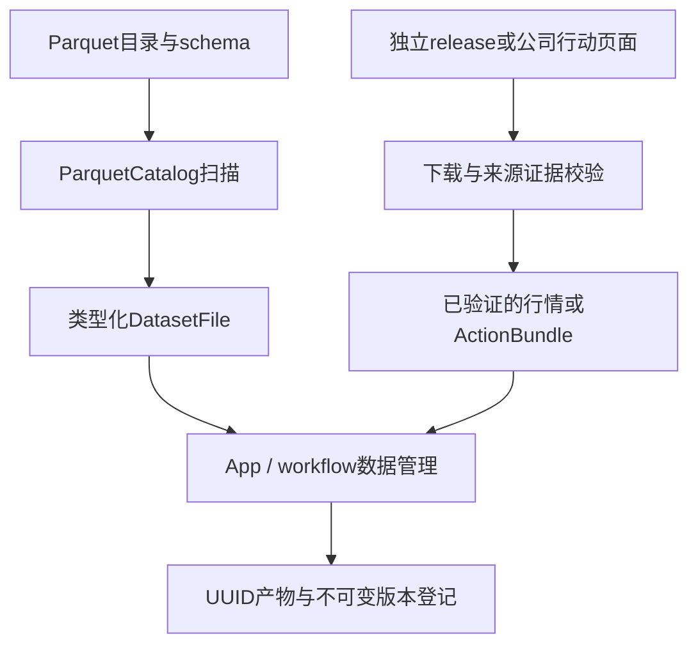
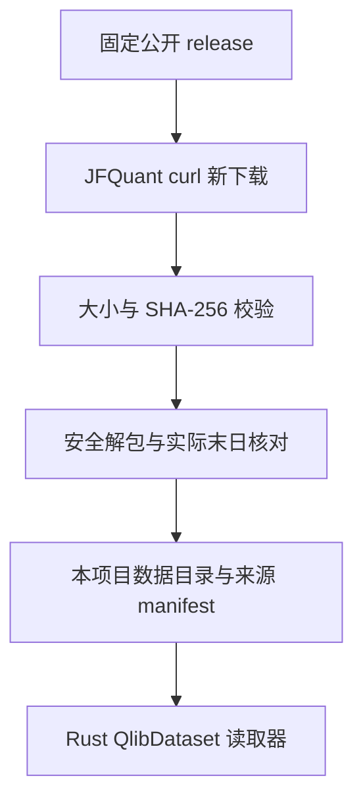
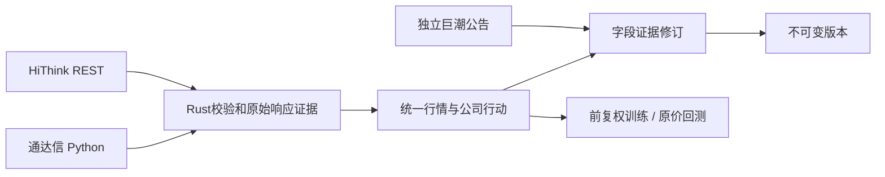

当前采集体系：HiThink（Rust REST主源）、通达信（Python SDK备用）、独立巨潮公告。服务协议18、采集协议12、来源策略2；接口、价格口径、构建和验收见[采集组件](collectors/README.md)。

## 当前采集契约（2026-10-15）

HiThink 为默认主源，由 Rust 直接调用 REST；通达信备用，维持内置 Python `tdxaidata==1.2.2`；巨潮公告使用独立 `cninfo` 来源。旧来源依赖、配置、权限检查及历史兼容入口已移除；旧数据不迁移、不删除，重新配置来源并采集。

公共来源为 `hithink|tdxaidata|cninfo`，复权选项为 `hithink-forward|tdx-forward|none`。服务协议18、采集协议12、来源策略2；HiThink 行情格式6，通达信格式5与 Qlib 读取保留。HiThink 训练选择供应商口径（`price_basis=provider`），前复权 OHLC、原始股数及人民币成交额、VWAP null；回测使用原价。训练缓存与 manifest 冻结口径、来源和证据哈希，特征顺序及公式版本保持。

接口、凭据、覆盖范围与复现命令见[采集组件](collectors/README.md)。当前成分不能回填历史，下载成功不代表研究或账户资料完整。

# analytics-storage

目录导航：[全部组件](../README.md) · [src：文件、获取、解析与证据](src/README.md)

## 职责

analytics-storage 负责本地 Parquet 目录发现、footer 元数据读取，以及独立下载、校验公开日行情。`qlib` 模块只是 Rust 二进制格式读取器，不依赖 Qlib Python 包，不查找其他项目或用户级缓存。DuckDB 查询由 engine 负责。

## 公共接口

| 接口 | 契约 |
|---|---|
| ParquetCatalog::open | 要求路径已存在；可传目录或单个 Parquet 文件 |
| ParquetCatalog::root | 返回 catalog 根路径 |
| ParquetCatalog::scan | 递归扫描 parquet 文件，按路径排序，返回行数、叶列类型和可空性 |
| validate_required_market_columns | 校验行情表必需列和逻辑类型 |
| acquisition::fetch_release / complete_release | 新目录下载固定 release，校验完整大小和 SHA-256，再解包并写来源凭证 |
| acquisition::verify_archive / extract_archive | 哈希校验；只允许 qlib_bin 内普通文件/目录，拒绝链接、重复成员、路径穿越和超过8 GiB的解包内容 |
| qlib::QlibDataset | 显式根目录、实际交易日历、历史成分区间、按日历偏移读取 nullable 日字段 |

标准行情 schema：

| 列 | 类型 | 允许 null |
|---|---|---|
| instrument_id | Utf8 | 由输入契约决定 |
| trade_date | Date | 由输入契约决定 |
| open/high/low/close | Float64 | 是 |
| volume/amount | Float64 | 是 |
| adj_open/adj_high/adj_low/adj_close | Float64 | 是 |
| is_trading | Boolean | 是 |
| listing_date | Date | 是 |

## 数据流



## 构建

    cargo check -p analytics-storage
    cargo nextest run -p analytics-storage
    RUSTDOCFLAGS="-D warnings" cargo doc -p analytics-storage --no-deps

## 验收

    cargo nextest run -p analytics-storage
    cargo test --doc -p analytics-storage

验收覆盖嵌套目录、非 Parquet 文件忽略、footer 行数、列类型映射和行情必需列错误定位。StorageError::Schema 会指出第一个缺失或类型错误的列。

## 独立数据获取

```bash
jfquant data download --tag 2026-10-12
jfquant jobs wait TASK_UUID
```

数据来自 [investment_data 固定版本公开资源](https://github.com/chenditc/investment_data/releases/tag/2026-10-12)。下载器调用系统 `curl`（HTTP/1.1、超时、慢速检测、重试），使用本项目自己的 `.jfquant/staging/TASK_UUID` 临时目录；目标目录已存在时拒绝覆盖。下载 manifest 和压缩包后核对大小与 SHA-256，验证实际日历末日，再原子重命名。没有数据源凭证、没有读取 JFQlib 或 `~/.qlib` 的逻辑。

中断后在匹配owner/tag的原检查点恢复，由公共服务回收curl和验证完整归档：

```bash
jfquant data download --tag 2026-10-12 --resume ORIGINAL_TASK_UUID
jfquant jobs wait TASK_UUID
```

这些业务命令需先选定工作区；默认立即返回task_id，继续依赖产物前使用jobs wait。新版本在验证、原子发布和登记完成后可用。

生成的 `jfquant_source.json` 保留 release URL、原始上游 manifest、SHA-256、大小、源码提交信息和 `independent_download` 标志。校验保证下载内容匹配上游公布的包，不保证第三方历史行情完全准确或历史数据修订不存在。

`QlibDataset` 读取 `calendars/day.txt` 和 `instruments/csi500.txt`；成分区间首尾包含对应交易日。`features/<lowercase symbol>/<field>.day.bin` 为 little-endian float32，首值为非负整数日历偏移，后续为日数据，非有限值转为 null；拒绝截断、非法偏移、超出实际日历和非法标识符。预测日历不参与读取。价格和成交量已经过上游归一化，单位还原由研究适配器负责。



验收：`cargo nextest run -p analytics-storage`，覆盖归档大小/哈希错误、链接拒绝、二进制偏移、空值和历史成分日历对齐。真实下载为联网手工验收，不在单元测试中重复下载。

## 行情与公司行动

采集来源限定为 HiThink Rust REST、通达信内置 Python SDK和独立巨潮公告；固定发布的 Qlib 数据读取继续保留。默认与备用规则、凭据位置、REST端点及覆盖范围见[采集组件](collectors/README.md)。

`collector::collect`、`collect_quotes`、`collect_coefficients`、`collect_actions` 是固定采集入口；`DailyDataset`统一读取 HiThink 格式6、通达信格式5及 Qlib。HiThink 保存原价和供应商前复权 OHLC，训练使用前复权、原始股数和人民币金额，VWAP与独立系数为null；回测始终使用原价。通达信独立 ForwardFactor和已有 Qlib单位恢复规则保留，不能套用 HiThink 量额口径。

`ActionBundle`格式6使用十进制文本保存事件金额及股份比例。缺公告、登记、支付、上市日期保持null；事件下载成功不等于账户资料完整。格式5仅保留受支持来源及合成fixture读取；任何废弃来源或混合来源证据均拒绝。

公司行动只有重新采集、固定离线对账和巨潮实施证据修订三个流程。旧网页补采、重解析及恢复入口已删除。`corporate_actions::reconcile::apply`保留事件并精确比较通达信参考，冲突形成带证据的问题；`corporate_actions::review::apply`在原事件哈希和字段证据均匹配后发布新版本，不能仅清除失败标记。详见[公司行动组件](src/corporate_actions/README.md)。



## 任务、协议与旧产物

服务协议18、Python采集协议12、来源策略2。协议或生产者签名不匹配的检查点不能恢复；旧来源数据、凭据和任务记录保留在用户工作区，但不进入新采集或研究。废弃任务重新采集，缺失事件字段通过巨潮证据修订。

传输经过受监管进程，取消时kill并wait；超时、业务错误、身份/覆盖不足或证据篡改不得发布完整版本。HiThink完整窗口刷新与分段重叠校验、通达信单证券恢复和巨潮分页证据分别验收，不以拼接不同来源字段补齐行情。

## 复现与验收

```bash
crates/app/packaging/build-collector.sh
DUCKDB_DOWNLOAD_LIB=1 cargo test -p analytics-storage
DUCKDB_DOWNLOAD_LIB=1 cargo test -p analytics-workflow -p analytics-cli -p analytics-desktop
DUCKDB_DOWNLOAD_LIB=1 cargo clippy --workspace --all-targets -- -D warnings
```

离线fixture覆盖来源拒绝、代码身份、时区、量额单位、null、重复事件、冲突、业务错误、限流、取消、完整窗口刷新、检查点与证据篡改，并验证巨潮修订和原价回测路径。没有本机 HiThink Key时，线上权限、真实覆盖与接口稳定性保持未验证。数据、模型、运行时及临时产物不提交。
