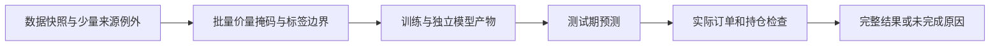

# Python 双源采集与独立复权系数

[上级：storage](../README.md) · [白名单实现](jfquant_collectors/README.md) · [确定测试](tests/README.md)

本组件负责 AKShare/yfinance 白名单行情、已验证价格指数、当前成分、交易日历和公司行动候选；Rust负责数据校验、正式研究价量、公司行动对账与发布。AKShare固定1.19.1、yfinance固定1.7.0，CPython3.12.15/20261009及全部35个依赖使用发行包/依赖哈希锁。运行不安装环境、不调用pip，不提供任意脚本执行。

## 请求与生命周期

采集协议7是JSON Lines：`ready / progress / shard / action_shard / complete / error`。`adjustment_source`是必需字段；AKShare使用`sina_hfq`，yfinance使用`none`。GUI/CLI有合法默认值，`run --request`必须提供完整当前请求，旧请求不转换。

父服务保持控制管道；客户端退出不取消任务，服务断开、取消或超时回收进程。stdout只承载协议，诊断写stderr并落盘。Rust先核对代码、SDK、解释器身份再接受分片，完成时复核；每个证券分片包含原价/供应商报价及独立`adjustment`记录。owner冻结协议、转换版本、源码、依赖锁和解释器锁；恢复前重验证券、系数、结构化证据及每份HTTP响应体，不兼容旧检查点。


## 显式系数与研究口径

使用[AKShare官方文档](https://akshare.akfamily.xyz/data/stock/stock.html)所列新浪`hfq-factor`上游。因SDK实现包含eval，本项目直接读取固定的`https://finance.sina.com.cn/realstock/company/SECURITY/hfq.js`，只解析对应证券变量赋值、一个JSON对象和无副作用注释，不执行响应，也不跟随重定向。禁止重复JSON键/日期、证券冲突、错误总数、空表、非法日期、JSON非标准常量或非正/非有限系数；保留原始十进制字符串及完整历史。每次请求含重试至少间隔1秒，超时30秒、最多3次尝试。

逐日取最近已生效系数F，缺开始前有效值不能使用未来值回填；系数延续不等于补行情。原始报价中的缺失值保持null。首个有效原价收盘日冻结F0，正式研究使用k=F/F0：OHLC=原价×k，研究成交量=真实股数/k，成交额保持人民币元，VWAP=实际成交额/真实股数×k；零成交量VWAP为null。Rust生成这些输入，供应商后复权价仅留证，负值等异常也不改写成正式价格。真实SH600000曾出现9.70/103.28和9.54/102.23的原价/供应商后复权报价，比值不能当作系数；此问题由独立系数解决，而非放宽报价容差。

只对已验证的SH000300/SH000905价格指数使用恒1；必须显式声明指数采集角色。任意股票被选作研究基准仍须取得股票系数，不因基准身份豁免。Yahoo维持`split_adjusted_candidate`，不与AKShare拼接，不用于严格撮合。

公司行动候选每股金额和送转单位单独校验。历史调整需要完整事件金额、生效日期和历史覆盖；实际执行区间还要求登记、支付、上市日期。缺参考价、事件/系数冲突、配股或未解释特殊行动都阻止训练；不猜日期、不改用其他来源。公式v4和默认178特征顺序不变，价量规则、系数哈希及锚点进入缓存/模型/研究签名。

## 文件与复现

规范行情格式5：`market/daily_manifest.json`、`bars/ID.parquet`、`adjustments/ID.json`。manifest含实际日历、历史成员、源价格口径、固定`explicit-hfq-first-raw-close-v1;shares;cny;nulls`及`adjustment_anchors`。系数记录格式3包含证券、basis（explicit/price_index/unavailable）、源地址、观察末日和按日期升序的points；完整HTTP响应与SDK表格在raw内，二者不能互冒。

```bash
jfquant data collect --provider akshare --adjustment-source sina-hfq \
  --start 2004-01-01 --end 2026-10-13 \
  --instruments SH600000,SZ000001,SH000300 --benchmarks SH000300
jfquant jobs wait TASK_UUID
jfquant research check --template recipe.json --market MARKET_ID --actions ACTIONS_ID
```

日期需同时覆盖滚动训练/验证与因子预热，当前成分列表不能回填历史。成功采集是合法快照，不等于历史成员、权益和研究窗口就绪。规范格式1、旧请求、旧检查点不转换；保留原文件与历史日志。

开发构建/锁更新在仓库根执行：

```bash
crates/app/packaging/build-collector.sh
uv pip compile crates/storage/collectors/requirements.in --python-version 3.12 --python-platform aarch64-apple-darwin --generate-hashes -o crates/storage/collectors/requirements.lock
cargo nextest run -p analytics-storage
uvx ruff check crates/storage/collectors
uvx ruff format --check crates/storage/collectors
```

修改任何采集模块后重新构建内置环境与Rust程序以匹配代码签名。nextest运行Python fixture、本地HTTP、真实模拟子进程及取消/恢复测试；联网抽查单独记录。解释器、行情、缓存、运行记录及安装包均不提交。2010—2026沪深300历史仍缺2004年覆盖和部分证券解释/公司行动资料，另一台Apple Silicon/macOS14实机验收待完成。

## 实施公告采集

announcements.py是第六个受签名白名单模块，依赖新增锁定pypdf5.9.0（共35项）。协议7的announcements操作接受同样证券和日期，固定CNINFO证券目录、搜索/PDF地址。先从官方目录核对代码、A股类别、交易所和唯一orgId，再以代码与机构ID联合查询，并核对返回身份；缺失或重复身份不猜。拒绝跨证券、重复ID、变化/截断分页、重定向、超大或加密附件。输出announcements.json及raw内PDF/文本/HTTP收据；每证券完整检查点可恢复，最终重验所有哈希。空文本、预案、风险提示和存在多候选日期保持待复核。

公告元数据保存来源映射、公布日、源地址、解析版本、原始单位/金额引用和每字段候选，候选不会自动覆盖正式动作。Python配股表也只留证；申购期、费用、获配/退款/上市条款由实施证据补齐后通过公共修订进入账本。

`cninfo-candidates-v2`识别中文及斜杠/横线日期，并在表头/普通A股行列数严格一致时提取表格日期，保留占位符及逐字段原文。冲突候选不自动裁决；每股/每10股金额保存原单位和引用，税前/不同股东税后金额不会自动选为真实权益。2026-10-14抽查SH600000的2025年度实施公告：普通股登记2026-07-15，除息/发放2026-07-16，每股0.42元；原文也含其他股东税后0.378元，继续要求复核。证据保留在本项目target内，不提交；这是单份候选抽查，不证明历史动作完整。

## 为什么需要本组件

隔离复杂供应商依赖并提供可分发的采集环境。AKShare与yfinance的Python生态方便读取公开接口，但不能承担研究准入裁定。内置运行环境和JSON Lines协议避免要求用户安装Python；Rust监督进程、限时、取消和检查点，并验证每个完整分片。

设计依据：2026-10-14接受的当前组件职责、可复现实验与用户研究需求、组件接口及测试。未在代码或证据中确认的历史取舍不推定为既有设计理由；来源、法规或数据格式变化时重新评估。


## 2026-10-14：直接代码读取与分阶段研究

为什么调整：普通市场代码无需先登记身份；独立目录、审核和权威名录下载增加了研究前置负担。特殊历史代码仍需在快照内明确区间，不能将旧证券行情或权益接到另一证券。训练使用价量和标签，到账／交付资料只在实际账户执行时检查。

当前格式：模板8、需求3、准入5、股票池3、公司行动4、规范行情5、系数3、采集7、服务10、研究结果12；快照内来源映射1、训练产物2。工作区和任务记录1、GTJA191公式v4及默认178项顺序保持。旧格式明确拒绝，不自动转换。

来源映射位于快照source_map.json，普通证券可用空exceptions。每个例外含市场代码、资产类别、适用区间及provider/symbol/coverage定位。冲突拒绝；SHT00018只能读取自身旧文件，不自动绑定SH600018。原Qlib文件不改写；显式重新登记冻结文件内容和映射。worker内缓存字段，取消检查以证券和固定批次执行。



验收：nextest覆盖来源日期边界、三档掩码、训练／回测分离及模型保留；Clippy、Rustdoc、格式、组件文档和包内CLI共同检查。生成数据、模型、运行记录和安装包不提交。另一台Apple Silicon/macOS14实机验收继续待完成。

## 报价、系数和事件为何拆开

协议7新增quotes及adjustment_shard。quotes跳过系数HTTP依赖，缺依据快照不能自动训练；coefficients独立获取完整Sina历史。Rust恢复时重新核验HTTP/结构化收据与解析记录，不混用旧协议检查点。 完整接口、why、边界和验收见[组件契约](../README.md)。
