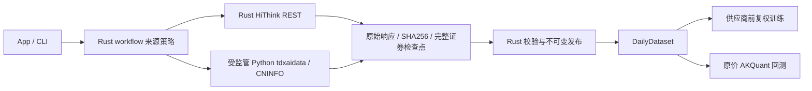

# 数据采集边界

本组件保存内置 Python 通达信 SDK、独立巨潮公告解析、离线公司行动核对和可重建依赖。HiThink 在 [Rust 客户端](../src/hithink.rs) 中直接访问 REST，不依赖 Python、Node、官方 CLI 或 marketdb。凭据使用 JFQuant 用户目录的私有文件，不放在工作区。

## 接口与数据流



`collector::{collect,collect_quotes,collect_actions,collect_reference,collect_announcements}` 使用同一 `CollectionRequest`。默认 `Provider::Hithink`；通达信 `Tdxaidata` 是备用；`Cninfo` 仅支持公告。自动 workflow 按角色尝试来源，显式任务不切源。切换行情来源重取整个证券历史，不混合不同来源的字段。

`collect_coefficients` 仅支持通达信独立 ForwardFactor。HiThink `AdjustmentSource::HithinkForward` 对应 `AdjustmentBasis::SupplierForward`，不是系数序列。巨潮请求使用 `AdjustmentSource::None`。服务协议18、Python JSON Lines协议12、来源策略2；旧任务和旧来源配置需重建，不改写或删除用户旧文件。

## HiThink 数据与价格口径

固定基址 `https://fuyao.aicubes.cn`，使用 `X-api-key`；同时检查 HTTP 状态和业务 `code`。网络超时、限流4001和服务错误5001/5002/5003最多三次，认证2001/权限2003及参数错误不重试。curl 通过私有 stdin 读取请求头，Key 不进 argv、请求文件、日志或响应证据；回显 Key 的正文拒绝保存。传输30秒截止，任务取消会终止并回收传输进程。

日线截止Asia/Shanghai已结束日期（16点前截止前一天），有效末日冻结在检查点owner中。股票历史强制 `interval=1d`，分别请求 `adjust=none` 和 `forward`。按最多九年分段，使用五个共同观察日验证，不一致拒绝发布。原始股数和人民币成交额不缩放；前复权 OHLC 与原价独立存储。研究 VWAP 和独立 factor 均为 null；不从价比推算系数。既有全null特征与样本检查保留，含仅依赖VWAP的特征集可能无法训练，需明确选择可用特征，不自动删列或改变顺序。

规范行情格式6使用 `hithink-forward-ohlc-v1;shares;cny;vwap-null`。训练显式选择 `price_basis=provider`；`verified` 不接受缺独立系数的供应商股票。`price_inputs`、缓存和训练/结果 manifest 记录口径与逐证券依据。通达信保持原系数归一化，Qlib 继续既有格式。自动刷新混合来源时使用 `per-security-price-volume-v1`，逐证券 `price_inputs.normalization` 声明实际转换；量额口径不冒充统一。回测只使用原价与真实股数。

| 数据 | 首期接口/用途 | 覆盖限制 |
|---|---|---|
| 股票日线 | `/api/a-share/prices/historical` 原价及前复权 | 单请求窗口最长10年，实际历史需授权验证 |
| 交易日历 | `/api/a-share/calendar/trading-days` | 固定近一年，不从股票报价推断历史日历 |
| 指数日线 | `/api/a-share-index/prices/historical` | 近5年，仅已支持沪深300/中证500身份 |
| 当前成分 | `/api/a-share-index/constituents/ths-stock-list` | 按观察日存储，不回填历史 |
| 公司行动 | `/api/a-share/corporate-actions/adjustment-factors` | 每股分红/送股、除权日；缺登记/到账/上市日保持null |
| 财务、估值、竞价、特色数据 | 能力记录，未接入研究存储 | 包含报表、指标、估值快照、涨跌停、热榜及龙虎榜 |
| 基金、公开期货期权 | 后续独立模块 | 不扩展当前A股行情schema |
| 全市场Parquet导出 | 后续批量优化 | 首期不自动下载全市场 |

官方[接入说明](https://github.com/HiThink-Tech/Financial-API)、[接口契约](https://fuyao.aicubes.cn/llms-full.txt)。仓库概述与字段页不同步时以具体接口契约为准。公开A股分钟K、tick、Level2、港美股行情及端内专用数据不作为本次能力承诺。

长历史 refresh 先按日历角色获取覆盖完整的独立日历，HiThink不足时自动尝试通达信，并冻结其证据；随后 Rust HiThink 使用该日历采行情。显式 HiThink 任务超出日历覆盖会报错，需通过自动 refresh 获取跨来源角色资料或选择通达信。HiThink 每次刷新重取整个研究窗口，避免前复权历史锚点变化后拼接旧值。

公司行动只声明已返回的普通事件结构化覆盖，不声明全类别已审计。字段冲突保持问题，配股等不受支持事件沿用明确识别后警告跳过规则；无法分类的事件不猜测。巨潮公告始终 candidate_only，经既有字段证据修订才改变正式事件。

## 凭据与运行

macOS 使用 `~/Library/Application Support/JFQuant/credentials/{hithink,tdxaidata}.json`，其他 Unix 使用 `~/.jfquant/credentials/`。复用0700目录、0600原子替换文件，拒绝非当前用户、链接和宽权限。App密码框和CLI读取同一本机配置；旧凭据不自动读取或删除。

```sh
jfquant data sources configure --provider hithink --key-stdin < /absolute/path/to/private-key-input
jfquant data sources configure --provider tdxaidata --key-stdin < /absolute/path/to/private-key-input
jfquant data sources list
jfquant data sources check --provider hithink
jfquant data collect --provider hithink --start 2026-09-01 --end 2026-10-14 --instruments SH600000,SZ000001,SH000300 --benchmarks SH000300
jfquant data collect --kind actions --provider hithink --start 2016-01-01 --end 2026-10-14 --instruments SH600000
jfquant data collect --kind announcements --provider cninfo --start 2026-01-01 --end 2026-10-14 --instruments SH600000
jfquant jobs wait TASK_ID
```

输入文件由用户在仓库外创建，不提交或放入研究导出。SDK解释器、原生库、模型与数据都不提交。开发可设置 `JFQUANT_COLLECTOR_RUNTIME=/absolute/path/to/python3`；发布只使用包内解释器。程序运行时不调用 pip、uv 或系统 Python。

## 构建与验收

```sh
uv pip compile crates/storage/collectors/requirements.in --python-version 3.12 --python-platform aarch64-apple-darwin --generate-hashes -o crates/storage/collectors/requirements.lock
crates/app/packaging/build-collector.sh
DUCKDB_DOWNLOAD_LIB=1 cargo test -p analytics-storage -p analytics-workflow -p analytics-cli
DUCKDB_DOWNLOAD_LIB=1 cargo test -p analytics-desktop
uvx ruff check crates/storage/collectors
uvx ruff format --check crates/storage/collectors
cargo fmt --all --check
```

离线验收包含真实本地HTTP传输、业务限流/权限、凭据回显拒绝、时区/单位/null、跨窗口冲突、原价与训练价隔离、分片哈希恢复、取消和巨潮修订。离线fixture不能证明线上授权、退市证券及完整历史可用；线上验证需本机配置Key后执行，独立记录结果。

通达信 `tdxaidata==1.2.2` 继续使用原生动态库；官方 `127.0.0.1:17709` HTTP属于TQ客户端模式，不是tdxaidata云端HTTP版本，本次不引入。来源：[TdxAiData](https://help.tdx.com.cn/quant/docs/markdown/mindoc-1hjbgqpdhv114.html)、[TQ HTTP](https://help.tdx.com.cn/quant/docs/markdown/mindoc-1hdhbmi50d038.html)。

## 公司行动对账与证据修订

旧网页补采及其恢复入口已删除。固定离线规则 `jfquant-actions-v2`只接收HiThink标准事件和通达信参考，按原始证券身份与日期区间校验，精确比较每股条款；重复事件去重，身份冲突拒绝，数值冲突保留证据。历史代码使用冻结的日期化来源映射，不能按下载代码改写证券身份。登记、支付、上市日期保持null，巨潮实施证据修订单独发布。

```bash
jfquant data reconcile-actions --actions ACTION_VERSION --evidence-task TDX_TASK_UUID --market MARKET_VERSION
jfquant jobs wait TASK_UUID
jfquant data revise-actions --actions ACTION_VERSION --request REVISION_JSON
jfquant jobs wait TASK_UUID
```

来源识别规则集中在core；注册、读取、对账、修订和任务恢复均拒绝废弃来源及混合来源证据。旧任务可以查看，用户文件、凭据和历史产物不删除。协议18/12与来源策略2不自动迁移旧检查点。

## 2026-10-15 真实账户抽查

本机Key验证沪深股票、沪深300指数、近一年日历、公司行动与北交所920002采集成功。两只显式自选股票、3个不依赖VWAP的Alpha158特征完成272行训练、84行验证及47个交易日的原价回测；巨潮实施公告补齐平安银行登记／支付日期后复用原模型成功。该抽查不证明全市场、退市历史、长历史跨段或长期稳定性；完整特殊事件覆盖仍未知，audited账户策略正确阻断。生成证据和复现配置位于忽略的`target/hithink-live-acceptance/`，Key仅保存在本机私有凭据目录。
