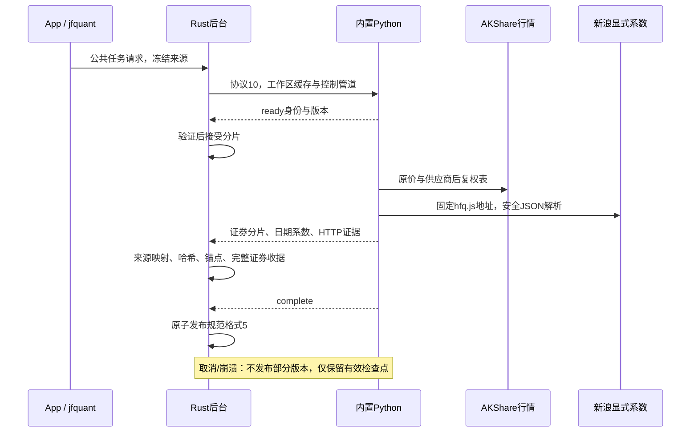
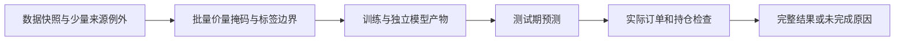
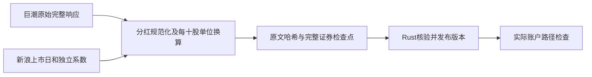
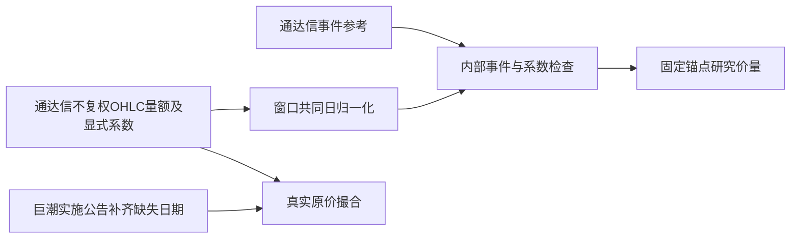
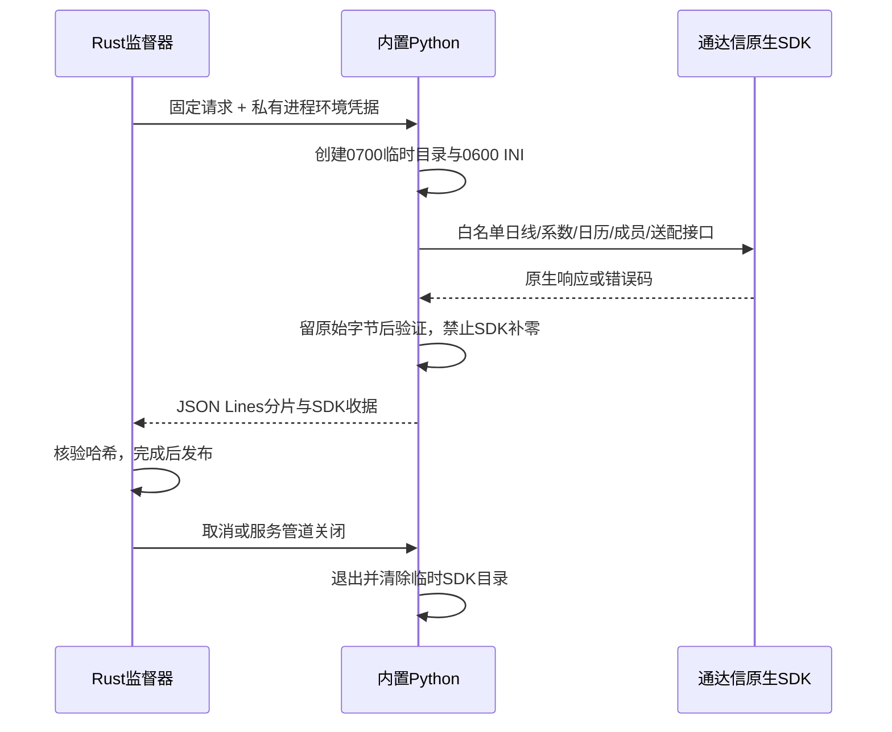
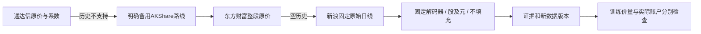

> 2026-10-15 AKQuant重构：当前服务14、工作流10、训练描述3、结果14。旧精细权益账本与Rust LightGBM FFI已移除；研究由workflow监督包内Python运行。下文涉及旧账本或原生LightGBM构建的历史说明不再适用于当前研究。当前构建与口径以[项目README](../../../README.md)及[研究worker](../../workflow/research/README.md)为准。

# Python 双源采集与独立复权系数

[上级：storage](../README.md) · [白名单实现](jfquant_collectors/README.md) · [确定测试](tests/README.md)

本组件负责 AKShare/yfinance 白名单行情、已验证价格指数、当前成分、交易日历和公司行动候选；Rust负责数据校验、正式研究价量、公司行动对账与发布。AKShare固定1.19.1、yfinance固定1.7.0，CPython3.12.15/20261009及全部35个依赖使用发行包/依赖哈希锁。运行不安装环境、不调用pip，不提供任意脚本执行。

## 请求与生命周期

采集协议10是JSON Lines：`ready / progress / shard / action_shard / complete / error`。`adjustment_source`是必需字段；AKShare使用`sina_hfq`，yfinance使用`none`。GUI/CLI有合法默认值，`run --request`必须提供完整当前请求，旧请求不转换。

父服务保持控制管道；客户端退出不取消任务，服务断开、取消或超时回收进程。stdout只承载协议，诊断写stderr并落盘。Rust先核对代码、SDK、解释器身份再接受分片，完成时复核；每个证券分片包含原价/供应商报价及独立`adjustment`记录。owner冻结协议、转换版本、源码、依赖锁和解释器锁；恢复前重验证券、系数、结构化证据及每份HTTP响应体，不兼容旧检查点。



## 显式系数与研究口径

使用[AKShare官方文档](https://akshare.akfamily.xyz/data/stock/stock.html)所列新浪`hfq-factor`上游。因SDK实现包含eval，本项目直接读取固定的`https://finance.sina.com.cn/realstock/company/SECURITY/hfq.js`，只解析对应证券变量赋值、一个JSON对象和无副作用注释，不执行响应，也不跟随重定向。禁止重复JSON键/日期、证券冲突、错误总数、空表、非法日期、JSON非标准常量或非正/非有限系数；保留原始十进制字符串及完整历史。每次请求含重试至少间隔1秒，超时30秒、最多3次尝试。

逐日取最近已生效系数F，缺开始前有效值不能使用未来值回填；系数延续不等于补行情。原始报价中的缺失值保持null。首个有效原价收盘日冻结F0，正式研究使用k=F/F0：OHLC=原价×k，研究成交量=真实股数/k，成交额保持人民币元，VWAP=实际成交额/真实股数×k；零成交量VWAP为null。Rust生成这些输入，供应商后复权价仅留证，负值等异常也不改写成正式价格。真实SH600000曾出现9.70/103.28和9.54/102.23的原价/供应商后复权报价，比值不能当作系数；此问题由独立系数解决，而非放宽报价容差。

只对已验证的SH000300/SH000905价格指数使用恒1；必须显式声明指数采集角色。任意股票被选作研究基准仍须取得股票系数，不因基准身份豁免。Yahoo维持`split_adjusted_candidate`，不与AKShare拼接，不用于严格撮合。

公司行动候选每股金额和送转单位单独校验。历史调整需要完整事件金额、生效日期和历史覆盖；实际执行区间还要求登记、支付、上市日期。缺参考价、事件/系数冲突、配股或未解释特殊行动都阻止训练；不猜日期、不改用其他来源。公式v4和默认178特征顺序不变，价量规则、系数哈希及锚点进入缓存/模型/研究签名。

## 文件与复现

规范行情格式5：`market/daily_manifest.json`、`bars/ID.parquet`、`adjustments/ID.json`。manifest含实际日历、历史成员、源价格口径、固定`explicit-hfq-first-raw-close-v1;shares;cny;nulls`及`adjustment_anchors`。系数记录格式3包含证券、basis（explicit/price_index/unavailable）、源地址、观察末日和按日期升序的points；完整HTTP响应与SDK表格在raw内，二者不能互冒。

```bash
jfquant data collect --provider akshare --adjustment-source sina-hfq \
  --start 2004-01-01 --end 2026-10-13 \
  --instruments SH600000,SZ000001,SH000300 --benchmarks SH000300
jfquant jobs wait TASK_UUID
jfquant research check --template recipe.json --market MARKET_ID --actions ACTIONS_ID
```

日期需同时覆盖滚动训练/验证与因子预热，当前成分列表不能回填历史。成功采集是合法快照，不等于历史成员、权益和研究窗口就绪。规范格式1、旧请求、旧检查点不转换；保留原文件与历史日志。

开发构建/锁更新在仓库根执行：

```bash
crates/app/packaging/build-collector.sh
uv pip compile crates/storage/collectors/requirements.in --python-version 3.12 --python-platform aarch64-apple-darwin --generate-hashes -o crates/storage/collectors/requirements.lock
cargo nextest run -p analytics-storage
uvx ruff check crates/storage/collectors
uvx ruff format --check crates/storage/collectors
```

修改任何采集模块后重新构建内置环境与Rust程序以匹配代码签名。nextest运行Python fixture、本地HTTP、真实模拟子进程及取消/恢复测试；联网抽查单独记录。解释器、行情、缓存、运行记录及安装包均不提交。2010—2026沪深300历史仍缺2004年覆盖和部分证券解释/公司行动资料，另一台Apple Silicon/macOS14实机验收待完成。

## 实施公告采集

announcements.py是受签名白名单模块，依赖新增锁定pypdf5.9.0（共36项）。协议10的announcements操作接受同样证券和日期，固定CNINFO证券目录、搜索/PDF地址。先从官方目录核对代码、A股类别、交易所和唯一orgId，再以代码与机构ID联合查询，并核对返回身份；缺失或重复身份不猜。拒绝跨证券、重复ID、变化/截断分页、重定向、超大或加密附件。输出announcements.json及raw内PDF/文本/HTTP收据；每证券完整检查点可恢复，最终重验所有哈希。空文本、预案、风险提示和存在多候选日期保持待复核。

公告元数据保存来源映射、公布日、源地址、解析版本、原始单位/金额引用和每字段候选，候选不会自动覆盖正式动作。Python配股表也只留证；申购期、费用、获配/退款/上市条款由实施证据补齐后通过公共修订进入账本。

`cninfo-candidates-v2`识别中文及斜杠/横线日期，并在表头/普通A股行列数严格一致时提取表格日期，保留占位符及逐字段原文。冲突候选不自动裁决；每股/每10股金额保存原单位和引用，税前/不同股东税后金额不会自动选为真实权益。2026-10-14抽查SH600000的2025年度实施公告：普通股登记2026-07-15，除息/发放2026-07-16，每股0.42元；原文也含其他股东税后0.378元，继续要求复核。证据保留在本项目target内，不提交；这是单份候选抽查，不证明历史动作完整。

## 为什么需要本组件

隔离复杂供应商依赖并提供可分发的采集环境。AKShare与yfinance的Python生态方便读取公开接口，但不能承担研究准入裁定。内置运行环境和JSON Lines协议避免要求用户安装Python；Rust监督进程、限时、取消和检查点，并验证每个完整分片。

设计依据：2026-10-14接受的当前组件职责、可复现实验与用户研究需求、组件接口及测试。未在代码或证据中确认的历史取舍不推定为既有设计理由；来源、法规或数据格式变化时重新评估。


## 2026-10-14：直接代码读取与分阶段研究

为什么调整：普通市场代码无需先登记身份；独立目录、审核和权威名录下载增加了研究前置负担。特殊历史代码仍需在快照内明确区间，不能将旧证券行情或权益接到另一证券。训练使用价量和标签，到账／交付日期保留为证据，AKQuant普通事件仅要求除权日处理所需条款；已识别不支持事件警告跳过。

当前格式：模板10、需求3、准入5、股票池3、公司行动6、规范行情5、系数3、采集10、服务16、研究结果16；快照内来源映射1、训练产物3。工作区和任务记录1、GTJA191公式v4及默认178项顺序保持。旧格式明确拒绝，不自动转换。

来源映射位于快照source_map.json，普通证券可用空exceptions。每个例外含市场代码、资产类别、适用区间及provider/symbol/coverage定位。冲突拒绝；SHT00018只能读取自身旧文件，不自动绑定SH600018。原Qlib文件不改写；显式重新登记冻结文件内容和映射。worker内缓存字段，取消检查以证券和固定批次执行。



验收：nextest覆盖来源日期边界、三档掩码、训练／回测分离及模型保留；Clippy、Rustdoc、格式、组件文档和包内CLI共同检查。生成数据、模型、运行记录和安装包不提交。另一台Apple Silicon/macOS14实机验收继续待完成。

## 报价、系数和事件为何拆开

协议7新增quotes及adjustment_shard。quotes跳过系数HTTP依赖，缺依据快照不能自动训练；coefficients独立获取完整Sina历史。Rust恢复时重新核验HTTP/结构化收据与解析记录，不混用旧协议检查点。 完整接口、why、边界和验收见[组件契约](../README.md)。

## Tushare账户资料来源

为什么保留可选Tushare来源：原新浪分红表没有现金到账日；Tushare的分红结构化字段直接覆盖该需求。当前只增加固定执行资料HTTP适配，不开放Tushare行情替换。用户明确选取来源，来源冲突不静默合并。协议10、公司行动6、执行资料1；原行情格式不变，旧检查点不自动转换。按证券完整分片恢复，条数触顶分日期拆分，单日仍触顶或不支持分段的接口明确报截断。

```bash
jfquant data sources configure --provider tushare --key-stdin < /path/to/private-token-input
jfquant data tushare-permissions
jfquant data collect --kind actions --provider tushare --start 2016-01-01 --end 2026-10-12 --instruments SH600018,SH600000,SZ000001
```

凭据输入文件是用户自己的本机安全输入，不写入仓库或工作区；App密码输入可直接保存本机私有文件。账户权限逐接口实测，不以积分或SDK安装推断可用。网络抽查单独记录，fixture全部离线。


## 普通分红为何优先巨潮

默认`actions`采集通过锁定AKShare客户端访问巨潮结构化历史，取得真实派息日；无需Token。新浪仅补充金额、登记日一致的红股上市日和独立复权系数。巨潮的股份到账日不等同上市日，不能直接代填。失败、空历史和来源冲突分别留证；所需区间外的坏记录不会让整只股票失效。



复现：`jfquant data collect --kind actions --provider akshare --start 2016-01-01 --end 2026-10-12 --instruments SH600018,SH600000,SZ000001`；随后`jfquant jobs wait TASK_ID`。协议仍为8，代码签名新增`cninfo.py`，旧采集代码的检查点不自动复用。验收涵盖完整空响应、截断、金额换算、日期语义及跨源冲突；联网结果单独记录，下载成功不代表全范围回测已完成。


## TdxAiData：原生边界、来源信任与适用范围

为什么增加：训练行情获取不应被公司行动结算字段绑住，也不应依赖其他项目缓存。固定 `tdxaidata==1.2.2` 加入哈希依赖锁（共36项），使用既有独立CPython3.12。运行时不调用pip，SDK原生库只在受监管子进程加载。来源优先级由workflow统一决定；这里的显式采集不会自行换源。

`tdx.py`在SDK高层清洗前截获原生返回，避免将错误吞成空表或把缺失送配字段补零。证据类型是 **SDK原生响应**，不是HTTP原文：保留函数、无密钥参数、版本、字节及SHA256。Rust接受完整分片前核对证据及来源，stdout通过独立文件描述符仅写协议，原生printf与Python诊断写stderr并脱敏。

行情强制 `dividend_type=none`、`fill_data=False`、`count=-1`；金额万元转元，量为真实股数，OHLC为元。`ForwardFactor`是供应商显式系数，不从调整报价比值推算。取消原价乘系数与`front`报价相等的门禁：前者是比例调整、后者可包含加法项，算法不同不能当作坏数据。窗口之间用至多5个共同观察日的显式系数证明单一缩放，再统一到首个有效原价日；原生六位小数、窗口缩放及原始响应全部留证。只核对通达信内部事件参考，不强制AKShare/Sina/Tushare为其行情背书。普通现金、送转、配股参考比值为`P*(1+s+r)/(P-c+r*认购价)`，保持现有0.2%事件阈值；该验证不生成支付、认购或交付日期。特殊类型11/15仍须解释，未解释不放行。`--kind quotes`独立采集仍不要求系数。转换来源规则升级`none-forward-event-reconciled-v2`，旧检查点代码签名不复用。



修复前的2026-10-15小样本：六只证券、三个窗口、三轮共54项检查，旧转换检查21项通过；这些数字是历史诊断，不代表当前规则的通过率。原生证据证明供应商`front`算法与比例调整不同，已取消这项比较；本来源事件和重叠窗口检查仍保留。独立原价长区间请求五只完成，SH600068为空，未发布六只完整版本。送配参考缺账户结算日期，不能当作完整账户事件。修复后结果另记本地任务，不修改历史报告。

原生调用日志`raw/sdk-requests.jsonl`逐次记录无密钥的函数、参数及响应哈希，包括后续校验失败的调用。来源检查据此统计原生数据请求；它不计连接/认证握手，也不代表积分数。积分成本未由接口提供时明确标为未知。

指数须由SDK `HSStockKind=0`核对，并使用正式已支持价格指数身份口径；仅填入benchmark参数不能免核验。当前成员只按获取日登记；不能回填历史。分红参考保留Type、每十股金额、原始送配字段，不补登记、到账、上市日。特殊送配单位和账户交付仍需账户抽查及实施证据。



Key保存在本机用户目录的私有JSON文件，不使用钥匙串。SDK所需INI和备份只存在工作区私有 `.tdx-runtime`，不写签名包；正常结束、取消由Rust清理，服务持独占锁恢复时清理上次崩溃残留。原生返回若含Key直接拒绝留证；更新或重编译无需系统授权。

```sh
# zsh，本机输入不回显；日常无需Cargo或外部Python。
read -s 'jfquant_tdx_key?通达信数据服务 Key: '; printf '\n'; printf '%s' "$jfquant_tdx_key" | jfquant data sources configure --provider tdxaidata --key-stdin; unset jfquant_tdx_key
jfquant data collect --kind market --provider tdxaidata --start 2016-01-01 --end 2016-12-30 --instruments SH600000,SH000300 --benchmarks SH000300
jfquant data collect --kind coefficients --provider tdxaidata --start 2006-01-01 --end 2026-10-12 --instruments SH600000
jfquant data collect --kind calendar --provider tdxaidata --start 2010-01-01 --end 2026-10-12 --instruments SH000300 --benchmarks SH000300
jfquant data collect --kind members --provider tdxaidata --start 2026-10-12 --end 2026-10-12 --instruments SH000300 --benchmarks SH000300 --universes csi300
```

官方依据：[行情](https://help.tdx.com.cn/quant/docs/markdown/mindoc-1ctuhthaq5qmg/mindoc-1h10g60jt68sc.html)、[分红送配](https://help.tdx.com.cn/quant/docs/markdown/mindoc-1ctuhthaq5qmg/mindoc-1h10hsiat36k4.html)、[SDK发行](https://pypi.org/project/tdxaidata/)。设计决定日期2026-10-15；接口字段、原生库或实测覆盖变化时重新评估。文档支持不等于本账户权限或完整历史可用，联网结果单独记录。

## 按缺口采集实施公告

为什么独立入口：修复两只股票的红股上市日不应重新扫描研究股票池或重训模型。App提供按已填证券与日期获取巨潮实施证据，CLI使用`jfquant data collect --kind announcements --provider akshare --start 2016-05-01 --end 2017-07-01 --instruments SH600000,SZ000001`。公共`CollectAnnouncements`任务复用既有监督采集、哈希及恢复，结果的`artifact`指向公告manifest；候选成功不表示账户事件已修复。再通过`data inspect-actions`和`data revise-actions`生成新不可变版本。

候选解析v3支持PDF日期中的空格、深市“起始交易日”及明确的上交所六列表头换行布局；保留原文引用，多个矛盾日期仍为null，不从其他日期列借值。仅对应实施文件可以修订，预案不能代替。

## 退市历史补采与来源边界

本轮真实研究不再使用Qlib快照补历史或恢复原价。通达信优先；空历史允许按明确备用路线重新取得整个证券历史。AKShare适配先请求东方财富股票原价，仅空响应或连接/超时失败时尝试新浪固定`hisdata_klc2/klc_kl.js`。解析失败、损坏或冲突不会触发这项回退。新浪序列的量已经是股、额为人民币元，不能再乘100；供应商来源写入结构化证据，原HTTP正文独立保存。`--kind quotes`不访问供应商后复权报价或系数接口。

新浪返回的JavaScript仅作为数据封套解析：证券变量名严格匹配，只允许编码字符串及惰性注释；网络文本不执行。固定锁定AKShare 1.19.1的解码器处理字符串，拒绝重复/无序日期、缺字段及无请求覆盖，不做`ffill`、删重复或自动填零。2026-10-15小样本SH600068可取得1997-05-26至2021-09-01原始日线；这不是对所有退市证券覆盖的承诺。采用该来源后仍须补独立系数及实际合并权益，不能只凭下载成功宣称回测就绪。



协议10增加固定离线操作`reconcile_actions`。输入为Rust核验并冻结的既有记录与日历，调用
与在线巨潮采集相同的`reconcile.py`，不访问网络、不执行用户代码。完成消息包含运行时及代码身份。
格式6保留Decimal文本、组成项和规则回执，识别特殊事件产生`execution_event_unsupported_skipped`；
普通金额/除权日/覆盖问题继续作为稳定ID问题输出。详见上级storage README。
