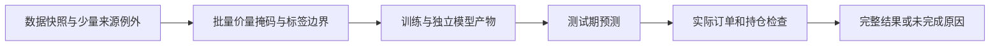

# 白名单采集实现

[上级：采集包](../README.md) · [测试](../tests/README.md)

`providers.py`调用固定AKShare/yfinance行情、指数、成员、日历和公司行动接口；`adjustment.py`从AKShare文档对应的固定新浪地址读取独立系数，核对证券、计数、日期唯一性和正有限十进制值，只接受JSON与注释。`evidence.py`在专用进程内记录requests/curl_cffi HTTP响应体及哈希，认证响应和URL crumb/token不留证。`__main__.py`处理协议6、身份握手、stdout隔离及父管道断开。

AKShare原价与供应商后复权表分别校验身份/日期，供应商后复权表不参与正式价格换算。股数=接口手数×100，成交额为元；缺失数值保持null。股票显式系数来源固定`sina_hfq`；经过验证的指数为price_index，Yahoo为unavailable。正式价量由Rust从原价和独立系数生成。

包内六个Python模块按文件名及内容计算SHA256，与Rust编译时签名核对。更改模块先用Ruff检查/格式化，再运行`crates/app/packaging/build-collector.sh`，最后重新构建CLI/App。代码、README和测试提交，运行缓存/HTTP证据不提交。接口、文件格式和验收边界见上级README。

announcements.py固定获取巨潮证券目录，以证券代码和已验证orgId联合获取实施证据；用pypdf提取文本并产生待审查日期/原始金额引用。cninfo-candidates-v2支持原文日期和严格对齐的普通股表格，逐字段保留引用，多候选不裁决。捕获PDF及HTTP证据，拒绝身份/分页/附件冲突。__main__.py协议6与六模块代码签名匹配后才能执行；依赖锁包含pypdf5.9.0，安装发生在开发打包阶段。SDK配股表不会被猜成完整可执行事件。

## 为什么需要本组件

只执行有边界的来源采集。固定接口和安全JSON解析阻止供应商响应变成代码。公告正文与表格候选明确区分，完整分页元数据保留供审核；一个证券的来源失败不应抹去其他证券已获取的证据。

设计依据：2026-10-14接受的当前组件职责、可复现实验与用户研究需求、组件接口及测试。未在代码或证据中确认的历史取舍不推定为既有设计理由；来源、法规或数据格式变化时重新评估。

## 2026-10-14：直接代码读取与分阶段研究

为什么调整：普通市场代码无需先登记身份；独立目录、审核和权威名录下载增加了研究前置负担。特殊历史代码仍需在快照内明确区间，不能将旧证券行情或权益接到另一证券。训练使用价量和标签，到账／交付资料只在实际账户执行时检查。

当前格式：模板6、需求3、准入4、股票池3、公司行动4、规范行情5、系数3、采集6、服务9、研究结果11；快照内来源映射1、训练产物1。工作区和任务记录1、GTJA191公式v4及默认178项顺序保持。旧格式明确拒绝，不自动转换。

来源映射位于快照source_map.json，普通证券可用空exceptions。每个例外含市场代码、资产类别、适用区间及provider/symbol/coverage定位。冲突拒绝；SHT00018只能读取自身旧文件，不自动绑定SH600018。原Qlib文件不改写；显式重新登记冻结文件内容和映射。worker内缓存字段，取消检查以证券和固定批次执行。

验收：nextest覆盖来源日期边界、三档掩码、训练／回测分离及模型保留；Clippy、Rustdoc、格式、组件文档和包内CLI共同检查。生成数据、模型、运行记录和安装包不提交。另一台Apple Silicon/macOS14实机验收继续待完成。
