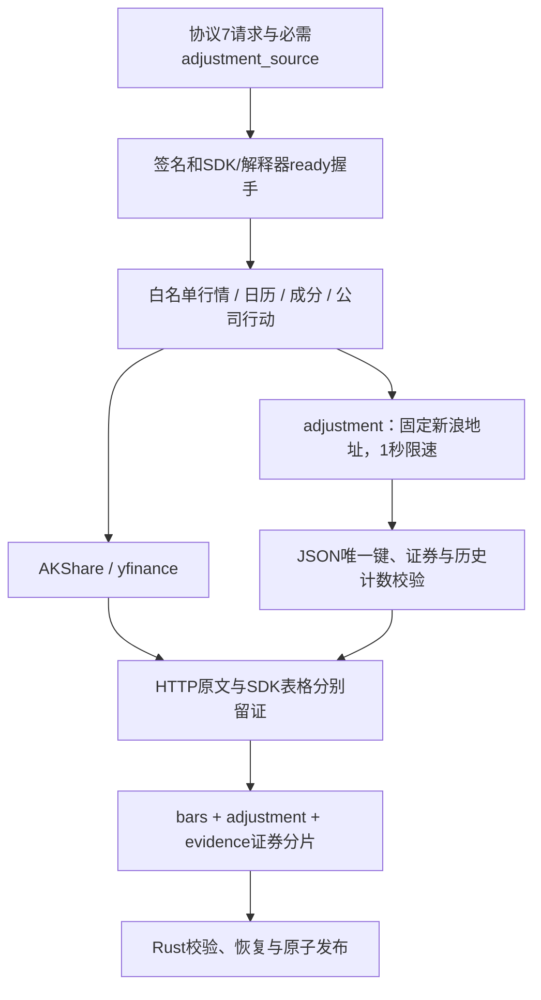
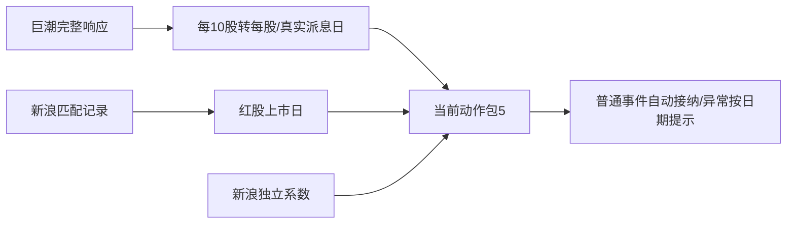
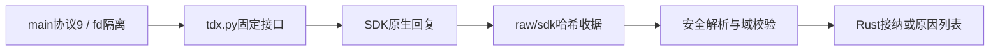

# 白名单采集实现

[上级：采集包](../README.md) · [测试](../tests/README.md)

`providers.py`调用固定AKShare/yfinance行情、指数、成员、日历和公司行动接口；`adjustment.py`从AKShare文档对应的固定新浪地址读取独立系数，核对证券、计数、日期唯一性和正有限十进制值，只接受JSON与注释。`evidence.py`在专用进程内记录requests/curl_cffi HTTP响应体及哈希，认证响应和URL crumb/token不留证。`__main__.py`处理协议7、身份握手、stdout隔离及父管道断开。

AKShare原价与供应商后复权表分别校验身份/日期，供应商后复权表不参与正式价格换算。股数=接口手数×100，成交额为元；缺失数值保持null。股票显式系数来源固定`sina_hfq`；经过验证的指数为price_index，Yahoo为unavailable。正式价量由Rust从原价和独立系数生成。

包内九个Python模块按文件名及内容计算SHA256，与Rust编译时签名核对。更改模块先用Ruff检查/格式化，再运行`crates/app/packaging/build-collector.sh`，最后重新构建CLI/App。代码、README和测试提交，运行缓存/HTTP证据不提交。接口、文件格式和验收边界见上级README。

announcements.py固定获取巨潮证券目录，以证券代码和已验证orgId联合获取实施证据；用pypdf提取文本并产生待审查日期/原始金额引用。cninfo-candidates-v3支持原文日期和严格对齐的普通股表格，逐字段保留引用，多候选不裁决。捕获PDF及HTTP证据，拒绝身份/分页/附件冲突。__main__.py协议9与九模块代码签名匹配后才能执行；依赖锁包含pypdf5.9.0，安装发生在开发打包阶段。SDK配股表不会被猜成完整可执行事件。

## 为什么需要本组件

只执行有边界的来源采集。固定接口和安全JSON解析阻止供应商响应变成代码。公告正文与表格候选明确区分，完整分页元数据保留供审核；一个证券的来源失败不应抹去其他证券已获取的证据。

设计依据：2026-10-14接受的当前组件职责、可复现实验与用户研究需求、组件接口及测试。未在代码或证据中确认的历史取舍不推定为既有设计理由；来源、法规或数据格式变化时重新评估。

## 2026-10-14：直接代码读取与分阶段研究

为什么调整：普通市场代码无需先登记身份；独立目录、审核和权威名录下载增加了研究前置负担。特殊历史代码仍需在快照内明确区间，不能将旧证券行情或权益接到另一证券。训练使用价量和标签，到账／交付资料只在实际账户执行时检查。

当前格式：模板10、需求3、准入5、股票池3、公司行动5、规范行情5、系数3、采集7、服务14、研究结果14；快照内来源映射1、训练产物3。工作区和任务记录1、GTJA191公式v4及默认178项顺序保持。旧格式明确拒绝，不自动转换。

来源映射位于快照source_map.json，普通证券可用空exceptions。每个例外含市场代码、资产类别、适用区间及provider/symbol/coverage定位。冲突拒绝；SHT00018只能读取自身旧文件，不自动绑定SH600018。原Qlib文件不改写；显式重新登记冻结文件内容和映射。worker内缓存字段，取消检查以证券和固定批次执行。

验收：nextest覆盖来源日期边界、三档掩码、训练／回测分离及模型保留；Clippy、Rustdoc、格式、组件文档和包内CLI共同检查。生成数据、模型、运行记录和安装包不提交。另一台Apple Silicon/macOS14实机验收继续待完成。

## 独立请求边界

providers.market在quotes操作不请求系数，coefficients不调用报价/分红；__main__逐证券报告失败并继续其他证券。stdout仅协议，原文与结构化返回分别留证；取消由Rust管道断开并回收进程。 完整接口、why、边界和验收见[组件契约](../README.md)。

## tushare.py为何存在

固定`dividend/suspend_d/stk_limit/adj_factor/anns_d` HTTPS适配补齐账户资料，复用现有requests而不加SDK。请求范围、取全结论、字段单位及原始HTTP响应分别留证；私有Token不留证。不转发可能包含凭据的供应商错误正文。权限不足独立记录，截断/解析失败不变成空数据。实施公告日与预案公告日分开；金额按每股税前人民币，送股与转增比例相加并与总比例核对。普通资料自动接纳，特殊公告候选仍需实施审查。

采集协议9中凭据只保留在专用进程的私有内存；每证券调用不会丢失凭据，环境读取后移除。不同请求行不共享磁盘认证缓存。每日系数/涨跌停重复冲突拒绝解析，不采用最后一行覆盖。限流(例如账户返回1次/小时)与权限不足分开报告，不能用原始成功一次的响应断言全池可下载。

## 为什么普通分红优先巨潮

`cninfo.py`是AKShare公司行动的默认适配器。真实抽查发现巨潮有完整派息日期，原新浪分红表缺该字段；先用巨潮可以直接补齐常规账户权益，无需Token或逐事件人工审核。固定HTTPS地址调用已锁定AKShare客户端，同时核对原始resultcode/count/total，避免空表列名异常被误认成网络失败。原始响应、按十股金额及转换规则均留证。

普通分红以巨潮为主；新浪仅匹配金额、登记日并补红股上市日，冲突保留为日期化问题。巨潮“股份到账日”不代替上市日。已实施但缺日期的实例保留null／问题；历史区间外的坏记录不污染当前候选。配股候选只在相关登记／除权区间阻断，不把一生曾配股当整只股票永久失败。独立新浪系数随包保存，支持执行核验，原Qlib factor仍只负责恢复原价。

## 为什么需要`tdx.py`

SDK1.2.2会把部分原生错误清洗成空值，并给送配缺字段补零。该模块在清洗前固定原生调用边界，保留原始字节、请求参数与哈希，校验日期、单位、正有限系数及跨年共同区间，避免错误变成可训练数据。公司行动参考不补结算日期，当前成员不回填历史。

`session`只在私有目录运行原生库，进程环境取Key后移除，INI0700目录/0600文件，结束后清理。版本锁、运行方式、证据格式及真实能力限制见[上层README](../README.md)。离线验收为`test_tdx.py`，SDK安装或fixture通过不等于账户联网权限已通过。

## 为什么增加新浪原始日线备用

真实研究本轮停止使用Qlib快照。退市SH600068的通达信历史为空，新浪仍保留旧证券原始行情，故`providers.sina_daily`作为AKShare股票路线的备用。仅东方财富空历史或连接/超时失败时整段采用新浪；损坏、解析错误及冲突不换源掩盖。来源写入证据，原文独立保存，不拼接日期或字段。股数和人民币金额保持接口单位，空值不填充。

网络JavaScript从不执行：只提取编码字符串，执行的解码器来自已锁定AKShare包。MiniRacer已在依赖锁中，无新增运行时依赖。日期重复/无序、证券冲突和字段截断拒绝；不调用高层函数的ffill、去重或eval。quotes不请求后复权表。验收为`test_providers.py`及本地独立联网记录；原价可取得不代表合并权益完整。
