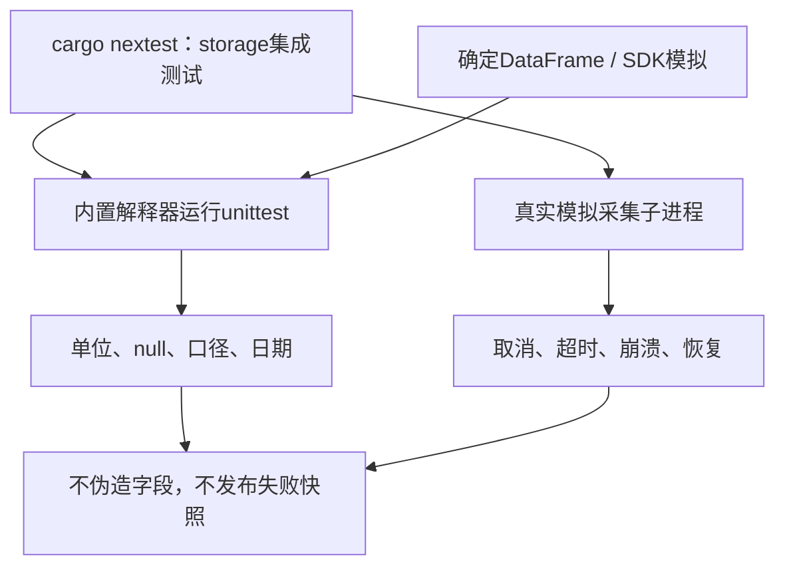
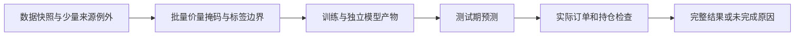
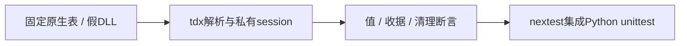

# Python 采集契约测试

TDX回归不再把供应商`front`报价作为比例调整的验收基准。测试显式系数的窗口锚点归一化、同源事件参考及原价一致性，负前复权报价不会导致原价失败。模拟原生边界同时检查调用日志脱敏、证据哈希和临时配置回收；联网抽查不替代这些固定断言。

[上级：采集组件](../README.md)

`test_providers.py` 用确定的DataFrame及模拟SDK验证手/股单位、不复权与调整价分离、null保留、重复日期、身份冲突、Yahoo参数和闭区间转换。SDK返回空表不得冒充无公司行动或完整行情。Rust `collector::supervisor_tests` 另验证真实子进程的取消、超时、崩溃、协议错误、部分下载不发布和哈希检查点恢复。

先构建内置解释器，再执行 `cargo nextest run -p analytics-storage`。公共源联网抽查放在忽略的target目录，不能作为确定测试依赖或提交产物。

回归覆盖后复权表身份与重复日期冲突；Rust监督测试还覆盖 HTTP 原文被修改、跨代码版本恢复、公司行动完成来源冻结、协议内存上限、完成后追加事件以及诊断日志不可写。

规范行情回归用非乘法后复权fixture证明：保存的原价及供应商报价不被改写，正式研究价量仅由独立系数生成。workflow验证缺事件、反向系数、特殊行动、来源冲突和参考价格缺失均在因子缓存/训练前拦截，并列出受影响因子。

新增真实模块子进程回归：代码身份不匹配在SDK调用/缓存创建前报错。Rust同时验证错误或缺失 `ready` 握手不会写出证券检查点。

`test_adjustment.py`覆盖安全解析（不调用eval）、唯一JSON键/日期、来源映射、完整历史计数、精确十进制值及禁止可执行尾部文本；本地HTTP验证429重试、每次尝试至少1秒、证据逐次保留、断网和超时不切换来源。协议7的实际子进程测试由Rust监督器覆盖，系数文件篡改与旧owner恢复均拒绝且不发布。

[test_announcements.py](test_announcements.py)覆盖固定附件白名单、实施/预案区分、字段和原单位候选、证券冲突/截断分页及本地HTTP PDF/空文本留证。空文本保持待审查，不自动发布权益修订。Rust review测试核对原哈希、实施字段引用、不可变修订和证据篡改拒绝；采集取消、断网、限流及检查点通用监督测试继续适用。

公告来源回归拒绝未知/重复orgId及交易所冲突，避免只用证券代码查询所得空响应被误当完整历史。表格回归包含最后交易日占位符、斜杠日期、每股金额原单位及正文/表格支付日冲突；冲突保持null并列出两份原文候选。

## 为什么需要本组件

把来源失败变成可重复检验的输入。公开站点会变化、限流和断网，联网成功不能替代正确性证明。fixture和本地模拟服务验证单位、来源映射、null、分页、取消与证据篡改；联网样本另记本地记录，不进入Git。

设计依据：2026-10-14接受的当前组件职责、可复现实验与用户研究需求、组件接口及测试。未在代码或证据中确认的历史取舍不推定为既有设计理由；来源、法规或数据格式变化时重新评估。

## 2026-10-14：直接代码读取与分阶段研究

为什么调整：普通市场代码无需先登记身份；独立目录、审核和权威名录下载增加了研究前置负担。特殊历史代码仍需在快照内明确区间，不能将旧证券行情或权益接到另一证券。训练使用价量和标签，到账／交付资料只在实际账户执行时检查。

当前格式：模板9、需求3、准入5、股票池3、公司行动5、规范行情5、系数3、采集7、服务11、研究结果13；快照内来源映射1、训练产物2。工作区和任务记录1、GTJA191公式v4及默认178项顺序保持。旧格式明确拒绝，不自动转换。

来源映射位于快照source_map.json，普通证券可用空exceptions。每个例外含市场代码、资产类别、适用区间及provider/symbol/coverage定位。冲突拒绝；SHT00018只能读取自身旧文件，不自动绑定SH600018。原Qlib文件不改写；显式重新登记冻结文件内容和映射。worker内缓存字段，取消检查以证券和固定批次执行。

验收：nextest覆盖来源日期边界、三档掩码、训练／回测分离及模型保留；Clippy、Rustdoc、格式、组件文档和包内CLI共同检查。生成数据、模型、运行记录和安装包不提交。另一台Apple Silicon/macOS14实机验收继续待完成。

## 不把下载成功当准入

新增独立系数与quotes fixture验证不调用其他接口；Rust覆盖恢复、原文篡改、视图锚点和原factor保持。Python子进程版本7拒绝旧消息。 完整接口、why、边界和验收见[组件契约](../README.md)。

## Tushare离线验收

`test_tushare.py`验证固定HTTPS与禁重定向、逐端点权限、限流重试、结构错误、截断、证券身份、实施/预案、重复与冲突、每股单位及认证回显拒绝留证。测试使用虚构凭据，不读取用户凭据；Rust nextest会执行包内Python fixture。真实权限和历史字段完整率单独记录，不用fixture宣称真实源已完整。

## 巨潮优先的回归理由

`test_cninfo.py`验证按十股转每股、真实派息日、到账不冒充上市、空表必须有完整原始响应、证券请求身份、冲突及旧日期隔离。测试mock已锁定客户端和HTTP返回，不访问公开网络。nextest使用分发解释器集成执行；网络抽查单独保存在工作区。

## TDX原生边界fixture

为什么新增：下载成功不能证明单位、复权或空历史正确。`test_tdx.py`用固定原生表和假ctypes边界核对金额万元转元、量为股、null、显式系数方向、重复/截断/错误、当前成员单日覆盖、SDK原文哈希、凭据不入证据及临时目录清理，不连接通达信。

复现：构建内置采集运行时后运行`cargo nextest run -p analytics-storage -E 'test(python_provider_contracts)'`。测试数量以本次执行报告为准；联网覆盖、权限及用量报告存本地任务，不提交。

新浪退市行情回归验证：封套证券一致、禁止执行网络文本、量为股/额为元、null不填充、日期重复拒绝，以及仅空历史或连接/超时失败整段回退；损坏输入不能换源掩盖。巨潮解析回归覆盖空格年月日、六列表头换行、缺日期占位符及深市起始交易日。合并账户资料仍独立检查，取得历史报价不代表权益已齐。
