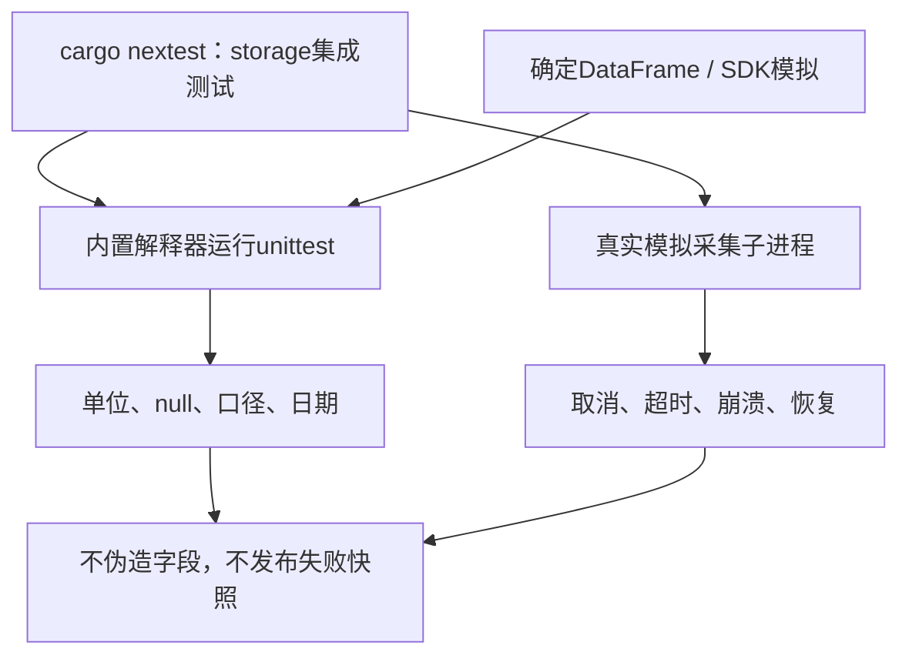

# Python 采集契约测试

[上级：采集组件](../README.md)

`test_providers.py` 用确定的DataFrame及模拟SDK验证手/股单位、不复权与调整价分离、null保留、重复日期、身份冲突、Yahoo参数和闭区间转换。SDK返回空表不得冒充无公司行动或完整行情。Rust `collector::supervisor_tests` 另验证真实子进程的取消、超时、崩溃、协议错误、部分下载不发布和哈希检查点恢复。

先构建内置解释器，再执行 `cargo nextest run -p analytics-storage`。公共源联网抽查放在忽略的target目录，不能作为确定测试依赖或提交产物。

回归覆盖后复权表身份与重复日期冲突；Rust监督测试还覆盖 HTTP 原文被修改、跨代码版本恢复、公司行动完成来源冻结、协议内存上限、完成后追加事件以及诊断日志不可写。

规范行情回归用非乘法后复权fixture证明：保存的原价及供应商报价不被改写，正式研究价量仅由独立系数生成。workflow验证缺事件、反向系数、特殊行动、来源冲突和参考价格缺失均在因子缓存/训练前拦截，并列出受影响因子。

新增真实模块子进程回归：代码身份不匹配在SDK调用/缓存创建前报错。Rust同时验证错误或缺失 `ready` 握手不会写出证券检查点。

`test_adjustment.py`覆盖安全解析（不调用eval）、唯一JSON键/日期、身份、完整历史计数、精确十进制值及禁止可执行尾部文本；本地HTTP验证429重试、每次尝试至少1秒、证据逐次保留、断网和超时不切换来源。协议4的实际子进程测试由Rust监督器覆盖，系数文件篡改与旧owner恢复均拒绝且不发布。

[test_announcements.py](test_announcements.py)覆盖固定附件白名单、实施/预案区分、字段和原单位候选、证券冲突/截断分页及本地HTTP PDF/空文本留证。空文本保持待审查，不自动发布权益修订。Rust review测试核对原哈希、实施字段引用、不可变修订和证据篡改拒绝；采集取消、断网、限流及检查点通用监督测试继续适用。

身份目录回归拒绝未知/重复orgId及交易所冲突，避免只用证券代码查询所得空响应被误当完整历史。表格回归包含最后交易日占位符、斜杠日期、每股金额原单位及正文/表格支付日冲突；冲突保持null并列出两份原文候选。

## 为什么需要本组件

把来源失败变成可重复检验的输入。公开站点会变化、限流和断网，联网成功不能替代正确性证明。fixture和本地模拟服务验证单位、身份、null、分页、取消与证据篡改；联网样本另记本地记录，不进入Git。

设计依据：2026-10-14接受的证券身份与完整准入计划、组件接口及测试。未在代码或证据中确认的历史取舍不推定为既有设计理由；来源、法规或数据格式变化时重新评估。

## 独立证券与未裁定覆盖

Why：单个来源失败不应使其他证券的完整证据丢失，也不能让成功响应被解释为全事件完整。协议4只将来源定位符传给库；Rust保留内部SEC身份并重验源响应。主进程逐证券捕获失败，发送shard_error后继续；存在缺分片时不发布完整快照。

公告 evidence 保存 all_announcements、pagination_complete、requested_announcement_dates及event_category_completeness=not_reviewed。元数据保留未被标题过滤的公告，供类别覆盖审核；候选正文及结构化表格不能自动证明不存在其他公司行动。日期与类别裁定由公共审计接口完成，不执行供应商返回文本。
