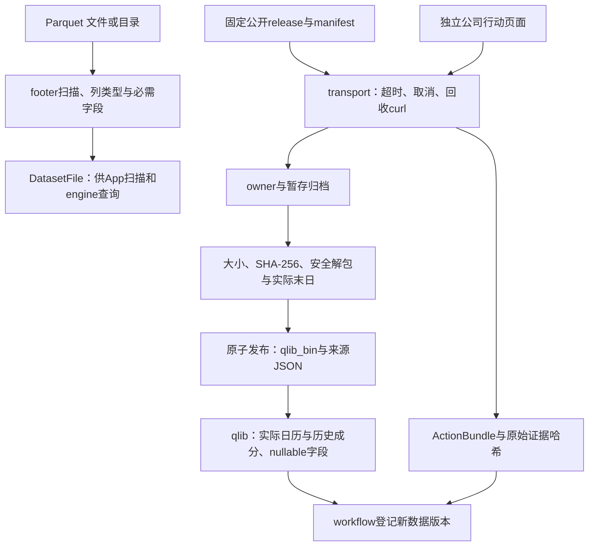

# Storage 源码：文件、下载与证据

[上级：analytics-storage](../README.md) · [公司行动内部模块](corporate_actions/README.md) · [数据版本登记](../../workflow/src/README.md)

本目录负责数据获取和文件解码，不持有DuckDB或LightGBM句柄，不决定研究收益。下载发布由workflow组合为持久化任务；本模块只返回验证过的元数据或明确错误。

## 模块与接口

| 文件 | 公共职责 |
|---|---|
| [lib.rs](lib.rs) | `ParquetCatalog::open/scan`、footer schema/行数与`validate_required_market_columns` |
| [acquisition.rs](acquisition.rs) | `ReleaseManifest`、固定release下载、验证大小/哈希、安全解包、恢复与原子发布 |
| [qlib.rs](qlib.rs) | `QlibDataset/DailyField`、真实交易日历、历史membership、nullable float32偏移读取、原价恢复 |
| [transport.rs](transport.rs) | 受`TaskContext`管理的curl、并发读取stdout/stderr、超时与取消回收；JSON请求错误 |
| [corporate_actions.rs](corporate_actions.rs) | `ActionBundle`、公开历史/详情解析、来源对账、日期补充、失败项重试与证据repair |



## 准入、恢复与文件格式

Parquet扫描并不证明公司行动或股票池完整。Qlib是输入文件格式，读取器不依赖Python Qlib、不访问其他项目缓存；float32文件首值是日历偏移，异常偏移、截断或非法标识符拒绝。非有限字段变null，成交价恢复规则由研究模块与`raw_price`共同落实。

release暂存目录冻结owner/tag，恢复不能换tag；只有完整压缩包通过哈希、归档路径/类型和实际交易末日验证才发布。归档不允许链接、重复成员或越界解包。公司行动缺支付/上市日保持null，失败与空历史分开，不能猜日期以形成“有效回测”。

`transport::curl`会在取消/超时时结束并回收子进程；输出失败不伪装成功。ActionBundle的原始响应/哈希与每阶段coverage保留在本地；公司行动阶段收据说明见[内部模块](corporate_actions/README.md)。

## 操作与验收

日常使用App或正式CLI，不调用旧独立下载二进制：

```bash
jfquant data download --tag 2026-10-12
jfquant jobs wait TASK_UUID
jfquant data versions
jfquant data actions --market MARKET_VERSION
jfquant jobs wait TASK_UUID
```

开发命令从仓库根目录执行，storage本身不需原生库：

```bash
cargo nextest run -p analytics-storage
cargo clippy -p analytics-storage --all-targets -- -D warnings
cargo nextest run -p analytics-cli -E 'test(standard_download) | test(standard_action_repair)'
```

前两项核对schema、归档、二进制读取、解析器、本地HTTP故障和子进程取消；最后一项还需[原生环境](../../README.md#开发与验收)，验证任务记录、busy及原子版本发布。真实公网下载只作单独验收，不进入网络依赖单元测试。数据、证据和检查点不提交Git。
