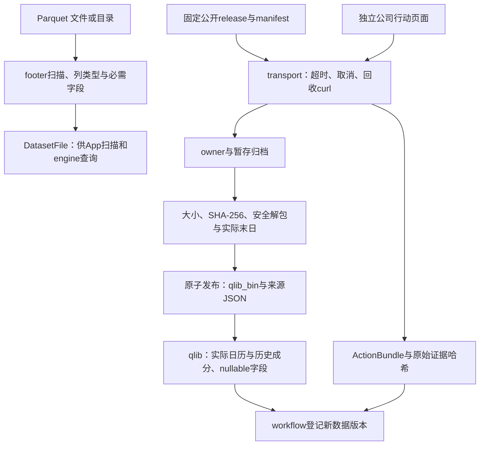
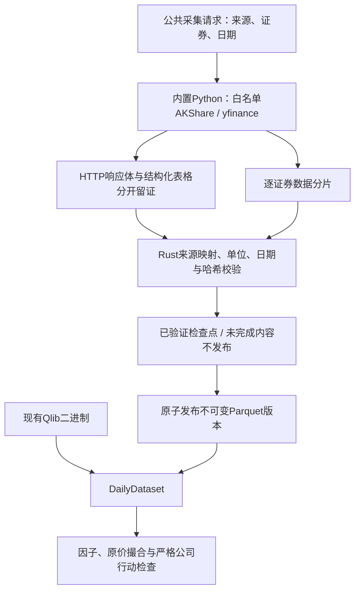
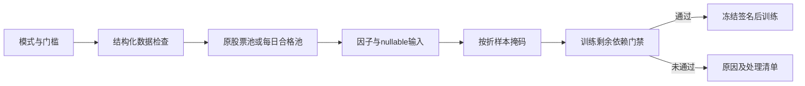
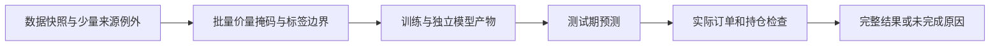

# Storage 源码：文件、下载与证据

[上级：analytics-storage](../README.md) · [公司行动内部模块](corporate_actions/README.md) · [数据版本登记](../../workflow/src/README.md)

本目录负责数据获取和文件解码，不持有DuckDB或LightGBM句柄，不决定研究收益。下载发布由workflow组合为持久化任务；本模块只返回验证过的元数据或明确错误。

## 模块与接口

| 文件 | 公共职责 |
|---|---|
| [lib.rs](lib.rs) | `ParquetCatalog::open/scan`、footer schema/行数与`validate_required_market_columns` |
| [acquisition.rs](acquisition.rs) | `ReleaseManifest`、固定release下载、验证大小/哈希、安全解包、恢复与原子发布 |
| [qlib.rs](qlib.rs) | `QlibDataset/DailyField`、真实交易日历、历史membership、nullable float32偏移读取、原价恢复 |
| [transport.rs](transport.rs) | 受`TaskContext`管理的curl、并发读取stdout/stderr、超时与取消回收；JSON请求错误 |
| [corporate_actions.rs](corporate_actions.rs) | `ActionBundle`、公开历史/详情解析、来源对账、日期补充、失败项重试与证据repair |
| [collector.rs](collector.rs) | 包内采集监督、协议7、限速/取消、分片证据与检查点校验 |
| [adjustment.rs](adjustment.rs) | 显式日期系数、证券来源映射、首个原价收盘锚点和转换版本 |
| [daily.rs](daily.rs) | Qlib/规范行情5共用读取、研究价量、原价及真实成交股数 |



## 准入、恢复与文件格式

Parquet扫描并不证明公司行动或股票池完整。Qlib是输入文件格式，读取器不依赖Python Qlib、不访问其他项目缓存；float32文件首值是日历偏移，异常偏移、截断或非法标识符拒绝。非有限字段变null，成交价恢复规则由研究模块与`raw_price`共同落实。

release暂存目录冻结owner/tag，恢复不能换tag；只有完整压缩包通过哈希、归档路径/类型和实际交易末日验证才发布。归档不允许链接、重复成员或越界解包。公司行动缺支付/上市日保持null，失败与空历史分开，不能猜日期以形成“有效回测”。

`transport::curl`会在取消/超时时结束并回收子进程；输出失败不伪装成功。ActionBundle的原始响应/哈希与每阶段coverage保留在本地；公司行动阶段收据说明见[内部模块](corporate_actions/README.md)。

## 操作与验收

日常使用App或正式CLI，不调用旧独立下载二进制：

```bash
jfquant data download --tag 2026-10-12
jfquant jobs wait TASK_UUID
jfquant data versions
jfquant data actions --market MARKET_VERSION
jfquant jobs wait TASK_UUID
```

开发命令从仓库根目录执行，storage本身不需原生库：

```bash
cargo nextest run -p analytics-storage
cargo clippy -p analytics-storage --all-targets -- -D warnings
cargo nextest run -p analytics-cli -E 'test(standard_download) | test(standard_action_repair)'
```

前两项核对schema、归档、二进制读取、解析器、本地HTTP故障和子进程取消；最后一项还需[原生环境](../../README.md#开发与验收)，验证任务记录、busy及原子版本发布。真实公网下载只作单独验收，不进入网络依赖单元测试。数据、证据和检查点不提交Git。

## 双源采集与统一日行情

`collector::CollectionRequest / Provider / collect / collect_quotes / collect_coefficients / collect_actions` 使用包内 CPython 3.12，AKShare 1.19.1、yfinance 1.7.0，依赖和发行包 SHA256 在组件旁锁定。Rust 服务监督单任务子进程，JSON Lines 协议7承载进度、证券分片、完成或稳定错误；取消、超时和异常均回收进程。owner、证券文件及证据哈希匹配后才恢复，成功证券不重复下载。详见 [采集包](../collectors/README.md)。

`daily::DailyDataset` 同时读取 Qlib 和规范 Parquet，提供交易日历、历史成员、归一化因子字段及独立 `raw_field`。规范格式5含 `daily_manifest.json` 和 `bars/SHxxxxxx.parquet`；实际价格、后复权价格、股数及人民币成交额分别保存，缺失值保留 null。`field` 采用固定价量重基准规则，`raw_field` 只接收已经验证的原价。Yahoo 标为 `split_adjusted_candidate`，不能用于严格撮合。



开发期先运行 `crates/app/packaging/build-collector.sh`，随后执行 nextest。开发构建可用 `JFQUANT_COLLECTOR_RUNTIME` 指定已经构建的解释器；发布构建只定位包内环境，不搜索系统 Python。公司行动采集成功不代表数据就绪：缺支付/上市日期、无法解释配股、未知历史覆盖均阻止训练。日线采集限定已结束的交易日，日历来自显式记录的 AKShare/新浪接口，不由存活股票的报价推断。

检查点 owner 同时冻结采集代码、依赖锁与解释器锁签名；更新这些内容后应启动新采集，不能混用旧分片。恢复前逐份重验 HTTP 收据，行情和公司行动均适用。公司行动完成消息、依赖锁哈希和解释器来源也进入 ActionBundle 的证据哈希。JSON Lines 在读取时限制单行32 MiB，stderr单行64 KiB；缺换行、无效UTF-8、完成后追加协议事件或日志无法持久化均失败。规范行情校验 OHLC 范围、有限数值、证券身份和 Date32 边界，null保留。

`DailyDataset::validate_factor_basis(id)` 验证独立系数的来源映射、日期覆盖及首个实际原价收盘锚点，不从供应商后复权报价推断系数。研究字段从原价与显式系数生成，原价字段和真实成交股数独立读取；历史跳变由公司行动证据核验。

采集协议7要求先发送 `ready`，包含代码签名及AKShare/yfinance/CPython准确版本，之后才能写入行情/公司行动分片或完成消息。完成消息再次核对身份；错误/缺失握手不会生成证券检查点。

## 独立系数接口

[adjustment.rs](adjustment.rs)定义格式3的独立系数记录，含证券、源地址、观察末日和按日期升序的points；规范行情本身为格式5。DailyDataset::adjustment_factors返回原始系数对账，raw_volume返回真实股数，field生成研究OHLC、倒数缩放的研究量和实际金额VWAP；零量VWAP为null。price_inputs冻结源哈希、精度、覆盖、锚点与规则，进入缓存、模型和研究签名。供应商adj列是证据，保留有限负值，不参与正式计算。

底层field保留Qlib字段单位：volume为研究股数/100，amount为实际人民币元/1000；ML的prepare_year统一乘回100和1000后再交给GTJA191。因此正式因子输入是股数/k及人民币元，两种读取器结果一致；raw_volume始终返回真实股数，执行账本不会读取调整量。

## 实施证据与当前版本

collector.rs增加collect_announcements，与行情/事件共用专用Python、取消/超时/回收及证据恢复；[corporate_actions/review.rs](corporate_actions/review.rs)负责元数据/HTTP/PDF/文本复核和不可变修订。公司行动4允许带类型条款；daily_manifest3、采集7，独立系数记录仍为1。复制旧文件或修改schema数字不能代替重新获取及证据核验。

## 为什么需要本组件

把来源证据与正式研究数据分开。每日行情通过统一读取器提供，Qlib保持原文件，规范Parquet记录转换依据。日期化身份绑定禁止复用代码时读取另一个证券的历史；缺失数据仍为null，但缺必要文件、身份或解释时准入失败。

设计依据：2026-10-14接受的当前组件职责、可复现实验与用户研究需求、组件接口及测试。未在代码或证据中确认的历史取舍不推定为既有设计理由；来源、法规或数据格式变化时重新评估。


## 三级研究模式：为什么允许筛选

决定日期2026-10-14，依据是用户接受的三级模式计划。正常预热空值、来源缺失和错误数据是不同问题：全部拒绝会浪费可用样本，全部放行又会混淆因子和真实权益。默认严格检查；另外提供“允许部分数据缺失”和“只用数据合格的股票”。模式是研究输入的一部分，不能作为训练失败后自动切换的兜底。

第二档保持原成员，纯缺失传播null；第三档派生每日合格成员，不改原始成员或证据。不能看到后来缺价而倒删早期股票。账户仍采用原价、整数股、T+1和连续权益；未裁定冲突、损坏、基准缺项及剩余必要依赖仍阻断。默认有效因子比例0表示至少一项有效，最低有标签样本1只表示可执行，不表示样本在统计上充分。所选因子整列无有效值不会被自动删除。

[daily.rs](daily.rs)新增research_field，纯文件缺失与非法内容由io::ErrorKind区分；其返回值只是nullable研究输入，不是完整性的认证。规范容器缺必需列仍是格式错误，不能通过放宽模式把损坏容器当成缺数据。源格式和原文哈希不变；资格及筛选记录由ML/workflow管理。



DailyDataset的restrict_reads用于工作线程的日期需求；三个research读取方法按绑定区间处理缺失，不把一个未来代码的NotFound扩展到整条证券历史。内部bound_field_policy仍拒绝重叠和非法内容，股票身份与权益不因供应商代码变化而变更。

## 2026-10-14：直接代码读取与分阶段研究

为什么调整：普通市场代码无需先登记身份；独立目录、审核和权威名录下载增加了研究前置负担。特殊历史代码仍需在快照内明确区间，不能将旧证券行情或权益接到另一证券。训练使用价量和标签，到账／交付资料只在实际账户执行时检查。

当前格式：模板8、需求3、准入5、股票池3、公司行动4、规范行情5、系数3、采集7、服务10、研究结果12；快照内来源映射1、训练产物2。工作区和任务记录1、GTJA191公式v4及默认178项顺序保持。旧格式明确拒绝，不自动转换。

来源映射位于快照source_map.json，普通证券可用空exceptions。每个例外含市场代码、资产类别、适用区间及provider/symbol/coverage定位。冲突拒绝；SHT00018只能读取自身旧文件，不自动绑定SH600018。原Qlib文件不改写；显式重新登记冻结文件内容和映射。worker内缓存字段，取消检查以证券和固定批次执行。



验收：nextest覆盖来源日期边界、三档掩码、训练／回测分离及模型保留；Clippy、Rustdoc、格式、组件文档和包内CLI共同检查。生成数据、模型、运行记录和安装包不提交。另一台Apple Silicon/macOS14实机验收继续待完成。

## 独立采集和惰性视图

collector.rs提供quotes/coefficients/actions；market_view.rs冻结完整依赖并验证原文到解析记录的绑定；daily.rs恢复原价后用新日期系数生成研究价量。旧factor用于原价，不能被新factor覆盖。 完整接口、why、边界和验收见[组件契约](../README.md)。

视图和原价恢复路径复用Qlib有限值域校验：负成交量/金额、非正价格/原系数拒绝；派生倍率或价量无法表示时返回错误，不能伪装成普通null。显式view的field("factor")返回F/F0，adjustment_factors保留来源F用于事件比值核验。锚点之前的研究字段保持null。回归测试使用内容哈希正确但成交量为负的基底，验证损坏不会被允许缺失模式放行。
