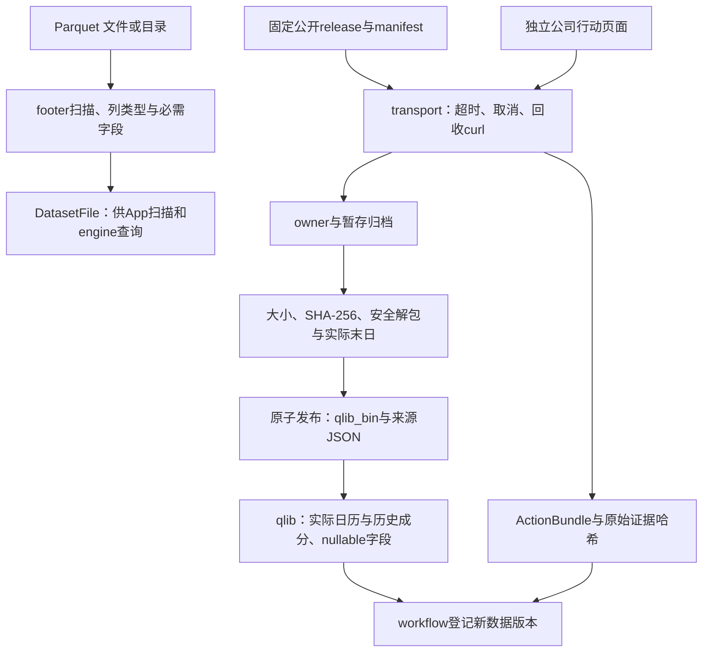
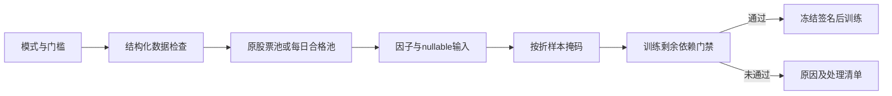
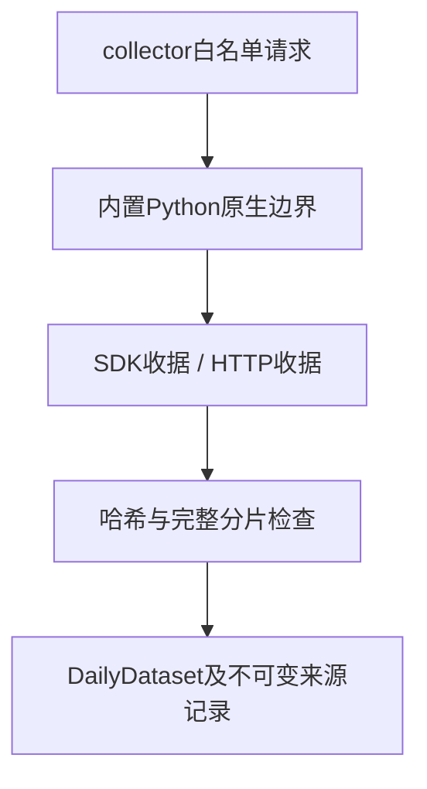

## BigQuant候选数据

`bigquant::{check,schema,quota,read,history}`：Rust HTTP元数据与最小官方Flight SDK桥接，保留原始nullable字段和哈希，固定历史投影、白名单/额度预检及本地缓存复用。离线prepare以原始缓存重验后保存Parquet候选，不自动研究准入。[组件说明](bigquant/README.md)。

## 当前采集契约（2026-10-15）

`bigquant::size_value/size_value_factors` 提供格式4年度分组、格式5六组收益充分统计量，
使用 PIT 财务和已批准停牌估值规则离线构造、重放 SMB/HML；缺失字段保持 null。
[公共接口、分组政策和命令](bigquant/README.md#pit-年度分组与-smbhml)。

三因子新增`three_factor::acquire`及`collector::collect_fundamentals`，固定通达信原生
回执规范化为逐日总股本、年度归母普通股权益候选。未知修订版本显式区分
observed_on/provider_dates；默认保守，不沿用缺日股本。格式、证据重放与验收见
[组件说明](three_factor/acquire/README.md)。

HiThink 为默认主源，由 Rust 直接调用 REST；通达信备用，维持内置 Python `tdxaidata==1.2.2`；巨潮公告使用独立 `cninfo` 来源。旧来源依赖、配置、权限检查及历史兼容入口已移除；旧数据不迁移、不删除，重新配置来源并采集。

公共来源为 `hithink|tdxaidata|cninfo`，复权选项为 `hithink-forward|tdx-forward|none`。服务协议44、采集协议16、来源策略2；HiThink 行情格式6，通达信格式5与 Qlib 读取保留。HiThink 训练选择供应商口径（`price_basis=provider`），前复权 OHLC、原始股数及人民币成交额、VWAP null；回测使用原价。训练缓存与 manifest 冻结口径、来源和证据哈希，特征顺序及公式版本保持。

接口、凭据、覆盖范围与复现命令见[采集组件](../collectors/README.md)。当前成分不能回填历史，下载成功不代表研究或账户资料完整。

# Storage 源码：文件、下载与证据

[上级：analytics-storage](../README.md) · [公司行动内部模块](corporate_actions/README.md) · [数据版本登记](../../workflow/src/README.md)

本目录负责数据获取和文件解码，不持有DuckDB或LightGBM句柄，不决定研究收益。下载发布由workflow组合为持久化任务；本模块只返回验证过的元数据或明确错误。

## 模块与接口

| 文件 | 公共职责 |
|---|---|
| [lib.rs](lib.rs) | `ParquetCatalog::open/scan`、footer schema/行数与`validate_required_market_columns` |
| [acquisition.rs](acquisition.rs) | `ReleaseManifest`、固定release下载、验证大小/哈希、安全解包、恢复与原子发布 |
| [qlib.rs](qlib.rs) | `QlibDataset/DailyField`、真实交易日历、历史membership、nullable float32偏移读取、原价恢复 |
| [transport.rs](transport.rs) | 受`TaskContext`管理的curl、并发读取stdout/stderr、超时与取消回收；JSON请求错误 |
| [corporate_actions.rs](corporate_actions.rs) | `ActionBundle`、来源身份与证据校验、固定对账和巨潮实施证据修订 |
| [collector.rs](collector.rs) | 包内采集监督、协议7、限速/取消、分片证据与检查点校验 |
| [adjustment.rs](adjustment.rs) | 显式日期系数、证券来源映射、首个原价收盘锚点和转换版本 |
| [daily.rs](daily.rs) | Qlib/规范行情5共用读取、研究价量、原价及真实成交股数 |
| [three_factor](three_factor/README.md) | 日频三因子读取、带披露版本的六月2×3自算与缺失明细 |



## 准入、恢复与文件格式

Parquet扫描并不证明公司行动或股票池完整。Qlib是输入文件格式，读取器不依赖Python Qlib、不访问其他项目缓存；float32文件首值是日历偏移，异常偏移、截断或非法标识符拒绝。非有限字段变null，成交价恢复规则由研究模块与`raw_price`共同落实。

release暂存目录冻结owner/tag，恢复不能换tag；只有完整压缩包通过哈希、归档路径/类型和实际交易末日验证才发布。归档不允许链接、重复成员或越界解包。公司行动缺支付/上市日保持null，失败与空历史分开，不能猜日期以形成“有效回测”。

`transport::curl`会在取消/超时时结束并回收子进程；输出失败不伪装成功。ActionBundle的原始响应/哈希与每阶段coverage保留在本地；公司行动阶段收据说明见[内部模块](corporate_actions/README.md)。

## 操作与验收

日常使用App或正式CLI，不调用旧独立下载二进制：

```bash
jfquant data download --tag 2026-10-12
jfquant jobs wait TASK_UUID
jfquant data versions
jfquant data actions --market MARKET_VERSION
jfquant jobs wait TASK_UUID
```

开发命令从仓库根目录执行，storage本身不需原生库：

```bash
cargo nextest run -p analytics-storage
cargo clippy -p analytics-storage --all-targets -- -D warnings
cargo nextest run -p analytics-cli -E 'test(standard_download) | test(retired_action_commands)'
```

前两项核对schema、归档、二进制读取、解析器、本地HTTP故障和子进程取消；最后一项还需[原生环境](../../README.md#开发与验收)，验证任务记录、busy及原子版本发布。真实公网下载只作单独验收，不进入网络依赖单元测试。数据、证据和检查点不提交Git。

## 双源采集与统一日行情

`daily::DailyDataset` 同时读取 Qlib 和规范 Parquet，提供交易日历、历史成员、归一化因子字段及独立 `raw_field`。规范格式5含 `daily_manifest.json` 和 `bars/SHxxxxxx.parquet`；实际价格、后复权价格、股数及人民币成交额分别保存，缺失值保留 null。`field` 采用固定价量重基准规则，`raw_field` 只接收已经验证的原价。Yahoo 标为 `split_adjusted_candidate`，不能用于严格撮合。


检查点 owner 同时冻结采集代码、依赖锁与解释器锁签名；更新这些内容后应启动新采集，不能混用旧分片。恢复前逐份重验 HTTP 收据，行情和公司行动均适用。公司行动完成消息、依赖锁哈希和解释器来源也进入 ActionBundle 的证据哈希。JSON Lines 在读取时限制单行32 MiB，stderr单行64 KiB；缺换行、无效UTF-8、完成后追加协议事件或日志无法持久化均失败。规范行情校验 OHLC 范围、有限数值、证券身份和 Date32 边界，null保留。

`DailyDataset::validate_factor_basis(id)` 验证独立系数的来源映射、日期覆盖及首个实际原价收盘锚点，不从供应商后复权报价推断系数。独立系数口径从原价与显式系数生成研究字段；HiThink供应商口径直接读取前复权OHLC、原始股数与金额，VWAP为null。原价回测字段独立读取，历史事件由公司行动证据核验。

## 独立系数接口

[adjustment.rs](adjustment.rs)定义格式4的独立系数记录，含证券、源地址、观察末日和按日期升序的points；规范行情本身为格式5。DailyDataset::adjustment_factors返回原始系数对账，raw_volume返回真实股数，field生成研究OHLC、倒数缩放的研究量和实际金额VWAP；零量VWAP为null。price_inputs冻结源哈希、精度、覆盖、锚点与规则，进入缓存、模型和研究签名。供应商adj列是证据，保留有限负值，不参与正式计算。

底层field保留Qlib字段单位：volume为研究股数/100，amount为实际人民币元/1000；ML的prepare_year统一乘回100和1000后再交给GTJA191。因此正式因子输入是股数/k及人民币元，两种读取器结果一致；raw_volume始终返回真实股数，执行账本不会读取调整量。

## 实施证据与当前版本

collector.rs增加collect_announcements，与行情/事件共用专用Python、取消/超时/回收及证据恢复；[corporate_actions/review.rs](corporate_actions/review.rs)负责元数据/HTTP/PDF/文本复核和不可变修订。公司行动5允许带类型条款；daily_manifest3、采集7，独立系数记录仍为1。复制旧文件或修改schema数字不能代替重新获取及证据核验。

## 为什么需要本组件

把来源证据与正式研究数据分开。每日行情通过统一读取器提供，Qlib保持原文件，规范Parquet记录转换依据。日期化身份绑定禁止复用代码时读取另一个证券的历史；缺失数据仍为null，但缺必要文件、身份或解释时准入失败。

设计依据：2026-10-14接受的当前组件职责、可复现实验与用户研究需求、组件接口及测试。未在代码或证据中确认的历史取舍不推定为既有设计理由；来源、法规或数据格式变化时重新评估。


## 三级研究模式：为什么允许筛选

决定日期2026-10-14，依据是用户接受的三级模式计划。正常预热空值、来源缺失和错误数据是不同问题：全部拒绝会浪费可用样本，全部放行又会混淆因子和真实权益。默认严格检查；另外提供“允许部分数据缺失”和“只用数据合格的股票”。模式是研究输入的一部分，不能作为训练失败后自动切换的兜底。

第二档保持原成员，纯缺失传播null；第三档派生每日合格成员，不改原始成员或证据。不能看到后来缺价而倒删早期股票。账户仍采用原价、整数股、T+1和连续权益；未裁定冲突、损坏、基准缺项及剩余必要依赖仍阻断。默认有效因子比例0表示至少一项有效，最低有标签样本1只表示可执行，不表示样本在统计上充分。所选因子整列无有效值不会被自动删除。

[daily.rs](daily.rs)新增research_field，纯文件缺失与非法内容由io::ErrorKind区分；其返回值只是nullable研究输入，不是完整性的认证。规范容器缺必需列仍是格式错误，不能通过放宽模式把损坏容器当成缺数据。源格式和原文哈希不变；资格及筛选记录由ML/workflow管理。



DailyDataset的restrict_reads用于工作线程的日期需求；三个research读取方法按绑定区间处理缺失，不把一个未来代码的NotFound扩展到整条证券历史。内部bound_field_policy仍拒绝重叠和非法内容，股票身份与权益不因供应商代码变化而变更。

## 2026-10-14：直接代码读取与分阶段研究

为什么调整：普通市场代码无需先登记身份；独立目录、审核和权威名录下载增加了研究前置负担。特殊历史代码仍需在快照内明确区间，不能将旧证券行情或权益接到另一证券。训练使用价量和标签，到账／交付资料只在实际账户执行时检查。

当前服务43、研究worker4、模板12、结果22、采集16、因子目录2、GTJA191公式v5（默认190项）。具体数据格式以所属组件的序列化类型与验证器为准；正常入口拒绝旧协议及旧格式，升级仅通过显式本地迁移执行。特征顺序、公式版本和来源哈希仍随产物冻结。

来源映射位于快照source_map.json，普通证券可用空exceptions。每个例外含市场代码、资产类别、适用区间及provider/symbol/coverage定位。冲突拒绝；SHT00018只能读取自身旧文件，不自动绑定SH600018。原Qlib文件不改写；显式重新登记冻结文件内容和映射。worker内缓存字段，取消检查以证券和固定批次执行。


验收：nextest覆盖来源日期边界、三档掩码、训练／回测分离及模型保留；Clippy、Rustdoc、格式、组件文档和包内CLI共同检查。生成数据、模型、运行记录和安装包不提交。另一台Apple Silicon/macOS14实机验收继续待完成。

## 独立采集和惰性视图

collector.rs提供quotes/coefficients/actions；market_view.rs冻结完整依赖并验证原文到解析记录的绑定；daily.rs恢复原价后用新日期系数生成研究价量。旧factor用于原价，不能被新factor覆盖。 完整接口、why、边界和验收见[组件契约](../README.md)。

视图和原价恢复路径复用Qlib有限值域校验：负成交量/金额、非正价格/原系数拒绝；派生倍率或价量无法表示时返回错误，不能伪装成普通null。显式view的field("factor")返回F/F0，adjustment_factors保留来源F用于事件比值核验。锚点之前的研究字段保持null。回归测试使用内容哈希正确但成交量为负的基底，验证损坏不会被允许缺失模式放行。

## 执行资料与来源信任

`execution_data.rs`定义格式1的停牌、精确涨跌停、交叉检查系数及权限状态；`credentials.rs`仅负责私有凭据文件原子保存/读取；`corporate_actions/execution_index.rs`每任务建立一次日期和证券索引。公司行动5中structured_coverage证明的是选定供应商结构化查询取全，不代表九类事件完整。已知事件字段缺项、冲突及无法解释的系数变化仍阻断实际权益；特殊覆盖未知通过明确的Provider策略保留告警。Audited策略继续要求全类别证据。

巨潮优先由`../collectors/jfquant_collectors/cninfo.py`采集、collector监督并哈希，`corporate_actions`验证当前来源证明，`execution_index`批量建索引及读取独立系数。为什么分开：恢复原价所用Qlib字段不等同于事件系数，普通结构化分红也不等同于特殊事件全覆盖。


## TDX与来源信任边界

为什么增加：高层SDK可能吞错误或补零，而复权及空值会直接改变训练样本。`collector.rs`先核验协议9、代码/依赖/解释器版本，再接受原生SDK收据或HTTP收据；`credentials.rs`只为已知供应商提供私有文件入口。`daily.rs`从TDX原价和显式ForwardFactor派生价量，指数类型须验证，候选行情不冒充研究输入。



当前公共调用和复现方式见[组件README](../README.md)及[采集协议](../collectors/README.md)。验收覆盖原生证据篡改、保留null、单位、窗口冲突和`.tdx-runtime`恢复清理；无网络测试不会宣称覆盖真实历史。


历史停复牌优先使用通达信结构化`get_gpjy_value([symbol],["GP29"],start,end)`，同时捕获`GetProDataInStr`和`GetTradeCalendarInStr`原生响应、调用参数及哈希。`GP29`为复牌日和此前停牌的交易日数；Rust `analytics_storage::tdx_status`按独立市场日历回推停牌日区间（可能包含首日日内停牌），不按自然日、不从缺K线猜测。当前`TPFlag`/`IsSTGP`/`IsQuitGP`仅是快照，不能回填历史；GP29更名/ST变更字段尚未转为完整历史ST状态机。复牌后的信息只用于回溯账户核验，不参与信号/股票池选择。

`data refresh --mode actions --workers 3`同步更新这部分辅助证据。完整股票池事件历史仍以HiThink为主；通达信事件日期不完整不会丢失独立状态证据。新采集器签名使旧检查点需重采；已登记行情不改写。`ExecutionData.capabilities`按证券记录`tdxaidata.gp29-status-days-v2`、范围、结构化证据名称和右侧截断警告。读取时从原生响应重新计算并核对日期；计数非整数、日历不足、证券/请求不符或证据篡改拒绝准入。没有复牌记录不能证明停牌不存在，仍缺失的持仓估值继续阻断。

GP29确认停牌日且缺少原始日线/成交量为零时，在日频账户适配中生成独立记录的估值标记`suspension_valuation_marks.json`（原始行情/训练报价不改写），沿用上一有效原价估值；遇已支持除权事件按参考公式调整估值。交给撮合器的估值行成交量为零，受成交量约束，不能产生交易；若同日原行情有正成交量，保留真实原价报价作为日内停牌边界，单独记录`suspension_traded_days.json`，不覆盖成停牌估值。Python行为fixture验证相同信号原本会成交、零成交量估值日不会成交。缺证据报价仍保留缺口，不删除整个证券。巨潮公告路径保留作例外补证，无需逐证券维护公告URL。

验收：`DUCKDB_DOWNLOAD_LIB=1 cargo test -p analytics-storage -p analytics-workflow --lib`；`PYTHONPATH=crates/workflow/research target/collector-build/python/bin/python3 -m unittest discover -s crates/workflow/research/tests`。依赖锁、公式、特征序及研究worker签名不变；更换纯采集代码后运行`bash crates/app/packaging/build-collector.sh`重建并校验内置运行时。

辅助执行数据格式2新增`suspension_day`（不声称全天停牌），保留格式1读取。GP29原生捕获规则仍为v1，Rust解释规则为status-days-v2；`execution.json`记录该估值策略，动作版本/结果签名隔离旧解释。缺少日线仍按日频停牌估值口径披露，不提供盘中停牌分钟级撮合。

最近持续停牌补充使用通达信`get_more_info`的`TPFlag=1`、`HqDate`、`StopJYDate_Recent`三字段组合，捕获固定`GetMoreInfoInStr`原生调用并绑定证券/哈希。仅当快照行情日期覆盖研究截止日、最近停牌日起未见相冲突的GP29复牌记录时，确认最近这一段持续停牌；当前标记单独存在、过期快照和缺失日期均不能回填历史。此证据只用于回溯账户估值，不用于因子或选股；保留更早未知区间。结果清单增加`dated-current-episode-v1`以隔离旧缓存。


状态只读查询由`data inspect-actions`的`stock_status`返回，包含已验证日期、能力范围和结构化证据名称，不把空记录当作完整历史。日频停牌估值仅接受明确零成交量或整行报价缺失；有正成交量的部分OHLC缺失不得改成估值行。无成交量但保留部分报价时保持缺口，无前价锚点也保持缺口，由实际持仓估值判定是否阻断。最近持续停牌解释接受截止日为周末/节假日，仍仅输出认证交易日历中的日期。

HiThink 公司行动查询失败按未知证券、参数、认证、权限、限流、上游与传输错误区分；1002 仅在原始消息精确匹配请求代码时认定未知证券。失败仍阻断准入，并持久化每只证券的 `*-actions-failure.json` 及全部 HTTP 响应、状态、URL 和哈希，不将失败当作无事件成功。

同一除权日多行（包括完全重复行）保留在原始响应中，生成稳定的 `source_event_conflict` 核对项，不自动求和、去重或放弃其他日期。每行的身份、范围和金额先严格验证；正式公告经现有字段证据修订及问题哈希核对后方可消除冲突。供应商已完整返回的历史覆盖与事件条款冲突分别记录，账户执行继续遵守未解决问题的暴露检查。验收：`cargo test -p analytics-storage hithink::tests` 和现有公司行动修订测试。

本次指数接入格式已收敛：AdjustmentRecord 仅接受格式4（`index_input` 必填，普通证券及内置目录指数显式为 null，自定义指数冻结完整合同）；SourceMap 仅接受格式2，指数无可下单证券身份；CollectionRequest 必须显式包含 `index_inputs`（可为空对象）。正常读取不升级旧版本、不猜测缺失字段。旧快照只作历史留存，显式离线转换后必须以新内容哈希重新登记，原始响应及采集器身份不得改写成当前版本。服务协议44、采集协议16拒绝旧检查点；格式更新不等于来源准入通过。

## Alpha030三因子输入

`three_factor.rs`定义可选格式1侧文件`three_factor_returns.json`，保留来源、市场、收益
口径、decimal单位及唯一有序日期。`DailyDataset::field/research_field`对mkt/smb/hml
读取日期对齐的全市场列，三列不进入价量缩放。缺文件维持NotFound，损坏维持InvalidData，
缺日/null不填充；所属worker缓存一次读取结果。格式示例与验收见[组件README](../README.md#alpha030外部三因子输入)。

`filesystem` provides metadata-only file identity, allocation and free-space reads without following symlinks. Workspace resource ownership and deletion stay in workflow. [Storage management](../../workflow/src/storage_management/README.md).
