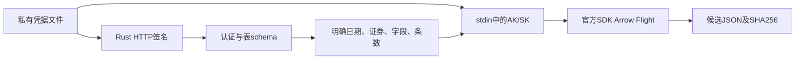
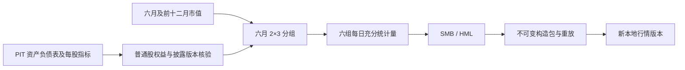

# BigQuant 本地接入

责任：核验历史数据下载权限、保存带哈希的原始证据，离线整理历史事实，并构造可复算的全市场 MKT。
候选整理与因子构造有独立格式和校验器；目录“免费”标签不等于本地 SDK 下载授权。

## 传输与接口

目前未发现官方 Rust SDK。认证、表定义使用 Rust + 系统 curl 的 HTTPS 接口，凭据和签名仅通过 stdin：

- `GET /bigapis/auth/v1/users/me`
- `GET /bigapis/data/v1/spacedatasources/spaces/00000000-0000-0000-0000-000000000000/datasources/{id}`
- HMAC-SHA256：`path + body + timestamp_ms`，GET body 为空。

依据官方发布的 `bigquant-core==0.1.14` 包 METADATA。官方数据查询走 Arrow Flight，未找到直接返回数据的 REST 下载接口。
数据层最小桥接使用官方 `bigquant==0.1.11`、`bigquant-core==0.1.14`，Python 3.11；解释器由调用者显式指定，
运行时不安装包、不改变既有 collector 环境。HTTP 认证成功并不证明 Flight SDK 资格或表权限。

公开 Rust 接口：`check`、`schema`、`quota`、`read`、`fetch`、`verify_snapshot`、`ReadRequest`，见 [源码](../bigquant.rs)。
`read` 先验证真实 schema，固定生成单表 SELECT，要求日期范围，最多 10000 行并多取一行检查截断；不接收任意 SQL。
每页最多显式选择64列；下载前读取当前SDK白名单和额度，按 `(limit+1)×字段数` 校验最大cell消耗。
此上界保守，不能保证平台没有其他计费规则或并发请求；平台仍决定实际额度。
Flight 子进程沿用 transport 取消监督，超时 90 秒，无自动重试。错误分类不回传 SDK 日志或异常原文。



## 配置和复现

从仓库根目录运行；数据输出放 `data/` 或 `target/` 等忽略目录。凭据位于用户私有目录
`Library/Application Support/JFQuant/credentials/bigquant.json`（macOS），目录0700、文件0600。
配置从 stdin 输入，不通过命令参数传 key。

```sh
uv venv --python 3.11 target/bigquant-runtime
uv pip install --python target/bigquant-runtime/bin/python \
  --index https://pypi.bigquant.com/simple/ --default-index https://pypi.org/simple/ \
  'bigquant==0.1.11' 'bigquant-core==0.1.14'
DUCKDB_DOWNLOAD_LIB=1 cargo build -p analytics-cli --bin jfquant
jfquant data bigquant configure --key-stdin
jfquant data bigquant check
jfquant data bigquant schema cn_stock_shares
jfquant data bigquant quota --python /absolute/path/to/target/bigquant-runtime/bin/python
jfquant data bigquant fetch --python /absolute/path/to/target/bigquant-runtime/bin/python \
  --request /absolute/path/to/request.json --output /absolute/path/to/shares.json
```

request.json 示例（证券编码为 BigQuant 格式）：

```json
{"table":"cn_stock_shares","columns":["date","instrument","total_shares"],"date_column":"date","start":"2024-01-01","end":"2024-12-31","instruments":["600519.SH"],"limit":100}
```

## 候选格式与准入

格式1：`schema_version/provider/transport/sdk/observed_at/complete/research_admitted/sha256/payload`。
SHA256 对 `serde_json::to_vec(payload)` 计算；payload 含请求、SQL、完整供应商metadata、Arrow schema、下载前额度和行。
`complete`只表示**本次查询未达到行数上限**，不表示供应商历史完整；false 时必须缩小日期或证券分片重新采集。
NULL保持null、非有限浮点映射null、日期ISO字符串、Decimal保留十进制字符串。输出禁止覆盖已有文件。`fetch`先校验已有输出的请求、SQL、schema和内容哈希；匹配时直接返回
`cache_hit=true`，无需HTTP、凭据或SDK。不同请求/损坏文件报错，不偷偷重新下载。
新输出通过同目录锁文件写入、fsync和原子硬链接发布；并发请求或残留锁明确报错，防止重复用量。
清理残留锁前应确认相同输出没有在运行的下载。

候选 `cn_stock_capital` 的 publish_date/change_date/total_shares 仍须核实单位和历史覆盖。
`cn_stock_financial_ly_shift__CAIXIN` 的 date/report_date/shift 和归母权益不自动认定原始修订版本；
优先股、永续债未知值不置零。`cn_stock_instruments`须确认退市历史。满足三因子格式2的依据前不注册研究输入。
不提供旧协议兼容层，不改变现有服务协议。

## 固定历史投影与离线整理

`history::{Request,Kind,fetch,verify,run_indices}`提供格式2的固定投影，独立版本
`bigquant-historical-projections-v1`。使用`data bigquant extract --python PATH --request JSON --output JSON`，
每页最多50000行，另取一行检测截断；同样做白名单/额度预检和不可覆盖缓存。
格式1与格式2各有显式校验器；不在运行时互转。

| kind | 字段及用途 |
| --- | --- |
| annual_equity | 12月31日年报的date/report_date/change_type、归母权益、其他权益工具及3项优先股/永续债字段，共9列；不取其他财务列 |
| share_runs / share_calendar | 总股本连续段与显式源日期；股本NULL和源日历缺口均保留 |
| universe_runs / universe_calendar | 历史证券存在的连续段与显式源日期；不替换为当前名单 |
| price_factors | 日期、代码、未复权close、供应商adjust_factor，共4列 |
| price_bars | 日期、代码、未复权OHLC、volume、amount、adjust_factor，共9列 |
| suspensions | 日期、代码、suspended=1的明确停牌记录，共3列；缺报价不自动等于停牌 |

run投影先对**全源日期**排序，再筛证券。每段保存首尾日期、总记录数和不同日期数；
`run_indices`以保存的源日历校验段长，拒绝重复日期及隐藏缺口。跨分片重叠还需离线整理检查。

请求示例：

```json
{"kind":"share_runs","start":"2024-01-01","end":"2024-06-30","instruments":[],"limit":50000}
```

[prepare.py](prepare.py)只在本地整理已下载证据；不导入SDK、不发起数据请求。
通过显式jfquant二进制复验每个缓存的原请求、SQL/schema/版本/哈希和未截断状态，
不存在的SDK路径保证不会把缓存未命中变为下载。使用`pyarrow`输出分片Parquet；已有输出拒绝覆盖，
临时目录完成后发布，manifest保存每片哈希及原始证据引用。

```sh
target/bigquant-research/venv/bin/python crates/storage/src/bigquant/prepare.py \
  --cli target/debug/jfquant \
  --sources data/bigquant-gapfill-20261019/source-index.json \
  --output data/bigquant-gapfill-20261019/prepared
```

source-index格式1必须显式含`shares_availability=provider_dates`、`shares_revision_risk=true`、
`scope`、`sources`。每个source含绝对路径`snapshot/request`、`command=fetch|extract`、
`kind`和`payload_sha256`。kind为上述投影或`basic_info/dividends/allotments`。
可选`identity_bindings`只保存有依据的代码映射声明，不自动改写证券代码。
使用绝对路径，整理后的source-index可以原样重放；删除或移动原始证据后须显式更新来源索引。

整理保留供应商原字段名和NULL，日期规范为Arrow date32，数字为float64（整数计数/状态保持int64）；
原始JSON继续保留十进制表示。新增`instrument_id/source_index/security_type`，不把代码格式转换
当作历史身份认证。股本段跨片不能重叠，并逐证券比较股本与历史证券目录的日期集合。

财报按实际date保留每个report_date版本。`parent_minus_other_equity`仅在归母权益和
其他权益工具合计都明确、分项无明显矛盾时计算；合计扣一次，不再扣优先股/永续债分项。
合计未知时输出null。该数值仍是候选：计价单位与普通股范围须进一步核验，不能直接发布HML。
行情新增`quote_state=priced|missing_close_suspended|missing_close_unexplained`；
停牌匹配不填充价格。adjust_factor保持供应商累积后复权字段身份，不认证为通达信独立系数。
所有整理产物`research_admitted=false`，不自动注册、替换行情或生成三因子。

## 验收

```sh
cargo test -p analytics-storage bigquant --lib
DUCKDB_DOWNLOAD_LIB=1 cargo test -p analytics-workflow bigquant_ --lib
cargo test -p analytics-storage credentials --lib
python3 -m unittest discover -s crates/storage/src/bigquant -p 'test_*.py'
DUCKDB_DOWNLOAD_LIB=1 cargo check -p analytics-cli
```

固定HMAC向量校验签名；构造查询校验日期、字段、证券注入和limit+1。真实公网权限测试独立执行，不进入单元测试。
SDK 官方说明：[使用文档](https://bigquant.com/wiki/doc/vac4qwmQr4)、[API手册](https://mf.bigquant.com/wiki/doc/064mz8zFJD)。

## 本机权限验收（2026-10-19，已开通后）

当前SDK白名单165表，周额度50,000,000 cell；用户提供的权限表注明试用截止2026-10-27。
已实际读取2005及2026日频股本、PIT不同披露版本、退市证券日目录、全表上市/退市基本信息、
未复权日行情及其复权字段、分红和配股日期。旧权限失败回执仅作为历史记录保留，不能代表现状。

按用户提供的2026-09-28套餐方案：日频股本`cn_stock_shares`、历史证券目录、基本信息、
未复权/后复权日行情、分红、配股均属免费版。PIT资产负债表及财报变更日期属旗舰版，
本次试用可读不代表长期免费。免费版配额0.05亿/周；试用50,000,000 cell/周并不自动延续。
元数据字段标记`free=true`与网页“免费”不是SDK表授权或长期套餐的证明。

套餐表中免费的`cn_stock_capital`、`cn_stock_adjust_factor`和`cn_stock_revoked_instruments`
未列入本次SDK白名单；`cn_stock_financial_ly_shift__CAIXIN`也不在白名单，且套餐表未列出，
不作为可长期免费取得财报的替代来源。

PIT文档正文将change_type=0/1说明为首次/后续披露，字段描述却写成调整过/未调整；
保留原始值，依据date/report_date核对版本，不自动翻转编码。002473.SZ的2019年报流动资产
在2020-04-30为223449880.95、2020-08-27为228470428.90，实测能读到两版。
股票股本只有日频date，不能冒充公告版本；用户已明确选择供应商历史日股本，并要求保留修订风险。
普通股权益仍需明确扣除项目、NULL语义和覆盖审核。
完整覆盖由逐日非空数量判断；MKT 与 SMB/HML 可通过下述独立构造与发布接口登记。实际采集清单和额度审计存于本机`data/bigquant-20261019/`。
后续批量补采及离线整理的独立审计存于`data/bigquant-gapfill-20261019/`。

## 全市场 MKT 构造与发布

公开接口 `market::{Request,fetch,issues,verify,return_on,calculate,build,verify_build,SuspensionPolicy}`。
方法版本 `bigquant-cn-market-lagcap-v4`，字段顺序固定为 `mkt/smb/hml`，单位为小数收益率。
它输出 **market_return，未减 RF**；不是供应商 Fama–French 因子的复刻。
此 MKT 专用入口保留 SMB/HML 为 null；下述 size/value 入口补充有依据的年度分组与收益。

固定 SQL 联结 `cn_stock_instruments`、`cn_stock_real_bar1d`、`cn_stock_shares`、
`cn_stock_status`、`cn_stock_basic_info`。每次下载前核对五表 schema、SDK 白名单及额度。
证券按供应商 `security_type` 选择 A 股，排除 CDR；保留历史代码映射和修订风险。
收益为复权收盘简单收益，权重为前一源交易日的未复权估值乘总股本。
首日和不连续入池日没有前一日权重，不计为当日可加权成员；任一可加权成员缺失、
证券分类未知或源键重复时，当日 MKT 为 null，不删除缺失成员后重新配权。

两种停牌策略均在证据中保留诊断：`strict` 必须有实际收盘价；
`confirmed-unchanged-factor` 仅在明确停牌、复权因子不变、源记录唯一且日期连续时使用估值。
复权因子变更的停牌日保持 null；未知缺报价也保持 null。估值可以由实际收盘价向后延用，
或由供应商明确的昨收价恢复：当前停牌估值还须 `exdr=0/change_ratio=0`；恢复前一停牌日估值须
当前 `exdr=0`、两日因子相同，并且上市日早于被恢复日期。仅在首个源日以昨收价初始化时，
须已提前上市、明确停牌、`exdr=0/change_ratio=0`。不下载 2005 年前的日报价。

为保留窗口上下文，查询从 2005-01-04 起读取，不能把请求的输出起日下推到窗口前。
Rust 验证全序列后才筛选输出起日。`market-extract` 返回每源日18列充分统计量，
最多10000行另取一行检查截断；无需下载全部证券逐日明细。
`market-issues` 返回**最后一个源日的所有成员**31列诊断，使用窗口末日筛选保留历史上下文。
格式3保存准确 SQL、请求、方法版本、五表元数据、Arrow schema、额度、行与哈希，
缓存命中不联网；原始证据 `research_admitted=false`，其本身不是已登记的因子。

```sh
# request.json: {"start":"2005-01-04","end":"2026-10-16"}
target/debug/jfquant data bigquant market-extract \
  --python "$PWD/target/bigquant-research/venv/bin/python" \
  --request request.json --output data/mkt/evidence.json
target/debug/jfquant data bigquant market-issues \
  --python "$PWD/target/bigquant-research/venv/bin/python" \
  --request request.json --output data/mkt/last-members.json
target/debug/jfquant data bigquant market-build --input data/mkt/evidence.json \
  --suspension confirmed-unchanged-factor --output data/mkt/factors
target/debug/jfquant --workspace "$PWD" data bigquant market-publish \
  --market MARKET_VERSION --artifact data/mkt/factors --output data/mkt/published
```

`market-build` 不联网，以锁和暂存目录构造不可覆盖的产物：`evidence.json`、
`three_factor_returns.json`、`report.json`、`manifest.json`。manifest 冻结 SQL/Rust 实现哈希、
字段顺序及 schema 哈希、证据/报告/因子哈希、SDK 版本、股本修订风险。
报告记录首日引用数量、停牌估值成员日、受影响日期、昨收引用和前日估值恢复数量。
`verify_build` 检查哈希并重算全部因子与报告，防止只更新文件哈希就篡改结果。

`Workspace::publish_bigquant_market_factors` 获取工作区租约后复验原行情身份，复制到新目录，
保存因子构造包并通过正常 `DailyDataset`/三因子读取器回读，登记新的 market 版本。
命令同步执行、不启动研究服务；运行前须停用持有工作区租约的服务。

`audit_annual.py` 仅离线检查已验证的 annual/universe/basic/calendar 缓存，按六月分组日和
前一十二月入池情况，取披露日期严格早于分组日的最新年报版本，最新版本为 null 时继续保留 null。
运行参数与 `prepare.py` 相同：`--cli PATH --sources source-index.json --output NEW_JSON`。
验收含独立手算权重、CDR排除、停牌/因子变更/未知缺报价、上市边界、发布回读及篡改重放拒绝。

## PIT 年度分组与 SMB/HML

`size_value::{Request,fetch,common_equity,audit,audit_supplemented}` 获取并验证六月分组输入。
`size_value_factors::{Plan,fetch,build,verify_build}` 冻结分组、读取六组充分统计量、构造及重放
标准三因子文件。方法版本 `bigquant-cn-ff3-june-bps-v1`，复用未修改的 MKT v4 估值规则。



原始 `other_equity_instruments` 的 NULL 保持 NULL。供应商 XPS 文档明确
`bps_lf=(归母权益-其他权益工具)/最新总股本`，公积金等每股指标使用同一分母。
因此使用 `金额/对应每股金额` 消去共同分母，再乘 BPS 得到普通股权益，金额锚以人民币计。
资本公积、盈余公积、未分配利润的所有可用非零锚须一致；零值矛盾、无正分母、重复源键、
缺 BPS 均拒绝。原始扣除项明确时须与直接扣除结果一致。相对核验容差 1e-7、绝对下限 1e-4。
XPS 日期不得早于最新原始财报；仅在额外已验证 PIT 回执证明权益及三个锚全部未变时允许旧 XPS。
不使用今日股本重算历史分母，不将财务字段缺失作为零。

分组使用上一年末年报、实际披露日期严格早于六月最后交易日的最新可得版本。
没有可得年报的公司排除并记录代码、原因；供应商 PIT 没有记录并不等于独立证明公司未披露，
报告对此保留 `actual_nonpublication_independently_verified=false`，外部公告证据另存审计。
CDR、前十二月尚未上市、普通股权益非正的公司排除；已有报表字段缺失或必要估值缺失会阻止整年分组。
样本六月总市值按 R7 中位数分 S/B，账面权益/前十二月总市值按 R7 的 30%/70% 分 L/N/H。
分组持有期为当年七月至次年六月，六组使用前一日总市值加权收益；有缺失成员的组合保持 null。
`SMB=(SL+SN+SH-BL-BN-BH)/3`，`HML=(SH+BH-SL-BL)/2`；中间组缺失仅影响 SMB。

格式4为每批最多五个连续分组年度的28列输入，格式5为每源日六组的10列充分统计量。
两者最多50000行并多取一行验截断，保存准确 SQL、字段元数据、Arrow schema、额度及哈希。
静态分组采用按年度证券集合的 CASE 表达式，日历网格采用六个 UNION ALL，适配供应商 SQL 编译器。
SQL 失败仅输出受限标识符及安全分类，不回传供应商异常或认证信息。

计划格式1拒绝未知字段；所有路径相对计划文件解析：

```json
{"schema_version":1,"construction_version":"bigquant-cn-ff3-june-bps-v1",
 "range":{"start":"2005-01-04","end":"2026-10-16"},
 "formation_inputs":["formations.json"],"balance_supplements":[],
 "market_evidence":"market.json","report_policy":"available_before_formation",
 "shares_availability":"provider_dates","shares_revision_risk":true}
```

```sh
# formation-request.json: {"start_year":2026,"end_year":2026}
target/debug/jfquant data bigquant size-value-extract \
  --python "$PWD/target/bigquant-research/venv/bin/python" \
  --request formation-request.json --output formations.json
target/debug/jfquant data bigquant size-value-audit --input formations.json \
  --balance-supplement balance-vintages.json --output annual-audit.json
target/debug/jfquant data bigquant size-value-returns \
  --python "$PWD/target/bigquant-research/venv/bin/python" --plan plan.json --output returns.json
target/debug/jfquant data bigquant size-value-build \
  --plan plan.json --returns returns.json --output data/size-value/factors
target/debug/jfquant --workspace "$PWD" data bigquant size-value-publish \
  --market MARKET_VERSION --artifact data/size-value/factors --output data/size-value/published
```

同步命令不启动服务；发布要求工作区租约。构造包保存 `inputs/`、相对路径 `plan.json`、
`returns.json`、标准 `three_factor_returns.json`、含分组/排除清单/每日诊断的 `report.json`、
`manifest.json`。manifest 冻结字段顺序、schema/实现/文件哈希、SDK 版本、政策与股本修订风险，
分别记录三因子非空日数、三者同时非空日数；只有全部日期齐全时 `full_three_factor_ready=true`。
发布获取租约、复制原行情并用正常读取器回读；数据候选的 `research_admitted=false` 不会被改写。

2026-09-28 套餐表将 `cn_stock_financial_xps` 与 `cn_stock_financial_ly_shift` 列为旗舰版，
试用可读不能视为长期免费。逐日股本的历史修订风险仍显式保留。

验收：`cargo test -p analytics-storage size_value --lib`，
`DUCKDB_DOWNLOAD_LIB=1 cargo test -p analytics-workflow bigquant_ --lib`，
`python3 -m unittest discover -s crates/storage/src/bigquant -p 'test_*.py'`。
固定夹具独立校验分母消去、六组公式、缺失传播、分位数和可移植产物重放及篡改拒绝。
