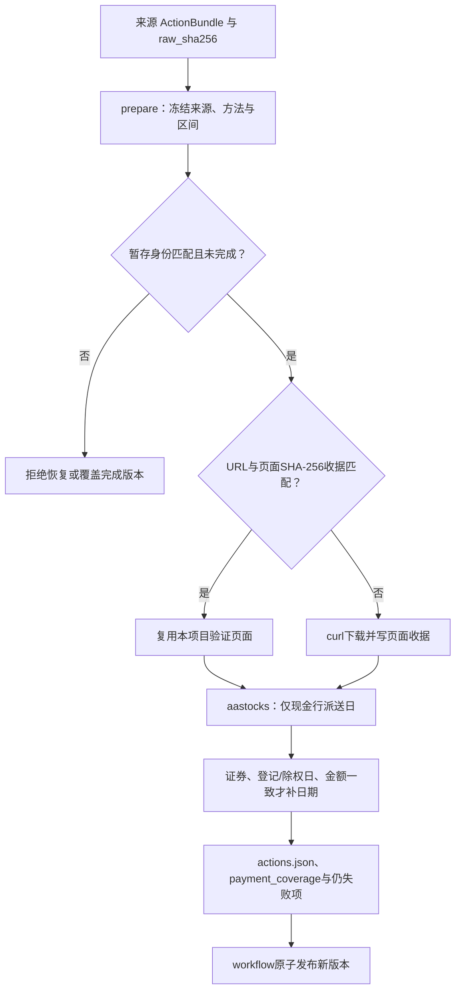

# 公司行动：现金日期补充与页面检查点

[上级：Storage源码](../README.md) · [ActionBundle公共入口](../../README.md#公开公司行动与原价恢复) · [股份账本](../../../core/src/README.md)

本目录被父模块`corporate_actions.rs`调用，专门处理现金日期补充和派生阶段收据。它不改变登记/除权权益规则，不从复权因子推测到账日期，也不将其他项目缓存当下载证据。

## 文件与调用关系

[aastocks.rs](aastocks.rs) 实现`fetch_pay_dates/repair_pay_dates`，由父模块重导出。它匹配证券、登记日、除权日与现金数量，只采用现金行明确的派送日；送股行日期不能当现金到账日。

[checkpoints.rs](checkpoints.rs) 是内部模块，`prepare`冻结来源bundle哈希、方法、区间，`page`核对URL与页面SHA-256收据。父模块的历史/详情/现金日期派生阶段共用它；不能把仅存在的HTML文件视为已验证检查点。



## 不可放宽的边界

继承的原证据会验证哈希并复制，但不会自动当作本次采集的新页面收据。恢复需相同源bundle、阶段和日期范围；发现完成的actions.json时拒绝覆盖。repair只重解析本项目已下载证据，保留真实下载时间，并单列重解析时间和`saved_evidence_only`。

区间内要求登记日早于除权日，除权日不晚于现金派送日；1900等占位日期不能用作真实到账日。缺日期、来源冲突或身份错配保留失败明细，不静默选择一方。股票上市日由父模块的明确上市字段处理，不由现金页面推断。

## 操作与测试

```bash
jfquant data supplement --actions ACTION_VERSION --method payments --start 2013-01-01 --end 2026-10-12
jfquant jobs wait TASK_UUID
jfquant data supplement --actions ACTION_VERSION --method repair-payments --start 2013-01-01 --end 2026-10-12
jfquant jobs wait TASK_UUID
```

使用当前公司行动版本ID；如果重试未完成的联网阶段，按同一请求传`--resume ORIGINAL_TASK_UUID`。完成后以data versions的新版本为准，旧快照保留。

从仓库根目录运行：

```bash
cargo nextest run -p analytics-storage -E 'test(corporate_actions::)'
cargo nextest run -p analytics-cli -E 'test(standard_action_repair)'
```

storage fixture验证现金/送股行分离、占位日期、错证券、缺日期、URL/哈希收据恢复及完成版本拒绝覆盖。CLI场景验证证据重解析后的去重版本ID与本次coverage产物；需要[原生环境](../../../README.md#开发与验收)。真实公开源仍有历史缺项，不能由fixture成功推断研究已就绪。
