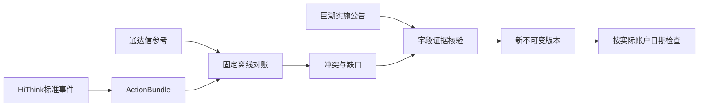

# 公司行动与实施证据

当前公司行动格式 **9**、修订请求 **4**、服务协议 **30**。跨证券字段证据按参与方原文关联核验，历史覆盖与已知事件条款分别检查。格式9保存登记机构按尾数排序／同尾随机分配的事实；研究向下取整仍是独立策略，不能充当实际分配规则。完整接口和核验说明见 [修订核验](review/README.md)。

## 历史验收与接口演进

配股账户本轮验收：三例部分条款通过正式修订发布为 `actions-f92cf5694fa809a8`，资料缺口保留。固定AKQuant原生扩展及Rust重放已支持配股状态流转，实际参与仍须满足字段及暴露检查。复用原六轮预测的放弃组累计收益52.49%、最大回撤26.73%，与原结果在数值容差内一致；参与组在宁波银行500股登记权益处停止，缺少单位、费用、获配比例、获配日及成功分支退款安排，没有发布收益。完整报告位于忽略目录 `target/csi300-rolling-2015-2026/rights-experiment-20261016/REPORT.md`。

当前写入行动格式8、修订请求3；保留行动5/6/7、公告修订1及结构化修订2读取。`rights_issue_facts` 的字段状态为 unknown / confirmed / not_applicable，后者必须有公告证据。请求3支持独立 `structured_manifest`，按身份验证后继承原始响应；公告对条款逐字段引用，获配、退款和上市可引用登记日之后的结果公告，认购决策条款仍要求登记日前披露。旧复合采集版本的 source-evidence 目录连同树哈希继承，拒绝链接和篡改。

部分资料发布不会清除原执行问题。三个案例的价格、比例、登记日及缴款和上市日期可发布；未知单位、费用、获配日期和成功分支退款安排继续为unknown。账户是否参与由新的冻结研究策略决定，不由“字段已验证”自动开启。

本组件维护 `ActionBundle`、执行索引、固定离线对账和证据修订，负责事件身份、历史覆盖、字段出处及不可变发布前校验。采集由父级固定 HiThink／通达信适配器完成，公告独立使用巨潮。

## 公共接口与数据流

- `ActionBundle::read`校验格式5／6／7、证券与事件身份及来源；格式6／7金额为十进制文本。废弃来源、混合来源证据、哈希不符或未审核生产者不得使用。
- `reconcile::apply`读取哈希验证的 HiThink标准事件与通达信参考，通过内置 Python固定规则精确比较每股条款、去重和记录冲突。无旧表字段兼容或网页补采。
- `review::verified_documents/apply`读取独立巨潮实施公告，对照原事件哈希、证券身份、字段引用和文档哈希，发布修订副本；普通问题只能用匹配字段证据关闭。
- `execution_index::ExecutionIndex`按账户实际依赖检查登记、除权、支付和上市日期。通用独立系数跳变诊断保留；供应商前复权不产生独立系数。



## 结构化配股字段（格式7）

现有通达信 actions 采集独立请求 GP41、GP43；任何单字段错误不抹去普通除权参考或停复牌。Python 只捕获原文，`facts::derive/refresh` 在 Rust 中解释并生成 `ActionBundle.field_facts`。直接采集、自动刷新汇总、离线对账均使用同一解释；读取格式7时从原文再次推导，字段值、原始单位、请求身份、JSON pointer 或哈希不符拒绝读取。HiThink 及通达信的旧格式5／6继续可读，新格式不迁移旧检查点。

`FactReport` 包含证券/来源身份、请求区间、获取时间、规则 `tdxaidata.rights-fields-v1`、字段查询状态与逐事件证据。`verified` 仅表示返回记录通过解释；`valid_empty` 仅表示该字段明确返回空数组；`coverage_unknown` 对应缺字段或 `Data={}`；错误为 `unavailable`，零日期/重复/截断/请求不匹配为 `invalid`。跨表歧义或价格不一致的事件标记 `conflict`，不补登记日。以上均不声明全历史或全类别完备。

GP41 登记日仅与同日 GP43、价格相等且登记日至除权日相隔不超过31自然日的唯一配股参考关联；这是保守的候选关联边界，超过窗口保持缺失，不外推日期。一个登记记录不能分配给两个事件。登记日期字段还须与记录日期一致。每股比例由原生每十股配股数精确十进制除以10，发行总量按万股乘以10000，均不经浮点换算。总量保留供应商精度，不能当作登记结算精确发行量，更不能用来反推每股比例。披露日缺失为null，获取时间不充当当时已知时间。

`RightsFacts` 的 `missing_fields` 是结构化接口本身的缺口；`engine_supported=false` 独立于资料是否已由公告补齐。原始 `CorporateAction`、采集失败与执行问题不会因新增事实自动改变。

修订请求版本2在每个 `EventRevision` 增加 `structured_fields`，与旧 `fields` 公告引用并存。结构化引用为 `{event_id, field}`，允许证明 `record_date`、`ex_date`、`terms.price`、`terms.ratio`；其余条款必须有公告证据。纯结构化修订的 `evidence_manifest` 指向当前 actions.json；混合修订仍指向巨潮 announcements.json。源快照必须经过读取重放、原事件哈希必须匹配，结构化修订不能清除失败或执行问题。版本1公告请求继续支持；修订仅发布新版本，原文件不改。请求示例片段：

```json
{
  "structured_fields": {
    "record_date": {"event_id": "SH600030:2022-01-27", "field": "record_date"},
    "terms.price": {"event_id": "SH600030:2022-01-27", "field": "subscription_price"}
  }
}
```

CLI 与 App 共用现有任务和详情；`data inspect-actions` 的 `details.structured_fields` 返回上述报告。App 在公司行动审计区域点击“加载事件、结构化字段与公告证据”，无需提供公告 manifest 即可查看结构化部分。未采集过这些字段的旧版本返回null，不能视为无配股。

```bash
jfquant data collect --kind actions --provider tdxaidata --start 2021-11-01 --end 2022-06-01 --instruments SZ002142,SH600030,SH600958
jfquant jobs wait TASK_UUID
jfquant data inspect-actions --actions ACTION_VERSION --instrument SH600030
jfquant jobs wait INSPECTION_UUID
jfquant data revise-actions --actions ACTION_VERSION --request REVISION_JSON
DUCKDB_DOWNLOAD_LIB=1 cargo test -p analytics-storage corporate_actions
DUCKDB_DOWNLOAD_LIB=1 cargo test -p analytics-desktop structured_action_inspection
```

后续配股执行需要登记日权益快照、明确认购策略与资金不足策略、冻结与退回现金、配股权/待上市资产估值、实际获配及上市可卖时序，并让上游引擎与 Rust 账本终值一致。现有 `EventTerms::RightsIssue` 能描述部分条款，但 AKQuant 适配只投影普通分红送股，仍不支持配股。公告的全市场零碎股分配规则也不能简化为对单一账户向下取整。不得为了填满类型而给成功发行虚构退款日期或获配日期。认购策略留待下一批明确，本批不改变模型、信号、股票池或原回测收益。

### 三个实际持仓案例的验收结论

| 证券 | 登记日／除权日 | 每股配股／价格 | 公告缴款期 | 新增股上市 | 原账户登记日持仓／理论配额 |
|---|---|---|---|---|---|
| 宁波银行 | 2021-11-23／2021-12-02 | 0.1／19.97元 | 2021-11-24～11-30 | 2021-12-15 | 500／50股 |
| 中信证券 | 2022-01-18／2022-01-27 | 0.15／14.43元 | 2022-01-19～01-25 | 2022-02-15 | 800／120股 |
| 东方证券 | 2022-04-20／2022-04-29 | 0.28／8.46元 | 2022-04-21～04-27 | 2022-05-13 | 2000／560股 |

三例结构化字段均由正式CLI采集和Rust读取重放核验，另捕获九份发行/结果/上市公告及原文哈希、精确引用。三例均未发布完整执行条款，`engine_supported=false`，原回测仍跳过配股。缴款和上市日期已找到，但获配生效、费用及成功发行退款语义尚不能填满现有强制字段；失败退款日不当作成功发行实际退款。三例理论配额恰为整数，不需要用全市场零碎股算法猜当前账户配额。GP43供应商总量与上市公告精确发行量分别差-6、+55、-61股，保留差异而不擅自归因为舍入。

联网验收及案例报告保存在忽略目录 `target/csi300-rolling-2015-2026/structured-audit-20261016/RIGHTS_CASES.{md,json}`，采集任务 `461e3b20-11ca-430b-a912-047caa00898d`、版本 `actions-a984b7a4d87f373a`。该报告是人工条款评估及原有持仓观察，不是新增模拟结果。主报告可通过上述公共inspect命令复查结构化部分，原模型/股票池/收益产物不修改。

## 结构化事实替代评审（2026-10-16，实施前审查记录）

本节保留实施前接口审查与小范围实测结论；其中 GP41/43 已按上节内化，其余新增候选接口仍未接入生产。审查对象为 HiThink Financial-API 的公开 REST 契约，以及当前固定的 `tdxaidata==1.2.2` SDK、随包字段百科和原生响应；不把其他同花顺产品、TQ 客户端专有函数或规划中的接口视为已授权能力。

结论：优先用结构化接口取得交易状态、普通现金/股份条款、配股登记日与价格、财务和股本资料。普通分红的登记/发放/红股上市日期，以及配股完整缴款交收、差异化分红、合并换股、退市清偿、零碎股分配等，当前两套接口仍不能完整取代实施公告。结构化传输本身不能证明字段含义、历史完整性或当时可知性。

### 账户事实与替代边界

| 需要的事实 | HiThink Financial-API | 通达信 TdxAiData | 当前判断 |
|---|---|---|---|
| 历史停复牌 | 公共契约未找到独立历史接口；股票基础信息仍在规划 | `get_gpjy_value/GP29` 复牌日与此前停牌交易日数；`get_more_info` 的 `TPFlag/HqDate/StopJYDate_Recent` | 已接入 Rust；后者仅证明带日期的最新连续停牌段。盘中停牌边界可有成交，不能一律当作全天停牌 |
| ST、更名、上市身份 | 涨停池有 `is_st`，只覆盖池内证券；基础信息规划中 | `GP29.Value[1]` 的更名/ST 类别；`get_stock_info` 的 `IsSTGP/IsQuitGP/J_start/HSStockKind` | 当前快照可结构化；完整历史 ST 状态机仍需初始状态、有效事件与覆盖证明。`IsQuitGP` 是退市整理板标志，不是所有已退市证券清单 |
| 除权日、每股现金、每股送转 | `/api/a-share/corporate-actions/adjustment-factors` 的 `ex_date_ms/dividend_per_share/per_share_bonus` | `get_divid_factors` 的 `Date/Type/Bonus/ShareBonus` | 已接入；通达信每十股口径独立转换，不混用总金额、送转总数 |
| 普通分红登记日、现金发放日、红股上市日 | 逐证券接口明确不返回登记日；也未提供后两项 | 本次普通现金分红样本的 `GP41` 无记录；目录只明确描述配股股权登记日，未找到后两项历史字段 | 继续使用实施公告；不能登记日=除权前一交易日、支付日=除权日 |
| 配股登记日、价格、比例 | 逐证券接口未返回配股专属条款；事件 dump 文档有 `allotment_ratio/allotment_price` | `GP41` 登记日、`GP43` 配股价/全公司配股数量；`get_divid_factors` 配股价与每十股比例 | 部分替代：登记日、价格优先结构化，比例使用有明确单位的专属字段。不得用全公司最终发行量除以任意股本反推股东认购比例 |
| 配股缴款起止、获配、退款、上市、零碎股规则 | 未找到完整公共契约；dump 也无完整交收日期 | 上述接口无完整条款 | 保留公告；`GP43.Date` 不等于新增股上市日。结构化部分字段不足以使账户执行就绪 |
| 合并/减资/股改/重整/代码变更/退市 | 未找到完整普通持有人执行条款 | `Type=11/15`、更名/股本变化只能提供线索；无完整继受证券、换股比例、现金选择与清偿时序 | 公告补证；不能从价格断档、代码相似或股本变化生成资产转换 |
| 涨跌停状态、限价 | 涨停/跌停/炸板池与异动接口 | 历史 `GP15`，快照 `ZTPrice/DTPrice`、`get_zdt_data` | 可以替代新闻中的状态描述，历史每日限价仍需单独核验；GP15 的触及/封住状态不能证明一整日都无法成交 |
| 财报、指标、股本 | 三大报表与 `financials/indicators`，有报告期、披露日；估值为快照 | 财务 `FN1..FN584`、`announce_time/tag_time`；历史股本 `get_gb_info*` | 可替代数值抽取；修订版本、真正首次可用日、累计/单季、单位仍需核验，不自动进入历史训练 |
| 股东、主营构成、解禁、增减持 | 当前 A 股公开范围不足以覆盖全部 | 专业 GP/GO 字段及 `download_file` JSON 文件 | 可减少研究资料文本抽取，但快照和无披露日的历史记录不能直接回填历史特征；不等同于普通股东到账权益 |
| 热榜、异动原因、新闻事件 | 热榜/龙虎榜/异动为结构化外壳；原因仍为文字；资讯事件库当前仅端内 | GP 专业表、综合信息与舆情文件 | 可用于检索与研究，不替代实施法律条款；新闻摘要和风险标签仍是非结构化内容 |

### 通达信逐类检查

已检查随包目录的行情/基础信息、证券列表/板块/日历、专业数据、关联/转债/ETF/涨跌停/股本、分笔、分时、订阅、竞价/批量/排序与文件下载组；字段表覆盖 FN、GP、BK、SC、GO 及各快照表。

- `get_market_data/get_divid_factors`：原价/复权与普通事件已使用；原生除权响应可能超出请求日期，必须自己按日期过滤。复权事件不包含完整支付时序。
- `get_gpjy_value`：GP29 状态；GP30 分红送转**总量**；GP41 配股登记；GP43 配股实施；GP15 涨跌停。GP01 股东数、GP05/23/26/35 增减持、GP19/20 质押、GP28 回购等可用于额外研究；BK/SC 是板块/市场汇总，不能当个股账户权益。
- `get_gp_one_data`：GO26/27 最新解禁、GO28 预约披露、GO35..41/44..47 最新业绩预告/快报、GO42/43 分红募资汇总，均不提供通用历史时点查询。不能拿最新值覆盖历史。
- `get_financial_data*`：FN 字段有报告期和公告时间；需检查历史修订和字段单位。随包文档称需要专业财务数据包，本机已有样本成功，不能推断所有账户都具备相同权限。
- `get_gb_info*`：本机成功返回历史总/流通股本；不证明股本变化原因或普通股东实际获配。
- `get_zzgz_stocklist/get_stock_list_in_sector/get_relation`：当前成分与归属；无已证实的历史成员生效区间。
- 快照、竞价、分时、分笔、订阅、排序及批量接口可用于行情研究；不能替代公司行动交收条款。GP15 文档覆盖自 2016-09-26；其他字段也有不同历史起点。
- `download_file` 有 **HTTP 文件下载子集**，不经过原生库：类型 1 十大股东、2 ETF 申赎清单、3 最新舆情、4 综合信息、5 经营分析、6 最近龙虎榜、7 限售解禁。SDK 源码固定路径为 `www.tdx.com.cn/fastapi/api/quantload/downdata`。这不是主要行情/专业数据的通用 HTTP 版本；本机验证 HTTPS 对 1/4/5/6/7 返回 HTTP200，其中 6 对样本返回空列表。未来这些子集可单独 Rust HTTP 化，主要 TDX SDK 继续 Python。
- 下载文件常含 JSON 字符串嵌套、中文字段、`亿/万` 显示单位、空字符串；综合信息的主营、风险、业绩摘要仍为文字。须按文件类型解析，不能把 JSON 外壳当作已验证事实。
- 官方 TQ 公共目录与本机 SDK 存在差别：`get_ipo_info/get_pricevol/get_match_stkinfo/refresh_kline` 等在 1.2.2 没有可用原生映射；不能只凭 TQ 文档列名接入。

### 同花顺逐类检查

核对完整聚合契约中 67 个 REST 文档章节，按独立方法/路径行识别到 106 个唯一端点（包括端内和规划说明，并非 106 个已验证开放接口）。

- 价格、事件、日历、指数：现有 Rust 接入范围保持；日历近一年、指数日线近五年、成分为当前快照。没有找到可直接补齐历史停牌/ST/退市全序列的公开契约。
- 财报、财务指标、估值：可替代对应数值摘录；估值快照、无首次披露时刻的指标不能用于历史时点回填。财报的 `report_date_ms` 需要区分首次披露与修订。
- 新股发行与申购：`ipo/calendar-list` 的上市日期属于新股发行阶段，不是分红送股/配股的股份上市日。
- 竞价、涨跌停池、热榜、龙虎榜、异动监控/解读：数值和标签可直接读取；涨停池 `is_st` 不是全市场历史 ST 表，异动 `analysis_content` 不是可执行公司行动事实。
- 资金流、高频、资讯事件、筹码形态、新增概念、部分 ETF 资金/预测契约标注为端内，不能因文档出现路径就加入外部采集。股票基础资料仍标注规划。
- 基金资料/分红/财务/持有人/持仓/净值、期货合约/基差/持仓/仓单/日程、期权合约/行情/日程、港股新股分别检查其目录和字段归属。基金分红确有登记/支付等日期，**不能借用为 A 股公司行动接口**；非 A 股能力不扩展本轮账户格式。
- 事件 dump 文档的配股比例/价格比逐证券事件丰富，但不含完整交收条款。本次未自动下载全市场文件，字段真实覆盖和授权未验证。

### 本机请求结果及接入门槛

原始响应、原生调用参数和 SHA256 保存在忽略目录 `target/csi300-rolling-2015-2026/structured-audit-20261016/`，不提交数据或凭据。HiThink Key 仅进请求头；TDX Key 由现有私有会话在进程内加载。审查脚本只是临时诊断，没有新增生产入口。

| 样本 | 实际返回 | 结论 |
|---|---|---|
| 宁波银行 2021 配股 | GP41：20211123，值 `211123.00`；GP43：同日 `19.97/59557.45` | 配股登记日、价格可用；数量单位万股且为全公司量，不是每股比例。日期是登记日，不是除权或上市日 |
| 中信证券 2022 配股 | GP41：20220118；GP43：`14.43/155202.17`；除权参考 20220127：原生 `AllotPrice=14.43/Allotment=1.50` | 跨接口身份/日期需要关联；每十股配 1.5 股与总发行量严格区分 |
| 东方证券 2022 配股 | GP41：20220420；GP43：`8.46/150290.70` | 第三个配股样本成功；不据此承诺所有历史证券覆盖 |
| 茅台 2024 分红 | GP30：20240619、现金 `3878636.25` 万元、送转 `0`；同窗 GP41 返回 `Data={}` | 总额只能核验，不能当每股金额；没有取得普通分红登记日，空响应不是无事件证明 |
| 华夏幸福复牌/信达最新停牌 | GP29：20210219，此前 10 交易日；信达 HqDate=20261015、TPFlag=1、最近停牌=20260915 | 已有结构化路径可复现，无需逐证券维护停牌公告 URL；不包含停牌原因和后续合并交收条款 |
| 国华网安长窗 GP29 | 原生 ErrorId=0，但 1024 条 Date 全为 `0` | 拒绝当有效历史；未证实完整 ST 历史。请求成功不能替代形状/日期校验 |
| 多字段 GP 查询 | 三个五字段组合请求返回 ErrorId=10；拆开 GP41/GP43/GP30 成功 | 不能照文档假定任意组合批量可用；未来需独立分片、失败隔离与覆盖记录，不能把错误转成空数据 |
| 同花顺中信配股 | code=0，20220127 事件现金/送股均为 0，没有配股专属字段 | 不能自动判为普通分红或无效事件；继续关联通达信参考 |
| 双源财务 | 通达信返回 8 期公告日/报告期；同花顺最近两期年报成功，但 2024/2025 年报均带披露日 2026-04-17 | 数值接口可用；当时可知性、历史修订仍需验证，不回灌成此前已知数据 |
| TDX HTTP 文件 | 股东/主营/解禁成功，综合信息有 69488 行，龙虎榜样本空 | 可开发类型化读取；综合信息仍含自由文本，无完整历史与披露时间保证 |

后续建议把来源选择从单一供应商优先改为**按事实字段和用途**选择：行情保持既有 HiThink/TDX；交易状态选 TDX；配股登记/价格选经核验的 TDX 专属字段；完整交收与特殊事件再补公告。新增结构化字段证据应独立于 `FieldEvidence` 的 PDF 精确引用，包含原始响应哈希、请求参数、字段路径、证券身份、原始单位、转换版本、事件生效日、上游披露日（可空）与抓取时间。Rust 重算映射后不可变发布，冲突保留双份证据，不伪造公告 quote、不直接清除执行问题。

可重放既有范围的验收命令：`DUCKDB_DOWNLOAD_LIB=1 cargo test -p analytics-storage tdx_status`、`DUCKDB_DOWNLOAD_LIB=1 cargo test -p analytics-storage corporate_actions`。新增接口接入时需要另加 GP41/43 日期与单位、零日期、真假空响应、多表失败、跨事件关联和披露时点 fixture；本次文档审查不等于这些接口已经内化，也未改变研究结果或模型。

资料：[HiThink 完整契约](https://fuyao.aicubes.cn/llms-full.txt)、[除复权](https://fuyao.aicubes.cn/docs/api-reference/corporate-actions/)、[事件 dump](https://fuyao.aicubes.cn/docs/api-reference/market-dumps/)、[财报](https://fuyao.aicubes.cn/docs/api-reference/financials/)、[股票基础资料](https://fuyao.aicubes.cn/docs/api-reference/stock-basics/)、[通达信官方简介](https://help.tdx.com.cn/quant/docs/markdown/mindoc-1hjbgqpdhv114.html)、[官方文件下载](https://help.tdx.com.cn/quant/docs/markdown/ctx.stock.md/mindoc-1h10pqrdlj71o.html)、[SDK 分发与随包字段契约](https://pypi.org/project/tdxaidata/1.2.2/)。HiThink 聚合文档 SHA256：`7f07b1afec8338c306c52cd2e7d0b9ee8b28285f50076bf80e20fd2c8cda1466`；TDX 随包文档 SHA256：`ae3034c5992f11fd893a5ac5d4a3dde189c3be719fa15fba4b017cc8b26a05ab`。

## 缺失与兼容边界

缺失公告、登记、支付、上市日期保持null；不从价格或复权系数猜日期。现有配股、迁码、换股和退市由冻结执行策略投影；不能投影的账户事件阻断执行，普通事件缺必要字段继续报告缺口。历史补采任务、网页证据和旧来源产物不恢复、不迁移、不删除；重新采集或通过巨潮证据修订。

当前服务协议43、采集协议16、来源策略2；公司行动格式9、行情格式6。既有可读历史版本保持既有读取规则，新证据链必须显式使用修订4，不添加猜测回退。来源拒绝规则集中在core，执行前以及注册、读取、对账和修订均验证。

## 命令与验收

```bash
jfquant data actions --market MARKET_VERSION --pool builtin:csi500
jfquant jobs wait TASK_UUID
jfquant data revise-actions --actions ACTION_VERSION --request REVISION_JSON
jfquant jobs wait TASK_UUID
DUCKDB_DOWNLOAD_LIB=1 cargo test -p analytics-storage corporate_actions
DUCKDB_DOWNLOAD_LIB=1 cargo test -p analytics-workflow
```

对账命令和公告采集参数见[采集组件](../../collectors/README.md)。fixture覆盖当前事件单位、null、重复、来源冲突、废弃来源与混合证据拒绝、公告字段修订和哈希篡改。HiThink账户权限、真实覆盖和稳定性须联网验证；离线通过不代表研究就绪。

## 可复用的选定文档与恢复

`evidence::{CaptureRequest, DocumentSpec, capture, recover_announcements, draft}` 支持共享证据维护任务。capture 使用有大小/时间限制的 HTTPS GET，禁止重定向，保存失败 HTTP 响应并逐份汇总；包内解释器仅运行固定 pypdf 提取代码，不读取临时外部脚本。证券代码、去空白标题匹配后才进入现有 schema-2 公告 manifest。实施分类由显式请求声明，默认未核实；不自动推断日期、金额或完整历史。所有选定文档历史覆盖均为 false。

部分批次恢复核验 receipts、原生 shard 身份、PDF/文本及 HTTP 哈希，保留原始树与原任务出处。未完成 shard 不加入 manifest；原有分页元数据原样保留，恢复本身不新增覆盖主张。copy_tree 拒绝链接并支持取消。

修订 draft 只重新绑定明确目标版本的事件哈希，不创造引用、处置或失败清除。改除权日时保留原事件身份；双重事件身份冲突拒绝。正式可用性仍由 review::apply 校验。验收：`cargo test -p analytics-storage corporate_actions::evidence` 及既有公司行动测试。

恢复不复制 `.tdx-runtime` 私有 SDK 配置目录；它不是证据或检查点。任务根目录须位于工作区，根链接及树内其他链接均拒绝。

## 当前证据与历史失败

`dependencies::DependencyIndex` 从 `ActionBundle::read` 已核验的版本构建一次，按证券、区间集合、所需类别和 `EventCheckPolicy` 返回 `CoverageResolution`：`available/partial/blocked`、精确剩余日期、证明文件以及独立的 `historical_failure`。账户逐日使用编译后的 `available_on` 查找，不重读公告或重新拼接区间。覆盖可用不代表已知事件的字段、交收或价格校验通过。

`review::apply` 允许完整独立公告审核覆盖原供应商失败的证券，保留 `failures` 和原始回执，不新增虚假的供应商查询成功。发布及读取均回放成功查询响应、总数、完整公告元数据和候选集合，并验证证券、范围、文件及审核哈希。选定PDF、事件修订和缺乏完整性证明的空查询不能单独关闭历史覆盖缺口。代码变更不能作为跨代码的无日期别名。

验收：`DUCKDB_DOWNLOAD_LIB=1 cargo test -p analytics-storage corporate_actions`。包含失败保留但独立覆盖通过、类别/日期差集、无事件完整查询、部分覆盖与原文篡改。

新发布的完整覆盖审核要求CNINFO原始查询回执绑定公开的证券/机构、交易所、完整查询和日期参数（coverage_validation_version=2）。固定采集器仅记录该公开接口的白名单表单，不记录供应商认证头或密钥。完整覆盖审核仅接受校验版本2；旧审核或旧采集批次缺少查询绑定时须重新采集并发布，选定PDF仍只能证明单笔事实。

公告全文查询与选定文档捕获共用 `extract_pdf_text`：PDF 上限64 MiB、4096页，拒绝加密PDF，逐页累计文本上限8 MiB。此上限覆盖大型合并报告，超限仍失败，不跳过候选或宣告覆盖完整。错误区分HTTP状态/主机、PDF头、字节、页数、加密及文本限制。历史查询解析器版本为 `cninfo-candidates-v10`。

## 跨证券补证当前流程

`status --task` 区分覆盖、条款、身份及执行问题；覆盖缺口中的 required_event_facts 是待核验要求，不表示所有字段都缺失。`draft --task` 输出逐项问题和绑定任务、源版本、请求、证据树哈希的校验收据；正式 revise-actions 始终重验。`combine` 可将一个完整查询与同证券选定文档合并，保持原查询区间及原始 HTTP 收据；两个不同完整查询不得合并。后继公告仅补其实际证明的字段，不扩展原证券历史覆盖。
