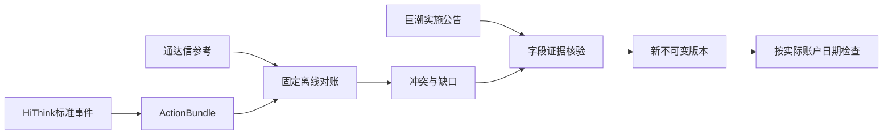

# 公司行动与实施证据

本组件维护 `ActionBundle`、执行索引、固定离线对账和证据修订，负责事件身份、历史覆盖、字段出处及不可变发布前校验。采集由父级固定 HiThink／通达信适配器完成，公告独立使用巨潮。

## 公共接口与数据流

- `ActionBundle::read/write`校验格式5／6、证券与事件身份及来源；格式6金额为十进制文本。废弃来源、混合来源证据、哈希不符或未审核生产者不得使用。
- `reconcile::apply`读取哈希验证的 HiThink标准事件与通达信参考，通过内置 Python固定规则精确比较每股条款、去重和记录冲突。无旧表字段兼容或网页补采。
- `review::verified_documents/apply`读取独立巨潮实施公告，对照原事件哈希、证券身份、字段引用和文档哈希，发布修订副本；普通问题只能用匹配字段证据关闭。
- `execution_index::ExecutionIndex`按账户实际依赖检查登记、除权、支付和上市日期。通用独立系数跳变诊断保留；供应商前复权不产生独立系数。



## 缺失与兼容边界

缺失公告、登记、支付、上市日期保持null；不从价格或复权系数猜日期。配股等未支持事件遵循已有警告／跳过规则，普通事件缺必要字段继续报告缺口。历史补采任务、网页证据和旧来源产物不恢复、不迁移、不删除；重新采集或通过巨潮证据修订。

服务协议19、采集协议12、来源策略2；公司行动格式6、行情格式6，受支持通达信格式5和Qlib读取保留。来源拒绝规则集中在core，执行前以及注册、读取、对账和修订均验证。

## 命令与验收

```bash
jfquant data actions --market MARKET_VERSION --pool builtin:csi500
jfquant jobs wait TASK_UUID
jfquant data revise-actions --actions ACTION_VERSION --request REVISION_JSON
jfquant jobs wait TASK_UUID
DUCKDB_DOWNLOAD_LIB=1 cargo test -p analytics-storage corporate_actions
DUCKDB_DOWNLOAD_LIB=1 cargo test -p analytics-workflow
```

对账命令和公告采集参数见[采集组件](../../collectors/README.md)。fixture覆盖当前事件单位、null、重复、来源冲突、废弃来源与混合证据拒绝、公告字段修订和哈希篡改。HiThink账户权限、真实覆盖和稳定性须联网验证；离线通过不代表研究就绪。
