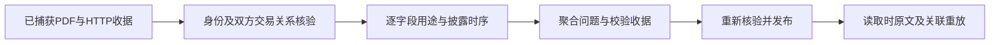

# 跨证券修订核验

负责修订4的参与方关系、逐字段证据检查和不可变收据重放，不计算因子或改变账户策略。公共接口为 `Participants`、`Participant`、`Diagnostic` 和 `review::validate_proposal`；现有 `review::apply` 在发布前使用同一检查，`ActionBundle::read` 再核验捕获原文及关联。



修订4在每个 EventRevision 增加可选 participants：event_id 必须匹配 replacement；predecessor 与 successor 各含 instrument、name、identity；identity 是 document_id/quote/unit，引用本方公告中带名称及六位代码的原文。relationship 为一个或多个相同引用结构，每条明确双方及换股吸收合并或迁码关系。关系只能来自经哈希和HTTP收据验证的原文，不能从拟发布事件或其他拟关联推导。

```json
{
  "event_id": "SH600000:2024-01-05",
  "predecessor": {
    "instrument": "SH600000", "name": "原公司",
    "identity": {"document_id": "old", "quote": "600000 原公司", "unit": "issuer_identity"}
  },
  "successor": {
    "instrument": "SZ000001", "name": "后继公司",
    "identity": {"document_id": "new", "quote": "000001 后继公司", "unit": "issuer_identity"}
  },
  "relationship": [{"document_id": "old", "quote": "后继公司换股吸收合并原公司", "unit": "merger_relationship"}]
}
```

后继公告可证明权益登记/转换生效、股份可交易、后继代码身份绑定和交收估值等字段；比例、普通股东对价等决策事实仍需原证券披露且满足登记前时序。条款、身份和完整历史覆盖独立核验。实际股份登记生效不得由公告日或上市首日推断。Terminal 价格参考仅适用于终止原证券的合并或退市，明确不提供后续交易所参考价；不得用于迁码或普通除权，也不拼接因子历史。RankedRemainder 记录全体股东尾数排序事实，单账户模拟舍零归属 ResearchTransitions。

`validate_proposal` 不写文件；返回稳定字段要求ID和 missing_fact/unlinked_evidence/invalid_evidence/waiting_identity 等问题。覆盖未知不会被报告成一组已确定缺失的交收字段。文件认证失败直接拒绝，不读取不可信的候选。完整发布预览仍执行 apply，以校验原问题解决及整包一致性。

命令：`DUCKDB_DOWNLOAD_LIB=1 cargo test -p analytics-storage corporate_actions`；工作区验收：`DUCKDB_DOWNLOAD_LIB=1 cargo nextest run --workspace`、Clippy 和 Rustdoc。测试包含多份跨证券原文、无关联引用、晚披露、独立错误汇总、篡改重放、合并与取消。

性能：每次 ActionBundle 加载按审核收据缓存已认证 JSON，各类别仍逐项核对声明；原始查询/文档重放按证券与区间去重。修订4收据重放每个发布主体的 HTTP 文件仅核验一次，逐字段引用仍独立验证。缓存只存活于本次加载，不跨版本跳过核验。

后继证券补采可通过修订4的 `structured_manifest` 引用已注册、完整核验的 HiThink 公司行动包；允许空 events/coverage_reviews 的纯附件修订。仅接受已有已发布事件指向、原包未查询过的后继证券，拒绝覆盖旧证券、无关证券、采集失败和未解决冲突；原文按哈希继承并在后续读取核验。可先用 `draft --request ... --task ...` 预览，再用原有 revise-actions 发布，不修改原任务和原模型。
