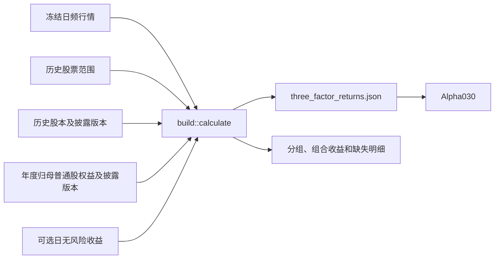

# 日频三因子读取与自算

BigQuant全市场MKT另由 `bigquant::market` 构造，输出同一格式1侧录文件，
未减RF，SMB/HML未就绪时保持null。其方法版本、停牌估值、格式3证据和发布命令见
[BigQuant组件](../bigquant/README.md#全市场-mkt-构造与发布)。

本组件读取供应商日频 MKT/SMB/HML，或使用选定行情和带日期的历史股本、年度净资产
自行构造三因子。计算不联网、不修改行情，也不把声明的股票范围认证为全市场覆盖。



## 公开接口

- `three_factor::{ThreeFactorReturns,Observation,path,FIELDS}`：格式1文件，三列顺序
  固定为 `mkt/smb/hml`，单位为小数；null/缺日不填充、不缩放。
- `build::{BuildRequest,Shares,BookEquity,RiskFree,MarketBasis}`：显式历史事实输入。
- `build::{calculate,BuildReport,Formation,DayReport}`：确定性计算和逐年/逐日诊断。
- `build::{VERSION,PORTFOLIOS,implementation_signature}`：构造版本、组合顺序和实现身份。
- `DailyDataset::three_factor_path()`：普通快照或行情补录视图上的实际三因子文件。

## 固定构造规则

独立版本为 `jfquant-cn-ff3-june-2x3-v2`，将
[Fama–French 六组合思路](https://mba.tuck.dartmouth.edu/pages/faculty/ken.french/Data_Library/six_portfolios.html)
应用于声明的A股历史范围，不声称逐值复现供应商或国泰君安内部数据。

1. 六月最后一个交易日分组，七月开始使用至次年六月。需要日历和历史范围覆盖上一年
   十二月及本年六月。不够时记录原因，保持对应SMB/HML为空。
2. 六月和上一年十二月末都在范围内的证券才参与分组。年度账面权益为上一年12月31日
   的**归母普通股权益、人民币元**；使用分组日之前披露的最新版本。同日披露因只有
   日期精度而保守地不用于当日分组。非正权益是有效排除信息，null权益是未知信息。
3. B/M为年度权益除以上一年十二月末市值；市值是**未复权收盘价×总股数**，只使用
   已生效且在市值日期之前披露的股本版本。null股本不回退到旧的非空值。股份类别和
   双重上市的总股数处理须在来源说明中记录。
4. 合格正权益证券的六月市值中位数区分S/B；同一范围的B/M的30%、70%分位数区分
   L/N/H。分位数采用R7线性插值；size≤中位数归S，B/M≤30%归L，
   30%<B/M≤70%归N，其余归H。并列值造成空组合时保留null。
5. 不在上一年十二月范围的新股、明确非正权益的证券排除并列明原因。其余应有的年度
   权益或十二月/六月市值缺失，会阻止该年度SMB/HML分组，避免残缺样本改变分位点。
   MKT独立计算，不要求股票具有正账面权益。
6. 日收益为选定行情的相邻市场交易日**复权收盘价简单收益**，使用**前一交易日原价
   市值权重**。组合使用两个端点都在历史范围内的成员；年度分组不随每日B/M改变。
   新股有两个端点后参与MKT，离开声明范围的股票退出组合。
7. 成员缺前日市值或当日收益时，整个受影响组合为null，不删掉成员重新加权。空组合
   为null；不把缺失停牌价格填0，不编造退市清算收益。
8. 固定组合顺序 `SL/SN/SH/BL/BN/BH`：
   `SMB=(SL+SN+SH)/3-(BL+BN+BH)/3`；`HML=(SH+BH)/2-(SL+BL)/2`。
   中性组合缺失影响SMB，不影响输入齐备的HML。
9. `market_basis=market_return` 输出市场收益；`excess_return` 再减输入的**日**无风险
   收益。缺RF只使相应MKT为null。Alpha030个股端不会自动减RF。

`price_basis=provider` 显式使用供应商复权序列；`verified` 要求独立系数和可验证来源，
不接受普通Qlib或供应商前复权报价冒充独立系数。

## 输入格式2

正常入口只接受格式2。`provider_history`必须显式填写：手工披露版本为null，供应商
采集为完整History对象；缺字段和格式1均拒绝。旧文件只做本地离线迁移，运行时不补字段。

以下仅说明结构，**不是生产数据**；完整输入需逐证券提供历史记录。单股票无法形成
六个非空组合。股份单位为**股**，权益为**元**，收益为**小数**。

```json
{
  "schema_version": 2,
  "construction_version": "jfquant-cn-ff3-june-2x3-v2",
  "sources": {
    "universe":"填写历史证券目录及版本",
    "shares":"填写历史股本来源、版本及原始凭据",
    "book_equity":"填写年报权益来源、披露版本及原始凭据"
  },
  "market":"填写实际市场和股份范围",
  "range":{"start":"2023-07-03","end":"2024-06-28"},
  "price_basis":"provider",
  "market_basis":"market_return",
  "universe": {
    "coverage":{"start":"2022-12-30","end":"2024-06-28"},
    "intervals":{"SH600000":[{"start":"2022-12-30","end":"2024-06-28"}]}
  },
  "shares":[{"instrument":"SH600000","effective_date":"2022-01-01",
    "published_on":"2022-01-01","total_shares":1000000000}],
  "book_equity":[{"instrument":"SH600000","period_end":"2022-12-31",
    "published_on":"2023-04-28","book_equity_cny":10000000000}],
  "risk_free":[],
  "provider_history":null
}
```

修订保留为额外记录，`published_on` 必须是**这版数值**的实际披露日，不能沿用原报告
的日期。重复证券/生效日/披露日股本键、重复证券/报告期/披露日权益键、非有限数字、
非正股数、非12月31日年报期、报告期尚未结束的披露日期及未知构造版本均拒绝。
`excess_return` 另需 `sources.rf` 和
`risk_free:[{"trade_date":"2023-07-03","value":0.00004}]`，不能直接填年利率。
`market_return` 不接受未使用的RF数组，避免无声忽略口径。

## 实际数据边界

现支持通达信逐日股本和年报权益的原生采集、规范化与计算衔接，见
[采集组件](acquire/README.md)。全市场历史目录及原始财报修订版本仍未认证。
HiThink股东权益合计不能直接冒充归母普通股权益；最新
估值不能回填历史。输入声明和哈希保证可复现，不自动证明原始事实或全市场目录完整。
已退市证券不能用今天的股票名单替代。

## 构建与验收

```sh
export DUCKDB_DOWNLOAD_LIB=1
cargo build -p analytics-cli --bin jfquant
target/debug/jfquant --workspace "$JFQUANT_WORKSPACE" data three-factors \
  --market "$JFQUANT_MARKET_VERSION" --inputs /absolute/path/to/historical-facts.json
target/debug/jfquant --workspace "$JFQUANT_WORKSPACE" jobs wait TASK_UUID --timeout 60
cargo test -p analytics-storage three_factor --lib
cargo test -p analytics-workflow three_factor_build --lib
cargo test -p analytics-cli --test platform three_factor
```

发布规则和产物见[workflow说明](../../../workflow/README.md#日频三因子自算)。输入文件、
生成的三因子和行情副本留在工作区，不提交仓库。测试使用12只手算股票的六组合收益
分数，覆盖权重滞后、未来修订、缺失传播、日RF和年度切换，明确标注为合成样例。
