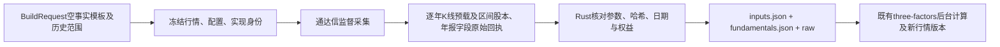

# 三因子原始事实采集与规范化

`acquire.rs`负责核对通达信原生回执并生成逐日股本、年度归母普通股权益候选；
`collector::collect_fundamentals`负责子进程、超时、取消、分证券检查点及完整发布。
规范化版本为`tdx-native-capital-common-equity-v1`，构造版本为
`jfquant-cn-ff3-june-2x3-v2`，服务协议43、采集协议16。



## 公开接口与格式

- `collector::{collect_fundamentals,implementation_identity}`：固定通达信来源，无自动备用；
  当前仅支持显式交易所股票代码，不接受指数、当前成分查询或不透明来源映射。
- `acquire::{Availability,History,Captured,ShareAtClose,Annual,Issue}`：BuildRequest格式2的
  `provider_history`字段必须显式填写null或完整对象，与手工`shares/book_equity`互斥。映射键必须完整匹配历史
  股票范围。逐日股本严格递增且精确匹配市值日期，不跨缺日沿用；年度报告保留披露键，
  后续null版本遮蔽旧值。
- `acquire::verify_bundle`：重验`fundamentals.json`及raw哈希，并从原生字节重放规范化。
  工作流提交及执行都校验；最终行情的`three_factor_build/`保存可再次使用的完整输入包。

`fundamentals.json`格式1保留请求、规范化版本、逐证券观察日期/候选/问题、raw哈希及
采集器身份。`provider_history`保存该文件SHA256、规范化版本、availability及逐证券候选。
采集成功只表示所有请求分片已保存；空结果、缺失年报、缺日和冲突不等于输入齐全。
构造版本v2明确加入供应商快照与时间假设分支；旧v1输入须由使用者显式核对并更新版本。

## 数值规则与边界

1. 采集`GetProDataInStr`的FN004/FN238/FN271/FN428/FN429及announce_time/tag_time，
   按公告日期查询，仅规范化12月31日年报；字段数组须等长，报告期与公告键不可重复。
   公告日必须晚于报告期且处于查询范围。保留SDK填充、pandas转换之前的原生响应。
2. 在固定SDK1.2.2/当前原生库的实测中，FN238为**股**、FN271为**元**；
   [通达信字段表](https://help.tdx.com.cn/quant/docs/markdown/TdxQuant.md/mindoc-1h10m001ic888.html)
   明确FN428/FN429为**万元**。候选权益=`FN271-(FN428+FN429)*10000`。
   须同时与`FN004*FN238`相容，容差为`0.0051*FN238+abs(FN271)*2e-7`，分别覆盖
   每股净资产两位小数与大额原生浮点表示的精度。该核对不证明会计数据独立正确。
3. 不用四舍五入的每股净资产乘积替代精确权益；任何所需字段缺失、优先/永续权益未知，
   或候选与每股净资产冲突时，年度权益为null并列问题。浦发银行2023年报实测的
   FN428/FN429为0，但与普通股每股净资产不相容，因此不会误用归母权益。
   [公司年报](https://news.spdb.com.cn/investor_relation/periodic_report/202404/P020240429645975590245.pdf)
   也明确普通股权益需扣除其他权益工具。此检查不代表所有发行人的权益类别已完备。
4. 股本采用`get_gb_info_by_date`的`Date/Zgb`，原生Zgb以股保存。逐年先加载对应日K线，
   再读取区间股本。指定日期列表模式实测首项Date=0，字符串日期还会全部错配，故不使用。
   Date=0、越界日期、重复/倒序、错误证券、回执参数或哈希不符均拒绝；不把错误日期
   映射到请求位置。null/空串/`--`保留null，股本0记缺失，负股本及非法数字拒绝。
5. 原生数据会保留其数值精度，不把近似大股数修正为猜测整数。没有历史版本序列时，
   `announce_time`不能证明本次数值在原公告当天已经存在。

## 时间口径

| availability | 使用规则 | 历史结果含义 |
|---|---|---|
| `observed_on`，默认 | 年报在实际采集日之后可用；股本仍须精确匹配日期 | 历史日频股本不可倒填，因此此次历史MKT/SMB/HML保持缺失 |
| `provider_dates`，显式选择 | 年报按供应商公告日，股本按供应商历史收盘日使用 | 可用于供应商历史口径研究；财报可能含后续修订，不能声称无前视偏差 |

这两种口径进入输入哈希及结果manifest。手工已验证实际披露版本继续使用原有
`shares/book_equity`分支。无风险收益不自动采集，`excess_return`仍需显式每日RF。
股票范围、退市覆盖、停牌和缺报价遵循已有构造器规则，不从当前名单推断历史全市场。

## 可复现命令

将[BuildRequest示例](../README.md#输入格式2)的`shares/book_equity`设为空数组，
填写真实历史范围和来源；保留RF与价格口径。系统从首个六月分组对应的上一年12月1日
开始采集至输出末日，行情本身仍须覆盖该历史及六月末。

```sh
export DUCKDB_DOWNLOAD_LIB=1
bash crates/app/packaging/build-collector.sh
cargo build -p analytics-cli --bin jfquant
target/debug/jfquant --workspace "$JFQUANT_WORKSPACE" data three-factor-inputs \
  --market "$JFQUANT_MARKET_VERSION" --inputs /absolute/path/template.json \
  --availability provider-dates
target/debug/jfquant --workspace "$JFQUANT_WORKSPACE" jobs wait CAPTURE_TASK --timeout 60
# 使用上述结果details.artifact；保留同目录fundamentals.json及raw/。
target/debug/jfquant --workspace "$JFQUANT_WORKSPACE" data three-factors \
  --market "$JFQUANT_MARKET_VERSION" --inputs /absolute/path/captured/inputs.json
target/debug/jfquant --workspace "$JFQUANT_WORKSPACE" jobs wait BUILD_TASK --timeout 60
```

省略CLI的`--availability`时，CLI显式生成observed-on；序列化请求必须包含availability，
服务不补缺失字段。中断后可用同参数加`--resume CAPTURE_TASK`，
模板、市场、口径、源码与依赖身份必须一致；取消/失败不会发布输入包。
App“自算市场三因子”也提供采集按钮和明确的历史日期选项，同一worker执行。

验收：`cargo test -p analytics-storage three_factor --lib`，
`cargo test -p analytics-workflow three_factor --lib`，
`cargo test -p analytics-cli --test platform three_factor`。
独立手工fixture覆盖股/万元转换、优先/永续资本、修订及缺失传播、日期/参数/哈希损坏。
生成数据、原始回执和临时产物保留在工作区或忽略的target目录，不提交Git。
