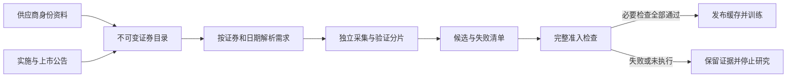

# 研究数据与账户执行的设计决定

状态说明：下列早期身份目录决定已被文末2026-10-14“移除独立身份管理”决定取代；保留理由用于解释演进，当前接口不包含身份目录、审核或自动转换。

决定日期：2026-10-14。依据：用户接受的《证券身份、独立补采与完整研究准入》计划、现有源文件和公开实施公告。历史原因无法查证时记为待核实，不反推作者意图。

| 决定 | Why：问题、依据及取舍 | 重新评估条件 |
|---|---|---|
| 证券身份与代码分离 | 上港集箱与上港集团先后使用600018；本地旧成员名为SHT00018，新行情从2006-10-26开始。单纯改名会把不同证券混为一条历史。独立身份增加登记工作，但保全价格和权益含义。 | 新资产类别、证券发行批次或身份依据变化 |
| 多份证据关联 | 官方实施公告不一定包含供应商内部代码。供应商身份证明与实施／上市公告承担不同证明责任，分别哈希并保留字段出处。 | 供应商编码规则、公告修订或证据冲突 |
| 独立补采与完整准入分开 | 单证券失败不应浪费其他证券已验证成果；部分成果又不足以支持完整收益。保存候选和检查点，最终门禁仍要求所有必要依赖通过。 | 有新的完整来源或研究依赖范围变化 |
| 未知不是空池 | 2005-04-08之前的成员覆盖未知，不能用当前成分或空集合解释。因子传播null；覆盖内已知成员缺行情是另一个需要处理的错误。 | 获得经过验证的更早成员历史 |
| 事件按类别证明覆盖 | 分红接口没有声称覆盖所有配股、合并、重整、退市等事项。查询成功与完整性分开记录，未解释事件和未执行检查阻断训练。 | 公告检索覆盖、事件分类或结算证据完善 |
| 当前格式及签名升级 | 身份、类别覆盖和证据链改变了研究输入意义，旧缓存不能共享同一个来源签名。旧文件保留供状态／日志查看，不自动解释为新口径收益。 | 任何影响输入意义、账户权益或公开协议的变化 |

上港换股依据：[公司上市公告](https://money.finance.sina.com.cn/corp/view/vCB_AllBulletinDetail.php?id=178143&stockid=600018)。别名依据：[新浪上港集箱T00018页面](https://finance.sina.com.cn/realstock/company/shT00018/nc.shtml)。T的字面展开不作为身份裁定依据。

## 三级研究策略与保守账户预检

决定日期：2026-10-14。依据：用户接受的三级研究模式计划，以及对“缺项”与“错误”含义的确认。

允许缺失模式保留原成员及空值，合格股票模式明确派生不同的每日股票池。二者不通过改写检查结果来放行，不自动切换模式，也不自动删除所选因子。默认有效比例0/最低有标签样本1是执行下限；实际研究应另外检查样本覆盖与代表性。

因子截面先确定，样本掩码后计算；计算后的筛选不倒过来重算截面，避免循环定义。资格仅使用截至对应日期的依赖；后来缺价不能改变早期成员。公司行动来源失败如果缺少结构化类型，当前保守视为未裁定，不从错误文本推断是否可排除。

账户准入对每只可能买入的证券保守检查后续估值和结算。这可能阻止实际上不会买到该证券的策略，但可以在调用训练器之前阻断无法证明的账户收益；仅剔除未来候选无法证明旧持仓已经退出。获得足以严格证明无持仓的执行预览或更完整的事件证据时再评估，不能用未来缺项倒删历史候选。

新策略和掩码改变研究来源，模板5、准入2、协议7、结果9明确拒绝旧格式；原始文件及历史状态/日志继续保留。其他输入格式本次未改变。

本轮自查补充：多代码绑定必须逐有效日期处理文件缺失，否则后续代码的文件缺失会错误清空早期历史，违反日期筛选原则。使用工作线程内的研究日期范围选择绑定，NotFound仅影响对应区间；解析损坏仍不放行。实际持仓还要求已知成交量或有证据的非交易权益，不能把未知成交量自动解释为停牌。

## 2026-10-14：移除独立身份管理，训练和账户分开

依据：用户接受《删除身份管理，简化检查，分离训练与回测》计划，以及真实非严格尝试中逐日重复构建FactorRegistry导致数分钟扫描、仅合格模式因所有类别覆盖不足变为空池。

决定：删除身份目录、审核与权威主数据采集，普通代码直接读文件。代码复用等例外保存于数据快照，不反向修改原成员；承继依据由公司行动负责，避免再建第二套审核。来源映射签名仍冻结，不能混接旧、新发行。

训练只检查价量口径、标签边界和样本。支付／交付日期不影响历史因子输入，因此不能阻止训练；复权跳变无可解释依据则仍阻止。回测遇到未持有股票缺执行资料时拒绝买入；已有持仓或待结算权益无法估值则停止并保存模型，不伪造完整收益。

Qlib参考：官方exchange.py将受限制订单的成交量置零，account.py对停牌持仓不更新价格。采用订单未成交继续处理其他订单的行为，仍保持本项目不复权整数股账本，不引入复权撮合或缺开盘价回退收盘价。来源：https://github.com/microsoft/qlib/blob/main/qlib/backtest/exchange.py 和 https://github.com/microsoft/qlib/blob/main/qlib/backtest/account.py 。

取舍：训练可以完成而回测未完成；候选资料不足可减少实际交易，必须展示拒单和无有效交易状态。快照内映射仅用于例外，不能发展为必须逐只登记的系统。重新评估条件为新的代码复用、无法解释的行情串接、批量检查性能回退或账户权益误算。

## 2026-10-14：来源信任、样本质量及配置正交

依据：用户接受《数据来源与检查机制优化，新增Alpha158组合》，并补充要求“workflow模板，因子和标的进行分离保存”。此前逐只Qlib归一化factor变化被历史事件核验拦截，不能直接推断为AKShare数据损坏。

决定：默认verified核验历史依据，显式provider仅接受登记的Qlib声明价量，并保留未对账事实和告警。样本缺失仍独立采用三档策略；来源损坏/冲突不能变null。训练与真实原价整数股账户分开，供应商训练不证明结算完整。旧Qlib factor恢复原价，新新浪F/F0生成研究输入，禁止互换。

Alpha158固定Qlib提交b87a2c294d364a33fb739359886acffe8ec907d1，单独算子和公式版本，保留GTJA191 v4。参考测试是独立NumPy/Pandas实现，不冒称直接Qlib执行；需要第三方执行差异审计时重新评估。

磁盘工作流升级8，因子profile1与标的profile1分别引用。日期/训练/账户参数不为每个因子×标的组合复制；运行解析成完整请求冻结，历史记录不跟随编辑。相对引用和内容签名文件实现可移植及共享，导出需携带相邻目录，单文件分发便利性作此取舍。此决定替代本文件先前“所有未来账户依赖在训练前保守预检”的设计说明。来源口径、新事件类别、不同组合输入单位或profile分发需求变化时重新评估。

## 2026-10-14：供应商结构化执行资料与全类别证明分开

真实两套回测全部拒单：旧事件版本只有SH600018，且九类覆盖证明为空。默认采用完整结构化来源，未知特殊类别覆盖作为明确告警；已发现事件缺项或冲突继续阻断实际账户。它不是完整全事件覆盖保证，用户仍可选Audited。Tushare dividend文档提供结算字段，但真实账户端点权限及历史空值必须实测；anns_d权限独立。取消每笔全包扫描，建立任务内执行索引。来源身份/请求取全不等价于事件完整，支付日期也不能替代复权依据。重新评估条件：供应商覆盖边界、特殊候选及字段实测变化。证据：https://tushare.pro/document/2?doc_id=103、214、183、28、176。

## 2026-10-15：普通分红默认巨潮，来源核验留在后台

用户要求优先可靠巨潮并减少复杂配置。本项目实测巨潮提供常规派息日期，原新浪表缺该字段；采用巨潮主记录、新浪匹配补上市日及独立系数，界面不增加来源编排层。原始HTTP、金额单位、转换及日期来源仍留证，特殊事件未知是告警，已发现冲突/持仓权益缺项仍阻断。Qlib恢复字段日常微动不能当独立公司行动系数；执行证据与训练价量分别冻结，避免无谓重训。重评条件：上游字段语义/覆盖变化、出现不能由当前普通事件规则解释的实例。来源：[AKShare历史分红文档](https://akshare.akfamily.xyz/data/stock/stock.html)。

## 2026-10-15：全用途通达信优先，来源策略独立保存

问题：训练行情补采反复受网络和账户结算缺项影响；单一“检查更新”只覆盖Qlib发布包，不能表达不同来源能力。

决定：所有用途默认通达信→AKShare→Tushare；显式指定来源时禁止换源。策略独立于因子、标的及工作流文件，并冻结到任务。行情与复权成对更换整个证券历史，账户事件按匹配记录选更完整来源，冲突保留。增量逐证券查内部缺口和最后5交易日，稀疏系数/事件重新查所需历史，修改生成新版本与差异。

Why：优先可信且稳定的数据路径可以减少研究前置成本；但优先级不能创造接口缺失字段，更不能把当前状态回填历史。分开来源信任、样本完整性和实际账户执行，可让模型训练与结算补采独立推进。

依据：用户本轮“全部数据通达信优先”选择、TdxAiData1.2.2官方接口及锁定包源码、组件离线测试。当前实际账户覆盖须以独立小样本联网报告为准；SDK安装和通过fixture不足以证明历史完整或长期稳定。重新评估条件：接口单位、原生系数方向、来源覆盖、权限或SDK发行变化。此决定不授权全量联网下载，先提交不超过10只证券的三轮用量报告。

## 2026-10-15：本机私有文件取代系统钥匙串

实际问题：用户完成系统授权后，后台仍因CLI重编译/授权作用范围无法读取，重复授权阻碍数据获取。用户明确要求停止钥匙串方案并参照CC Switch。

决定：每个已知供应商一个私有JSON凭据文件，保存于用户级目录，目录0700/文件0600、原子替换、读取拒绝宽权限和链接。App与CLI共用，不随程序签名变化，不写任务或工作区，不自动备份。不增加SQLite数据库或伪加密，明确文件为明文、由OS文件权限保护。删除钥匙串调用及授权命令，不保留自动回退；旧项不删除。

依据：CC Switch本地供应商配置及私有原子写实现、用户本轮明确选择。重新评估条件：多人共享、远程执行或更高密钥隔离要求。

## 2026-10-15：真实研究重新采集，不再使用Qlib快照兜底

依据：用户明确要求“Qlib快照不要再用了”。本轮真实沪深300研究及退市证券补采都遵循此选择；历史快照留在磁盘，不再作为本轮训练、原价恢复或缺口补足来源。保留已有读取器和合成对照能力，不推定用户要求删除这些代码。

Why：研究需要明确知道每份行情从哪里取得、采用何种单位和复权规则。旧快照的恢复依赖会增加当前采集链路的不确定性。所有用途继续通达信优先；缺失字段或历史才显式补采其他来源，不要求另一供应商为完整通达信行情背书。

通达信内部`ForwardFactor`按共同观察日消除请求锚点差异，并核对本来源事件参考；不再要求比例调整结果等于供应商可能采用加法调整的`front`报价。单位、正有限值、同源区间一致性和已发现的真实冲突仍检查。普通配股参考可说明历史训练价量，不自动生成账户认购和交付日期。

实测SH600068在通达信和东方财富返回空历史，新浪固定原始日线接口仍返回1997—2021年旧证券数据。AKShare适配仅在东方财富股票原价为空或连接/超时失败时整段切换到新浪，保留HTTP正文及固定解码器版本；不拼接字段或日期、不前向填充、不执行网络JavaScript。该路径解决行情缺口，不证明吸收合并权益已完整。

公告补采独立于模型和股票池准备，`CollectAnnouncements`可按证券、日期获取巨潮实施证据。候选解析v3处理空格日期和严格对齐的换行表头，修订仍核对原值哈希和字段引用，生成不可变版本。三条红股上市日已据实施公告补齐；其他证券未审查项目不自动判定通过。新增任务升级服务协议13；采集协议9及研究结果13保持不变。

重新评估条件：用户另选数据源、上游编码/单位/复权规则改变、退市历史撤回，或出现当前事件参考无法解释的实例。真实验证结果、行情与证据保存在忽略的工作区，不提交Git。
