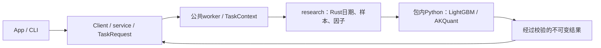
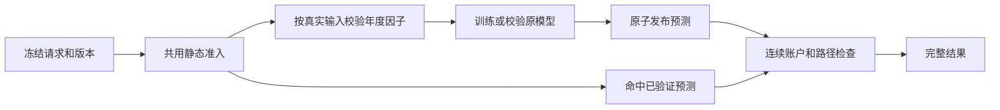
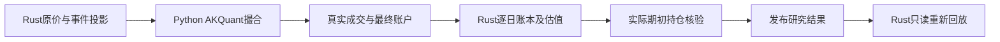

当前采集体系：HiThink（Rust REST主源）、通达信（Python SDK备用）、独立巨潮公告。服务协议21、采集协议13、来源策略2；接口、价格口径、构建和验收见[采集组件](../storage/collectors/README.md)。

# analytics-workflow

本组件拥有工作区、不可变数据登记、独立因子／标的／工作流配置、Unix socket服务、
任务记录、研究编排和Python研究进程监督。App与CLI交换普通数据，后端句柄不进入UI。



公共入口：`Workspace`、`WorkflowRequest`、`service::TaskRequest`、`service::Client`、
`ResearchTemplate`；研究入口集中在 `research::pipeline` 与 `research::backtest`。
Python协议及支持边界见 [research/README.md](research/README.md)，Rust目录见
[src/research/README.md](src/research/README.md)。不再依赖或维护独立analytics-ml。

## 协议与产物

服务19；工作流10（仍分别引用factors与targets）；模型manifest2；训练描述3；结果16。
行情、公司行动、采集和原始证据格式保持原版本。旧输入明确拒绝，不自动转换，
原文件、运行状态与日志保留。独立配置解析后冻结到任务，运行中不跟随文件编辑。

`research::backtest::run_with_context`按既有日期切分与样本规则计算Rust因子，各折调用
同一Python进程训练预测，再将全部样本外信号一次交给AKQuant，跨折跨年不重置账户。
训练产物可独立读取及复用；模型和描述文件的哈希、公式、顺序与运行时签名均核验。

同一工作区同时一个计算任务，无隐式排队。关闭客户端不取消任务；取消协作退出，
两秒后终止研究进程组；进程崩溃不发布完整结果。日志不携带供应商凭据。

## 缓存和错误

年度因子缓存位于运行目录父级的`.factor-shards-v1/签名`，以实际行情、股票池、
预热和横截面、价格口径、公式与特征顺序隔离。任务保留自己的已验收副本；标签单独重建。
模型签名增加训练参数、日期、训练／验证掩码及依赖；回测签名增加账户、执行行情、
预测来源、事件和引擎口径。因子null保留为缺失值，不自动填零或删列。

普通事件未决问题、无法映射的费用参数或实际持仓无法估值停止回测，保留已完成
模型。`execution_readiness.json`记录停止原因；无有效交易与完成回测分开显示。

## 构建与验收

```bash
crates/app/packaging/build-collector.sh
DUCKDB_DOWNLOAD_LIB=1 cargo check -p analytics-workflow --all-targets
DUCKDB_DOWNLOAD_LIB=1 cargo nextest run -p analytics-workflow
DUCKDB_DOWNLOAD_LIB=1 RUSTDOCFLAGS="-D warnings" cargo doc -p analytics-workflow --no-deps
```

开发时`JFQUANT_COLLECTOR_RUNTIME`可指定包内解释器，生产构建只从App包解析。
底层DuckDB测试二进制独立启动时需要`DYLD_LIBRARY_PATH="$PWD/target/debug/deps"`。
生成数据、缓存、模型和临时输出不提交。设计取舍沿革见[DECISIONS.md](DECISIONS.md)。

复用模型回测支持独立账户覆盖 `ResearchExecution`：资金、费用、持仓数、调仓周期及退池策略。
App提交当前账户设置；CLI可用 `research backtest --training <ID> --actions <ID> --template <PATH>`。
只提取模板的账户字段；原模型特征、训练日期和参数仍由训练产物冻结。

## 研究准入与阶段缓存修复（服务协议18，结果格式16）

完整研究和已有模型回测共用 `backtest/execution.rs` 的静态检查，计算前汇总来源失败、未查询、结构化覆盖不足、不支持条款、行情结构和交易参数问题。执行证券取测试期历史成员；资料从测试期首次入池检查至结束，覆盖出池未卖持仓。基准仅检查行情。训练入口不要求账户数据；普通分红/送转按 AKQuant 除权日条款核验，无需旧账本到账/上市日。真实持仓缺价仍在运行时阻断。

`AdmissionCheck.stage` 区分训练、静态执行和账户运行。预检失败写 `execution_readiness.json`，完整检查在 `admission.json`。`stages.json` 表示各阶段是否完整；`prediction_manifest.json` 只在预测产物校验通过后发布。折报告在账户未执行时 `performance=null`；只有完整账户写 `summary.json`（格式15）。`execution_diagnostics` 提供有效信号、成交回报、拒单回报及原因；当前适配器无法取得完整提交订单数，因此 `submitted_orders=null`，不把成交回报数当作订单数。历史格式仍可读取任务状态/日志，不重新解释为新结果。



共享因子在 `.jfquant/runs/.factor-shards-v1/` 保存 Parquet、哈希和清单。签名包含实际 executor panel、预热和横截面、复权锚点、公式版本、特征顺序及价格口径。null 保留为 Parquet null；任务内矩阵保持现有 f32 缓冲。标签随任务当前行情重建，切分边界照常排除越界标签；任务参数不导致重复执行相同因子。分片按年整体更新，不做分片内增量。旧 `.factor-cache` 不自动升级。

预测在 `.jfquant/runs/.predictions-v1/` 原子发布，以模型/manifest哈希、完整行情内容哈希、因子输入签名、分折、样本策略和研究运行时定位；修改费用、持仓数量或普通事件不改变预测键。缓存命中验证所有文件和样本掩码哈希后直接执行账户，不重复因子/预测。旧CSV预测不导入新缓存。取消或崩溃留下的 `.partial` 无完成清单，不参与复用。

```sh
DUCKDB_DOWNLOAD_LIB=1 cargo test -p analytics-workflow --lib
cargo run -p analytics-cli -- --workspace /absolute/workspace research backtest \
  --training TRAINING_TASK_ID --actions ACTION_VERSION
```

原模型复用仍校验训练描述、模型与manifest哈希以及已验证价格口径的事件签名；改变训练价格或样本时应新建训练。每次补采创建新数据版本，未完成覆盖不以删股或伪造空事件解除。

## 公司行动核对与警告执行（服务16、结果16）

公共任务 `ReconcileActions { actions, evidence_tasks, market }` 冻结基础版本、可重复指定的
终态证据任务和可选行情日历。执行前复核输入哈希，暂存完成后原子移动并注册新公司行动版本。
App的公司行动核对入口与CLI调用同一任务；详细问题位于公司行动版本及核对回执，readiness仅
内联阻断摘要和证据引用，完整准入/质量/问题分别保存在引用文件。

```bash
DUCKDB_DOWNLOAD_LIB=1 cargo build -p analytics-cli
./target/debug/jfquant --workspace "$PWD" data reconcile-actions \
  --actions ACTION_VERSION --evidence-task EVIDENCE_TASK_UUID --market MARKET_VERSION
./target/debug/jfquant --workspace "$PWD" jobs wait TASK_UUID --timeout 60
./target/debug/jfquant --workspace "$PWD" research backtest \
  --training TRAINING_TASK_UUID --actions NEW_ACTION_VERSION
```

已识别特殊事件固定 `unsupported_event_policy=warn_and_skip`：预检与实际执行共用判定，跳过
引擎投影，不补偿、不自动卖出、不剔除成员或样本。普通事件冲突、必要除权日及历史覆盖缺口仍阻断。
普通同日事件现金先于送转，以原股数派息。完成结果记录 `event_simulation_complete`、未模拟事件
数量/证券/日期或不确定区间/证据，以及此前持仓快照可判断的 `held_across_event`（未知为null）。
报告/App显示“回测完成，含未模拟事件”；CLI返回相同结构。收益按披露的简化口径解释。

只改事件/警告策略使账户结果失效；原训练口径未变时模型、因子及匹配的预测继续复用。
研究worker、依赖锁、模型manifest2、训练描述3和模板10保持。验收：
`DUCKDB_DOWNLOAD_LIB=1 cargo test -p analytics-workflow --lib`，另运行research/tests的Python验收。

已核实的纯现金差异化分红可直接投影普通股实际现金：交易所参考金额保存在`Reference`，
不复权执行行情已反映除息参考变化，Dividend仅收到公众股实际金额。不能将参考金额误当持有人
所得；需特殊股份分配等仍无法表达的条款继续披露并跳过。fixture覆盖每股实际0.18元、参考0.15元，
100股现金增加18元、价格变动后权益净增加3元，研究worker没有新增处理分支。

`InspectActions`的问题项返回`issue`与其`sha256`，用于精确的`resolve_issues`修订，避免调用方
推测序列化顺序。旧补采任务不再支持提交或恢复；使用当前采集、对账与巨潮证据修订入口。

## 证券分片获取与覆盖报告（服务19）

`RefreshRequest.workers` 默认3，可设1—8。行情与公司行动按证券进行有界并发；每个线程显式继承任务上下文，独立调用Rust REST或受监管Python进程。发布与数据注册仍在调用线程，DuckDB/LightGBM句柄不跨线程。批次按计划顺序接收结果，失败/取消保留已验证分片，全部所需证券成功后才发布行情。

`reuse_shards_from` 可显式复用最多8个原生刷新任务。同一历史窗口和基准是前提；只原子复制完成的证券分片。原采集器再次检查请求、生产者、行情、复权和证据哈希；复制不是准入或发布。恢复用`resume`，改变股票池的新任务用`reuse_shards_from`，两者不改变来源切换时整证券完整窗口重取的规则。

公共只读入口 `coverage::refresh_report(workspace, task_id, inspect_bars)` 与RPC `RefreshCoverage` 可在采集中调用。默认仅汇总进度、来源和缺失；`inspect_bars=true`读取已完成输出，统计历史成员的逐日/年度行情覆盖。无行情不能自动等同停牌。下载完成不等于研究就绪，`research_ready=null`，仍须走现有训练及执行准入。

全部证券查询结束且基准可用后，报告返回`available_pool_definition`，以原历史池减去明确缺失证券；不自动保存或使用。不完整采集不生成候选池，避免把尚未完成的证券当成缺失。可用样本存在幸存者偏差风险。

```sh
jfquant data refresh --template workflow.json --market MARKET_ID --mode full --workers 3
jfquant data coverage --refresh TASK_ID
jfquant data coverage --refresh TASK_ID --inspect-bars
jfquant data refresh --template available-workflow.json --market MARKET_ID --workers 3 --reuse-shards-from TASK_ID
DUCKDB_DOWNLOAD_LIB=1 cargo test -p analytics-workflow --lib
```

验收包含并发上限、线程任务上下文、确定性接收、取消保留分片、日期成员去重、缺失覆盖、请求篡改拒绝和可用池仅提议不发布。传输及检查点篡改沿用storage fixture。凭据位置和采集协议13不变；网络和SDK等待仍是采集主要耗时。

分区位于不同本地工作区时，可用`--sources-manifest sources.json`汇总覆盖，或`--reuse-shards-manifest sources.json`复用；JSON数组元素为当前工作区任务UUID字符串，或`{"workspace":"/absolute/workspace","task_id":"UUID"}`。只读验证原生任务、同一不可变基础数据/窗口/基准及证券子集；不修改来源工作区。尚有分区待检查的证券不被误列为缺失。复用仍由采集器重新验证全部身份及哈希。

完整通达信检查点恢复由Rust监督器直接验证原始完成记录并重建派生元数据，不启动空待下载Python请求；原日历/完成证据保留。回归fixture验证无进程启动、日历不变及证据篡改拒绝。

`data refresh --mode actions`保留登记行情，只并发更新公司行动，App提供“更新行动”。可复用同窗口的通达信参考分片；参考历史并不因此被声明为可执行事件。HiThink生产者变更后不复用旧生产者检查点，重新请求动作原始响应。

HiThink零现金/零送股事件单独保存为未分类问题；只有同日唯一通达信参考明确包含正配股量、正配股价且无普通现金/送股时才识别为配股，并记录两份证据，以现有AKQuant规则警告跳过。类型15等未知参考仍阻断。业务3002仅在响应精确断言该证券“No adjustment events”时记录显式空事件历史，其他缺数据/权限/认证错误不视为成功；原始响应保留并在读取时重核。

资格检查尊重SupplierForward合约：VWAP和独立factor按约定为null，不因此筛掉HiThink证券，依赖它们的因子仍输出null。OHLC、股数、人民币金额或源文件损坏继续按既有策略处理；独立系数口径仍检查系数。派生池签名变化自动隔离修复前的错误筛选缓存，特征顺序/公式/null值本身不变。


供应商执行准入区分候选池问题与实际账户暴露：完整结构化历史、原始证据/哈希、合法条款和执行行情仍静态检查。未解决的来源冲突或未知事件以NotRun警告保留，Rust在账户模拟后读取完整逐日持仓快照，按事件生效前一交易日持仓判断暴露；受影响则拒绝发布收益，未持有不剔除证券。期初现金持仓为零；除权日新买入不产生前日权益。全类别审计模式仍提前阻断。失败任务的订单/快照是诊断产物，不能当作已验收收益。`event_exposure_checks.json`记录逐事件数量、状态和证据；`execution.json`记录校验版本。缺失/非法快照拒绝通过。

通达信两位小数每十股参考与主源现金、送股均在半个显示单位内时标记`tdx_reference_precision_difference`，保留原始差异及证据，不改写主源条款，不宣称舍入原因已证实或独立核验通过。只有供应商模式允许使用主源条款；真实差异和未知事件仍需实际持仓核验，审计模式不降级。fixture覆盖精度边界、送股不一致、实际前日持仓、当日才买入、空仓及审计策略。


历史停复牌优先使用通达信结构化`get_gpjy_value([symbol],["GP29"],start,end)`，同时捕获`GetProDataInStr`和`GetTradeCalendarInStr`原生响应、调用参数及哈希。`GP29`为复牌日和此前停牌的交易日数；Rust `analytics_storage::tdx_status`按独立市场日历回推停牌日区间（可能包含首日日内停牌），不按自然日、不从缺K线猜测。当前`TPFlag`/`IsSTGP`/`IsQuitGP`仅是快照，不能回填历史；GP29更名/ST变更字段尚未转为完整历史ST状态机。复牌后的信息只用于回溯账户核验，不参与信号/股票池选择。

`data refresh --mode actions --workers 3`同步更新这部分辅助证据。完整股票池事件历史仍以HiThink为主；通达信事件日期不完整不会丢失独立状态证据。新采集器签名使旧检查点需重采；已登记行情不改写。`ExecutionData.capabilities`按证券记录`tdxaidata.gp29-status-days-v2`、范围、结构化证据名称和右侧截断警告。读取时从原生响应重新计算并核对日期；计数非整数、日历不足、证券/请求不符或证据篡改拒绝准入。没有复牌记录不能证明停牌不存在，仍缺失的持仓估值继续阻断。

GP29确认停牌日且缺少原始日线/成交量为零时，在日频账户适配中生成独立记录的估值标记`suspension_valuation_marks.json`（原始行情/训练报价不改写），沿用上一有效原价估值；遇已支持除权事件按参考公式调整估值。交给撮合器的估值行成交量为零，受成交量约束，不能产生交易；若同日原行情有正成交量，保留真实原价报价作为日内停牌边界，单独记录`suspension_traded_days.json`，不覆盖成停牌估值。Python行为fixture验证相同信号原本会成交、零成交量估值日不会成交。缺证据报价仍保留缺口，不删除整个证券。巨潮公告路径保留作例外补证，无需逐证券维护公告URL。

验收：`DUCKDB_DOWNLOAD_LIB=1 cargo test -p analytics-storage -p analytics-workflow --lib`；`PYTHONPATH=crates/workflow/research target/collector-build/python/bin/python3 -m unittest discover -s crates/workflow/research/tests`。依赖锁、公式、特征序及研究worker签名不变；更换纯采集代码后运行`bash crates/app/packaging/build-collector.sh`重建并校验内置运行时。

辅助执行数据格式2新增`suspension_day`（不声称全天停牌），保留格式1读取。GP29原生捕获规则仍为v1，Rust解释规则为status-days-v2；`execution.json`记录该估值策略，动作版本/结果签名隔离旧解释。缺少日线仍按日频停牌估值口径披露，不提供盘中停牌分钟级撮合。

通达信普通行动成功返回`Value: []`时只记录空参考，账户事件覆盖仍未核验；独立GP29及交易日历照常查询。完整调用序列fixture防止无分红证券丢失停复牌状态。分片导入同时核对通达信生产者签名，旧生产者检查点跳过重采，HiThink签名未变的完整分片可独立复用。


### 原生结果复核

`analytics_workflow::research::backtest::verification::report(&workspace, task_id)`与只读服务RPC `VerifyResearch`，提供CLI `jfquant research verify --task <UUID>`。不启动Python、不重训、不重跑账户、不改写历史任务。仅接受成功的本机原生任务，检查冻结请求及结果签名、outcome/summary/execution副本、每日复利与逐日权益、逐笔/逐日费用、年度与fold指标、估值行无成交、实际事件暴露，返回被复核文件的SHA-256。失败以错误结束；`status=consistent`仅表示产物一致，保留`event_simulation_complete`、跳过事件与实际持仓计数，`research_ready=null`，不宣称消除幸存者偏差或完整模拟配股。旧任务仍可查看，缺少本次审计所需产物时不伪造通过。

```sh
DUCKDB_DOWNLOAD_LIB=1 cargo test -p analytics-workflow verification
DUCKDB_DOWNLOAD_LIB=1 cargo test -p analytics-cli --test platform current_research_cli_and_api_share_results
jfquant research verify --task <completed-task-uuid>
```

停牌估值规则为`zero-volume-valuation-only-v2`：有正成交量时保留完整原始OHLC，部分缺价保持缺口；成交量未知且仍有部分报价不能推定没有交易。仅有证据的零量或整行无报价可使用估值行，无前价锚点保持缺口，仅实际持仓时触发账户缺口。结果执行签名隔离旧规则；复核fixture覆盖收益/权益/费用篡改、实际冲突暴露和估值行发生交易。


### Rust closing ledger

AKQuant 0.3.66的跨证券延后成交可能发生在其当日曲线已记录之后，盘后回调也可能延迟到下一交易日。因此回调持仓与上游逐日曲线不能直接作为最终研究账户。

Python只导出带日期的真实成交、拒单、原始曲线及`on_stop`最终账户（`native_account_daily.json`）。Rust `backtest/account.rs`从初始现金，按日先应用已支持的除权日Dividend/Split投影，再回放全部成交与费用，以原价及有证据的停牌标记估值。`portfolio_snapshots.json`包含持仓、现金、权益和`valuation_prices`；`daily.json`的收益、换手率、费用及持仓数由该账本生成。最终股份、现金和权益必须与引擎最终账户一致，真实持仓缺价拒绝发布。前日账本持仓用于事件暴露核验。

`execution.json`冻结`accounting_version=rust-filled-trade-ledger-v1`并进入结果签名；`execution_actions.json`保存实际支持的事件投影，`engine_curve_differences.json`披露上游曲线与完整成交账本的日内记录时点差异。`research verify`只读地再次回放相同Rust账本，检查收益、分年指标、费用、实际暴露及估值行无成交，返回产物哈希。不支持的事件继续警告/跳过，不补造配股或日期；产物一致不代表无样本偏差或事件模拟完整。

旧结果仍可查看，缺少当前账本产物时不能通过新审计。研究worker生产者签名变化会要求重新训练，不绕过旧模型签名检查。Python测试中的小账本仅是跨语言fixture参考，生产账户逻辑在Rust。



验收覆盖多次换股及延后成交、旧股基数先现金后送股、最终账户篡改、持仓缺价、费用不一致、估值行成交和未模拟事件披露。

结构化行动：采集、动作刷新汇总及离线对账发布格式7，读取时重放字段证据；`InspectActions`返回`details.structured_fields`，`ReviseActions`接受版本2字段引用并保留版本1公告请求。字段补齐不清除配股执行告警，不重训模型；规则及案例见[公司行动组件](../storage/src/corporate_actions/README.md)。

BacktestPredictions 接收成功原生回测任务、行动版本和 rights::Policy；冻结原任务及预测文件哈希，核验特征/市场身份后只执行账户。研究执行协议2、结果格式17及配股账本v2；旧结果16和账本v1保持只读核验。参见研究worker README。

依赖升级保持服务和研究协议不变；Decimal 1.43.0 同步原生引擎，sha2 0.11.1 使用固定旧格式摘要。Python 哈希锁和原生源码锁共同隔离研究环境；旧结果只读核验与预测复用继续保留。
