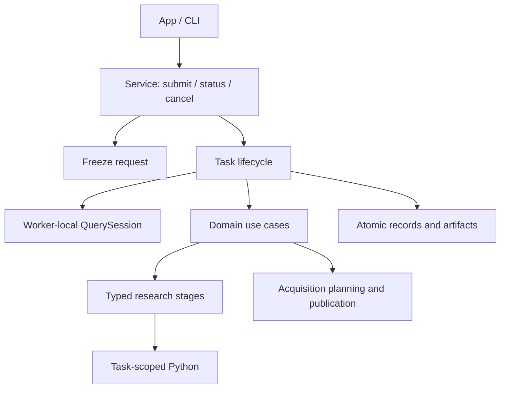
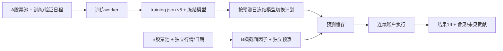

# analytics-workflow

本组件负责本地工作区服务、输入冻结、不可变数据登记、任务生命周期和研究编排。
App/CLI 共用业务入口，DuckDB 与 Python 研究资源始终由计算任务拥有。
模块职责、依赖方向和数据流见 [源码组件说明](src/README.md)。

## 公共接口与数据流

- `Workspace`：工作区路径、独占锁、持久化运行记录和目录访问。
- `WorkflowRequest` / `ResearchTemplate`：共享业务请求和解析后的研究配置。
- `snapshot` / `execute`：提交时冻结输入，worker 内执行领域用例。
- `service::Client` / `TaskRequest`：Unix socket 客户端和单计算任务提交。
- `views`：后台读取目录、结果、日志与 NAV，不创建 native 句柄。
- `maintenance`：离线预览和可恢复归档；见下方命令。



一个工作区同一时间运行一个计算任务，无隐式排队。客户端退出不取消任务；
协作取消不能完成时回收研究进程组。结果校验及写盘失败不能发布成功。
终态转换统一由 `Workspace::finish` 完成，恢复只处理遗留 Running 记录。

## 研究输入与产物

工作流分别引用独立因子与标的配置，提交时冻结实际修订、日期和来源。
自定义公式由受限表达式注册表解析，不执行用户代码；可与内置 GTJA191 / Alpha158
混合选择。有序特征、公式版本、样本掩码和来源哈希均进入相应阶段签名。

完整研究组合准入、特征、训练、预测和一次连续账户执行。单独训练不执行账户；
已有模型预测不重新拟合；预测回放不加载模型。账户参数不进入因子签名。
缺失因子保留 null，模型适配为 missing；不得填零或静默删列。

年度因子共享缓存为运行父目录 `.factor-shards-v1`，预测缓存为 `.predictions-v1`。
缓存命中仍验证哈希、日期、特征与样本身份。未知来源冲突阻断，允许的缺失和
已披露不支持事件按冻结策略处理，不自动切换策略。账户参数和权益边界见
[研究后端](research/README.md)。

协议版本由 `service::PROTOCOL_VERSION` 定义；结果版本由
`research::backtest::RESEARCH_SCHEMA_VERSION` 定义；日程训练描述由
`research/backtest/artifacts::TRAINING_SCHEMA_VERSION` 定义。不要复制历史版本表。
旧研究结果归档后重建；原始行情与证据保留其有效读取格式。

## 构建与验收

```bash
crates/app/packaging/build-collector.sh
export DUCKDB_DOWNLOAD_LIB=1
cargo nextest run --workspace
cargo clippy --workspace --all-targets -- -D warnings
RUSTDOCFLAGS='-D warnings' cargo doc --workspace --no-deps
cargo fmt --all -- --check
python3 crates/workflow/checks/architecture.py
PYTHONPATH=crates/workflow/research target/collector-build/python/bin/python3 -B -m unittest discover -s crates/workflow/research/tests
```

开发时 `JFQUANT_COLLECTOR_RUNTIME` 可选择内置解释器；独立测试二进制可设置
`DYLD_LIBRARY_PATH="$PWD/target/debug/deps"`。生成数据、依赖、模型与打包产物不提交。
原生打包和测试应顺序运行，避免替换测试使用的解释器或争抢训练验收时限。

## 独立训练与跨池模型回测

`research::backtest::independent` 提供 `TrainingPlan`、`TrainingSchedule`、
`BacktestPlan`、`ModelSelection`、`ModelCatalogue` 和共享 worker `Job`。
`WorkflowRequest::Independent` 对 App/CLI 暴露训练、模型查询、两侧输入预检/补采和独立回测。



训练计划格式1没有测试区间。支持 `single {window}`、`manual {windows}`、
`rolling {first,step,expanding,until}`；窗口仅含 `train` 与可空 `validation`。
滚动 `until` 必须明确且在训练快照覆盖内。`config` 使用 FitConfig，仅包含有序因子及训练配置，没有账户字段。
回测计划格式1独立记录训练任务ID、`models`、B池、`range`、行情/行动版本和账户参数。
`models` 缺省为 `{"mode":"rolling"}`，或 `{"mode":"single","model_id":"..."}`。
第一版滚动序列仅来自同一训练任务。

每个模型记录原窗口、实际保留训练/验证样本数与证券集合、特征/标签最晚日期
`fit_data_end`、下一已知交易日 `available_from` 和真实完成时间。若训练快照尚无下一交易日，
`available_from` 为 null，执行时以 B 的已验证交易日历及 `date > fit_data_end` 判断。
每日选择已可用且截止日期最新的模型；同日截止按窗口发布顺序选择最后一个。
首日没有模型或窗口覆盖不足时明确失败，不缩短区间。切换不重置账户、不增加调仓。

A/B允许重叠，横截面分别按各自有效成员计算；入池前历史仅用于预热。
回测从模型读取公式修订、算子版本与特征顺序，不读取 A 行情或可变因子库。
回测基准须符合模型的基准输入契约。正常缺失保留 null；无未来收益标签不阻断预测。
训练签名按 A 的实际字段/身份、样本、标签边界及参数计算；预测绑定模型序列、B输入与日期，
账户再绑定交易规则。更换B或日期不训练；只改资金/交易参数可复用相同预测。

`training.json` 格式5在所有模型完成并校验后发布。失败/取消模型不能被查询为完整产物。
模型 manifest 仍使用3，增加 `fitting` 元数据；运行结果仅接收当前格式。
当前日程训练描述按签名验证，仅当具备签名覆盖的 `fit_calendar_sha256`、签名覆盖的拟合缓存与样本掩码、
特征及模型收据时才转为可验证清单；证据不足保留原回测入口，不补造日期或标的。
新独立回测可以重放已发布预测，重放固定 B 与候选范围，无需训练模型文件。

`model_selection.json` 保存提交时冻结的模型清单和日期区间；`independent_predictions.json`
保存预测、可空评价标签及按当前模型判定的曾见/未见标记。
`cross_pool_report.json` 包含每日有效候选/预测数量、分组IC、费用和同一账户损益贡献。
分组按当日模型，而非买入批次；两组不是独立策略收益。不能归属的权益损益单独列为
`unattributed_pnl_cny`，不隐式分摊。账户与模型切换来源同时写入结果和可读报告。

复现与验收：

```bash
DUCKDB_DOWNLOAD_LIB=1 cargo test -p analytics-workflow independent::tests
DUCKDB_DOWNLOAD_LIB=1 cargo test -p analytics-cli independent_fit_models
DUCKDB_DOWNLOAD_LIB=1 cargo test -p analytics-desktop independent_training_and_backtest_editors
DUCKDB_DOWNLOAD_LIB=1 cargo clippy -p analytics-workflow -p analytics-cli -p analytics-desktop --all-targets -- -D warnings
DUCKDB_DOWNLOAD_LIB=1 RUSTDOCFLAGS='-D warnings' cargo doc -p analytics-workflow -p analytics-cli --no-deps
cargo fmt --all -- --check
```

测试使用临时数据，覆盖A行情不可用、跨池及重叠、模型选择边界/并列、横截面手算、
混合递归因子延长终点保持原特征/信号、缺失评价标签、缓存失效和无模型文件的预测重放。

## 架构边界与离线维护

当前职责和数据流以 [源码组件说明](src/README.md) 为准。根模块仅导出接口；
用例、存储、请求冻结、查询会话、任务生命周期和研究阶段分别维护。
服务协议以 `service::PROTOCOL_VERSION` 为准；研究结果仅接收当前
`RESEARCH_SCHEMA_VERSION`；日程训练描述统一为 `TRAINING_SCHEMA_VERSION`，
独立训练目录继续使用自身的模型目录契约。旧运行时兼容不作为重构要求。

```bash
# 只读清单：文件哈希、旧任务和 JSON 引用；不会启动服务
jfquant --workspace "$JFQUANT_WORKSPACE" workspace maintain
# 停止服务后，获取独占锁并执行；中断后使用同一命令恢复
jfquant --workspace "$JFQUANT_WORKSPACE" service stop
jfquant --workspace "$JFQUANT_WORKSPACE" workspace maintain --apply
python3 crates/workflow/checks/architecture.py
```

维护不删除任何原始输入。旧任务及共享因子/预测缓存归档至
`.jfquant/archive/<UUID>/`，保留 manifest 哈希清单。旧任务原路径成为相对证据引用，
不再列入活动任务；共享缓存不保留活动别名，后续重新计算。行情、事件、公告、
来源收据、staging 和用户配置保持原位。配置无法通过当前解析时阻止维护并列出原因，
不猜测转换。尚未完成的维护 journal 阻止服务启动；恢复前重新校验清单中的文件。
归档不会自动删除。命令实现和中断/重复执行验收见 `src/maintenance.rs`。

## 组合数据检查（协议26）

`input_check::{InputCheckPlan,InputCheckReport,CheckRequest,run}` 提供依赖、输入、
实际因子计算、样本四阶段检查；只有四阶段完成且现有 `AdmissionReport` 允许时才就绪。
内置子集、跨目录和固定自定义修订使用相同有序 `FactorRef`；不运行 IC、训练或账户。
因子页 Parquet、研究 DailyDataset 是两个适配器，保留各自递归历史、价格转换和标签定义。
研究 preview/check、独立 TrainingInputs/BacktestInputs（不补采）及正式研究走同一 prepare/samples；
因子诊断及流水线也复用检查计算。补采仍使用已有需求计划，不把补采完成当作完整检查通过。

`input-check.json` 格式1记录冻结计划、请求/实际阶段范围、逐字段依赖范围、
缺失总数与 task/history 分类、逐因子有效率/标签配对数/连续空值日期和准入处置。
输入阻断时因子/样本保持 not_run。未能解析日程时保留失败报告，执行区间为空。
严格/允许缺失/合格样本沿用既有规则，默认严格；公式产生的正常空值不冒充源损坏。
空因子明确披露，不自动删列；训练仍要求每列有有效训练值并满足样本门槛。

依赖从 AST 按字段传播，合并重复窗口后按成员区间批量展开；阶段间空档不参与检查。
横截面依赖保留算子所在日期的成员上下文；标签可读取退出后日期。
研究执行基准只要求实际回测区间和前一交易日，因子使用基准时另按公式读取。
预测/回测末端按日历及有效基准收盘缩短，训练/验证不缩短；标签尾部缺失不缩短成交周期。

Parquet 全上下文缓存 `.factor-artifacts-v2` 使用 Float64 Parquet、manifest 和双哈希收据；
研究沿用 `.factor-shards-v1`。每次命中重新核对内容、日期键、股票池、顺序、定义、算子版本、
价格口径、历史/种子及输入身份。损坏/缺失缓存重新计算；不拼装旧单因子列，不信任 ready 标记。
App 的后台文件元数据探针仅提示报告过期，正式任务仍验证内容哈希。
两类缓存均可由维护归档处理。检查任务由 worker 持有 DuckDB，沿用进度、协作取消及任务持久化。

验收：`cargo nextest run --workspace` 包括逐字段/横截面/递归/范围外缺口、三档策略、
标签与基准尾部、完整检查无训练及正式任务缓存复用；安装包验收见 App packaging/verify-cli.sh。
