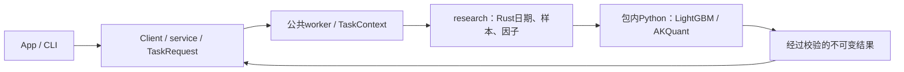
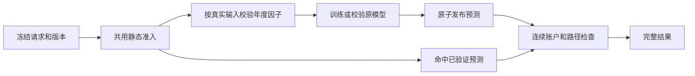

# analytics-workflow

本组件拥有工作区、不可变数据登记、独立因子／标的／工作流配置、Unix socket服务、
任务记录、研究编排和Python研究进程监督。App与CLI交换普通数据，后端句柄不进入UI。



公共入口：`Workspace`、`WorkflowRequest`、`service::TaskRequest`、`service::Client`、
`ResearchTemplate`；研究入口集中在 `research::pipeline` 与 `research::backtest`。
Python协议及支持边界见 [research/README.md](research/README.md)，Rust目录见
[src/research/README.md](src/research/README.md)。不再依赖或维护独立analytics-ml。

## 协议与产物

服务16；工作流10（仍分别引用factors与targets）；模型manifest2；训练描述3；结果16。
行情、公司行动、采集和原始证据格式保持原版本。旧输入明确拒绝，不自动转换，
原文件、运行状态与日志保留。独立配置解析后冻结到任务，运行中不跟随文件编辑。

`research::backtest::run_with_context`按既有日期切分与样本规则计算Rust因子，各折调用
同一Python进程训练预测，再将全部样本外信号一次交给AKQuant，跨折跨年不重置账户。
训练产物可独立读取及复用；模型和描述文件的哈希、公式、顺序与运行时签名均核验。

同一工作区同时一个计算任务，无隐式排队。关闭客户端不取消任务；取消协作退出，
两秒后终止研究进程组；进程崩溃不发布完整结果。日志不携带供应商凭据。

## 缓存和错误

年度因子缓存位于运行目录父级的`.factor-shards-v1/签名`，以实际行情、股票池、
预热和横截面、价格口径、公式与特征顺序隔离。任务保留自己的已验收副本；标签单独重建。
模型签名增加训练参数、日期、训练／验证掩码及依赖；回测签名增加账户、执行行情、
预测来源、事件和引擎口径。因子null保留为缺失值，不自动填零或删列。

普通事件未决问题、无法映射的费用参数或实际持仓无法估值停止回测，保留已完成
模型。`execution_readiness.json`记录停止原因；无有效交易与完成回测分开显示。

## 构建与验收

```bash
crates/app/packaging/build-collector.sh
DUCKDB_DOWNLOAD_LIB=1 cargo check -p analytics-workflow --all-targets
DUCKDB_DOWNLOAD_LIB=1 cargo nextest run -p analytics-workflow
DUCKDB_DOWNLOAD_LIB=1 RUSTDOCFLAGS="-D warnings" cargo doc -p analytics-workflow --no-deps
```

开发时`JFQUANT_COLLECTOR_RUNTIME`可指定包内解释器，生产构建只从App包解析。
底层DuckDB测试二进制独立启动时需要`DYLD_LIBRARY_PATH="$PWD/target/debug/deps"`。
生成数据、缓存、模型和临时输出不提交。设计取舍沿革见[DECISIONS.md](DECISIONS.md)。

复用模型回测支持独立账户覆盖 `ResearchExecution`：资金、费用、持仓数、调仓周期及退池策略。
App提交当前账户设置；CLI可用 `research backtest --training <ID> --actions <ID> --template <PATH>`。
只提取模板的账户字段；原模型特征、训练日期和参数仍由训练产物冻结。

## 研究准入与阶段缓存修复（服务协议16，结果格式16）

完整研究和已有模型回测共用 `backtest/execution.rs` 的静态检查，计算前汇总来源失败、未查询、结构化覆盖不足、不支持条款、行情结构和交易参数问题。执行证券取测试期历史成员；资料从测试期首次入池检查至结束，覆盖出池未卖持仓。基准仅检查行情。训练入口不要求账户数据；普通分红/送转按 AKQuant 除权日条款核验，无需旧账本到账/上市日。真实持仓缺价仍在运行时阻断。

`AdmissionCheck.stage` 区分训练、静态执行和账户运行。预检失败写 `execution_readiness.json`，完整检查在 `admission.json`。`stages.json` 表示各阶段是否完整；`prediction_manifest.json` 只在预测产物校验通过后发布。折报告在账户未执行时 `performance=null`；只有完整账户写 `summary.json`（格式15）。`execution_diagnostics` 提供有效信号、成交回报、拒单回报及原因；当前适配器无法取得完整提交订单数，因此 `submitted_orders=null`，不把成交回报数当作订单数。历史格式仍可读取任务状态/日志，不重新解释为新结果。



共享因子在 `.jfquant/runs/.factor-shards-v1/` 保存 Parquet、哈希和清单。签名包含实际 executor panel、预热和横截面、复权锚点、公式版本、特征顺序及价格口径。null 保留为 Parquet null；任务内矩阵保持现有 f32 缓冲。标签随任务当前行情重建，切分边界照常排除越界标签；任务参数不导致重复执行相同因子。分片按年整体更新，不做分片内增量。旧 `.factor-cache` 不自动升级。

预测在 `.jfquant/runs/.predictions-v1/` 原子发布，以模型/manifest哈希、完整行情内容哈希、因子输入签名、分折、样本策略和研究运行时定位；修改费用、持仓数量或普通事件不改变预测键。缓存命中验证所有文件和样本掩码哈希后直接执行账户，不重复因子/预测。旧CSV预测不导入新缓存。取消或崩溃留下的 `.partial` 无完成清单，不参与复用。

```sh
DUCKDB_DOWNLOAD_LIB=1 cargo test -p analytics-workflow --lib
cargo run -p analytics-cli -- --workspace /absolute/workspace research backtest \
  --training TRAINING_TASK_ID --actions ACTION_VERSION
```

原模型复用仍校验训练描述、模型与manifest哈希以及已验证价格口径的事件签名；改变训练价格或样本时应新建训练。每次补采创建新数据版本，未完成覆盖不以删股或伪造空事件解除。

## 公司行动核对与警告执行（服务16、结果16）

公共任务 `ReconcileActions { actions, evidence_tasks, market }` 冻结基础版本、可重复指定的
终态证据任务和可选行情日历。执行前复核输入哈希，暂存完成后原子移动并注册新公司行动版本。
App的公司行动核对入口与CLI调用同一任务；详细问题位于公司行动版本及核对回执，readiness仅
内联阻断摘要和证据引用，完整准入/质量/问题分别保存在引用文件。

```bash
DUCKDB_DOWNLOAD_LIB=1 cargo build -p analytics-cli
./target/debug/jfquant --workspace "$PWD" data reconcile-actions \
  --actions ACTION_VERSION --evidence-task EVIDENCE_TASK_UUID --market MARKET_VERSION
./target/debug/jfquant --workspace "$PWD" jobs wait TASK_UUID --timeout 60
./target/debug/jfquant --workspace "$PWD" research backtest \
  --training TRAINING_TASK_UUID --actions NEW_ACTION_VERSION
```

已识别特殊事件固定 `unsupported_event_policy=warn_and_skip`：预检与实际执行共用判定，跳过
引擎投影，不补偿、不自动卖出、不剔除成员或样本。普通事件冲突、必要除权日及历史覆盖缺口仍阻断。
普通同日事件现金先于送转，以原股数派息。完成结果记录 `event_simulation_complete`、未模拟事件
数量/证券/日期或不确定区间/证据，以及此前持仓快照可判断的 `held_across_event`（未知为null）。
报告/App显示“回测完成，含未模拟事件”；CLI返回相同结构。收益按披露的简化口径解释。

只改事件/警告策略使账户结果失效；原训练口径未变时模型、因子及匹配的预测继续复用。
研究worker、依赖锁、模型manifest2、训练描述3和模板10保持。验收：
`DUCKDB_DOWNLOAD_LIB=1 cargo test -p analytics-workflow --lib`，另运行research/tests的Python验收。

已核实的纯现金差异化分红可直接投影普通股实际现金：交易所参考金额保存在`Reference`，
不复权执行行情已反映除息参考变化，Dividend仅收到公众股实际金额。不能将参考金额误当持有人
所得；需特殊股份分配等仍无法表达的条款继续披露并跳过。fixture覆盖每股实际0.18元、参考0.15元，
100股现金增加18元、价格变动后权益净增加3元，研究worker没有新增处理分支。

`InspectActions`的问题项返回`issue`与其`sha256`，用于精确的`resolve_issues`修订，避免调用方
推测序列化顺序。格式6拒绝旧`SupplementActions`路径，防止绕开统一核对规则。
