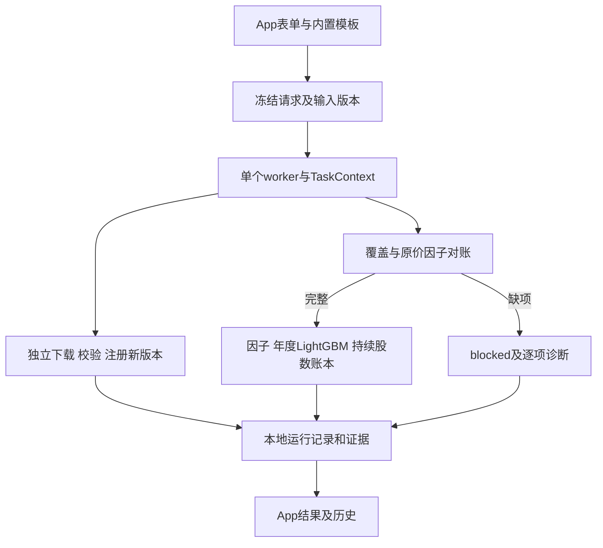
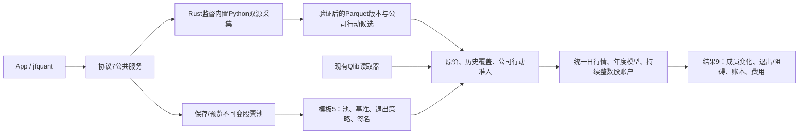
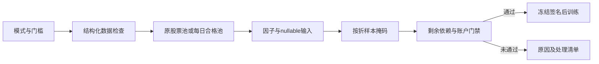

# analytics-workflow

目录导航：[全部组件](../README.md) · [src：持锁服务、worker与持久化任务](src/README.md) · [templates：受控默认模板、完整导出与冻结参数](templates/README.md)

## 职责与公共接口

把JFQuant内置采集与研究模块组合为独立App可运行的本地流程，不调用Codex、Cargo或Python。原生查询、因子与LightGBM计算由本crate共用worker完成；App与CLI只传递可序列化数据，不传递原生句柄。

| 接口 | 契约 |
|---|---|
| Workspace::open / resolve / lease | 显式根目录；打开后不依赖cwd；绝对输入支持，元数据和注册版本使用工作区相对路径；独占文件锁由服务持有，防止多个后台写入；多个客户端共用服务 |
| Workspace::register / datasets | 登记JFQuant验证过的行情文件内容、来源说明或公司行动及证据哈希；数据完整性不等同采集成功；不读取JFQlib缓存 |
| ResearchTemplate::builtin / validate / read / write | source-controlled JSON模板，schema_version=5；参数默认及校验；保存和导入不执行脚本 |
| snapshot / signature | 冻结请求、数据版本及签名、软件与公式版本；有序特征列表改变会改变签名 |
| Workspace::begin / progress / finish / runs / recover | UUID输出目录、原子任务状态、追加日志；重启把未结束任务标为Interrupted；迟到进度不恢复终态 |
| execute | 同步在worker调用storage/ml；TaskContext提供取消及进度，返回plain-data WorkflowOutcome |
| Workspace::import_run / results | 当前schema 9严格研究结果只读登记，先校验再创建记录，不改原目录；查看年度结果、工作台产物或执行准入检查 |
| self_check | 在worker执行真实DuckDB查询、LightGBM小模型训练和预测；供自包含安装包验收 |

首版内置GTJA191／中证500年度流程，支持数据更新、公司行动补充、准入检查和年度研究；不包含任意脚本、调度或通用DAG编辑器。模板默认5年训练、1年验证、次年测试，前50、每5交易日调仓、100万元、最新A股费率及178个v4研究因子。缺少真实MKT/SMB/HML的030和12条隔离公式不能选入模板。

## 文件格式与数据流

```text
WORKSPACE/
  data/                          行情版本、公司行动及下载证据
  .jfquant/workspace.json         schema_version=1；工作区身份
  .jfquant/catalog/*.json         DataVersion：ID、kind、相对路径、签名、实际起止及来源/缺项摘要
  .jfquant/templates/*.json       ResearchTemplate：用户参数；可以导入/导出
  .jfquant/staging/UUID/          行情owner.json及未完成压缩包
  .jfquant/staging/actions-UUID/  公司行动owner.json、原始响应、按证券哈希检查点
  .jfquant/runs/UUID/run.json     RunRecord：状态、参数/版本快照、签名、阶段、错误、相对输出目录
  .jfquant/runs/UUID/events.jsonl UTC时间与进度；按行追加
  .jfquant/service.log             自动启动后台的诊断（不提交）
  .jfquant/runs/UUID/payload.json   工作台查询、扫描、导出和汇总的WorkerEvent结果
  .jfquant/runs/UUID/outcome.json   完成任务的WorkflowOutcome，包含新版本及检查更新/演示信息
  .jfquant/runs/UUID/artifacts.json 流水线/重训指标、重要性、预览与相对产物路径
```

运行和数据版本记录JSON使用schema_version=1，研究模板使用schema_version=5，股票池定义使用schema_version=2；JSON模板拒绝未知字段及不支持的公式版本。运行状态为running/succeeded/failed/blocked/cancelled/interrupted/imported。元数据用新临时文件、sync及rename发布；记录ID与目录相互校验，不能通过记录中的路径覆盖工作区外文件。数据引用在执行前复核签名；行情details.content_sha256按排序后的相对文件名、长度和实际字节计算，执行时在后台重新哈希，增删、改名或修改行情均拒绝。旧目录记录没有内容哈希时需重新登记，不自动沿用旧身份。公司行动原始证据哈希也在后台复核；更改已登记输入需登记为新版本。提交时只读取版本元数据，较长的字节校验保留取消检查且不阻塞控制请求。目录整体迁移后，相对版本和运行路径仍可读取；导入的当前研究保留原路径引用，其来源目录需继续可访问。



注册不复制其他项目缓存，不自动删除旧版本。公开源仍可能有历史、结算日期或分配对象缺失；严格研究停止在训练前，保留execution_readiness.json逐项明细。研究重新运行使用新UUID，不恢复训练中途状态；行情和最初的公司行动下载可恢复本项目拥有且哈希匹配的检查点。后续补充阶段取消后保留owner及页面收据，恢复时只复用URL与SHA256匹配的页面，完成后发布新版本。

## 构建与验收

```bash
export DUCKDB_LIB_DIR="$PWD/target/debug/deps"
export DYLD_LIBRARY_PATH="$DUCKDB_LIB_DIR:$(brew --prefix lightgbm)/lib:$(brew --prefix libomp)/lib"
cargo check -p analytics-workflow
cargo nextest run -p analytics-workflow
cargo nextest run -p analytics-desktop -E 'test(platform_) | test(research_) | test(incomplete_research)'
cargo clippy --workspace --all-targets --features analytics-ml/lightgbm-native -- -D warnings
```

该crate连接native ml/engine；初次开发构建先用`DUCKDB_DOWNLOAD_LIB=1 cargo build -p analytics-desktop`准备DuckDB，并安装构建用LightGBM。安装包的用户不需要这些开发依赖。`test-support`仅供App验收用合成输入构造器；生产包不包含该feature。

验收覆盖模板往返/版本/因子顺序/签名、独占锁与工作区迁移、终态不被迟到事件改写、中断恢复、完整合成原价研究及缺公司行动提前拒绝。合成数据不冒充公开数据：输入来源显式标记synthetic_fixture，覆盖2007—2010四个年份和1+1滚动、两年样本外，零费率手算1000元、100股10元，分红0.1元/股及每股送0.1股后110股9元＋现金10元＝1000元。App worker另以1005元本金、最低5元佣金验证：买入100股后分红送转，2009及2010年底均为110股＋现金10元，累计费用5元、总收益−5/1005；更换年度模型不会重置账户。真实第三方数据不得据此宣称已完整回测。

工作区产物全部属于本地状态，禁止提交；只提交组件、内置模板、测试和README。App打包及安装见[app README](../app/README.md)。

`WorkflowRequest::CreateDemo`及`demo::create`提供离线完整演示，显式generator=`JFQuant analytics-workflow synthetic-demo-v1`，不使用公开下载身份/验证标记；生成新的UUID输入目录，返回数据版本和手算研究模板，结果input_kind=synthetic_fixture。生产演示与测试复用同一构造器，`test-support`仅保留测试便利包装。

补充任务的resume字段引用最初暂存任务UUID；来源、方法及区间必须匹配owner，重用URL和哈希收据验证过的页面，最终发布新版本。`WorkflowRequest::label`区分更新、采集、检查和研究操作，供运行记录展示。

## 共用后台和本地服务

backend::WorkerCommand/WorkerEvent/TaskKind/RunSummary是App与CLI共用执行协议，backend::Wake提供界面无关通知。原生句柄始终由单个worker持有，panic后退出该worker并在所属线程释放全部连接/模型。App不再实现执行/汇总/错误处理逻辑。backend的test-support仅提供故障、暂停等验收注入，发行包不包含测试操作。

| 公共接口 | 契约 |
|---|---|
| service::TaskRequest | 可序列化workflow、scan、describe、query、query_next、export、pipeline、train；禁止未知字段；clap不进入领域模块 |
| service::Client::connect / ensure / call / wait | 显式工作区；自动启动jfquant、调用版本化RPC、等待终态；超时不取消 |
| service::Rpc | 提交、状态、事件、任务/日志/结果、版本、模板、只读历史导入及服务控制 |
| service::ServiceError | code、message、可选task_id；统一busy/blocked/cancelled/query_expired等错误 |
| service::serve / bridge | 唯一持锁后台；egui通知适配；客户端退出不终止任务 |
| service::resolve_workspace / find_binary | workspace参数→JFQUANT_WORKSPACE→App设置；包内同目录jfquant，开发可JFQUANT_CLI_BIN |

协议version=7，Unix socket每连接一条JSON行请求/响应；请求为{version,request:{method,params}}，响应为{version,data,error}，成功data允许null。请求上限16MiB、响应读取上限64MiB；事件历史按2048条及32MiB双重预算淘汰，避免多个SQL页面累积突破响应限制（最新单条事件仍保留）；页面过大时缩小page-size或直接导出。socket位于/tmp/jfquant-有效UID/工作区规范路径哈希.sock，目录0700/socket0600，不开放网络端口。启动竞争通过工作区文件锁处理；持锁者才能清理旧socket及恢复记录，客户端不修改活跃任务。

服务一次只接受一个计算任务，无队列，busy包含当前ID；begin先原子落盘再返回提交信息，冻结参数不在worker开始执行时重写；停止/空闲退出与提交共用锁，停止后拒绝尚未处理的连接，不留下已接受但无人执行的记录。查询等payload必须持久化成功才报告成功，写盘失败按失败记录返回。普通错误保留worker，panic标记unavailable，空闲restart重建。取消在下载/因子/训练/回测检查点生效；正在执行的单次DuckDB查询要待原生调用返回，再记录取消状态。

SQL每个query_id持有独立连接及稳定ordinal快照，保持既有重复键/NULL分页语义；十分钟不访问过期，连接在worker线程释放。服务十分钟没有请求且无活动任务时退出，此时查询会话也已达到相同空闲期。App每150ms轮询活动状态/事件，接入已运行任务并可取消；SQL页面/Describe/导出payload只应用于本App提交的任务，其他客户端的查询不覆盖当前分页和cursor；丢失服务连接显示错误，重新连接时服务恢复interrupted记录。停止服务要求空闲，研究不恢复中途模型。

CLI与App均调用TaskRequest。研究JSON示例外层为{"operation":"workflow","request":{"operation":"research","template":完整模板,"market":"版本ID","actions":"版本ID","audit_only":false}}；query包含request:{sql,limit,sort,after}及可选query_id；query_next包含query_id和after；pipeline包含PipelineRequest；train包含cache_path、universe_id、config。输出始终绑定新UUID；参数顺序、公式和输入签名继续冻结。完整CLI示例见[CLI README](../cli/README.md)。

## 当前接口与结果格式

App与jfquant仅使用标准TaskRequest/WorkflowRequest；不保留旧命令、路径参数适配、输出目录别名或旧请求JSON回退。研究适配器属于正常workflow，按冻结模板和登记版本构造ResearchRequest；所有执行仍在同一worker。

研究summary.json使用schema_version=9，仅raw_integer_shares模式。报告生成、Workspace::results和import_run共用ml::backtest::validate_result：校验版本、执行模式、来源/公式/签名、费用及研究参数、年度报告和汇总必需字段。旧格式或不完整结果返回unsupported_result_format；RPC错误包含可用的task_id。任务状态和日志仍可查看，单条结果不可读取不会阻止其他记录加载。旧文件不删除、不迁移、不转换，也不能作为新任务执行。

工作区、数据版本和任务元数据继续使用schema1，模板使用schema5；研究结果schema9与因子公式v4是不同版本。下载恢复只使用标准请求中的resume UUID和受验证的owner/收据检查点；研究以新UUID重新计算。服务程序定位在service组件，显式JFQUANT_CLI_BIN无效时直接报cli_missing；不会调用Cargo寻找程序。协议不匹配返回protocol_mismatch，不启动替代服务或自动降级；更新前先让任务结束并用原版本jfquant service stop停止空闲服务，再启动新版本。

验收覆盖正式命令与公共API的结果/冻结参数/特征顺序/跨年账本/费用一致、标准下载恢复、忙碌拒绝、证据修复去重、旧请求拒绝、当前结果只读导入以及旧结果拒绝且文件不变。前台Ctrl+C不影响已提交后台任务的真实信号测试继续保留。另一台Apple Silicon/macOS 14实机验收仍待完成。

## 2026-10-13 清理验收记录

workspace nextest共163项通过、0跳过；Clippy与Rustdoc使用-D warnings通过，doctest、格式和git diff检查通过。包内App/CLI原生自检、正式合成年度研究、正式Parquet因子流水线、服务停止后离线结果读取及签名验证通过，App/DMG已重建。另一台Apple Silicon/macOS 14实机验收待完成，此记录不替代该项。

开发复现（从仓库根目录执行；原生库由App旁的build-native.sh准备）：

```bash
export DUCKDB_DOWNLOAD_LIB=1
export LIGHTGBM_LIB_DIR="$PWD/target/native-macos14/install/lib"
export DYLD_LIBRARY_PATH="$PWD/target/debug/deps:$LIGHTGBM_LIB_DIR"
cargo nextest run --workspace --profile ci
cargo clippy --workspace --all-targets -- -D warnings
RUSTDOCFLAGS="-D warnings" cargo doc --workspace --no-deps
cargo test --workspace --doc
cargo fmt --all -- --check
git diff --check
crates/app/packaging/package-macos.sh
```

采集证据、模型、运行记录、日志和安装包保持本地生成内容，不参与Git提交。

## 动态股票池与 Python 采集接口

当前模板schema 5、研究结果schema 9、服务协议7；公式仍为v4。模板增加 `pool_version`、`benchmark` 和 `pool_exit_policy`；默认 `builtin:csi500` / `SH000905`，沪深300模板使用 `builtin:csi300` / `SH000300`。自选和集合组合引用不可变pool版本，冻结成员区间、人工日期调整及输入哈希；模型manifest和缓存签名包含这些研究输入。原schema结果明确拒绝，历史状态和日志仍可查看，不转换旧文件。



`pools create/validate/import/export/list/versions/preview` 使用公共定义及解析器；`data collect --provider akshare|yfinance --kind market|actions` 提交后台任务，使用 jobs wait 显式等待。`run --request` 可提交完整公共请求。App提供来源、采集日期/证券、股票池JSON编辑、日期预览、退出策略及失败采集恢复按钮。包内Python和依赖只用于采集，不需要外部Python；日常操作不调用Cargo。

```bash
jfquant templates default --universe csi300 --output csi300-template.json
jfquant pools validate --definition pool.json
jfquant pools create --definition pool.json
jfquant pools preview pool-0123456789abcdef --market market-0123456789abcdef --date 2026-10-12
jfquant data collect --provider akshare --start 2004-01-01 --end 2026-10-13 --instruments SH600000,SZ000001,SH000300 --benchmarks SH000300
jfquant data collect --kind actions --provider akshare --start 2004-01-01 --end 2026-10-13 --instruments SH600000,SZ000001
jfquant research demo-parquet
```

示例ID须换为实际版本。下载可恢复验证过的证券；重新提交时参数必须与owner一致。临时/缺失输入不会自动换源、补字段或启动训练。原价撮合不使用Yahoo拆股调整价；缺支付/上市日期或指数历史成员仍阻止研究。2010样本外的5+1窗口需要2004—2009完整历史池及行情，不能以当前成分回填。

开发验收先运行 `crates/app/packaging/build-collector.sh`，再执行workspace nextest、严格Clippy/Rustdoc和格式检查。解释器、依赖、数据、模型、缓存、日志、运行记录及DMG均留在忽略目录。另一台Apple Silicon/macOS14实机验收待完成。

## 2026-10-14 本机验收记录

自审后187项workspace nextest通过、0跳过，其中集成运行11项Python契约/本地HTTP测试及3项打包加载命令fixture。严格Clippy、Rustdoc、doctest、Rust/Python格式、差异及组件文档链接检查通过；每层有效组件目录均有README和Mermaid。Python环境89个原生对象通过arm64及macOS14检查，App/DMG已重建并通过签名和清空环境的包内CLI合成研究、流水线及离线读取验收。

公开源抽查：AKShare和yfinance分别成功获取SH600000、SZ000001及SH000300短区间数据；包内CLI在清空环境后成功调用内置AKShare采集SH600000。下载成功与研究就绪分开，Yahoo仍保留split_adjusted_candidate标记。复查2010—2026沪深300的5+1窗口：要求从2004-01-02覆盖，实际历史池始于2005-04-08，且所需历史中含未解释临时代码SHT00018。请求明确返回blocked（CLI退出码3）和问题清单，在因子缓存/训练前停止；没有生成真实收益报告，也不猜代码映射或历史成员。

验证记录、数据和包位于忽略的target/.jfquant/data目录。另一台无开发环境Apple Silicon/macOS14实机验收待完成；本次未提交或推送。

自定义股票池的已验证覆盖只到所选行情日历的实际首末交易日；日期预览与研究准入共用该区间，定义中未来调整不会冒充有效历史覆盖。

研究准入的 `factor_basis_issues / adjustment_issues / affected_factor_ids` 由统一后台返回，App和CLI查看同一问题明细。后复权报价单独留证；只有通过显式系数覆盖和公司行动对账的原价派生输入可用于训练。

## 独立系数的公共流程

采集请求必需adjustment_source：AKShare=sina_hfq、yfinance=none；App/CLI有一致合法默认值，完整JSON请求需明确提供。规范行情4、采集协议4、服务7、报告8；模板5、股票池2、工作区/版本/记录1保持。旧规范行情、检查点及结果不转换，保留文件与日志。合成Parquet演示生成独立系数与锚点，Qlib演示保持当前读取，通过同一后台比较账本、费用和特征顺序。

## 日期调度、需求预览与实施公告修订

当前模板5包含schedule、action_policy、identity_version、quality_policy；删除first_test_year/last_year和ResearchConfig的training_years/validation_years字段，不解析旧格式。沪深300默认首折2006—2010训练、2011验证、2012测试，rolling的until=null取数据最后完整日；中证500沿用2013首测。single和manual必须显式完整覆盖，rolling只裁切生成的最后一折，不缩短用户明确指定的截止日期。

PreviewResearch返回统一日程、所需证券、历史起点、未知截面边界和可用标签样本计数；PrepareResearchData从同一需求获取公司行动或巨潮实施证据，每证券先落盘需求和失败明细，未解析身份不会启动该证券的错误采集，其余证券继续。后继证券按事件关系扩展准入；不能将SHT00018猜成某只股票。身份目录以多份来源／实施证据和日期绑定别名，不拼接不同证券价格序列。

InspectActions按证券返回原事件、original_sha256、来源错误与公告候选。ReviseActions核对原哈希、每个改变字段的原文引用、证券/实施身份和单位说明，生成新版本并复制哈希验证的证据；原事件、原失败原因和裁定理由保留在review收据。解决来源失败必须同时修正事件，不能只删失败标记。公告manifest必须位于当前工作区。


CLI使用research preview/prepare-data/check/run，复杂日程通过--schedule FILE或run --request提交。任务默认返回ID，jobs wait等待；同一工作区仍只有一个计算任务，不增加任务队列。workspace/data/run元数据仍为1，股票池2，公式v4；服务7、规范行情4、采集4、公司行动3、结果9。旧文件与历史日志保留，不迁移。

## 为什么需要本组件

让研究脱离开发工具也能复现。工作区、版本、任务和参数冻结属于所有入口共同需要的业务能力。独立后台服务让App关闭或CLI退出后任务继续；不可变身份与数据版本让历史结果保持可解释。

设计依据：2026-10-14接受的证券身份与完整准入计划、组件接口及测试。未在代码或证据中确认的历史取舍不推定为既有设计理由；来源、法规或数据格式变化时重新评估。


## 证券身份、候选采集与完整准入

Why见[设计决定](DECISIONS.md)。交易代码复用意味着身份、来源定位和权益承继必须分开；目录使用SEC加UUID，代码及供应商别名带日期。模板schema5引用identity_version；空引用允许编辑模板，但研究准入失败。目录1、股票池2、动作3、行情4、系数2、采集4、服务7、结果9；旧格式不自动转换。

`identities capture --request FILE`接受`{"urls":["https://finance.sina.com.cn/realstock/company/shT00018/nc.shtml"]}`，只获取白名单HTML原文和提取文本，输出候选路径及哈希，不创建证券身份。`identities import REGISTRY`核验完整证据包；`review --request REGISTRY`登记具有裁定理由的新版本；`show/check/export/list`通过同一任务接口运行，先返回任务ID。

```sh
jfquant --workspace "$JFQUANT_WORKSPACE" identities capture --request identity-sources.json
jfquant --workspace "$JFQUANT_WORKSPACE" jobs wait TASK_ID --timeout 180
jfquant --workspace "$JFQUANT_WORKSPACE" identities import identity-package/registry.json
jfquant --workspace "$JFQUANT_WORKSPACE" identities check IDENTITY_VERSION --provider qlib --symbol SHT00018 --date 2005-06-01
jfquant --workspace "$JFQUANT_WORKSPACE" identities export IDENTITY_VERSION exported-identities
jfquant --workspace "$JFQUANT_WORKSPACE" research preview --template recipe.json --market MARKET_ID --actions ACTION_ID
jfquant --workspace "$JFQUANT_WORKSPACE" research prepare-data --template recipe.json --market MARKET_ID --actions ACTION_ID
```

身份包registry.json的securities以SEC键保存security_id、issuer、name、kind、lifetime、locators及evidence键。定位符包含provider/symbol/coverage/evidence；证据包含相对original/text路径、两份SHA256、source_url、quote、kind和parser_version。原文和引用分别重验，记录日期须有引用依据。source_membership证据可引用本项目已验证行情包中的原始成员文件；不得改写该文件。

`research preview/prepare-data --actions`枚举已知承继依赖；未提供动作版本时successor_check明确not_run。需求格式1保存每证券日期、成员区间、用途和身份状态。preparation按证券保存captured与verified.json，恢复核对完整需求签名和文件树哈希，失败项继续保留并重试。成功下载仍是候选，未裁定身份或类别覆盖时不会登记完整研究快照。

准入格式2使用passed/failed/not_run。事件覆盖分distribution、differential、rights_issue、reduction、reform、reorganization、merger、code_change及delisting；必要失败和未执行都不授权训练；第二档的纯缺失保留为空值，第三档的排除记录另行展示。临时因子检查使用.admission-factor-staging，检查有效训练标签及每个所选因子的有效值后才发布factor-cache。检查模式保留暂存结果，不启动训练。


目录lifetime表示证据已支持的身份日期区间。新证券末日可以是所选数据观察末日，不能解释成退市；只有具有实际日期和权益依据的公司行动才改变账户。身份目录不自动生成退市、清偿或换股实例。已存在的SEC键不能改派给另一个主体；同主体同发行记录更新保留原键。

## 三级研究模式：为什么允许筛选

决定日期2026-10-14，依据是用户接受的三级模式计划。正常预热空值、来源缺失和错误数据是不同问题：全部拒绝会浪费可用样本，全部放行又会混淆因子和真实权益。默认严格检查；另外提供“允许部分数据缺失”和“只用数据合格的股票”。模式是研究输入的一部分，不能作为训练失败后自动切换的兜底。

第二档保持原成员，纯缺失传播null；第三档派生每日合格成员，不改原始成员或证据。不能看到后来缺价而倒删早期股票。账户仍采用原价、整数股、T+1和连续权益；未裁定冲突、损坏、基准缺项及剩余必要依赖仍阻断。默认有效因子比例0表示至少一项有效，最低有标签样本1只表示可执行，不表示样本在统计上充分。所选因子整列无有效值不会被自动删除。

ResearchTemplate当前schema5，增加quality_policy：{"strictness":"strict","min_valid_feature_ratio":0.0,"min_labeled_rows":1}。PreviewResearch、Research及补采需求使用同一模板；App/CLI覆盖参数后冻结实际值。preview返回quality和样本候选数量；真实因子有效数量须在私有暂存计算后才能确定，预览不冒充完整准入。

执行结果schema9、服务协议7、准入格式2；身份1、股票池2、动作3、行情4、系数2、采集4及任务记录1保持不变。旧模板/结果/协议明确拒绝，旧文件不自动转换。临时分片、日志和运行记录继续位于工作区，不提交Git。筛选不是数据更新的自动修复；执行错误时仍提供未通过及未执行明细。


