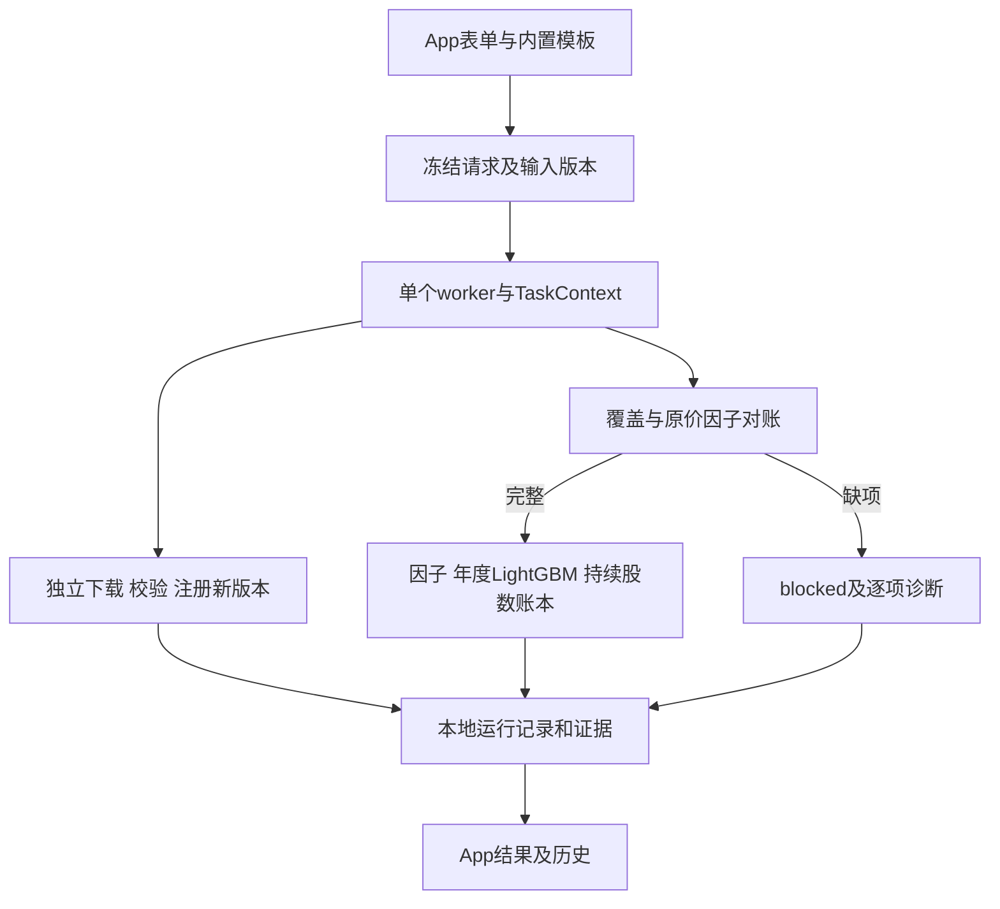
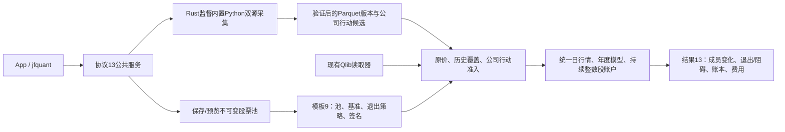
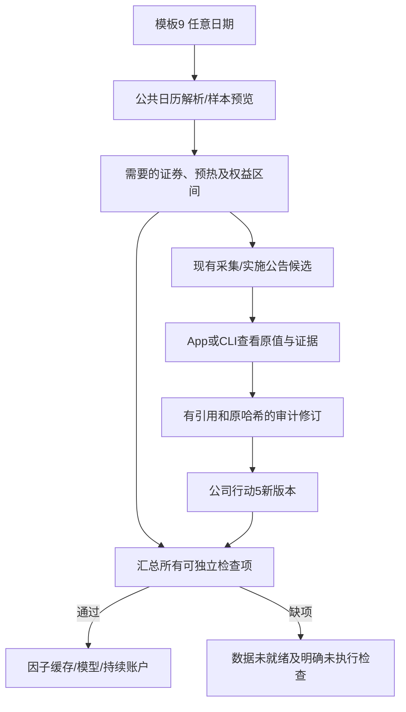
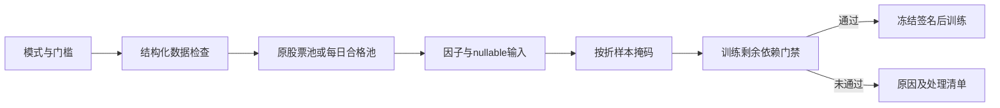
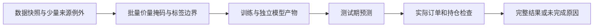
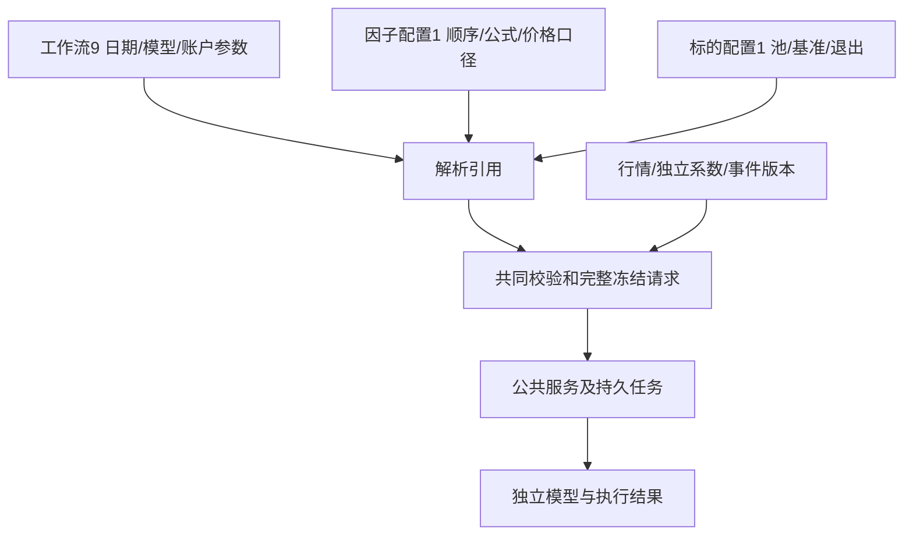
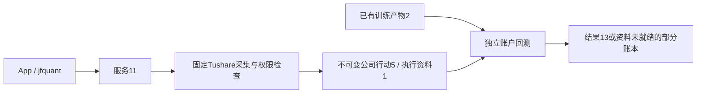
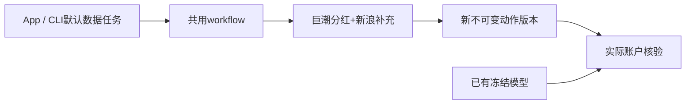
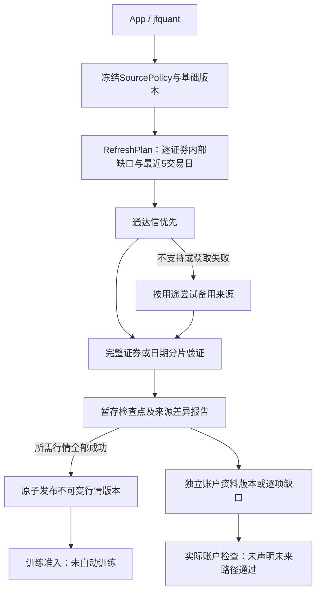
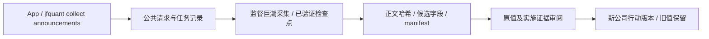

# analytics-workflow

目录导航：[全部组件](../README.md) · [src：持锁服务、worker与持久化任务](src/README.md) · [templates：受控默认模板、完整导出与冻结参数](templates/README.md)

## 职责与公共接口

把JFQuant内置采集与研究模块组合为独立App可运行的本地流程，运行不依赖Codex、Cargo或外部Python，采集使用包内解释器。原生查询、因子与LightGBM计算由本crate共用worker完成；App与CLI只传递可序列化数据，不传递原生句柄。

| 接口 | 契约 |
|---|---|
| Workspace::open / resolve / lease | 显式根目录；打开后不依赖cwd；绝对输入支持，元数据和注册版本使用工作区相对路径；独占文件锁由服务持有，防止多个后台写入；多个客户端共用服务 |
| Workspace::register / datasets | 登记JFQuant验证过的行情文件内容、来源说明或公司行动及证据哈希；数据完整性不等同采集成功；不读取JFQlib缓存 |
| ResearchTemplate::builtin / validate / read / write | 工作流9引用独立因子/标的profile1；解析、校验与原子保存，不执行脚本 |
| snapshot / signature | 冻结请求、数据版本及签名、软件与公式版本；有序特征列表改变会改变签名 |
| Workspace::begin / progress / finish / runs / recover | UUID输出目录、原子任务状态、追加日志；重启把未结束任务标为Interrupted；迟到进度不恢复终态 |
| execute | 同步在worker调用storage/ml；TaskContext提供取消及进度，返回plain-data WorkflowOutcome |
| Workspace::import_run / results | 当前schema 13严格研究结果只读登记，先校验再创建记录，不改原目录；查看年度结果、工作台产物或执行准入检查 |
| self_check | 在worker执行真实DuckDB查询、LightGBM小模型训练和预测；供自包含安装包验收 |

内置GTJA191及Alpha158，可分别选择沪深300或中证500，支持数据更新、公司行动补充、准入检查和年度研究；不包含任意脚本、调度或通用DAG编辑器。模板默认5年训练、1年验证、次年测试，前50、每5交易日调仓、100万元、最新A股费率及178个v4研究因子。缺少真实MKT/SMB/HML的030和12条隔离公式不能选入模板。

## 文件格式与数据流

```text
WORKSPACE/
  data/                          行情版本、公司行动及下载证据
  .jfquant/workspace.json         schema_version=1；工作区身份
  .jfquant/catalog/*.json         DataVersion：ID、kind、相对路径、签名、实际起止及来源/缺项摘要
  .jfquant/templates/*.json       WorkflowDocument9：流程参数及相对引用
  .jfquant/templates/factors/*.json FactorProfile1：有序特征、公式和训练口径
  .jfquant/templates/targets/*.json TargetProfile1：池版本、基准和退出策略
  .jfquant/staging/UUID/          行情owner.json及未完成压缩包
  .jfquant/staging/actions-UUID/  公司行动owner.json、原始响应、按证券哈希检查点
  .jfquant/runs/UUID/run.json     RunRecord：状态、参数/版本快照、签名、阶段、错误、相对输出目录
  .jfquant/runs/UUID/events.jsonl UTC时间与进度；按行追加
  .jfquant/service.log             自动启动后台的诊断（不提交）
  .jfquant/runs/UUID/payload.json   工作台查询、扫描、导出和汇总的WorkerEvent结果
  .jfquant/runs/UUID/outcome.json   完成任务的WorkflowOutcome，包含新版本及检查更新/演示信息
  .jfquant/runs/UUID/artifacts.json 流水线/重训指标、重要性、预览与相对产物路径
```

运行和数据版本记录JSON使用schema_version=1，研究模板使用schema_version=9，股票池定义使用schema_version=3；JSON模板拒绝未知字段及不支持的公式版本。运行状态为running/succeeded/failed/blocked/cancelled/interrupted/imported。元数据用新临时文件、sync及rename发布；记录ID与目录相互校验，不能通过记录中的路径覆盖工作区外文件。数据引用在执行前复核签名；行情details.content_sha256按排序后的相对文件名、长度和实际字节计算，执行时在后台重新哈希，增删、改名或修改行情均拒绝。旧目录记录没有内容哈希时需重新登记，不自动沿用旧身份。公司行动原始证据哈希也在后台复核；更改已登记输入需登记为新版本。提交时只读取版本元数据，较长的字节校验保留取消检查且不阻塞控制请求。目录整体迁移后，相对版本和运行路径仍可读取；导入的当前研究保留原路径引用，其来源目录需继续可访问。



注册不复制其他项目缓存，不自动删除旧版本。公开源仍可能有历史、结算日期或分配对象缺失；价量依据缺失时训练停止，实际账户依据缺失时回测停止，保留execution_readiness.json逐项明细。研究重新运行使用新UUID，不恢复训练中途状态；行情和最初的公司行动下载可恢复本项目拥有且哈希匹配的检查点。后续补充阶段取消后保留owner及页面收据，恢复时只复用URL与SHA256匹配的页面，完成后发布新版本。

## 构建与验收

```bash
export DUCKDB_LIB_DIR="$PWD/target/debug/deps"
export DYLD_LIBRARY_PATH="$DUCKDB_LIB_DIR:$(brew --prefix lightgbm)/lib:$(brew --prefix libomp)/lib"
cargo check -p analytics-workflow
cargo nextest run -p analytics-workflow
cargo nextest run -p analytics-desktop -E 'test(platform_) | test(research_) | test(incomplete_research)'
cargo clippy --workspace --all-targets --features analytics-ml/lightgbm-native -- -D warnings
```

该crate连接native ml/engine；初次开发构建先用`DUCKDB_DOWNLOAD_LIB=1 cargo build -p analytics-desktop`准备DuckDB，并安装构建用LightGBM。安装包的用户不需要这些开发依赖。`test-support`仅供App验收用合成输入构造器；生产包不包含该feature。

验收覆盖模板往返/版本/因子顺序/签名、独占锁与工作区迁移、终态不被迟到事件改写、中断恢复、完整合成原价研究及缺公司行动提前拒绝。合成数据不冒充公开数据：输入来源显式标记synthetic_fixture，覆盖2007—2010四个年份和1+1滚动、两年样本外，零费率手算1000元、100股10元，分红0.1元/股及每股送0.1股后110股9元＋现金10元＝1000元。App worker另以1005元本金、最低5元佣金验证：买入100股后分红送转，2009及2010年底均为110股＋现金10元，累计费用5元、总收益−5/1005；更换年度模型不会重置账户。真实第三方数据不得据此宣称已完整回测。

工作区产物全部属于本地状态，禁止提交；只提交组件、内置模板、测试和README。App打包及安装见[app README](../app/README.md)。

`WorkflowRequest::CreateDemo`及`demo::create`提供离线完整演示，显式generator=`JFQuant analytics-workflow synthetic-demo-v1`，不使用公开下载身份/验证标记；生成新的UUID输入目录，返回数据版本和手算研究模板，结果input_kind=synthetic_fixture。生产演示与测试复用同一构造器，`test-support`仅保留测试便利包装。

补充任务的resume字段引用最初暂存任务UUID；来源、方法及区间必须匹配owner，重用URL和哈希收据验证过的页面，最终发布新版本。`WorkflowRequest::label`区分更新、采集、检查和研究操作，供运行记录展示。

## 共用后台和本地服务

backend::WorkerCommand/WorkerEvent/TaskKind/RunSummary是App与CLI共用执行协议，backend::Wake提供界面无关通知。原生句柄始终由单个worker持有，panic后退出该worker并在所属线程释放全部连接/模型。App不再实现执行/汇总/错误处理逻辑。backend的test-support仅提供故障、暂停等验收注入，发行包不包含测试操作。

| 公共接口 | 契约 |
|---|---|
| service::TaskRequest | 可序列化workflow、scan、describe、query、query_next、export、pipeline、train；禁止未知字段；clap不进入领域模块 |
| service::Client::connect / ensure / call / wait | 显式工作区；自动启动jfquant、调用版本化RPC、等待终态；超时不取消 |
| service::Rpc | 提交、状态、事件、任务/日志/结果、版本、模板、只读历史导入及服务控制 |
| service::ServiceError | code、message、可选task_id；统一busy/blocked/cancelled/query_expired等错误 |
| service::serve / bridge | 唯一持锁后台；egui通知适配；客户端退出不终止任务 |
| service::resolve_workspace / find_binary | workspace参数→JFQUANT_WORKSPACE→App设置；包内同目录jfquant，开发可JFQUANT_CLI_BIN |

协议version=11，Unix socket每连接一条JSON行请求/响应；请求为{version,request:{method,params}}，响应为{version,data,error}，成功data允许null。请求上限16MiB、响应读取上限64MiB；事件历史按2048条及32MiB双重预算淘汰，避免多个SQL页面累积突破响应限制（最新单条事件仍保留）；页面过大时缩小page-size或直接导出。socket位于/tmp/jfquant-有效UID/工作区规范路径哈希.sock，目录0700/socket0600，不开放网络端口。启动竞争通过工作区文件锁处理；持锁者才能清理旧socket及恢复记录，客户端不修改活跃任务。

服务一次只接受一个计算任务，无队列，busy包含当前ID；begin先原子落盘再返回提交信息，冻结参数不在worker开始执行时重写；停止/空闲退出与提交共用锁，停止后拒绝尚未处理的连接，不留下已接受但无人执行的记录。查询等payload必须持久化成功才报告成功，写盘失败按失败记录返回。普通错误保留worker，panic标记unavailable，空闲restart重建。取消在下载/因子/训练/回测检查点生效；正在执行的单次DuckDB查询要待原生调用返回，再记录取消状态。

SQL每个query_id持有独立连接及稳定ordinal快照，保持既有重复键/NULL分页语义；十分钟不访问过期，连接在worker线程释放。服务十分钟没有请求且无活动任务时退出，此时查询会话也已达到相同空闲期。App每150ms轮询活动状态/事件，接入已运行任务并可取消；SQL页面/Describe/导出payload只应用于本App提交的任务，其他客户端的查询不覆盖当前分页和cursor；丢失服务连接显示错误，重新连接时服务恢复interrupted记录。停止服务要求空闲，研究不恢复中途模型。

CLI与App均调用TaskRequest。研究JSON示例外层为{"operation":"workflow","request":{"operation":"research","template":完整模板,"market":"版本ID","actions":"版本ID","audit_only":false}}；query包含request:{sql,limit,sort,after}及可选query_id；query_next包含query_id和after；pipeline包含PipelineRequest；train包含cache_path、universe_id、config。输出始终绑定新UUID；参数顺序、公式和输入签名继续冻结。完整CLI示例见[CLI README](../cli/README.md)。

## 当前接口与结果格式

App与jfquant仅使用标准TaskRequest/WorkflowRequest；不保留旧命令、路径参数适配、输出目录别名或旧请求JSON回退。研究适配器属于正常workflow，按冻结模板和登记版本构造ResearchRequest；所有执行仍在同一worker。

研究summary.json使用schema_version=12，仅raw_integer_shares模式。报告生成、Workspace::results和import_run共用ml::backtest::validate_result：校验版本、执行模式、来源/公式/签名、费用及研究参数、年度报告和汇总必需字段。旧格式或不完整结果返回unsupported_result_format；RPC错误包含可用的task_id。任务状态和日志仍可查看，单条结果不可读取不会阻止其他记录加载。旧文件不删除、不迁移、不转换，也不能作为新任务执行。

工作区、数据版本和任务元数据继续使用schema1，模板使用schema9；研究结果schema13与因子公式v4是不同版本。下载恢复只使用标准请求中的resume UUID和受验证的owner/收据检查点；研究以新UUID重新计算。服务程序定位在service组件，显式JFQUANT_CLI_BIN无效时直接报cli_missing；不会调用Cargo寻找程序。协议不匹配返回protocol_mismatch，不启动替代服务或自动降级；更新前先让任务结束并用原版本jfquant service stop停止空闲服务，再启动新版本。

验收覆盖正式命令与公共API的结果/冻结参数/特征顺序/跨年账本/费用一致、标准下载恢复、忙碌拒绝、证据修复去重、旧请求拒绝、当前结果只读导入以及旧结果拒绝且文件不变。前台Ctrl+C不影响已提交后台任务的真实信号测试继续保留。另一台Apple Silicon/macOS 14实机验收仍待完成。

## 动态股票池与 Python 采集接口

当前模板schema 9、研究结果schema13、服务协议13；公式仍为v4。解析后配置包含 `pool_version`、`benchmark` 和 `pool_exit_policy`（磁盘保存于TargetProfile）；默认 `builtin:csi500` / `SH000905`，沪深300模板使用 `builtin:csi300` / `SH000300`。自选和集合组合引用不可变pool版本，冻结成员区间、人工日期调整及输入哈希；模型manifest和缓存签名包含这些研究输入。原schema结果明确拒绝，历史状态和日志仍可查看，不转换旧文件。



`pools create/validate/import/export/list/versions/preview` 使用公共定义及解析器；`data collect --provider akshare|yfinance --kind market|actions` 提交后台任务，使用 jobs wait 显式等待。`run --request` 可提交完整公共请求。App提供来源、采集日期/证券、股票池JSON编辑、日期预览、退出策略及失败采集恢复按钮。包内Python和依赖只用于采集，不需要外部Python；日常操作不调用Cargo。

```bash
jfquant templates default --universe csi300 --output csi300-template.json
jfquant pools validate --definition pool.json
jfquant pools create --definition pool.json
jfquant pools preview pool-0123456789abcdef --market market-0123456789abcdef --date 2026-10-12
jfquant data collect --provider akshare --start 2004-01-01 --end 2026-10-13 --instruments SH600000,SZ000001,SH000300 --benchmarks SH000300
jfquant data collect --kind actions --provider akshare --start 2004-01-01 --end 2026-10-13 --instruments SH600000,SZ000001
jfquant research demo-parquet
```

示例ID须换为实际版本。下载可恢复验证过的证券；重新提交时参数必须与owner一致。临时/缺失输入不会自动换源、补字段或启动训练。原价撮合不使用Yahoo拆股调整价；指数历史成员缺失停止训练，支付/上市日期在真实账户执行时校验。2010样本外的5+1窗口需要2004—2009完整历史池及行情，不能以当前成分回填。

开发验收先运行 `crates/app/packaging/build-collector.sh`，再执行workspace nextest、严格Clippy/Rustdoc和格式检查。解释器、依赖、数据、模型、缓存、日志、运行记录及DMG均留在忽略目录。另一台Apple Silicon/macOS14实机验收待完成。

## 独立系数的公共流程

采集请求必需adjustment_source：AKShare=sina_hfq、yfinance=none；App/CLI有一致合法默认值，完整JSON请求需明确提供。规范行情5、采集协议9、服务11、报告11；模板9、股票池3、工作区/版本/记录1保持。旧规范行情、检查点及结果不转换，保留文件与日志。合成Parquet演示生成独立系数与锚点，Qlib演示保持当前读取，通过同一后台比较账本、费用和特征顺序。

## 日期调度、需求预览与实施公告修订


InspectActions按证券返回原事件、original_sha256、来源错误与公告候选。ReviseActions核对原哈希、每个改变字段的原文引用、证券/实施身份和单位说明，生成新版本并复制哈希验证的证据；原事件、原失败原因和裁定理由保留在review收据。解决来源失败必须同时修正事件，不能只删失败标记。公告manifest必须位于当前工作区。



CLI使用research preview/prepare-data/check/run，复杂日程通过--schedule FILE或run --request提交。任务默认返回ID，jobs wait等待；同一工作区仍只有一个计算任务，不增加任务队列。workspace/data/run元数据仍为1，股票池3，公式v4；服务11、规范行情5、采集7、公司行动5、结果13。旧文件与历史日志保留，不迁移。

## 为什么需要本组件

让研究脱离开发工具也能复现。工作区、版本、任务和参数冻结属于所有入口共同需要的业务能力。独立后台服务让App关闭或CLI退出后任务继续；不可变数据版本与来源映射让历史结果保持可解释。

设计依据：2026-10-14接受的当前组件职责、可复现实验与用户研究需求、组件接口及测试。未在代码或证据中确认的历史取舍不推定为既有设计理由；来源、法规或数据格式变化时重新评估。


## 三级研究模式：为什么允许筛选

决定日期2026-10-14，依据是用户接受的三级模式计划。正常预热空值、来源缺失和错误数据是不同问题：全部拒绝会浪费可用样本，全部放行又会混淆因子和真实权益。默认严格检查；另外提供“允许部分数据缺失”和“只用数据合格的股票”。模式是研究输入的一部分，不能作为训练失败后自动切换的兜底。

第二档保持原成员，纯缺失传播null；第三档派生每日合格成员，不改原始成员或证据。不能看到后来缺价而倒删早期股票。账户仍采用原价、整数股、T+1和连续权益；未裁定冲突、损坏、基准缺项及剩余必要依赖仍阻断。默认有效因子比例0表示至少一项有效，最低有标签样本1只表示可执行，不表示样本在统计上充分。所选因子整列无有效值不会被自动删除。

ResearchTemplate当前schema6，增加quality_policy：{"strictness":"strict","min_valid_feature_ratio":0.0,"min_labeled_rows":1}。PreviewResearch、Research及补采需求使用同一模板；App/CLI覆盖参数后冻结实际值。preview返回quality和样本候选数量；真实因子有效数量须在私有暂存计算后才能确定，预览不冒充完整准入。

执行结果schema13、服务协议13、准入格式5；股票池3、动作5、行情5、系数3、采集7及任务记录1保持不变。旧模板/结果/协议明确拒绝，旧文件不自动转换。临时分片、日志和运行记录继续位于工作区，不提交Git。筛选不是数据更新的自动修复；执行错误时仍提供未通过及未执行明细。



## 2026-10-14：直接代码读取与分阶段研究

为什么调整：普通市场代码无需先登记身份；独立目录、审核和权威名录下载增加了研究前置负担。特殊历史代码仍需在快照内明确区间，不能将旧证券行情或权益接到另一证券。训练使用价量和标签，到账／交付资料只在实际账户执行时检查。

当前格式：模板9、需求3、准入5、股票池3、公司行动5、规范行情5、系数3、采集7、服务11、研究结果13；快照内来源映射1、训练产物2。工作区和任务记录1、GTJA191公式v4及默认178项顺序保持。旧格式明确拒绝，不自动转换。

App与jfquant共用后台。research train产出training.json及逐折model.txt/manifest.json；research backtest引用训练任务，不重新训练；research run先训练再回测。补齐支付日不改变训练价量依据，系数或除权参考改变须重训。check只证明训练就绪，账户提示保持not_run；回测失败仍可读取模型及部分账户记录。

```bash
jfquant --workspace "$JFQUANT_WORKSPACE" research train --template recipe.json --market MARKET_ID --actions HISTORY_ACTIONS_ID
jfquant --workspace "$JFQUANT_WORKSPACE" jobs wait TRAIN_JOB_ID --timeout 60
jfquant --workspace "$JFQUANT_WORKSPACE" research backtest --training TRAIN_JOB_ID --actions EXECUTION_ACTIONS_ID
jfquant --workspace "$JFQUANT_WORKSPACE" jobs results BACKTEST_JOB_ID
```



验收：nextest覆盖来源日期边界、三档掩码、训练／回测分离及模型保留；Clippy、Rustdoc、格式、组件文档和包内CLI共同检查。生成数据、模型、运行记录和安装包不提交。另一台Apple Silicon/macOS14实机验收继续待完成。

## 本轮真实沪深300尝试与边界

2026-10-14使用本项目Qlib快照重新登记为market-190561c63c90f90a，没有修改原二进制或复用其他项目缓存。2010起训、年度5+1共11折：首折训练2010-01-04—2014-12-31、验证2015-01-05—2015-12-31、测试2016-01-04—2016-12-30；756交易日预热从2006-11-28开始，末折测试至2026-10-12。

只新采集SH600018公司行动，当前动作版本不代表全池覆盖。严格/允许缺失模式保留895个历史来源证券，发现887个证券的系数/事件问题；仅合格股票模式保留894个，仍有886个证券的问题。SHT00018缺旧行情，没有映射到新上港集团。三档均在训练缓存和训练器调用前停止；回测因没有完成的训练产物而拒绝，没有真实收益报告。检查约72/52/63秒（含数据字节核验），仅用于本机参考，不是性能承诺。完整原因、计时及命令输出位于忽略的.jfquant/experiments/csi300-split-stages-20261014。

## 分离配置与明确来源口径

为什么拆分：因子组合和股票池是独立研究变量，把它们嵌在每个流程文件会制造“组合数×标的数”重复配置，修改因子顺序容易漏改。当前磁盘工作流格式8只存流程参数和相对profile引用；FactorProfile1保存组合/顺序/公式/训练口径，TargetProfile1保存池版本/基准/退出策略。`profiles::{WorkflowDocument,FactorProfile,TargetProfile}`共用校验，App、CLI共同调用。运行中的ResearchTemplate是解析后的冻结对象，**不是磁盘工作流文件格式**；不接受旧平铺JSON回退。

`ResearchTemplate::write`先以内容签名命名写入factors/targets，再原子发布工作流引用。相同配置复用同一文件；导出时须携带这两个子目录，整体移动后可读取。单独加载标的不会修改因子顺序。显式参数覆盖后冻结完整值；修改profile不回写历史任务。

价格口径、缺失策略与因子组合各自选择。CollectQuotes、CollectCoefficients、ComposeMarket复用工作区单worker及标准任务生命周期。系数来源失败不拖垮其他采集任务，候选下载不等于研究准入。格式：工作流/解析模板9、profile各1、准入5、训练产物2、结果13、服务11、采集8；系数bundle/组合视图1，其余未变格式保持。



## 为什么将执行资料策略保存到流程

流程模板9增加event_check_policy(provider默认/audited)，因子和标的profile仍为1。服务11统一App/CLI的Tushare权限任务、执行策略和状态；公司行动5与执行资料1作为不可变输入冻结。填齐到账日只改变执行依据，不改变既有模型。旧模板和结果不自动转换，旧历史状态日志保留。



## 为什么默认巨潮优先而不增加配置

`data actions`、App下载公司行动及研究补采统一使用AKShare的巨潮优先适配器，仍通过当前公共任务和取消/恢复机制运行。常规分红自动取得派息日；新浪补匹配的上市事实及独立系数。无正式定位的历史键只登记该键失败，不绑定到复用代码的新证券。研究补采检查点冻结采集代码签名与来源规则，不能沿用另一来源的旧成功收据。

独立系数属于执行资料；补齐它或派息日不改原provider模型的训练价量、特征顺序及训练签名。新的完整事件/系数内容进入执行签名。公式、模板和任务结构保持不变，不做旧数据转换。




## 统一来源优先级与增量刷新：为什么独立于研究模板

2026-10-15：研究模板描述“研究什么、如何训练和交易”，来源策略描述“如何取得数据”。把供应商顺序混入因子或标的配置，会让换源无故复制研究配置，也难以解释同一研究为何用了不同资料。因此 `refresh::SourcePolicy` 单独保存于工作区 `.jfquant/source-policy.json`（格式1），提交任务时冻结实际策略；没有设置文件时使用代码默认值。

**所有用途默认通达信第一、AKShare第二、Tushare第三**：`quotes`（包含一致的复权依据）、`actions`、`execution`、`members`、`calendar`。AKShare公司行动适配内部为巨潮主记录、已匹配的新浪日期补充。`--provider` 是固定途径，只使用该来源，不执行备用切换。yfinance仍是可显式选择的候选来源，未进入A股自动撮合链。

优先级不等于能力声明。通达信历史停牌、历史涨跌停尚未验证，记录 `historical_execution_not_verified`；历史成员继续使用已选数据版本，获取的新名单仅覆盖观测日。通达信分红送配仅生成参考候选，缺少登记、支付或上市字段时转向账户资料来源。缺凭据、接口失败、能力不支持、事件冲突分别保留；冲突不会因为备用顺序而被覆盖。



公共请求：`SourceStatus`、`SaveSourcePolicy`、`CheckSource`、`CollectReference`、`RefreshData`，由同一个 worker执行；App和CLI不复制业务规则。`RefreshRequest`指定已解析模板、基础行情及可选事件版本、`incremental|repair|full`、可选固定来源/结束日期和恢复任务ID。`RefreshPlan/RefreshResult`为格式1。服务协议13、采集协议9；既有研究及数据格式不变，旧采集检查点不转换。

增量按证券检查原始OHLC、真实量额的内部缺口，并重查最近5个交易日；`repair`不强制重查尾部，`full`重取所需范围。更换行情来源必须重取该证券所需完整历史，不能拼接不同来源的单日或字段。系数重查完整所需历史；既有原文件不改写。`revisions-证券.json`记录前后报价与系数；新价量需要重训，单补结算资料可复用原模型。行情失败不阻断独立事件采集，完整证券仍保留检查点；任一必要证券失败不发布完整行情。

账户资料可将事件集合、登记日、金额、比例和日期核对一致的更完整来源作为同一证券的补充版本；当前不对不一致的事件集合做自动逐字段裁决。源响应、匹配诊断和未解释的通达信特殊事件全部留证。`source-evidence-sha256.json`绑定完整采集证据树，登记和复用时重新校验。缺支付日/上市日仍明确列出，下载成功不会自动变成“可回测”。

```sh
jfquant data sources list
jfquant data sources policy --file source-policy.json
jfquant data sources check --provider tdxaidata
jfquant jobs wait TASK_ID
jfquant data refresh --template workflow.json --market MARKET_ID --actions ACTIONS_ID --preview
jfquant data refresh --template workflow.json --market MARKET_ID --actions ACTIONS_ID --mode incremental
jfquant data refresh --template workflow.json --market MARKET_ID --mode repair --provider tdxaidata
```

`source-policy.json` 示例：

```json
{"schema_version":1,"overlap_sessions":5,"priorities":{"quotes":["tdxaidata","akshare","tushare"],"actions":["tdxaidata","akshare","tushare"],"execution":["tdxaidata","akshare","tushare"],"members":["tdxaidata","akshare","tushare"],"calendar":["tdxaidata","akshare","tushare"]}}
```

验收：nextest验证默认全用途顺序、固定来源、策略保存及签名冻结、内部缺口合并、预览不下载；Python fixture验证原生响应、单位、空值、错误和凭据清理。联网验证为独立本地产物，不能用离线通过声称历史覆盖或长期稳定。通达信全量采集仍须先交付小样本覆盖及用量报告并获确认。另一台Apple Silicon/macOS14验收待完成。

## 按缺口补采实施证据

为什么独立任务：补齐一只股票的支付/上市日不应重取全池或重训模型。`CollectAnnouncements`接收固定AKShare/巨潮来源、证券、日期和可选resume，App和CLI提交同一请求。先验证再接受，失败不登记事件版本；成功返回公告manifest及`candidate_only=true`，必须经`InspectActions/ReviseActions`核对原值哈希、实施字段引用后生成不可变修订。App历史可恢复公告采集。新增请求采用服务协议13。



复现：`jfquant data collect --kind announcements --provider akshare --start 2016-05-01 --end 2017-07-01 --instruments SH600000,SZ000001`，然后`jfquant jobs wait TASK_ID`。候选解析v3支持空格日期、沪市六列换行表和深市起始交易日，矛盾不自动裁决。真实研究本轮不使用Qlib快照；通达信行情完整时不要求其他来源背书，备用来源仅补用途缺口。详见[设计决定](DECISIONS.md)。
