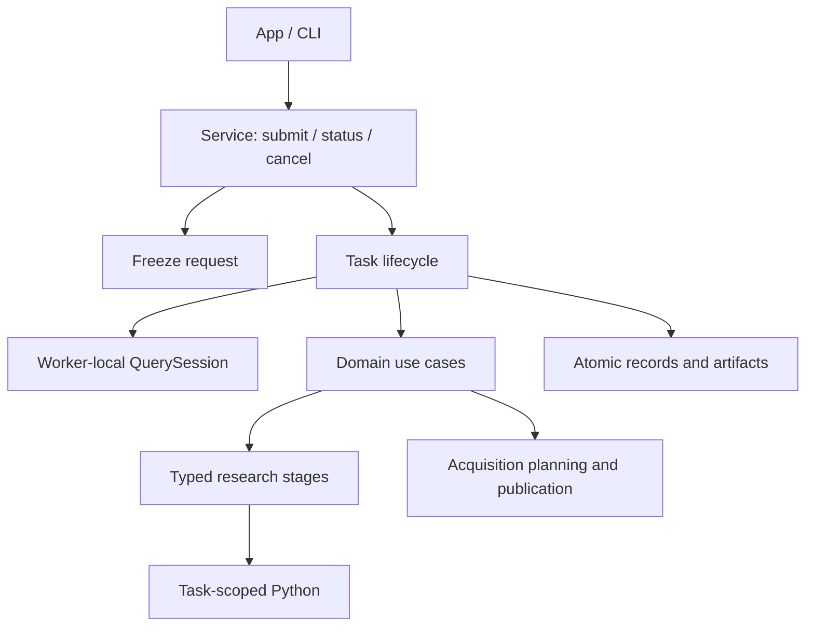
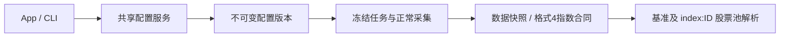
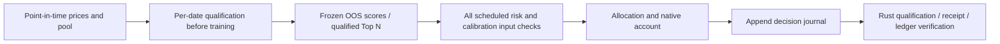

# analytics-workflow

## 本地存储管理

新增共享 `WorkflowRequest::Storage` 的扫描、预览和永久释放任务，以及资源清单、清理收据和独立能力状态。服务协议46，App/CLI同步更新；数据、模型及研究签名格式不变。
按生产者清单识别资源，按实际依赖保护训练材料与预测回放；保留任务参数、摘要、曲线及来源身份。提交前中断回滚，提交后启动继续删除；失败可重试相同计划。接口、统计口径、目录格式及复现命令见 [存储管理组件](src/storage_management/README.md)。

### 协议46升级与数据格式

45→46同步更新App、CLI和服务，拒绝旧服务协议，不协商、不降级。沿用overview/resources与清理完整核验；清单摘要格式3与SQLite文件索引分开保存，旧清单缓存重新生成，旧未执行计划重新预览。既有事务、收据及历史摘要保持格式1并正常恢复；工作区1、结果22、worker4及行情/模型签名格式不变，无需业务数据迁移。

账户执行身份使用组件内的 `research/rust-execution-dependencies.json`，由锁文件与workflow本地依赖闭包的有效Cargo合同生成；架构检查会拒绝过期收据。依赖变化后运行 `python3 crates/workflow/checks/execution_dependencies.py --write`。这会更新新执行的依赖身份，不修改既有结果的冻结身份及签名；旧结果仍按原产物核验。

## MSCI 官方收盘任务

`IndexOperation::CollectMsci {version, calendar_market, start, end}` 复用后台任务、取消、报告、原子发布和市场登记。提交冻结指数版本、日历市场及适配器签名，执行前重新校验。报告保留请求范围、实际范围、内部缺值和日历来源。服务协议46，原有行情格式及采集协议不变。仅采集指数收盘，不进入股票来源自动协调，不生产股票或成员历史。

验收：`DUCKDB_DOWNLOAD_LIB=1 cargo test -p analytics-workflow indices --lib`。

本组件负责本地工作区服务、输入冻结、不可变数据登记、任务生命周期和研究编排。
App/CLI 共用业务入口，DuckDB 与 Python 研究资源始终由计算任务拥有。
模块职责、依赖方向和数据流见 [源码组件说明](src/README.md)。

## 公共接口与数据流

- `Workspace`：工作区路径、独占锁、持久化运行记录和目录访问。
- `WorkflowRequest` / `ResearchTemplate`：共享业务请求和解析后的研究配置。
- `snapshot` / `execute`：提交时冻结输入，worker 内执行领域用例。
- `service::Client` / `TaskRequest`：Unix socket 客户端和单计算任务提交。
- `views`：后台读取目录、结果、日志与 NAV，不创建 native 句柄。
- `maintenance`：离线预览和可恢复归档；见下方命令。



一个工作区同一时间运行一个计算任务，无隐式排队。客户端退出不取消任务；
协作取消不能完成时回收研究进程组。结果校验及写盘失败不能发布成功。
终态转换统一由 `Workspace::finish` 完成，恢复只处理遗留 Running 记录。

## 研究输入与产物

工作流分别引用独立因子与标的配置，提交时冻结实际修订、日期和来源。
自定义公式由受限表达式注册表解析，不执行用户代码；可与内置 GTJA191 / Alpha158
混合选择。有序特征、公式版本、样本掩码和来源哈希均进入相应阶段签名。

完整研究组合准入、特征、训练、预测和一次连续账户执行。单独训练不执行账户；
已有模型预测不重新拟合；预测回放不加载模型。账户参数不进入因子签名。
缺失因子保留 null，模型适配为 missing；不得填零或静默删列。

年度因子共享缓存为运行父目录 `.factor-shards-v1`，预测缓存为 `.predictions-v1`。
缓存命中仍验证哈希、日期、特征与样本身份。未知来源冲突阻断，允许的缺失和
已披露不支持事件按冻结策略处理，不自动切换策略。账户参数和权益边界见
[研究后端](research/README.md)。

协议版本由 `service::PROTOCOL_VERSION` 定义；结果版本由
`research::backtest::RESEARCH_SCHEMA_VERSION` 定义；日程训练描述由
`research/backtest/artifacts::TRAINING_SCHEMA_VERSION` 定义。不要复制历史版本表。
旧研究结果归档后重建；原始行情与证据保留其有效读取格式。

## 构建与验收

```bash
crates/app/packaging/build-collector.sh
export DUCKDB_DOWNLOAD_LIB=1
cargo nextest run --workspace
cargo clippy --workspace --all-targets -- -D warnings
RUSTDOCFLAGS='-D warnings' cargo doc --workspace --no-deps
cargo fmt --all -- --check
python3 crates/workflow/checks/architecture.py
PYTHONPATH=crates/workflow/research target/collector-build/python/bin/python3 -B -m unittest discover -s crates/workflow/research/tests
```

开发时 `JFQUANT_COLLECTOR_RUNTIME` 可选择内置解释器；独立测试二进制可设置
`DYLD_LIBRARY_PATH="$PWD/target/debug/deps"`。生成数据、依赖、模型与打包产物不提交。
原生打包和测试应顺序运行，避免替换测试使用的解释器或争抢训练验收时限。

## 独立训练与跨池模型回测

`research::backtest::independent` 提供 `TrainingPlan`、`TrainingSchedule`、
`BacktestPlan`、`ModelSelection`、`ModelCatalogue` 和共享 worker `Job`。
`WorkflowRequest::Independent` 对 App/CLI 暴露训练、模型查询、两侧输入预检/补采和独立回测。


训练计划格式1没有测试区间。支持 `single {window}`、`manual {windows}`、
`rolling {first,step,expanding,until}`；窗口仅含 `train` 与可空 `validation`。
滚动 `until` 必须明确且在训练快照覆盖内。`config` 使用 FitConfig，仅包含有序因子及训练配置，没有账户字段。
回测计划格式1独立记录训练任务ID、`models`、B池、`range`、行情/行动版本和账户参数。
`models` 缺省为 `{"mode":"rolling"}`，或 `{"mode":"single","model_id":"..."}`。
第一版滚动序列仅来自同一训练任务。

每个模型记录原窗口、实际保留训练/验证样本数与证券集合、特征/标签最晚日期
`fit_data_end`、下一已知交易日 `available_from` 和真实完成时间。若训练快照尚无下一交易日，
`available_from` 为 null，执行时以 B 的已验证交易日历及 `date > fit_data_end` 判断。
每日选择已可用且截止日期最新的模型；同日截止按窗口发布顺序选择最后一个。
首日没有模型或窗口覆盖不足时明确失败，不缩短区间。切换不重置账户、不增加调仓。

A/B允许重叠，横截面分别按各自有效成员计算；入池前历史仅用于预热。
回测从模型读取公式修订、算子版本与特征顺序，不读取 A 行情或可变因子库。
回测基准须符合模型的基准输入契约。正常缺失保留 null；无未来收益标签不阻断预测。
训练签名按 A 的实际字段/身份、样本、标签边界及参数计算；预测绑定模型序列、B输入与日期，
账户再绑定交易规则。更换B或日期不训练；只改资金/交易参数可复用相同预测。

`training.json` 格式5在所有模型完成并校验后发布。失败/取消模型不能被查询为完整产物。
模型 manifest 仍使用3，增加 `fitting` 元数据；运行结果仅接收当前格式。
当前日程训练描述按签名验证，仅当具备签名覆盖的 `fit_calendar_sha256`、签名覆盖的拟合缓存与样本掩码、
特征及模型收据时才转为可验证清单；证据不足保留原回测入口，不补造日期或标的。
新独立回测可以重放已发布预测，重放固定 B 与候选范围，无需训练模型文件。

`model_selection.json` 保存提交时冻结的模型清单和日期区间；`independent_predictions.json`
保存预测、可空评价标签及按当前模型判定的曾见/未见标记。
`cross_pool_report.json` 包含每日有效候选/预测数量、分组IC、费用和同一账户损益贡献。
分组按当日模型，而非买入批次；两组不是独立策略收益。不能归属的权益损益单独列为
`unattributed_pnl_cny`，不隐式分摊。账户与模型切换来源同时写入结果和可读报告。

复现与验收：

```bash
DUCKDB_DOWNLOAD_LIB=1 cargo test -p analytics-workflow independent::tests
DUCKDB_DOWNLOAD_LIB=1 cargo test -p analytics-cli independent_fit_models
DUCKDB_DOWNLOAD_LIB=1 cargo test -p analytics-desktop independent_training_and_backtest_editors
DUCKDB_DOWNLOAD_LIB=1 cargo clippy -p analytics-workflow -p analytics-cli -p analytics-desktop --all-targets -- -D warnings
DUCKDB_DOWNLOAD_LIB=1 RUSTDOCFLAGS='-D warnings' cargo doc -p analytics-workflow -p analytics-cli --no-deps
cargo fmt --all -- --check
```

测试使用临时数据，覆盖A行情不可用、跨池及重叠、模型选择边界/并列、横截面手算、
混合递归因子延长终点保持原特征/信号、缺失评价标签、缓存失效和无模型文件的预测重放。

## 架构边界与离线维护

当前职责和数据流以 [源码组件说明](src/README.md) 为准。根模块仅导出接口；
用例、存储、请求冻结、查询会话、任务生命周期和研究阶段分别维护。
服务协议以 `service::PROTOCOL_VERSION` 为准；研究结果仅接收当前
`RESEARCH_SCHEMA_VERSION`；日程训练描述统一为 `TRAINING_SCHEMA_VERSION`，
独立训练目录继续使用自身的模型目录契约。旧运行时兼容不作为重构要求。

```bash
# 只读清单：文件哈希、旧任务和 JSON 引用；不会启动服务
jfquant --workspace "$JFQUANT_WORKSPACE" workspace maintain
# 停止服务后，获取独占锁并执行；中断后使用同一命令恢复
jfquant --workspace "$JFQUANT_WORKSPACE" service stop
jfquant --workspace "$JFQUANT_WORKSPACE" workspace maintain --apply
python3 crates/workflow/checks/architecture.py
```

维护不删除任何原始输入。旧任务及共享因子/预测缓存归档至
`.jfquant/archive/<UUID>/`，保留 manifest 哈希清单。旧任务原路径成为相对证据引用，
不再列入活动任务；共享缓存不保留活动别名，后续重新计算。行情、事件、公告、
来源收据、staging 和用户配置保持原位。配置无法通过当前解析时阻止维护并列出原因，
不猜测转换。尚未完成的维护 journal 阻止服务启动；恢复前重新校验清单中的文件。
归档不会自动删除。命令实现和中断/重复执行验收见 `src/maintenance.rs`。

## 组合数据检查（协议29）

`input_check::{InputCheckPlan,InputCheckReport,CheckRequest,run}` 提供依赖、输入、
实际因子计算、样本四阶段检查；只有四阶段完成且现有 `AdmissionReport` 允许时才就绪。
内置子集、跨目录和固定自定义修订使用相同有序 `FactorRef`；不运行 IC、训练或账户。
因子页 Parquet、研究 DailyDataset 是两个适配器，保留各自递归历史、价格转换和标签定义。
研究 preview/check、独立 TrainingInputs/BacktestInputs（不补采）及正式研究走同一 prepare/samples；
因子诊断及流水线也复用检查计算。补采仍使用已有需求计划，不把补采完成当作完整检查通过。

`input-check.json` 格式1记录冻结计划、请求/实际阶段范围、逐字段依赖范围、
缺失总数与 task/history 分类、逐因子有效率/标签配对数/连续空值日期和准入处置。
输入阻断时因子/样本保持 not_run。未能解析日程时保留失败报告，执行区间为空。
严格/允许缺失/合格样本沿用既有规则，默认严格；公式产生的正常空值不冒充源损坏。
空因子明确披露，不自动删列；训练仍要求每列有有效训练值并满足样本门槛。

依赖从 AST 按字段传播，合并重复窗口后按成员区间批量展开；阶段间空档不参与检查。
横截面依赖保留算子所在日期的成员上下文；标签可读取退出后日期。
研究执行基准只要求实际回测区间和前一交易日，因子使用基准时另按公式读取。
预测/回测末端按日历及有效基准收盘缩短，训练/验证不缩短；标签尾部缺失不缩短成交周期。

Parquet 全上下文缓存 `.factor-artifacts-v2` 使用 Float64 Parquet、manifest 和双哈希收据；
研究沿用 `.factor-shards-v1`。每次命中重新核对内容、日期键、股票池、顺序、定义、算子版本、
价格口径、历史/种子及输入身份。损坏/缺失缓存重新计算；不拼装旧单因子列，不信任 ready 标记。
App 的后台文件元数据探针仅提示报告过期，正式任务仍验证内容哈希。
两类缓存均可由维护归档处理。检查任务由 worker 持有 DuckDB，沿用进度、协作取消及任务持久化。

验收：`cargo nextest run --workspace` 包括逐字段/横截面/递归/范围外缺口、三档策略、
标签与基准尾部、完整检查无训练及正式任务缓存复用；安装包验收见 App packaging/verify-cli.sh。

共享证据维护使用 `WorkflowRequest::Evidence` / `action_evidence::EvidenceRequest`，提供选定文档捕获、终态采集恢复/重试、缺口与修订预览。工作区证据树、来源任务记录及原始行动版本冻结后再执行；正式发布与研究准入不由草稿状态替代。接口详见 [CLI 补证流程](../cli/src/README.md#公司行动证据维护agent-与-gui-共用)。

当前证据驱动的任务准入、历史失败追溯与验证命令见本组件 src 下的 README；公司行动状态按任务实际范围计算，采集失败记录不再等同于当前任务阻断。

## Corporate event research execution

Independent backtest plans now use schema **2**, with required `execution.corporate_event_policy`: `evidence_only` or explicit `research_transitions`. Generate a new plan with current CLI/App; old plans are rejected rather than silently migrated. Training catalogue schema 5, weights and feature contracts are unchanged. Result schema is **20**, local service protocol **31**, execution dependencies schema **2**, and shared rights/company-event accounting is `rust-filled-trade-ledger-events-v3`.

The shared adapter projects reviewed terminal/successor events, follows successor dependencies, and keeps earlier coverage requirements. Preflight freezes input checks and dependency hashes; execution verifies market/action bytes and these receipts without rebuilding coverage for every security. CLI task evidence status recomputes the same projection against its selected action version and frozen market/pool context. A migrated code does not splice normalized quotes; merger consideration never transfers model predictions or membership. Unsupported locked-successor events remain blocking.

`corporate_event_report.json` records candidate and actually exposed events, floor loss at conversion, synthetic liquidation notional/fees and phase audit. Synthetic amounts remain separate from exchange fills and fees. Pending assets enter NAV, never available buying power.

## 跨证券证据任务

协议31扩展现有 Evidence 工作流：Combine 合并核验后的完整查询与选定文档，Draft 可绑定终结任务；状态报告格式3、当前依赖格式2和草稿报告格式3。补证清单区分当前覆盖与事件问题，缺少完整历史不能推断所有事件字段缺失。草稿输出 validation-receipt.json，绑定行动版本、请求、冻结任务及证据树；publish 始终重验，不消费孤立的通过标志。状态查询不联网；投影失败保留结构化阻断及其余独立检查，取消不会降级为普通数据问题。

后继证券补采可通过修订5的 `structured_manifest` 引用已注册、完整核验的 HiThink 公司行动包；允许空 events/coverage_reviews 的纯附件修订。仅接受已有已发布事件指向、原包未查询过的后继证券，拒绝覆盖旧证券、无关证券、采集失败和未解决冲突；原文按哈希继承并在后续读取核验。可先用 `draft --request ... --task ...` 预览，再用原有 revise-actions 发布，不修改原任务和原模型。

提交只核对行动 manifest 的规范签名（`ActionBundle::snapshot_content`），不在持有服务控制锁时重放全部证据；worker 仍通过 `ActionBundle::read` 与 acquisition 检查核验原始字节。快照身份不是准入结论，证据篡改必须在 worker 阻断，不能用元数据缓存替代完整核验。

离线 ReconcileActions 将原生行动采集的 GP29 凭据一并交给存储层验证并冻结，沿用现有任务、取消和原子发布流程。停牌证明与事件历史覆盖分别判定；其用途仅为既有账户停牌估值，不改变因子输入。

## 数据修订与账户诊断

Evidence MarketDraft 和 ReviseMarket 共用只读校验，版本1收据绑定原行情、选择、来源树哈希和可选任务。发布重算校验，不读取ready标记；后台取消后不得rename发布。ImportStatus只导入独立停牌凭据，和ReconcileActions的全量条款协调分开。行动修订5发布格式10，服务协议46。

公告／GP29状态索引每任务一次，账户估值不进入因子输入。候选缺价报告先于撮合，实际账本在首个未知估值日汇总同日持仓缺口，将后续账户状态标为等待核验；不以假价格继续认证，也不把候选数当持仓影响数。补录市场进入既有完整数据签名，因子、标签、预测按完整上下文重新校验／计算；仅账户证据变化保留可验证预测复用。

人工审核差异化现金分红使用既有 Evidence Draft / ReviseActions。单份充分正式文件即可，草稿显示实际派息与除息参考分开引用的缺项；发布仅关闭匹配的问题并保存版本1分派审核收据，账户继续按原执行合同处理实际现金。原行情、模型与未解决冲突不改变。

## Shared index selection

`ResearchTemplate::builtin_index(ID)` builds a standard recipe for each routed core
catalogue index, retaining feature order, formula version and default schedule. Existing
CSI300/500 recipes remain unchanged; unknown IDs and catalogue-only entries return
explicit errors. `builtin:<ID>` resolves only the corresponding membership in the frozen
market version; absence never falls back to another pool or current constituents.

Refresh preserves every routed index's historical membership present in the input.
Current-member collection follows the selected builtin pool and provider capability,
independently of the chosen performance benchmark. Custom/composed pools do not imply
CSI500 membership. No histories, models or input caches are generated by selection.

Acceptance: `DUCKDB_DOWNLOAD_LIB=1 cargo test -p analytics-workflow index_recipes`.

## 工作区指数接入

`indices` 服务通过现有任务、取消和原子写入管理配置；配置格式1，服务协议46。
`.jfquant/indices/index-<完整内容哈希>.json` 是不可变版本；重复导入返回同一版本。
内置种子用 `builtin:<id>` 解析，用户版本不覆盖内置身份，不允许不同指数占用相同数据键或供应商路线。
修改展示字段生成新的配置完整性版本，但不改变计算合同签名，也不改写原有数据与任务。



`IndexOperation::Verify` 显式运行正常采集并登记新市场版本；报告记录请求日期、
实际有效收盘价范围、空值日期、适配器能力与身份核验边界。成功响应不证明未返回日期、
编制方身份或历史成分；币种和收益类型来自显式配置及接口合同，不能从代码推断。
训练/回测继续执行原有任务数据检查。验证报告绑定冻结配置及采集实现；后续任务重新验证自己的输入。
`indices list/show` 使用只读 RPC，不创建研究任务；App 目录通过后台读取更新。

自定义股票池引用 `index:<definition.id>`，要求所选市场快照中存在该定义和对应历史成员；
基准不要求成员数据。刷新从基础快照取得冻结映射，不随目录编辑变更。
验收：`cargo test -p analytics-workflow indices`，包括不可变版本、展示签名、映射冲突、篡改、
导入冻结、取消、导出及缺少成员数据。

本次指数接入格式已收敛：AdjustmentRecord 仅接受格式4（`index_input` 必填，普通证券及内置目录指数显式为 null，自定义指数冻结完整合同）；SourceMap 仅接受格式2，指数无可下单证券身份；CollectionRequest 必须显式包含 `index_inputs`（可为空对象）。正常读取不升级旧版本、不猜测缺失字段。旧快照只作历史留存，显式离线转换后必须以新内容哈希重新登记，原始响应及采集器身份不得改写成当前版本。服务协议46、采集协议16拒绝旧检查点；格式更新不等于来源准入通过。

## 指数历史成分任务

`membership_history::Operation`经`IndexOperation::History`提供Draft、Preview、Publish、Import、Status、Export、Capture、Material、Compare，复用worker、取消和报告持久化。提交冻结指数、市场/日历/映射、请求及原文哈希；执行重验。服务协议46。

发布选择确切连续范围，复制证据到`.jfquant/histories/history-<SHA256>/evidence/`。产物格式2包含请求、审核、规则版本、日历、映射、报告及成员区间；读取重验冻结副本及结果，不信任ready标记。导出生成history.json及相对原文；导入重验。

股票池格式3增加显式history表达式。事实预览可用；任务按实际阶段日期校验可知时间及身份，历史输入参与既有签名。组合股票池解析合同显式使用 resolution_schema_version=1，histories 必填（无历史依赖时为空数组）；缺失、错误类型及旧解析格式直接拒绝，需重新解析。新合同改变组合池计算签名，旧计算产物重新检查，不改写历史任务或模型。内置及 index: 股票池继续使用其独立的市场成员合同。ready表示存在事实区间且原文/核对绑定完整性通过；facts_complete表示请求内事实完整；task_ready还要求请求交易日可知时间完整，均不能替代正式研究准入。

验收：`DUCKDB_DOWNLOAD_LIB=1 cargo test -p analytics-workflow membership_history --lib`；架构：`python3 crates/workflow/checks/architecture.py`。


### 历史补证材料任务

服务协议46仅接受历史请求/报告/产物2；旧任务记录和原文保留，旧产物不能直接使用，需准备当前格式请求并重新验证发布；没有旧格式转换模块或运行时猜测。`history_material::MaterialAction`提供Inspect、Register、Extract、Review；检查只读离线，采集仅由Capture显式联网。文件、PDF与像素解码全部在worker。Inspect分别返回`material_status`、带来源/哈希的`extracted_texts`和可选缩略RGBA；Review显式生成原图区域核对收据，返回新草稿，不修改旧文件。取消不会发布历史产物。

`Compare`接收两个预览任务ID，要求相同`task_context_signature`（指数计算合同、市场、日历、身份、请求范围及规则）；证据变化仍允许比较。结果分别列解除/剩余/新增诊断、新增/失去证明日期和连续区间数量。完整冻结签名仍包含证据与修订，任何关键输入变化使旧预览失效；正式发布重新核验副本。


验收：`DUCKDB_DOWNLOAD_LIB=1 cargo test -p analytics-workflow history_ --lib`；`python3 crates/workflow/checks/architecture.py`。研究数据、模型和既有因子合同不改变。

## 组合优化与离线迁移

`allocation::AllocationConfig`是股票和策略共用的目标合同，缺少新字段时拒绝读取。默认等权、风险窗口252、单股上限0.1、策略上限0.6、无换手限制；固定目标仓位0.98。小股票池须显式提高上限，否则失败。均值方差必须填写正的risk_aversion。收益期限与调仓周期一致，收益端点必须已经实现；不填零、删候选或降级。

`research::backtest::combined::{CombinedPortfolioPlan,Job}`接受2—20个成功原生股票策略任务，不递归组合。来源市场、日历和事件政策一致；提交冻结来源字节，worker重验。参考账从目标、原价和事件事实重建，独立维护分数股、现金、待执行目标和锁定资产。普通参考初始资金为1 CNY，事件要求的离散数量及现金舍入仍保留，因此涉及离散权益时不能假定资金规模完全不影响参考结果。


prediction_start指定已有调度必须生成的历史样本外预测起点；reference_start指定参考账预热起点；execution_start指定正式账户起点。null使用既有调度/执行区间。不会用训练预测补足历史，也不自动移动起点。allocation-readiness.json在训练前列出三类区间、缺口与最早可能就绪日期下界；App输入检查直接展示。具体候选与收益端点随真实样本外预测再次核验。正式收益排除预热；风险需要252个完整H期观测，校准默认至少60个有效横截面、每日30个配对证券。

因子、训练、校准、优化和成交分别留痕；训练签名只绑定训练代码及所用库，不因优化配置变化失效。完整产物包含allocation-input.json、allocation_report.json、allocation-manifest.json、reference-targets.json、reference-input.json、reference-account.json和reference-event-checks.json；最终执行签名绑定其哈希。calibration、optimization、execution分别记录代码及依赖签名；校准收据按评分日期关联模型拟合截止日、策略合同、配对数量和H日收益端点。求解器不精确状态附带警告，风险预算显式报告贡献偏离。

服务39、worker3、研究结果21、独立回测计划3、模板/工作流11。正常服务不转换旧格式。离线迁移仅解析升级前模板10和独立回测计划2；未知格式列阻断。旧配置转为显式等权、单股上限1，保留原Top N及周期；旧模型/缓存/研究产物归档，原始数据和证据保持。配置备份、逐文件哈希和事务日志支持恢复；新任务或配置阻止回滚。

```bash
export DUCKDB_DOWNLOAD_LIB=1
cargo run -p analytics-cli -- --workspace "$JFQUANT_WORKSPACE" workspace migrate-allocation
# 服务停止并释放工作区独占锁后执行；外部配置逐份显式传入
cargo run -p analytics-cli -- --workspace "$JFQUANT_WORKSPACE" workspace migrate-allocation --apply --config /absolute/plan.json
# 迁移后无新任务/配置时，支持离线回滚；中断后重复原命令恢复
cargo run -p analytics-cli -- --workspace "$JFQUANT_WORKSPACE" workspace migrate-allocation --rollback
cargo test -p analytics-workflow --lib
PYTHONPATH=crates/workflow/research target/collector-build/python/bin/python3 -B -m unittest discover -s crates/workflow/research/tests
python3 crates/workflow/checks/architecture.py
```

池外强制退出沿用所选退出政策，生成显式pool_exit目标并核验全账户换手；资金暂留现金，下一次定期调仓恢复普通目标预算。撤单意图在同一回调中先移除原生挂单投影，替换订单前重查现金、可卖股份及锁定资产；收据保存两次快照。

组合来源可使用不同基准；基准仅属于已冻结的子策略评分合同。统一账户的展示基准取显式来源列表的第一项，市场、日历及事件事实和政策仍须一致。

外部工作流的工作区外profile引用必须同时在显式迁移文件清单中；正常启动检查注册配置的引用和格式。未列明的外部引用不会被扫描或隐式补迁。迁移归档还包括旧.factor-cache及带research_signature/formula_version审计标记的历史研究目录，证据采集产物保留。

股票层与策略层的H均取各自调仓周期。H大于1时，最近252个完整H日收益允许重叠，代表252个收益起始交易日，不代表252个独立观测。


## Allocation admission revision

Current contracts: service 44, research worker 4, research result 22, workflow/template 12, independent backtest plan 4, combined plan 2, allocation input/report/manifest 2. Normal readers reject previous formats; `workspace migrate-allocation` explicitly upgrades template/workflow 10–11, backtest plan 2–3 and combined plan 1. Revision transactions use `.jfquant/allocation-admission-migration.json`; the previous migration journal and backups remain intact. An unfinished previous-generation transaction must first finish with its original binary. Migration preserves existing methods, windows and caps, sets `candidate_policy="unfiltered"` and preserves the old numerical tolerance (`1e-10` for format 11/plan 3); new configurations use `1e-9`. No default migration enables filtering or changes Top N.

## 日频三因子自算

BigQuant提供独立离线入口 `Workspace::publish_bigquant_market_factors(market, artifact, output)`。
它获取工作区租约，核验基准行情、产物实现/字段/内容哈希并重算报告，复制到新目录，
通过正常读取器核对 `three_factor_returns.json` 后登记新行情。源manifest保留原来源，
增加原行情身份与 `bigquant_market_factor` 构造manifest；不启动研究服务。
产物含全市场MKT（未减RF），SMB/HML保持null，`full_three_factor_ready=false`。
`Workspace::publish_bigquant_size_value_factors` 使用同一发布事务重放 PIT 年度分组及六组收益包，
以 `bigquant_size_value_factor` 保存构造manifest并写入含 SMB/HML 的标准文件。
完整性取构造manifest的实际日数，缺失不补零；公开接口与验收见
[PIT 年度分组](../storage/src/bigquant/README.md#pit-年度分组与-smbhml)。
[固定投影、停牌规则与CLI](../storage/src/bigquant/README.md#全市场-mkt-构造与发布)。
验收：`DUCKDB_DOWNLOAD_LIB=1 cargo test -p analytics-workflow bigquant_ --lib`。

新增`WorkflowRequest::CollectThreeFactorInputs {market,inputs,availability,resume}`，
同一worker从BuildRequest空事实模板采集通达信逐日股本、年度权益。冻结模板字节、
行情、规范化/构造实现、采集器/依赖身份；恢复还核对口径和检查点所有者。成功后的
details.artifact指向`inputs.json`，同目录保留`fundamentals.json`、raw回执和原模板。
失败或取消不发布输入包。`BuildThreeFactors`在提交和执行时重放原生规范化验证，
最终行情的`three_factor_build/`保存完整可复算输入包及时间假设manifest。

默认`observed_on`不能把今天采集的版本倒填至历史；显式`provider_dates`可计算供应商
历史日期口径，保留`revision_vintage_verified=false`。构造版本v2、服务协议46。
不自动改变因子选择，不认证全市场或无前视财务。[字段与完整命令](../storage/src/three_factor/acquire/README.md)。

`WorkflowRequest::BuildThreeFactors { market, inputs }` 由共享worker执行，CLI/App共用。
`inputs` 为[三因子输入格式2](../storage/src/three_factor/README.md)，只接受当前格式，
provider_history必须显式填写null或对象，采集请求availability必填；服务不补旧字段。
旧数据仅本地离线转换并保留备份，派生行情重新计算登记，旧回执和旧签名不改写。
路径可以是工作区相对路径
或显式绝对路径。提交时冻结原文件字节SHA256、构造版本、实现签名和行情版本；执行前
拒绝输入或实现改变，计算后再次核验原行情。原行情保持不变，新行情副本独立登记。

新行情根目录写入 `three_factor_returns.json` 和 `three_factor_build/`：原样 `inputs.json`、
逐年分组/逐日组合/缺失原因 `report.json`、包含原行情身份及文件哈希的 `manifest.json`。
保留原行情来源、原始回执和合成标记；生成结果不会把自述财务事实升级为已认证的全市场
数据。`ready` 表示所请求日期三列全部非空；任务仍可发布带null的诊断结果，并返回
`complete_observations/incomplete_observations`。未自动修改研究因子选择。

```sh
DUCKDB_DOWNLOAD_LIB=1 cargo test -p analytics-workflow three_factor_build --lib
DUCKDB_DOWNLOAD_LIB=1 cargo test -p analytics-cli --test platform three_factor
```

`AllocationConfig.candidate_policy` is explicit: `unfiltered` preserves candidates and fails on missing optimizer input; `complete_risk_window` checks complete realized H-day endpoint history **before** score ranking. It applies to stock strategies and can also be selected for their equal-weight comparison baseline. Eligibility is computed separately for every decision date using endpoints no later than that date. It never alters factor/training membership, shortens the risk window, fills prices, reduces Top N or relaxes caps. Insufficient eligible candidates fail before training when identifiable from the pool, or after predictions before opening the actual account. Empty source signals retain liquidation semantics. Combined capital allocation consumes frozen source stock qualifications and does not filter source strategies.

`allocation-eligibility.json` records early per-date identities, excluded endpoint dates, reason (`verified_suspension` versus `unknown_price_or_tradeability`) and hashes. The frozen `allocation-input.json` includes that evidence, its hash and the Rust-owned `STOCK_EXPOSURE`; Python has no independent exposure literal. `allocation-admission.json` records actual prediction-based checks and all failing scheduled dates before matching. Method comparison requires identical eligibility hashes, policy, window and account constraints.

Calibration percentiles are defined on the scoring day's qualified cross section. Once labels mature, known suspension endpoints are excluded **without reranking** and recorded per date; unknown label prices still block. Each used date retains equal total regression weight. Dates below the configured pair threshold are disclosed and omitted; the minimum number of valid dates is still required. Neither future endpoints nor later eligibility determine the earlier ranking.

CLARABEL uses explicit `solver_tolerance` (new default `1e-9`, allowed `1e-12`–`1e-6`) for feasibility and absolute/relative gaps, with objective scale 1000 and constraint scale 100 for numerical conditioning. Scaling preserves the mathematical constraints; returned weights are never clipped or normalized. Both scales, solver state, iterations and objective value are recorded and signed. Independent constraint tolerance remains `1e-6`; execution additionally rejects negative targets before cancelling orders or invoking AKQuant. An inaccurate status remains a warning and does not establish objective optimality. Closed-form, flat-return and boundary-weight regression cases cover numerical accuracy and strictly nonnegative execution.

Reference-account target quantities are calculated only for securities with positive trading volume and a valid open. An unheld target without a tradable opening quote remains pending with cash intact; each later session recomputes it, and a newer instruction replaces it. Missing valuation for an existing holding still fails, as does a positive-volume row without a valid opening price. This does not create a quote or infer a suspension from a missing row. Reproduce the reference checks with `DUCKDB_DOWNLOAD_LIB=1 cargo test -p analytics-workflow allocation_reference --lib`.

Decisions append once to `allocation-decisions.jsonl`; the running report contains counts, and completion/failure writes the full report once. Rust verifies the journal against targets and decisions, qualified identities and endpoint prices against input, then the existing account ledger. There is no quadratic cumulative rewriting of the full decision history.



Acceptance commands (generated fixtures stay under target):
```sh
DUCKDB_DOWNLOAD_LIB=1 cargo test --workspace
DUCKDB_DOWNLOAD_LIB=1 cargo clippy --workspace --all-targets -- -D warnings
PYTHONPATH=crates/workflow/research target/collector-build/python/bin/python3 -B -m unittest discover -s crates/workflow/research/tests
python3 crates/workflow/checks/architecture.py
```

正常入口不补齐缺失的新协议字段：模板必须显式携带格式12，worker必须收到格式2的优化输入及显式的missing_prices、admission、prediction_provenance字段；旧格式与字段缺失均在账户启动前拒绝。当前标准流水线训练描述符4与独立训练目录5分别由两个现行入口生成，均严格验证当前嵌入合同，并不接受旧版本模型协议。旧配置解析和转换仅存在于显式离线迁移模块。

Signed JSON uses serde_json's `float_roundtrip` parser: saving, reopening and copying solver weights must preserve their exact f64 values and signature, including scientific-notation boundary weights. Publication checks the persisted execution signature before the task can succeed. There is no fallback verification or rewriting of previously mismatched results; rerun them. The execution component signature includes persistence code and workspace dependency features. Reproduce: `DUCKDB_DOWNLOAD_LIB=1 cargo test -p analytics-workflow signed_floats_survive_repeated_publication --lib`.

Reference buys use the largest affordable representable fractional quantity: if Decimal division rounds a cash-limited quantity above available cash, the reference account steps down one least-significant share unit and verifies affordability before trading. It never clamps negative cash, repairs optimizer weights or changes the requested target. Regression checks include `1/6`, prices `91.19` and `123.456789`, and very small balances; errors retain the failing date and cash amount.

## GTJA191 v5完整定义（2026-10-18）

191项均可计算；12项原歧义公式采用公开的JFQuant解释，精确执行式与原文一起进入
FactorSpec、manifest和[因子审计](../factor/FACTOR_AUDIT.md)。默认组改为190项，
历史178项相对顺序保持；旧v4配置/模型不会自动升级。全191项显式配置为
`templates/factors/gtja191-full.json`，也可在界面选用Alpha030。

Alpha030需要数据根目录的`three_factor_returns.json`，格式见
[storage接口](../storage/README.md#alpha030外部三因子输入)。输入依赖规划、原生日频年度
面板、Parquet因子页和原管道均读取同一来源，保留null和decimal单位；严格策略阻止
缺少必要来源，允许缺失策略沿用null及样本门槛，不伪造输入。
来源元数据和文件字节进入快照、年度分片及独立输入签名，修改来源会使缓存失效。

```bash
DUCKDB_DOWNLOAD_LIB=1 cargo test -p analytics-workflow alpha030
DUCKDB_DOWNLOAD_LIB=1 cargo test -p analytics-workflow recipes_validate_order_version_and_parameter_signatures
```

## 存储优化：协议46

`StorageRequest`新增`MigrationPlan { resources } / MigrationApply { plan } / Export { resource, output }`；`ResourceQuery`在服务端筛选，RPC增加StorageResources及StorageMigrations。App/CLI/服务同步升级到46，拒绝45。扫描缓存格式3改用SQLite全量重建，旧未执行清理计划重新预览；清理事务/收据/历史摘要仍用格式1恢复。新发布不可变行动及公告证据按原文哈希共享压缩，显式迁移历史证据；业务manifest和模型schema不变。

数据流、永久释放、恢复/导出命令及可复现性能验收见[存储管理组件](src/storage_management/README.md#sqlite-索引与共享证据协议46)。`DUCKDB_DOWNLOAD_LIB=1 cargo test -p analytics-workflow storage_ --lib`验证迁移/清理、共享引用、历史摘要、模型复用及预测回放保护。

新行动/公告生产者在成功发布时显式登记准确manifest及数据版本/任务归属，不依赖catalog扫描、UUID子串或目录存在性推测。迁移预览区分文件条目与按原文SHA256去重的唯一对象。
