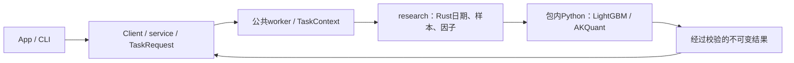

# analytics-workflow

本组件拥有工作区、不可变数据登记、独立因子／标的／工作流配置、Unix socket服务、
任务记录、研究编排和Python研究进程监督。App与CLI交换普通数据，后端句柄不进入UI。



公共入口：`Workspace`、`WorkflowRequest`、`service::TaskRequest`、`service::Client`、
`ResearchTemplate`；研究入口集中在 `research::pipeline` 与 `research::backtest`。
Python协议及支持边界见 [research/README.md](research/README.md)，Rust目录见
[src/research/README.md](src/research/README.md)。不再依赖或维护独立analytics-ml。

## 协议与产物

服务14；工作流10（仍分别引用factors与targets）；模型manifest2；训练描述3；结果14。
行情、公司行动、采集和原始证据格式保持原版本。旧输入明确拒绝，不自动转换，
原文件、运行状态与日志保留。独立配置解析后冻结到任务，运行中不跟随文件编辑。

`research::backtest::run_with_context`按既有日期切分与样本规则计算Rust因子，各折调用
同一Python进程训练预测，再将全部样本外信号一次交给AKQuant，跨折跨年不重置账户。
训练产物可独立读取及复用；模型和描述文件的哈希、公式、顺序与运行时签名均核验。

同一工作区同时一个计算任务，无隐式排队。关闭客户端不取消任务；取消协作退出，
两秒后终止研究进程组；进程崩溃不发布完整结果。日志不携带供应商凭据。

## 缓存和错误

因子缓存位于运行目录父级的`.factor-cache/签名`，以行情、股票池、价格口径、公式与
特征顺序隔离。每次任务保留自己的已验收副本；失败样本准入不发布共享缓存。
模型签名增加训练参数、日期、训练／验证掩码及依赖；回测签名增加账户、执行行情、
预测来源、事件和引擎口径。因子null保留为缺失值，不自动填零或删列。

已知不支持的权益事件、无法映射的费用参数或实际持仓无法估值停止回测，保留已完成
模型。`execution_readiness.json`记录停止原因；无有效交易与完成回测分开显示。

## 构建与验收

```bash
crates/app/packaging/build-collector.sh
DUCKDB_DOWNLOAD_LIB=1 cargo check -p analytics-workflow --all-targets
DUCKDB_DOWNLOAD_LIB=1 cargo nextest run -p analytics-workflow
DUCKDB_DOWNLOAD_LIB=1 RUSTDOCFLAGS="-D warnings" cargo doc -p analytics-workflow --no-deps
```

开发时`JFQUANT_COLLECTOR_RUNTIME`可指定包内解释器，生产构建只从App包解析。
底层DuckDB测试二进制独立启动时需要`DYLD_LIBRARY_PATH="$PWD/target/debug/deps"`。
生成数据、缓存、模型和临时输出不提交。设计取舍沿革见[DECISIONS.md](DECISIONS.md)。

复用模型回测支持独立账户覆盖 `ResearchExecution`：资金、费用、持仓数、调仓周期及退池策略。
App提交当前账户设置；CLI可用 `research backtest --training <ID> --actions <ID> --template <PATH>`。
只提取模板的账户字段；原模型特征、训练日期和参数仍由训练产物冻结。
