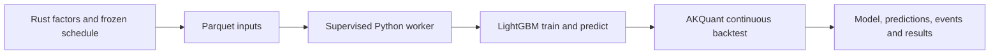
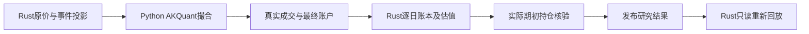

# Python research worker

`jfquant_research` is the private research backend supervised by `analytics-workflow`.
It uses AKQuant 0.3.66 and Python LightGBM 4.7.0. It does not execute user scripts,
embed Python in Rust, load Rust LightGBM handles, or implement another exchange.



Protocol 1: stdin accepts JSON Lines with `version`, `signature`, `operation` and
operation-specific file references. Operations are `train`, `predict`, `backtest`,
`cancel`, `shutdown`. Stdout contains only `ready`, `progress`, `complete`, `error`.
Library output is redirected to stderr. A dedicated input reader accepts cancellation
while the main thread computes. Rust kills the process group after two seconds when
cooperative cancellation cannot finish. Model handles never leave this process.

One task reuses one process across all folds and final backtest. Train and predict
matrices cross the process boundary as Parquet, with named columns in manifest order;
Arrow nulls become NumPy NaN. Test data never participates in early stopping. The
saved best model is reloaded for test metrics and later prediction. Completed model
artifacts survive a failed backtest; a complete summary is published only on success.

Trading uses the upstream next-open fill mode, raw prices, T+1, 98% target exposure,
10% per-bar participation, integer shares, and no forced final liquidation. AKQuant's
lot size represents board increments; distinct board minimum sizes and daily price
limits are not modeled. Fees are the upstream total, recorded from each fill, without
invented exchange/broker breakdowns. Gross commission or AllInclusive maps to the
upstream model; Net, unequal global transfer/stamp rates and nonzero dividend tax
are rejected. Custom legacy tick, sale-delay, minimum-quantity and price-limit settings
are also rejected instead of silently ignored. Distribution/split rights apply on ex-date. Known unsupported events use the Rust adapter’s fixed `warn_and_skip` projection: they are disclosed and omitted without changing signals or account positions. Ordinary event conflicts block publication when actual opening positions are exposed; audited policy blocks them before simulation. There is no registration/pay/listing-date rights ledger.

The bundled interpreter and hash-locked dependencies are shared with collectors;
processes and lifetimes remain independent. Runtime changes invalidate model reuse.
Build from the repository root:

```bash
crates/app/packaging/build-collector.sh
DUCKDB_DOWNLOAD_LIB=1 cargo test -p analytics-workflow
DYLD_LIBRARY_PATH="$PWD/target/debug/deps" cargo test -p analytics-workflow
PYTHONPATH=crates/workflow/research target/collector-build/python/bin/python3 -B -m unittest discover -s crates/workflow/research/tests
```

The second test command is useful when launching standalone test binaries that do
not inherit Cargo's dynamic-library search path. Do not commit runtime trees,
datasets, wheel files, models or temporary outputs.

本轮测量、命令及剩余目标环境验收见 [ACCEPTANCE.md](ACCEPTANCE.md)。


### Rust closing ledger

AKQuant 0.3.66的跨证券延后成交可能发生在其当日曲线已记录之后，盘后回调也可能延迟到下一交易日。因此回调持仓与上游逐日曲线不能直接作为最终研究账户。

Python只导出带日期的真实成交、拒单、原始曲线及`on_stop`最终账户（`native_account_daily.json`）。Rust `backtest/account.rs`从初始现金，按日先应用已支持的除权日Dividend/Split投影，再回放全部成交与费用，以原价及有证据的停牌标记估值。`portfolio_snapshots.json`包含持仓、现金、权益和`valuation_prices`；`daily.json`的收益、换手率、费用及持仓数由该账本生成。最终股份、现金和权益必须与引擎最终账户一致，真实持仓缺价拒绝发布。前日账本持仓用于事件暴露核验。

`execution.json`冻结`accounting_version=rust-filled-trade-ledger-v1`并进入结果签名；`execution_actions.json`保存实际支持的事件投影，`engine_curve_differences.json`披露上游曲线与完整成交账本的日内记录时点差异。`research verify`只读地再次回放相同Rust账本，检查收益、分年指标、费用、实际暴露及估值行无成交，返回产物哈希。不支持的事件继续警告/跳过，不补造配股或日期；产物一致不代表无样本偏差或事件模拟完整。

旧结果仍可查看，缺少当前账本产物时不能通过新审计。研究worker生产者签名变化会要求重新训练，不绕过旧模型签名检查。Python测试中的小账本仅是跨语言fixture参考，生产账户逻辑在Rust。



验收覆盖多次换股及延后成交、旧股基数先现金后送股、最终账户篡改、持仓缺价、费用不一致、估值行成交和未模拟事件披露。
