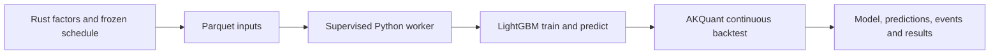

# Python research worker

`jfquant_research` is the private research backend supervised by `analytics-workflow`.
It uses AKQuant 0.3.66 and Python LightGBM 4.7.0. It does not execute user scripts,
embed Python in Rust, load Rust LightGBM handles, or implement another exchange.



Protocol 1: stdin accepts JSON Lines with `version`, `signature`, `operation` and
operation-specific file references. Operations are `train`, `predict`, `backtest`,
`cancel`, `shutdown`. Stdout contains only `ready`, `progress`, `complete`, `error`.
Library output is redirected to stderr. A dedicated input reader accepts cancellation
while the main thread computes. Rust kills the process group after two seconds when
cooperative cancellation cannot finish. Model handles never leave this process.

One task reuses one process across all folds and final backtest. Train and predict
matrices cross the process boundary as Parquet, with named columns in manifest order;
Arrow nulls become NumPy NaN. Test data never participates in early stopping. The
saved best model is reloaded for test metrics and later prediction. Completed model
artifacts survive a failed backtest; a complete summary is published only on success.

Trading uses the upstream next-open fill mode, raw prices, T+1, 98% target exposure,
10% per-bar participation, integer shares, and no forced final liquidation. AKQuant's
lot size represents board increments; distinct board minimum sizes and daily price
limits are not modeled. Fees are the upstream total, recorded from each fill, without
invented exchange/broker breakdowns. Gross commission or AllInclusive maps to the
upstream model; Net, unequal global transfer/stamp rates and nonzero dividend tax
are rejected. Custom legacy tick, sale-delay, minimum-quantity and price-limit settings
are also rejected instead of silently ignored. Distribution/split rights apply on ex-date. Known unsupported events use the Rust adapter’s fixed `warn_and_skip` projection: they are disclosed and omitted without changing signals or account positions. Ordinary event conflicts still block execution. There is no registration/pay/listing-date rights ledger.

The bundled interpreter and hash-locked dependencies are shared with collectors;
processes and lifetimes remain independent. Runtime changes invalidate model reuse.
Build from the repository root:

```bash
crates/app/packaging/build-collector.sh
DUCKDB_DOWNLOAD_LIB=1 cargo test -p analytics-workflow
DYLD_LIBRARY_PATH="$PWD/target/debug/deps" cargo test -p analytics-workflow
PYTHONPATH=crates/workflow/research target/collector-build/python/bin/python3 -B -m unittest discover -s crates/workflow/research/tests
```

The second test command is useful when launching standalone test binaries that do
not inherit Cargo's dynamic-library search path. Do not commit runtime trees,
datasets, wheel files, models or temporary outputs.

本轮测量、命令及剩余目标环境验收见 [ACCEPTANCE.md](ACCEPTANCE.md)。
