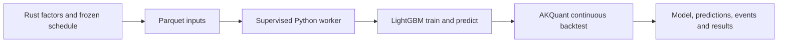
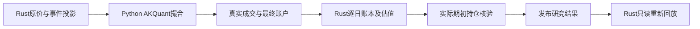

# Python research worker

`jfquant_research` is the private research backend supervised by `analytics-workflow`.
It uses AKQuant 0.3.66 and Python LightGBM 4.7.0. It does not execute user scripts,
embed Python in Rust, load Rust LightGBM handles, or implement another exchange.



Protocol 4: stdin accepts JSON Lines with `version`, `signature`, `operation` and
operation-specific file references. Operations are `train`, `predict`, `backtest`,
`cancel`, `shutdown`. Stdout contains only `ready`, `progress`, `complete`, `error`.
Library output is redirected to stderr. A dedicated input reader accepts cancellation
while the main thread computes. Rust kills the process group after two seconds when
cooperative cancellation cannot finish. Model handles never leave this process.

One task reuses one process across all folds and final backtest. Train and predict
matrices cross the process boundary as Parquet, with named columns in manifest order;
Arrow nulls become NumPy NaN. Test data never participates in early stopping. The
saved best model is reloaded for test metrics and later prediction. Completed model
artifacts survive a failed backtest; a complete summary is published only on success.

Trading uses the upstream next-open fill mode, raw prices, T+1, 98% target exposure,
10% per-bar participation, integer shares, and no forced final liquidation. AKQuant's
lot size represents board increments; distinct board minimum sizes and daily price
limits are not modeled. Fees are the upstream total, recorded from each fill, without
invented exchange/broker breakdowns. Gross commission or AllInclusive maps to the
upstream model; Net, unequal global transfer/stamp rates and nonzero dividend tax
are rejected. Custom legacy tick, sale-delay, minimum-quantity and price-limit settings
are also rejected instead of silently ignored. Distribution/split rights apply on ex-date. Known events without a supported execution projection block execution. Ordinary event conflicts block publication when actual opening positions are exposed; audited policy blocks them before simulation. The shared Rust rights and company-event journals handle explicit supported settlement phases.

The bundled interpreter and hash-locked dependencies are shared with collectors;
processes and lifetimes remain independent. Runtime changes invalidate model reuse.
Build from the repository root:

```bash
crates/app/packaging/build-collector.sh
DUCKDB_DOWNLOAD_LIB=1 cargo test -p analytics-workflow
DYLD_LIBRARY_PATH="$PWD/target/debug/deps" cargo test -p analytics-workflow
PYTHONPATH=crates/workflow/research target/collector-build/python/bin/python3 -B -m unittest discover -s crates/workflow/research/tests
```

The second test command is useful when launching standalone test binaries that do
not inherit Cargo's dynamic-library search path. Do not commit runtime trees,
datasets, wheel files, models or temporary outputs.

本轮测量、命令及剩余目标环境验收见 [ACCEPTANCE.md](ACCEPTANCE.md)。


### Rust closing ledger

配股账户使用 `rust-filled-trade-ledger-events-v3`，当前普通账户与配股账户分别核验。原生补丁在日切完成全部上日成交后记录登记权益，日初按冻结策略处理认购、退款和上市；待上市资产计净值但不计购买力。Python仅配置输入和导出 `rights_state.json`，Rust重放并比较全部状态、现金、股份和最终权益。认购本金与配股费用单列，不伪装成市场成交。

`research replay-predictions --source UUID --actions VERSION` 消费成功回测已发布的预测和完整样本回执，无模型加载或重训；原生产环境只记录为来源，独立核验预测哈希、训练描述签名、日期、特征和市场身份。App“配股与预测复用”提供同一策略：`--participation participate|abandon`、`--attempt first_day|last_day`、`--insufficient-cash partial|all_or_abandon|stop`。默认依次为participate、first_day、partial。实际持仓必要资料不足时输出 `rights_gap_report.json`，不发布收益。

原生 fixture：先运行 `PYTHONPATH=crates/workflow/research target/collector-build/python/bin/python3 -B -m unittest discover -s crates/workflow/research/tests`；跨语言账本检查使用合成fixture目录设置 `JFQUANT_RIGHTS_FIXTURE_DIR`，执行 `DUCKDB_DOWNLOAD_LIB=1 cargo test -p analytics-workflow native_rights_fixture -- --ignored`。`backtest_timing.json`记录撮合墙钟和进程峰值内存；性能结论必须比较同一输入，不能由Rust/Python标签推断。

AKQuant 0.3.66的跨证券延后成交可能发生在其当日曲线已记录之后，盘后回调也可能延迟到下一交易日。因此回调持仓与上游逐日曲线不能直接作为最终研究账户。

Python只导出带日期的真实成交、拒单、原始曲线及`on_stop`最终账户（`native_account_daily.json`）。Rust `backtest/account.rs`从初始现金，按日先应用已支持的除权日Dividend/Split投影，再回放全部成交与费用，以原价及有证据的停牌标记估值。`portfolio_snapshots.json`包含持仓、现金、权益和`valuation_prices`；`daily.json`的收益、换手率、费用及持仓数由该账本生成。最终股份、现金和权益必须与引擎最终账户一致，真实持仓缺价拒绝发布。前日账本持仓用于事件暴露核验。

`execution.json`冻结`accounting_version=rust-filled-trade-ledger-v1`并进入结果签名；`execution_actions.json`保存实际支持的事件投影，`engine_curve_differences.json`披露上游曲线与完整成交账本的日内记录时点差异。`research verify`只读地再次回放相同Rust账本，检查收益、分年指标、费用、实际暴露及估值行无成交，返回产物哈希。未投影的已知事件阻断执行，不补造配股或日期；产物一致不代表无样本偏差或事件模拟完整。

旧结果归档后重建，缺少当前账本产物时不能通过新审计。研究worker生产者签名变化会要求重新训练，不绕过旧模型签名检查。Python测试中的小账本仅是跨语言fixture参考，生产账户逻辑在Rust。



验收覆盖多次换股及延后成交、旧股基数先现金后送股、最终账户篡改、持仓缺价、费用不一致、估值行成交和未模拟事件披露。

共享研究环境使用 pandas 3.0.6，保留输入日期、股数、金额和 null 契约。升级依赖会改变运行环境签名，旧模型环境检查继续生效；已有预测可经 `research replay-predictions` 做执行回归，无需重训。对照要求预测、成交数量和身份一致，普通浮点账户沿用现有核验容差。

## Runtime resource ownership

This component owns `requirements.in`, `requirements.lock` and
`akquant-source.lock.json`. Packaging installs collector and research locks together,
then copies this lock as `research-requirements.lock` into the bundled interpreter.
Research dependency fingerprints use this lock plus the AKQuant source receipt;
research Rust code no longer embeds resources from the App directory. Versions and
wheel hashes were retained from the previously verified environment.

Rebuild with `crates/app/packaging/build-collector.sh`; it checks all native objects
and exact runtime versions. The current result reader rejects historical result
formats. Archive/rebuild derived artifacts using the workflow maintenance command.
The current Rust stages are documented [beside their code](../src/research/backtest/stages/README.md).

## Native company-event acceptance

The bundled native journal now also executes company transitions. Account export uses `jfquant_account_snapshot()` after engine finalization, not the earlier strategy stop callback. All trade matching remains upstream; Python only passes frozen inputs and exports receipts. Current shared accounting version is `rust-filled-trade-ledger-events-v3`. No v2 result fallback is provided.

```bash
bash crates/app/packaging/build-collector.sh
JFQUANT_CORPORATE_FIXTURE_DIR="$PWD/target/corporate-fixtures" PYTHONPATH=crates/workflow/research target/collector-build/python/bin/python3 -B -m unittest discover -s crates/workflow/research/tests
JFQUANT_CORPORATE_FIXTURE_DIR="$PWD/target/corporate-fixtures" DUCKDB_DOWNLOAD_LIB=1 cargo test -p analytics-workflow native_corporate_fixtures -- --ignored
```

Fixtures cover midrun/final-day liquidation, migration and locked merger delivery. Current results reject obsolete result schemas; the independent schema-5 model catalogue continues its own model/hash/feature verification and does not require retraining merely for an execution change.

## Allocation backend

Current worker protocol is **3**. The bundled hash lock includes skfolio **1.9.4**, Ledoit–Wolf estimation and CLARABEL. `allocation.py` owns holding-period risk, daily equally weighted historical OOS calibration, independent constraint checks and original solver receipts. `combined.py` uses frozen source targets and independent reference NAV, tracks self-financing capital drift, and emits one net security target. Unsupported/infeasible inputs fail without fallback.

The native cross-section context exposes `jfquant_decision_snapshot()` after timestamp finalization; it never reborrows Engine and includes cash, prices, positions, sellable quantities, frozen cash, locked value and pending orders. Portfolio-update and after-trading callbacks are not used as closing evidence. The reference account owns separate event state and does not reuse real order or reservation audit rows. RiskBudgeting's unit-budget variables are explicitly transformed to the 0.98 stock budget; this is part of the mathematical formulation, not post-solve repair.

MeanRisk and RiskBudgeting use the configured CLARABEL tolerance (default 1e-9) with 200 iterations. Objectives are scaled by 1000 and constraints by 100, without changing the feasible set or repairing the returned weights. Both scales are recorded in solver receipts and their implementation enters the optimization signature. Constraint scaling avoids tiny negative boundary weights observed in the real minimum-variance run. All outputs undergo independent 1e-6 budget/cap/turnover checks; the execution boundary additionally rejects any negative target before cancelling orders or submitting to AKQuant's strictly nonnegative API. `optimal_inaccurate` is disclosed and accepted only after residual checks. Actual money/share checks retain the existing ledger tolerances. Overlapping H-period observations are not independent statistical evidence.

```bash
bash crates/app/packaging/build-collector.sh
PYTHONPATH=crates/workflow/research target/collector-build/python/bin/python3 -B -m unittest discover -s crates/workflow/research/tests -p test_allocation.py
DUCKDB_DOWNLOAD_LIB=1 cargo test -p analytics-workflow frozen_sources_net_into_one_account --lib
```

首次启动已签名的macOS运行时可能触发原生扩展校验；worker就绪限时180秒，每100毫秒检查取消。超时、协议或依赖校验失败仍回收进程，不更换优化方法。


### Candidate and label admission

Worker protocol 4 consumes allocation input format 2, including Rust's `stock_exposure`. Explicit `candidate_policy=complete_risk_window` checks as-of endpoint completeness before Top N; `unfiltered` retains strict historical-input failures. Early Rust admission writes `allocation-eligibility.json`; Python validates generated scores and all scheduled risk/calibration inputs before starting AKQuant, saving `allocation-admission.json` on success or failure. Known suspended calibration labels are disclosed and excluded without changing original percentiles; unknown gaps block. Qualification never reads a later endpoint to decide an earlier candidate.

`solver_tolerance` defaults to `1e-9`, with objective scale 1000 and original-output constraint checks at `1e-6`. These parameters and warnings are in signed receipts. `allocation-decisions.jsonl` appends each decision/target once, and format-2 reports aggregate once at termination. Cancellation and failed writes cannot publish a completed report. Tests include a native minimum-variance run selecting the next qualified stock, a blocked run that never starts AKQuant, flat expected returns, future-price mutations and journal equality.

Worker拒绝非格式2或缺少必需字段的allocation-input.json；不通过get/default补入admission、missing_prices或prediction_provenance。均值方差要求显式样本外预测来源。旧输入拒绝回归同时验证不会启动AKQuant或修改输入文件。

## Rust执行依赖收据

`rust-execution-dependencies.json` 是workflow拥有的构建依赖收据，绑定Cargo.lock及workflow本地依赖闭包的有效Cargo合同。生成和校验命令见[架构检查](../checks/README.md)。执行签名读取组件内收据；原始任务、模型和结果的冻结签名保持原样。

## 新产物的Parquet编码

训练输入、预测和回测Rust写入及Python预测输出统一采用Zstd level1；训练读取仍使用标准Parquet解码，保持列顺序、类型、浮点精度、null和既有行组策略。历史Parquet与模型不重写。修改内置`training.py`后重新运行`crates/app/packaging/build-collector.sh`，严格运行时签名检查继续生效。
