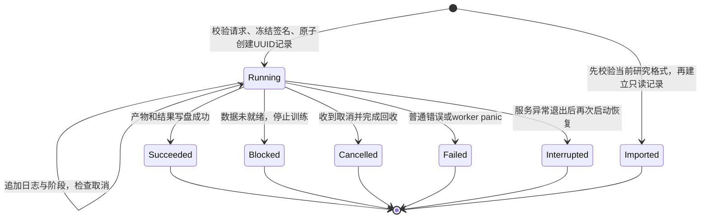
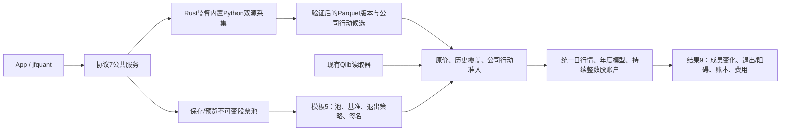
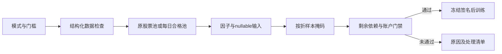

# Workflow 源码：工作区服务与持久化执行

[上级：analytics-workflow](../README.md) · [内置模板](../templates/README.md) · [CLI客户端](../../cli/src/README.md) · [App适配](../../app/src/README.md)

本目录是App与CLI共同的业务执行层。只有服务持有工作区独占锁；计算worker创建和释放原生句柄。客户端不各自恢复记录或重复实现下载、训练、研究生命周期。

## 模块与公共接口

| 文件 | 接口与职责 |
|---|---|
| [lib.rs](lib.rs) | `Workspace/ResearchTemplate/DataVersion/RunRecord/WorkflowRequest`；路径、签名、数据准入、原子元数据、同步worker执行及当前结果读取 |
| [service.rs](service.rs) | `TaskRequest/Rpc/Client/ServiceError`、`serve/bridge`；Unix socket协议7、独占服务、提交互斥、控制读取、客户端适配 |
| [backend.rs](backend.rs) | `WorkerCommand/WorkerEvent/TaskKind/RunSummary/Wake`；SQL会话、任务执行/取消、原生模型、结果汇总与panic退役 |
| [demo.rs](demo.rs) | `create`：生产与测试共用的完整合成输入、明确synthetic_fixture身份和手算模板 |
| [testing.rs](testing.rs) | feature限定的`synthetic`便利包装；不随正式发行包启用 |
| [tests.rs](tests.rs) | 模板/签名/版本、迁移、中断、完整年度账户与真实缺项提前拒绝 |

## 状态必须先持久化



`Submit`先冻结输入版本、模板和有序特征，创建记录再返回task_id。busy包含当前任务ID、没有队列；停止/空闲退出与提交共用锁，停止后不能留下无人执行的已接受任务。结果写盘失败不能发送成功事件。迟到进度不把终态改回Running。

## 控制面与原生计算面


SQL会话闲置十分钟释放并返回query_expired；控制请求不共享其句柄。服务无请求/活动任务/有效查询会话时闲置十分钟退出。下载取消回收curl，研究在阶段/因子/训练/日循环检查；取消等待本身不取消任务。

## 文件与版本

工作区、版本、运行记录schema1；模板schema5；服务协议7；研究结果schema9。workspace路径不依赖cwd，`snapshot/signature`冻结输入身份和内容签名，长字节/证据校验在worker执行前进行。用户修改已登记数据必须登记新版本。

数据与运行目录用UUID及相对路径；工作区整体迁移保持当前记录可用。旧任务状态和日志仍能读取，但旧格式结果或旧请求不转换、不重新执行。只读导入用公共`validate_result`，失败不创建记录。实际下载恢复使用原任务UUID的受验证owner/页面收据；研究重新运行创建新记录，不宣称训练中途恢复。

## 验收与修改指南

从仓库根目录执行，环境见 [Crates导航](../../README.md#开发与验收)：

```bash
cargo nextest run -p analytics-workflow
cargo nextest run -p analytics-cli --test platform
cargo nextest run -p analytics-desktop -E 'test(service_client_tasks) | test(research_worker)'
cargo clippy -p analytics-workflow --all-targets -- -D warnings
```

新增任务要同时覆盖TaskRequest→WorkerCommand→持久化结果→客户端事件，检查公共请求签名、取消和失败结果。修改服务要覆盖启动竞争、busy、协议不匹配、停止/提交竞争、客户端退出与崩溃恢复。修改研究要比较App与CLI的冻结参数、特征顺序、跨年账本和费用，不能只断言任务成功。

## 动态股票池与 Python 采集接口

当前模板schema 5、研究结果schema 9、服务协议7；公式仍为v4。模板增加 `pool_version`、`benchmark` 和 `pool_exit_policy`；默认 `builtin:csi500` / `SH000905`，沪深300模板使用 `builtin:csi300` / `SH000300`。自选和集合组合引用不可变pool版本，冻结成员区间、人工日期调整及输入哈希；模型manifest和缓存签名包含这些研究输入。原schema结果明确拒绝，历史状态和日志仍可查看，不转换旧文件。



`pools create/validate/import/export/list/versions/preview` 使用公共定义及解析器；`data collect --provider akshare|yfinance --kind market|actions` 提交后台任务，使用 jobs wait 显式等待。`run --request` 可提交完整公共请求。App提供来源、采集日期/证券、股票池JSON编辑、日期预览、退出策略及失败采集恢复按钮。包内Python和依赖只用于采集，不需要外部Python；日常操作不调用Cargo。

```bash
jfquant templates default --universe csi300 --output csi300-template.json
jfquant pools validate --definition pool.json
jfquant pools create --definition pool.json
jfquant pools preview pool-0123456789abcdef --market market-0123456789abcdef --date 2026-10-12
jfquant data collect --provider akshare --start 2004-01-01 --end 2026-10-13 --instruments SH600000,SZ000001,SH000300 --benchmarks SH000300
jfquant data collect --kind actions --provider akshare --start 2004-01-01 --end 2026-10-13 --instruments SH600000,SZ000001
jfquant research demo-parquet
```

示例ID须换为实际版本。下载可恢复验证过的证券；重新提交时参数必须与owner一致。临时/缺失输入不会自动换源、补字段或启动训练。原价撮合不使用Yahoo拆股调整价；缺支付/上市日期或指数历史成员仍阻止研究。2010样本外的5+1窗口需要2004—2009完整历史池及行情，不能以当前成分回填。

开发验收先运行 `crates/app/packaging/build-collector.sh`，再执行workspace nextest、严格Clippy/Rustdoc和格式检查。解释器、依赖、数据、模型、缓存、日志、运行记录及DMG均留在忽略目录。另一台Apple Silicon/macOS14实机验收待完成。

股票池定义覆盖与实际求值覆盖分开：后者限制在行情日历内，成员预览超出实际首末交易日明确失败，研究不能把未来定义或被截断日历当作已验证覆盖。

独立系数与事件对账的准入回归同时执行审计和实际研究请求：缺系数、缺事件、反向跳变、特殊行动和参考价格缺失均列出证券/受影响因子，实际研究明确 `data_not_ready`，不产生因子缓存或开始训练。供应商非乘法后复权报价只留证，其数值不影响正式研究输入。

demo::create_canonical生成规范行情4、每证券独立系数及首个真实收盘锚点，并明确synthetic来源。真实与合成系数不能混用。模型/研究冻结价量清单，旧schema5和规范1不转换，历史状态和日志保留。

## 当前日期流程与证据审查

lib.rs中的research_requirements、PreviewResearch和PrepareResearchData共用core日程解析；research把同一schedule/action_policy传到ML。[identities.rs](identities.rs)核验当前工作区内的实施证据及日期化别名映射，未覆盖区间仍保留为未知证券。InspectActions提供可复制的原事件哈希与候选字段，ReviseActions调用storage::corporate_actions::review并原子发布新版本。样本预览只统计可形成标签的行，特征有限值数量明确标为尚未计算。

验收用`cargo nextest run -p analytics-workflow`，包含单次/手动日期、无验证集、折间权益结算、尾日无标签预测、Qlib/Parquet账本一致性、来源问题在缓存前停止，以及旧年份字段拒绝。

## 为什么需要本组件

用统一执行日程和准入门控制所有入口。这里负责解析依赖、身份修订和任务生命周期，不重复实现因子公式。preparation逐证券保存候选及验证检查点，未知身份继续阻止最终准入，但不阻止其他来源获取。一次研究冻结实际日期和所有来源版本。

设计依据：2026-10-14接受的证券身份与完整准入计划、组件接口及测试。未在代码或证据中确认的历史取舍不推定为既有设计理由；来源、法规或数据格式变化时重新评估。

## 三级研究模式：为什么允许筛选

决定日期2026-10-14，依据是用户接受的三级模式计划。正常预热空值、来源缺失和错误数据是不同问题：全部拒绝会浪费可用样本，全部放行又会混淆因子和真实权益。默认严格检查；另外提供“允许部分数据缺失”和“只用数据合格的股票”。模式是研究输入的一部分，不能作为训练失败后自动切换的兜底。

第二档保持原成员，纯缺失传播null；第三档派生每日合格成员，不改原始成员或证据。不能看到后来缺价而倒删早期股票。账户仍采用原价、整数股、T+1和连续权益；未裁定冲突、损坏、基准缺项及剩余必要依赖仍阻断。默认有效因子比例0表示至少一项有效，最低有标签样本1只表示可执行，不表示样本在统计上充分。所选因子整列无有效值不会被自动删除。

[quality_tests.rs](quality_tests.rs)通过正式workflow入口验证三档差异、未来缺口、可能持仓缺价/支付日、空池和全无效样本；不通过测试专用旁路跳过门禁。lib.rs把模板quality_policy下沉ResearchRequest，需求预览复用backtest::quality::qualify，service.rs使用协议7。工作区/任务格式不变，客户端退出仍不取消后台任务。


