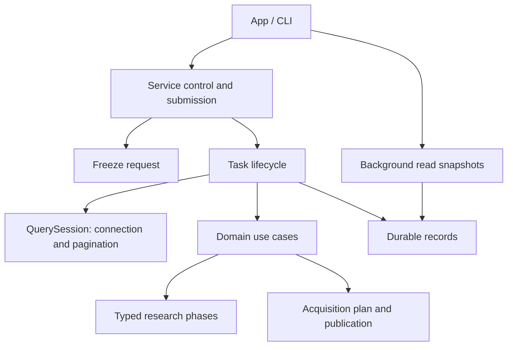

# Workflow implementation

`three_factor_build` also freezes empty-facts templates, market and collector identities for
CollectThreeFactorInputs. It acquires capital/equity on the worker, publishes a portable native
evidence package, and replays normalization before BuildThreeFactors publishes a new market.
Service protocol44. [Input format and acceptance](../../storage/src/three_factor/acquire/README.md).

`Workspace::publish_bigquant_market_factors` synchronously leases the workspace, replays the
immutable BigQuant artifact, preserves the base source identity, copies a new market and registers
its standard factor sidecar. MKT is a market return without RF subtraction; SMB/HML remain null.
See [BigQuant construction](../../storage/src/bigquant/README.md#全市场-mkt-构造与发布).

`Workspace::publish_bigquant_size_value_factors` uses the same leased publication path to replay
PIT June formations and six portfolio statistics, write SMB/HML, and register the new market.
It preserves actual coverage and share revision risk in `bigquant_size_value_factor`.
See [size/value contracts and acceptance](../../storage/src/bigquant/README.md#pit-年度分组与-smbhml).

The crate root only exposes component APIs. Business changes belong in their
owning component; adding a task must not add business logic to `lib.rs`.

| Component | Responsibility |
|---|---|
| `contracts` | Workspace requests, templates, data-version and run records |
| `workspace` / `persistence` | Paths, exclusive lease, atomic records and terminal transitions |
| `snapshot` | Freeze request identities before acceptance |
| `three_factor_build` | Freeze historical facts, construct daily factors, publish a separate market version |
| `usecases` | Acquisition, action review, configuration, research dispatch and data admission |
| `backend` | Worker dispatch, task lifecycle and worker-local query sessions |
| `service` | Unix transport, submission exclusivity, control requests and client bridge |
| `research/backtest/stages` | Typed prepare, sign, replay, sample, fit/predict and publish phases |
| `refresh` | Planning, quote/action acquisition and immutable publication |
| `views` | Read-only catalog/result/log/NAV snapshots for background clients |
| `maintenance` | Offline preview, integrity inventory, recoverable archival |
| `storage_management` | Resource accounting, dependency preview, permanent release, historical display and crash recovery |



DuckDB is created, used and dropped on its worker thread. Query sessions do not
contain another task worker. Python remains task scoped, with process cleanup on
success, error, cancellation and unwind. Task context is explicit at research
phase boundaries; existing lower-level synchronous adapters retain scoped context.
Only service submission owns the active-task reservation. Terminal state writes
are centralized in `Workspace::finish`; terminal records cannot transition again.

Public wire versions are defined by `service::PROTOCOL_VERSION`, research result
version by `research::backtest::RESEARCH_SCHEMA_VERSION`, and scheduled-training
version by `research/backtest/artifacts::TRAINING_SCHEMA_VERSION`. Do not duplicate
numeric version histories here. Independent model catalogues have their own
contract in `research/backtest/independent`.

```bash
export DUCKDB_DOWNLOAD_LIB=1
cargo nextest run -p analytics-workflow
cargo nextest run -p analytics-cli --test platform
cargo nextest run -p analytics-desktop
python3 crates/workflow/checks/architecture.py
cargo clippy --workspace --all-targets -- -D warnings
RUSTDOCFLAGS='-D warnings' cargo doc --workspace --no-deps
```

Acceptance covers null propagation, feature order, immutable sample masks,
training/prediction reuse, continuous accounts, query expiry, cancellation,
submission races, crash recovery, and archive interruption/resumption. Component
README updates accompany changes to contracts, artifacts or asynchronous work.

`input_check`：版本化计划/报告、逐字段窗口与两种输入适配、整上下文 Parquet 收据缓存；
`research/backtest/stages/input_report` 将共享检查嵌入已有 prepare/samples，避免重建训练准入系统。

Daily input dependencies union identical cross-sectional contexts and raw-field intervals before
materializing observation sets. This preserves disjoint windows, historical membership and
recursive seeds while avoiding repeated full-pool expansion during real rolling fits.
Regression compares the optimized sets against the original observation-by-observation algorithm.

`action_evidence`：共享 Capture / Recover / Retry / Status / Draft 后台任务。输入版本和外部证据树在提交时冻结，执行前核对；捕获与恢复输出现有公告 manifest，修订草稿经正式 review 校验后保存在任务目录，不自动发布。失败批次的恢复保留来源任务状态与签名，原生重试保持原请求和 resume owner。客户端只传普通数据；任务沿用进度、取消和 outcome 持久化。服务协议 27。

## 当前公司行动依赖（协议28）

训练复权、回测预检和账户逐日检查共用存储层 `DependencyIndex`，不再无条件按历史采集失败阻断。保留供应商/严格审核策略、供应商价格路径和实际持仓暴露规则；账户问题不自动变成训练价格问题。

新任务保存格式1的 `adjustment-dependencies.json`、`execution-dependencies.json`，包含真实证券区间集合和检查策略；不以跨折大区间替代训练依赖。`EvidenceRequest::Status { task: Some(ID), .. }` 冻结已结束任务的上下文文件哈希，针对所选行动版本生成状态报告；不启动因子、训练或账户。仅接受明确的当前依赖文件；旧任务缺少准确上下文时要求重新运行输入检查，不从旧报告恢复范围。

证据报告格式2分为 `evidence_inventory` 与 `task_dependencies`。`current` 提供覆盖、事件检查、缺口数、阻断检查数、受影响证券数和历史失败证券数；`ready` 仅指公司行动依赖。补齐对比限定同一冻结任务上下文，列出新增及消失的阻断。旧报告不改写，正式运行必须重新准入；行动版本及执行校验版本进入原有冻结签名。

验证：`DUCKDB_DOWNLOAD_LIB=1 cargo test -p analytics-workflow --lib`；`python3 crates/workflow/checks/architecture.py`。

完整原生公告批次的空白修订草稿同时填入覆盖审核骨架（查询日期、全部候选ID、源版本哈希、默认九类）；审核理由留空且校验未通过。审核人必须调整实际证明的事件日期/类别并审阅候选，查询日期本身不代表事件覆盖。选定PDF批次不生成完整覆盖骨架。

## Allocation modules

`allocation` defines strict shared config, independent weight/time verification and signed artifact manifests. `allocation_reference` maintains a separate fractional event-aware account. `allocation_migration` is the sole legacy reader for this upgrade, with offline preview/apply/resume/rollback. `allocation_comparison` checks frozen same-input completed methods. Multi-strategy orchestration lives beside research execution in `research/backtest/combined.rs`; App/CLI dispatch the same WorkflowRequest variants. Current protocol: service44 / worker4 / result22 / template12 / independent-backtest-plan4.

`research/backtest/allocation_readiness.rs`在训练前检查冻结日历上的预测、参考账、正式账户边界，输出最早就绪日期下界；`allocation.rs`独立验证下一开盘生效、求解/目标一致性和账户换手。迁移模块覆盖中断归档和中断回滚恢复，未知注册格式阻断服务启动。


`research/backtest/allocation_admission.rs` builds date-local endpoint qualification before training without changing the training pool. `allocation.rs` owns `STOCK_EXPOSURE`, strict candidate policy/tolerance config, target and append-journal verification; the worker consumes that single exposure contract. `allocation_migration.rs` is the only reader of previous allocation formats, with a separate admission-revision transaction journal. See the workflow README for formats, diagnostics and acceptance commands.


`storage_management::json_migration::JsonToSqliteMigration`提供显式离线JSON导入、备份、
事务回滚及提交后恢复。Workspace及依赖发现使用storage的Catalog/Run/Config/Package/
MigrationStore，连接不进入UI。SQL schema v2与服务协议47的格式及验收见
[存储管理](storage_management/README.md#json元数据拆表协议47)。
