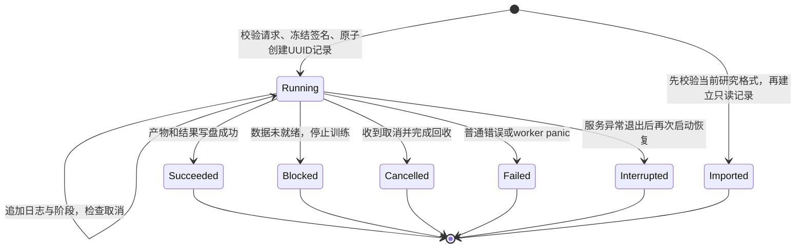
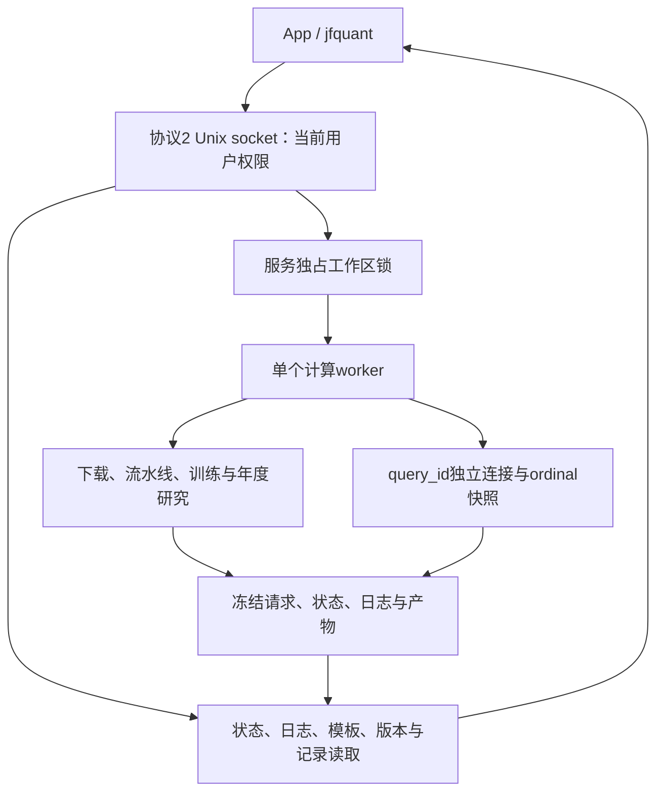

# Workflow 源码：工作区服务与持久化执行

[上级：analytics-workflow](../README.md) · [内置模板](../templates/README.md) · [CLI客户端](../../cli/src/README.md) · [App适配](../../app/src/README.md)

本目录是App与CLI共同的业务执行层。只有服务持有工作区独占锁；计算worker创建和释放原生句柄。客户端不各自恢复记录或重复实现下载、训练、研究生命周期。

## 模块与公共接口

| 文件 | 接口与职责 |
|---|---|
| [lib.rs](lib.rs) | `Workspace/ResearchTemplate/DataVersion/RunRecord/WorkflowRequest`；路径、签名、数据准入、原子元数据、同步worker执行及当前结果读取 |
| [service.rs](service.rs) | `TaskRequest/Rpc/Client/ServiceError`、`serve/bridge`；Unix socket协议2、独占服务、提交互斥、控制读取、客户端适配 |
| [backend.rs](backend.rs) | `WorkerCommand/WorkerEvent/TaskKind/RunSummary/Wake`；SQL会话、任务执行/取消、原生模型、结果汇总与panic退役 |
| [demo.rs](demo.rs) | `create`：生产与测试共用的完整合成输入、明确synthetic_fixture身份和手算模板 |
| [testing.rs](testing.rs) | feature限定的`synthetic`便利包装；不随正式发行包启用 |
| [tests.rs](tests.rs) | 模板/签名/版本、迁移、中断、完整年度账户与真实缺项提前拒绝 |

## 状态必须先持久化



`Submit`先冻结输入版本、模板和有序特征，创建记录再返回task_id。busy包含当前任务ID、没有队列；停止/空闲退出与提交共用锁，停止后不能留下无人执行的已接受任务。结果写盘失败不能发送成功事件。迟到进度不把终态改回Running。

## 控制面与原生计算面



SQL会话闲置十分钟释放并返回query_expired；控制请求不共享其句柄。服务无请求/活动任务/有效查询会话时闲置十分钟退出。下载取消回收curl，研究在阶段/因子/训练/日循环检查；取消等待本身不取消任务。

## 文件与版本

工作区、模板、版本、运行记录schema1；服务协议2；研究结果schema4。workspace路径不依赖cwd，`snapshot/signature`冻结输入身份和内容签名，长字节/证据校验在worker执行前进行。用户修改已登记数据必须登记新版本。

数据与运行目录用UUID及相对路径；工作区整体迁移保持当前记录可用。旧任务状态和日志仍能读取，但旧格式结果或旧请求不转换、不重新执行。只读导入用公共`validate_result`，失败不创建记录。实际下载恢复使用原任务UUID的受验证owner/页面收据；研究重新运行创建新记录，不宣称训练中途恢复。

## 验收与修改指南

从仓库根目录执行，环境见 [Crates导航](../../README.md#开发与验收)：

```bash
cargo nextest run -p analytics-workflow
cargo nextest run -p analytics-cli --test platform
cargo nextest run -p analytics-desktop -E 'test(service_client_tasks) | test(research_worker)'
cargo clippy -p analytics-workflow --all-targets -- -D warnings
```

新增任务要同时覆盖TaskRequest→WorkerCommand→持久化结果→客户端事件，检查公共请求签名、取消和失败结果。修改服务要覆盖启动竞争、busy、协议不匹配、停止/提交竞争、客户端退出与崩溃恢复。修改研究要比较App与CLI的冻结参数、特征顺序、跨年账本和费用，不能只断言任务成功。
