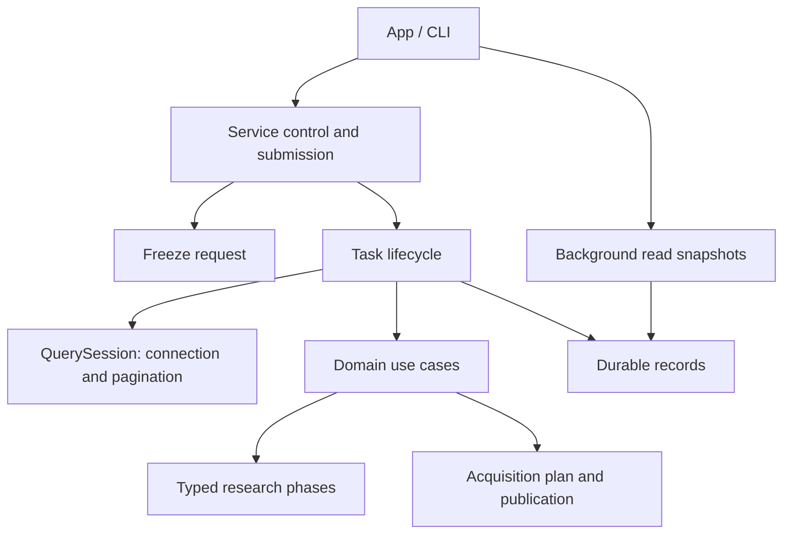

# Workflow implementation

The crate root only exposes component APIs. Business changes belong in their
owning component; adding a task must not add business logic to `lib.rs`.

| Component | Responsibility |
|---|---|
| `contracts` | Workspace requests, templates, data-version and run records |
| `workspace` / `persistence` | Paths, exclusive lease, atomic records and terminal transitions |
| `snapshot` | Freeze request identities before acceptance |
| `usecases` | Acquisition, action review, configuration, research dispatch and data admission |
| `backend` | Worker dispatch, task lifecycle and worker-local query sessions |
| `service` | Unix transport, submission exclusivity, control requests and client bridge |
| `research/backtest/stages` | Typed prepare, sign, replay, sample, fit/predict and publish phases |
| `refresh` | Planning, quote/action acquisition and immutable publication |
| `views` | Read-only catalog/result/log/NAV snapshots for background clients |
| `maintenance` | Offline preview, integrity inventory, recoverable archival |



DuckDB is created, used and dropped on its worker thread. Query sessions do not
contain another task worker. Python remains task scoped, with process cleanup on
success, error, cancellation and unwind. Task context is explicit at research
phase boundaries; existing lower-level synchronous adapters retain scoped context.
Only service submission owns the active-task reservation. Terminal state writes
are centralized in `Workspace::finish`; terminal records cannot transition again.

Public wire versions are defined by `service::PROTOCOL_VERSION`, research result
version by `research::backtest::RESEARCH_SCHEMA_VERSION`, and scheduled-training
version by `research/backtest/artifacts::TRAINING_SCHEMA_VERSION`. Do not duplicate
numeric version histories here. Independent model catalogues have their own
contract in `research/backtest/independent`.

```bash
export DUCKDB_DOWNLOAD_LIB=1
cargo nextest run -p analytics-workflow
cargo nextest run -p analytics-cli --test platform
cargo nextest run -p analytics-desktop
python3 crates/workflow/checks/architecture.py
cargo clippy --workspace --all-targets -- -D warnings
RUSTDOCFLAGS='-D warnings' cargo doc --workspace --no-deps
```

Acceptance covers null propagation, feature order, immutable sample masks,
training/prediction reuse, continuous accounts, query expiry, cancellation,
submission races, crash recovery, and archive interruption/resumption. Component
README updates accompany changes to contracts, artifacts or asynchronous work.

`input_check`：版本化计划/报告、逐字段窗口与两种输入适配、整上下文 Parquet 收据缓存；
`research/backtest/stages/input_report` 将共享检查嵌入已有 prepare/samples，避免重建训练准入系统。

Daily input dependencies union identical cross-sectional contexts and raw-field intervals before
materializing observation sets. This preserves disjoint windows, historical membership and
recursive seeds while avoiding repeated full-pool expansion during real rolling fits.
Regression compares the optimized sets against the original observation-by-observation algorithm.

`action_evidence`：共享 Capture / Recover / Retry / Status / Draft 后台任务。输入版本和外部证据树在提交时冻结，执行前核对；捕获与恢复输出现有公告 manifest，修订草稿经正式 review 校验后保存在任务目录，不自动发布。失败批次的恢复保留来源任务状态与签名，原生重试保持原请求和 resume owner。客户端只传普通数据；任务沿用进度、取消和 outcome 持久化。服务协议 27。
