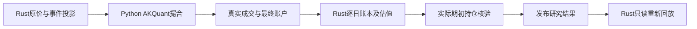

# Research orchestration

Rust owns ordered feature contracts, nullable matrices, source/data qualification,
chronological folds, label purging, IC and result metadata. `pipeline` handles the
single-run factor/model flow; `backtest` handles dated rolling research and a single
continuous AKQuant execution followed by Rust closing-account replay. `worker` supervises the fixed Python operations.

`LightGbmTrainer` and `LightGbmPredictor` are file/protocol adapters, not C FFI wrappers.
They write named Arrow-null-preserving Parquet matrices, reuse the task's process,
validate model manifests and record dependency receipts. The Python process keeps
all native models. `worker::TaskSession` retires it after completion or unwind.

The Rust closing ledger replays actual fills; matching and model fitting remain in
the supervised upstream process. Factor formulas and reference tests remain in analytics-factor. Trading limitations and protocol
are defined in [../../research/README.md](../../research/README.md).

```bash
DUCKDB_DOWNLOAD_LIB=1 cargo test -p analytics-workflow research::
DUCKDB_DOWNLOAD_LIB=1 cargo clippy -p analytics-workflow --all-targets -- -D warnings
```

SupplierForward资格检查将VWAP/独立factor视为合约规定的null，保持证券成员及178列等原特征顺序；真实缺价或损坏仍进入策略决定，独立系数口径仍需系数。合约null进入因子计算后继续传播到LightGBM missing；不填零或生成价格比值系数。fixture：`cargo test -p analytics-workflow --lib supplier_contract_nulls`。


供应商执行准入区分候选池问题与实际账户暴露：完整结构化历史、原始证据/哈希、合法条款和执行行情仍静态检查。未解决的来源冲突或未知事件以NotRun警告保留，Rust在账户模拟后读取完整逐日持仓快照，按事件生效前一交易日持仓判断暴露；受影响则拒绝发布收益，未持有不剔除证券。期初现金持仓为零；除权日新买入不产生前日权益。全类别审计模式仍提前阻断。失败任务的订单/快照是诊断产物，不能当作已验收收益。`event_exposure_checks.json`记录逐事件数量、状态和证据；`execution.json`记录校验版本。缺失/非法快照拒绝通过。

通达信两位小数每十股参考与主源现金、送股均在半个显示单位内时标记`tdx_reference_precision_difference`，保留原始差异及证据，不改写主源条款，不宣称舍入原因已证实或独立核验通过。只有供应商模式允许使用主源条款；真实差异和未知事件仍需实际持仓核验，审计模式不降级。fixture覆盖精度边界、送股不一致、实际前日持仓、当日才买入、空仓及审计策略。


历史停复牌优先使用通达信结构化`get_gpjy_value([symbol],["GP29"],start,end)`，同时捕获`GetProDataInStr`和`GetTradeCalendarInStr`原生响应、调用参数及哈希。`GP29`为复牌日和此前停牌的交易日数；Rust `analytics_storage::tdx_status`按独立市场日历回推停牌日区间（可能包含首日日内停牌），不按自然日、不从缺K线猜测。当前`TPFlag`/`IsSTGP`/`IsQuitGP`仅是快照，不能回填历史；GP29更名/ST变更字段尚未转为完整历史ST状态机。复牌后的信息只用于回溯账户核验，不参与信号/股票池选择。

`data refresh --mode actions --workers 3`同步更新这部分辅助证据。完整股票池事件历史仍以HiThink为主；通达信事件日期不完整不会丢失独立状态证据。新采集器签名使旧检查点需重采；已登记行情不改写。`ExecutionData.capabilities`按证券记录`tdxaidata.gp29-status-days-v2`、范围、结构化证据名称和右侧截断警告。读取时从原生响应重新计算并核对日期；计数非整数、日历不足、证券/请求不符或证据篡改拒绝准入。没有复牌记录不能证明停牌不存在，仍缺失的持仓估值继续阻断。

GP29确认停牌日且缺少原始日线/成交量为零时，在日频账户适配中生成独立记录的估值标记`suspension_valuation_marks.json`（原始行情/训练报价不改写），沿用上一有效原价估值；遇已支持除权事件按参考公式调整估值。交给撮合器的估值行成交量为零，受成交量约束，不能产生交易；若同日原行情有正成交量，保留真实原价报价作为日内停牌边界，单独记录`suspension_traded_days.json`，不覆盖成停牌估值。Python行为fixture验证相同信号原本会成交、零成交量估值日不会成交。缺证据报价仍保留缺口，不删除整个证券。巨潮公告路径保留作例外补证，无需逐证券维护公告URL。

验收：`DUCKDB_DOWNLOAD_LIB=1 cargo test -p analytics-storage -p analytics-workflow --lib`；`PYTHONPATH=crates/workflow/research target/collector-build/python/bin/python3 -m unittest discover -s crates/workflow/research/tests`。依赖锁、公式、特征序及研究worker签名不变；更换纯采集代码后运行`bash crates/app/packaging/build-collector.sh`重建并校验内置运行时。

辅助执行数据格式2新增`suspension_day`（不声称全天停牌），保留格式1读取。GP29原生捕获规则仍为v1，Rust解释规则为status-days-v2；`execution.json`记录该估值策略，动作版本/结果签名隔离旧解释。缺少日线仍按日频停牌估值口径披露，不提供盘中停牌分钟级撮合。

最近持续停牌补充使用通达信`get_more_info`的`TPFlag=1`、`HqDate`、`StopJYDate_Recent`三字段组合，捕获固定`GetMoreInfoInStr`原生调用并绑定证券/哈希。仅当快照行情日期覆盖研究截止日、最近停牌日起未见相冲突的GP29复牌记录时，确认最近这一段持续停牌；当前标记单独存在、过期快照和缺失日期均不能回填历史。此证据只用于回溯账户估值，不用于因子或选股；保留更早未知区间。结果清单增加`dated-current-episode-v1`以隔离旧缓存。


### 原生结果复核

`analytics_workflow::research::backtest::verification::report(&workspace, task_id)`与只读服务RPC `VerifyResearch`，提供CLI `jfquant research verify --task <UUID>`。不启动Python、不重训、不重跑账户、不改写历史任务。仅接受成功的本机原生任务，检查冻结请求及结果签名、outcome/summary/execution副本、每日复利与逐日权益、逐笔/逐日费用、年度与fold指标、估值行无成交、实际事件暴露，返回被复核文件的SHA-256。失败以错误结束；`status=consistent`仅表示产物一致，保留`event_simulation_complete`、跳过事件与实际持仓计数，`research_ready=null`，不宣称消除幸存者偏差或完整模拟配股。旧任务仍可查看，缺少本次审计所需产物时不伪造通过。

```sh
DUCKDB_DOWNLOAD_LIB=1 cargo test -p analytics-workflow verification
DUCKDB_DOWNLOAD_LIB=1 cargo test -p analytics-cli --test platform current_research_cli_and_api_share_results
jfquant research verify --task <completed-task-uuid>
```

停牌估值规则为`zero-volume-valuation-only-v2`：有正成交量时保留完整原始OHLC，部分缺价保持缺口；成交量未知且仍有部分报价不能推定没有交易。仅有证据的零量或整行无报价可使用估值行，无前价锚点保持缺口，仅实际持仓时触发账户缺口。结果执行签名隔离旧规则；复核fixture覆盖收益/权益/费用篡改、实际冲突暴露和估值行发生交易。

### Rust closing ledger

AKQuant 0.3.66的跨证券延后成交可能发生在其当日曲线已记录之后，盘后回调也可能延迟到下一交易日。因此回调持仓与上游逐日曲线不能直接作为最终研究账户。

Python只导出带日期的真实成交、拒单、原始曲线及`on_stop`最终账户（`native_account_daily.json`）。Rust `backtest/account.rs`从初始现金，按日先应用已支持的除权日Dividend/Split投影，再回放全部成交与费用，以原价及有证据的停牌标记估值。`portfolio_snapshots.json`包含持仓、现金、权益和`valuation_prices`；`daily.json`的收益、换手率、费用及持仓数由该账本生成。最终股份、现金和权益必须与引擎最终账户一致，真实持仓缺价拒绝发布。前日账本持仓用于事件暴露核验。

`execution.json`冻结`accounting_version=rust-filled-trade-ledger-v1`并进入结果签名；`execution_actions.json`保存实际支持的事件投影，`engine_curve_differences.json`披露上游曲线与完整成交账本的日内记录时点差异。`research verify`只读地再次回放相同Rust账本，检查收益、分年指标、费用、实际暴露及估值行无成交，返回产物哈希。不支持的事件继续警告/跳过，不补造配股或日期；产物一致不代表无样本偏差或事件模拟完整。

旧结果仍可查看，缺少当前账本产物时不能通过新审计。研究worker生产者签名变化会要求重新训练，不绕过旧模型签名检查。Python测试中的小账本仅是跨语言fixture参考，生产账户逻辑在Rust。



验收覆盖多次换股及延后成交、旧股基数先现金后送股、最终账户篡改、持仓缺价、费用不一致、估值行成交和未模拟事件披露。

## 固定修订的混合因子

ResearchConfig.factor_refs可混合内置158/191及自定义定义；必须与factor_ids同序。算子与公式版本
进入因子签名及模型格式3的训练schema哈希，模型读取重核完整定义与编译收据。滚动训练描述4与独立训练目录5
是不同的当前生产者合同；旧训练描述3拒绝读取，原文件留作历史，不能改签为当前格式。研究结果仅接受22。年度缓存按依赖扩大预热，并记录实际载入起点和递归种子规则。
修改/归档库中公式不影响冻结模型；端到端验收见`custom_factors::tests::frozen_mixed_research_trains_and_old_model_survives_library_edits`。

## 独立模型生命周期

`backtest::independent` 提供无test日期的训练日程，以及按可用日期自动选择模型的独立B池预测/回测。模型保存实际拟合标的、标签边界和完整特征契约，B不参与调参；回测无需A行情。沿用worker句柄所有权、空值与连续账户语义。组件根README记录版本及复现命令。
