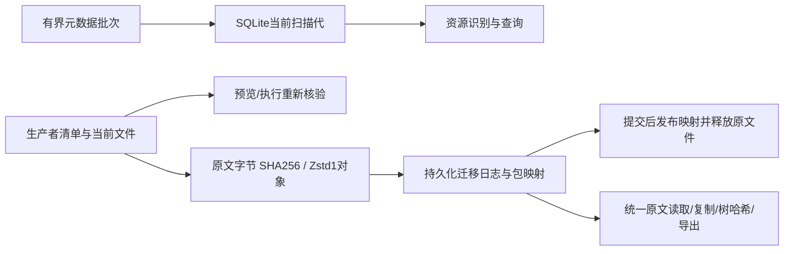

# 工作区存储管理

## 职责与接口

`scan` 盘点工作区；`plan` 根据资源 ID 计算精确删除集合和依赖阻断；`apply` 仅执行已持久化计划。
App 与 CLI 使用 `WorkflowRequest::Storage { request: Scan { level, threads } | Plan | Apply }`，经过同一个服务任务槽、worker、取消和结果持久化流程。
`Rpc::StorageInventory` 读取上次扫描的资源摘要，`Rpc::StorageHistory` 读取清理收据。服务协议46；扫描清单格式3，进度快照、计划、日志和历史视图格式1。
从协议45升级需同步更新服务、App和CLI，拒绝旧协议；已有数据与模型格式没有变化，无需数据转换。旧扫描缓存失效后重建，旧未执行计划重新预览，已有事务仍按格式1恢复。未知清单、计划、事务及收据格式会明确拒绝，不自动转换或兼容旧版本；工作区移动后旧缓存清单也必须重新扫描。

`types` 定义普通数据接口；`inventory` 根据现有生产者清单认领文件；`members` 限定生产者的保留文件名和清单成员；`dependencies` 解析完整性、追溯与未决引用；`cleanup` 管理事务；`history` 保存显示快照与能力状态。
底层 `analytics_storage::filesystem` 只读元数据，不依赖 DuckDB 或 Python。查询会话在执行清理前由原 worker 关闭；原生句柄不会传给客户端。

## 统计和保护

分类是互斥的空间归属，归档和临时状态是筛选标签。分类合计按 device/inode 去重；资源明细展示成员文件，因此共享资源明细不能直接相加。
逻辑大小和分配空间分开保存。释放估计按选择集合去重，硬链接未全部纳入删除时，不将其分配空间计为可释放。
文件系统共享块不能精确归属，估计不是磁盘可用空间增量承诺。权限错误、跨挂载点和扫描期间变化均使清单不完整，禁止据此清理。

只按已识别生产者和清单认领文件，不根据任意父目录扩展删除范围。配置、未知文件及未经确认的链接受保护；外部引用只显示，不计入工作区占用。
行情、训练折、样本掩码及年度缓存目录中的未识别文件独立保留。只有树哈希、没有文件成员清单的复合证据包，以及仅有归属标记的临时检查点，首版只统计并保护，不能按整个目录删除。
训练模型包含所需样本证据；共享预测包属于预测回放依赖。保留的预测身份需要训练描述时，只共享该描述，不要求保留已明确释放的模型字节。
市场视图的底层数据是完整性依赖；已完成任务的冻结来源是追溯关系。未决引用阻止清理，不自动级联扩大选择。

## 数据流与恢复


`.jfquant/storage/inventory.json`保存最近完成的轻量摘要（不含文件清单）；`index.sqlite`保存按扫描代次组织的文件、资源、所有者、依赖和对象索引，不能作为删除依据；不再读写旧files.json（新扫描完成后移除旧缓存）；`snapshot.json`保存当前或上次扫描进度；`plans/UUID.json` 保存计划；`transactions/UUID/journal.json` 是可用性提交的权威记录；`result.json` 是可查询收据；`history/TASK.json` 保存原参数、结果与收益曲线。
原始 catalog、run.json、签名 manifest、特征顺序、schema 哈希和公式版本不改写。数据释放后从可选版本中隐藏，原身份仍在 catalog；历史展示与模型复用、预测回放、原始输入和完整核验分别报告。

同内容重新采集或恢复后，登记为带新身份的可用版本；重复登记保持幂等。原已释放版本不会重新变成可用，旧研究仍指向原身份。已完成清理收据支持工作区移动；移动后重新扫描再生成新计划。

提交前可以取消并回滚。启动恢复在独占租约内执行：未提交暂存回滚，已提交暂存继续删除。
临时事务目录不是回收站。提交后不能取消永久删除；逐项失败保留 `pending_deletion`，任务报告失败，重试同一计划继续剩余删除。完成计划重复执行返回原收据。
永久删除后先同步暂存目录，再持久化完成状态；目录同步失败同样保留待处理状态，启动或重试继续完成。
计划绑定选择文件身份、大小、时间及相关元数据；文件或引用变化使计划失效。工作区迁移后应重新扫描与预览，不能执行原路径下的旧计划。

## 复现与验收

```bash
export DUCKDB_DOWNLOAD_LIB=1
cargo test -p analytics-workflow storage_ --lib
cargo test -p analytics-cli storage_
cargo test -p analytics-desktop storage_
python3 crates/workflow/checks/architecture.py
cargo fmt --all -- --check
cargo clippy -p analytics-storage -p analytics-workflow -p analytics-cli -p analytics-desktop --all-targets -- -D warnings

export JFQUANT_WORKSPACE=/absolute/workspace
jfquant storage scan # 默认overview
jfquant storage scan --level resources --threads 4
jfquant jobs wait SCAN_TASK
jfquant storage list --sort size
jfquant storage list --category models --status archived
jfquant storage plan --resource RESOURCE_ID --resource ANOTHER_RESOURCE_ID
jfquant jobs wait PLAN_TASK
jfquant jobs results PLAN_TASK # 查看 id、blockers、impacts、files 和释放估计
jfquant storage apply --plan PLAN_ID --confirm-permanent
jfquant jobs wait APPLY_TASK
jfquant storage history
```

验收覆盖分类合计、硬链接保留、共享材料、未决引用、数据视图依赖、来源追溯、摘要及曲线保留、计划过期、取消、服务写入互斥、提交前后恢复和待删除文件变化。只使用临时合成工作区；不清理用户真实数据。

## 分级、进度与性能

- `overview`仅遍历元数据并汇总整个工作区（包括target）；目录桶取父目录前两层，桶间互斥，不能假定target全部可清理。普通文件不保留明细，仅多链接文件记录去重身份。
- `resources`增加生产者manifest与成员识别，不执行引用分析。两级`dependencies_checked=false`，可释放空间为未评估；选择状态仅为候选，以plan核验结果为准。
- `plan/apply`仍完整扫描并验证引用与文件身份；未知JSON仍参与安全发现。元数据直接哈希原始字节，资源名/路径使用任务内索引；SQLite全量重建，不新增文件监听或增量扫描。清理后只将摘要标记stale，用户重新扫描更新占用。
- 默认`min(available_parallelism,4)`，可显式1—8线程。专用线程池只处理目录与文件metadata，生产者解析仍串行；不共享数据库/模型句柄。
- `Rpc::StorageSnapshot`返回可空的轻量快照：工作区、scan_id、level、phase、时间/耗时、finished/complete、目录计数、占用及诊断。每秒最多一次中间持久化，开始/结束额外写入最终状态。各阶段每秒报告进度，取消保留上次完整摘要。摘要查询不打开SQLite或加载文件清单；缺失缓存是正常空状态。
- `Rpc::StorageInventory`仅读取最近完成的摘要。`finished`与`complete`分别表示任务结束与扫描完整，不能互相替代。目录统计是扫描期间观测值，APFS共享块仍为估计，无法提供文件系统原子快照。

### 可复现基准

将旧提交导出到临时目录，分别构建旧/新发布CLI并保留各自二进制。运行：

```bash
DUCKDB_DOWNLOAD_LIB=1 cargo build --release -p analytics-cli
python3 crates/workflow/checks/storage_benchmark.py --root /tmp/jfquant-storage-million-unique --baseline /absolute/previous-release-jfquant --current /absolute/current-release-jfquant
```

脚本要求新建且不存在的目录，生成百万空文件及1000个JSON；只重置该生成样本中的工作区元数据。旧版完整扫描、新版1/4线程总览和完整清理核验均报告耗时及服务峰值RSS，不执行删除。首次与热运行分别报告；首次运行不是清空操作系统缓存后的冷测。严格冷测应在专用环境重启或由操作者清空缓存，记录操作，不在真实工作区自动清缓存。

### 2026-10-19 实测

Apple M6、macOS/APFS、发布构建；样本100万空文件、1000个约40KiB JSON。并发构建会影响结果，以下为观测范围，不是时延承诺；未执行清缓存冷测。

| 路径 | 耗时 | 服务峰值RSS |
|---|---:|---:|
| 旧版完整扫描 | 25.3—32.0秒 | 1037—1083MiB |
| 新版单线程总览 | 12.6秒 | 17MiB |
| 新版4线程总览 | 3.9—5.2秒 | 17—18MiB |
| 新版完整清理核验 | 18.3—19.3秒 | 627—657MiB |

真实工作区只读总览：1,789,661个文件、约187.3GiB分配空间，约23.9秒完成，诊断为空；进度查询约80ms，完成后的摘要查询约72ms。259份原有登记、任务及产物manifest扫描前后字节一致。容量统计包含本地构建产物，不等于可释放量。

启动在独占租约内完成事务和任务恢复后，将未完成的进度快照标记为“扫描中断”、`finished=true / complete=false`，保留部分计数与上次完整摘要。此操作幂等，不恢复已取消的扫描；损坏或未知的进度缓存仍由读取接口明确报错，不阻断权威清理事务恢复。


## SQLite 索引与共享证据（协议46）

`index.sqlite`使用内置SQLite、WAL、单写连接、4096次写入一批和短读事务。连接留在所属线程，不传递DuckDB/LightGBM句柄。文件记录使用紧凑内部编码、字节路径和整数扫描代次；资源识别通过文件名、路径前缀、所有者及JSON部分索引查询。全量清理核验仍重新读取当前文件和生产者清单，SQLite引用计数不能授权删除。

最新完成代次在新扫描期间保留；取消或中断只留下未完成代次，下次扫描丢弃。完成后切换摘要、清除旧代、checkpoint并增量回收空页。索引可删除后重建；缺失索引明确要求重新扫描，不能把缺失当成空工作区。轻量inventory/snapshot继续独立保存，资源查询使用`Rpc::StorageResources { scan_id, query }`在服务端筛选。



证据对象格式1：`JFQOBJ01`、编码字节（0原始/1 Zstd）、8字节小端原始长度和正文。默认Zstd level1，无收益时原样编码；SHA256身份按解压后的原文计算。对象在`.jfquant/objects/sha256/前两位/哈希.obj`。原始清单和业务签名不改写。`.jfquant/storage/packages/registry.json`与独立包映射、事务日志是读取权威；索引仅缓存其查询。映射声明的成员缺失或损坏时明确报错，不读取遗留副本回退。

首版支持生产者可核验的行动、公告、收据、历史对账与validated-preview原文；复合source-evidence先验证原树哈希再建立全部成员映射。私有运行目录或无法确认的成员阻断。其他证据家族不自动迁移；显式选中时报告不支持。可变采集文件仍写staging，成功发布不可变行动/公告包时，由生产者直接提交准确manifest及数据版本/任务归属，再转换为共享对象。发布登记不扫描catalog、不匹配UUID子串、不探测惯用目录推测归属；仅历史盘点按已有生产者目录契约发现候选，成员仍须通过manifest和树哈希核验。通用JSON引用搜索只增加保护，不能授权迁移或删除。Rust读取/复制/目录列举/树哈希统一经过evidence_store；Python输入先按需物化。路径、原文长度、树哈希顺序和业务schema保持。

共享对象仅当所有权威映射所有者均被选中且依赖核验通过才可清理；未知对象、未知映射和未决引用受保护。原文引用量、唯一原文量及对象保存量单独显示，不能与工作区实际占用重复相加。收益分为逻辑变化、已移除文件容量与磁盘可用空间差，APFS共享块仍使物理收益存在估计误差。

### 迁移、恢复和独立导出

```bash
jfquant storage migrate plan                       # 全部可识别行动/公告证据，仅读原文
jfquant storage migrate plan --resource RESOURCE_ID
jfquant jobs wait TASK_ID
jfquant jobs results TASK_ID                       # 精确成员、阻断、重复量、对象量、额外预算
jfquant storage migrate apply --plan PLAN_ID --confirm-rewrite
jfquant jobs wait TASK_ID
jfquant storage migrate history
jfquant storage export --resource RESOURCE_ID --output NEW_DIRECTORY
jfquant jobs wait TASK_ID
```

预览会写入可重建索引及计划，不改业务文件。执行仅接受计划ID与显式确认；无确认参数拒绝提交任务。`.jfquant/storage/migration-plans/`保存计划，`migrations/ID/journal.json`保存原文件身份、对象创建意图和提交状态。执行前重验生产者、原始文件及注册表；流式写入、同步、核验对象后暂存原文，持久化提交再发布映射和删除暂存。提交前失败/取消回滚；提交后通过重启服务或重试同一计划继续释放，逐项失败保留pending_deletion。启动恢复完成前不接收业务请求；SQLite更新失败不影响权威恢复。迁移提交令旧扫描/预览过期。

导出使用临时目录核验全部原文字节及树哈希后原子发布；拒绝覆盖已有目录、源包内部和工作区管理目录。输出含原始manifest与原文，可独立读取。已迁移工作区整体移动使用相对映射；维护归档同时移动映射并保留已知run别名与原身份根。

协议45旧扫描缓存全部重建，未执行旧清理计划重新预览；不保留旧files.json读取或转换分支。清理事务、收据、历史摘要仍为格式1，先恢复后工作；不迁移公司行动或模型业务schema。

新生产Parquet统一Zstd level1（Rust行情、因子矩阵、预测、回测；Python预测和BigQuant整理）。已有Parquet/模型不重写，列序、类型、精度、null、默认行组及业务版本不变。协议/编码改变后重新打包内置Python运行时：`crates/app/packaging/build-collector.sh`；执行依赖收据：`python3 crates/workflow/checks/execution_dependencies.py --write`。

验收新增：对象两种编码/损坏、HTTP/SDK原文校验、迁移前后原文字节和树哈希、共享所有者清理、独立导出、工作区移动/实际维护归档、硬链接、计划失效/取消、部分发布崩溃恢复与删除重试。生产者原manifest保持字节一致。

参考：[SQLite WAL](https://www.sqlite.org/wal.html)、[Parquet标准压缩编码](https://parquet.apache.org/docs/file-format/data-pages/compression/)。


### 大计划与回执查询

`MigrationPreview`是任务返回的轻量结果：保留计划ID、工作区/scan_id、包根、资源ID、文件条目数、唯一原文对象数、容量、阻断和`members_manifest`。精确成员、FileStamp与对象映射仍保存在该字段引用的完整计划文件中；App提供复制清单路径，CLI可直接查看JSON。成员清单不再重复塞入任务outcome和事件，不扩大64MiB RPC帧，也不增加通用分页。此分离覆盖几十万成员的默认“全部证据”预览。

`storage migrate history`只读小型`result.json`回执；删除依据始终为journal、当前生产者和包映射。启动恢复仍校验完整journal，并按其权威结果重建缺失或损坏的回执缓存。结果分别记录`object_bytes_added`、`deleted`、`evidence_logical_bytes_delta`和磁盘可用空间前后值。正文逻辑变化针对选中原文inode及新对象，不含索引、映射或日志；不应作为全工作区净节省或APFS实际回收承诺。

新对象在事务`created/`保留硬链接inode凭据，提交/回滚后释放凭据；回滚仅删除与凭据身份一致、且没有保留映射引用的对象。若对象被外部替换或无法确认归属，则保护该对象。提交日志写入失败先检查持久化提交状态：未提交恢复原文，已提交继续完成；恢复失败时worker不可用并阻止业务读写，状态、日志和回执仍可查询。修复磁盘/权限后执行`jfquant service restart`（先恢复再接收业务），或停止并重新启动服务。

SQLite使用32MiB有界页缓存。目录前缀使用两个明确的范围分支，JSON/所有者查询指定对应部分索引，避免无统计信息时退化为整代遍历。原文入口复用已识别工作区根，但仍检查工作区标记、包注册表/映射文件身份及已知归档别名；树哈希只解析一次成员位置后流式读取。

### 编码与计算基准命令

```bash
DUCKDB_DOWNLOAD_LIB=1 cargo build --release -p analytics-cli
DUCKDB_DOWNLOAD_LIB=1 cargo build --release -p analytics-storage --example storage_encoding_benchmark
python3 crates/workflow/checks/storage_benchmark.py --root /tmp/NEW_MILLION_FIXTURE --baseline /absolute/protocol45/jfquant --current "$PWD/target/release/jfquant" --tiered-baseline
# 新建输出目录，源Parquet只读，每份取首个最多16384行批次。
target/release/examples/storage_encoding_benchmark /tmp/NEW_ENCODING_OUTPUT /absolute/market.parquet /absolute/predictions.parquet
# 固定种子16384×32 nullable矩阵、504日×20证券，经过真实训练、预测、AKQuant回测入口。
PYTHONPATH=crates/workflow/research:crates/workflow/research/tests target/collector-build/python/bin/python3 -B crates/workflow/checks/storage_codec_benchmark.py --output /tmp/NEW_CODEC_OUTPUT
```

Python基准比较无压缩、Snappy和Zstd1的写入、读取、训练、预测及回测墙钟，断言原值、预测及账户逐日结果完全一致。生成样本和全部结果只保留在新建临时目录，不提交。首次进程运行与热运行分别记录；未清操作系统缓存时不标为严格冷测。

“文件条目”是证据包映射中的原始相对路径；重复副本仍各占一个条目，不能当成独立原文数。`MigrationPreview.unique_objects`按解压后原文字节SHA256去重，和文件条目数分别展示。两者均不含目录，硬链接及实际分配空间另按文件身份统计。

SQLite长语句通过任务取消标记的progress handler中断；取消时回滚当前缓存批次并保留上一完成代，不因清除旧扫描索引而延后响应。扫描显式安装传入的TaskContext，数据库连接仍留在原服务线程；事务恢复使用独立的不可取消上下文。


### 2026-10-20 SQLite 首版验收

环境：Apple M6、macOS 27.0.1/APFS、发布构建；相同可丢弃样本为100万空文件和1000个约40KiB JSON。各轮独占运行，无并发构建或其他基准；首次/热运行没有清除OS缓存，不能称为严格冷测。每轮重建索引。

| 操作 | 协议45首次/热运行 | 协议46首次/热运行 | 协议46峰值RSS |
|---|---:|---:|---:|
| 资源识别（4线程） | 14.70 / 14.42秒 | 29.15 / 35.22秒 | 69.5 / 67.3MiB |
| 完整清理核验 | 14.42 / 14.33秒 | 33.76 / 33.95秒 | 59.3 / 61.7MiB |

旧版资源识别峰值1042MiB、完整核验655—656MiB；新版资源识别内存下降约93%，超过40%目标。SQLite有界写入和游标查询使全量重建变慢，本版不宣称全量扫描加速。SQLite索引约227MiB，旧files.json约420MiB。空间总览1线程12.53秒/16.6MiB，4线程3.79秒/17.1MiB；缓存查询0.076—0.120秒。清除旧代时通过SQLite取消检查后，端到端取消0.376秒（修正前2.21秒）。

编码样本是固定种子的16384×32 nullable矩阵、504交易日×20证券行情/信号；三种编码各在独立Python进程测量，均通过生产矩阵读取、LightGBM训练/预测、AKQuant回测。原值、所有编码的预测和逐日账户结果完全一致。

| 编码 | 矩阵逻辑/分配KiB | 行情逻辑/分配KiB | 信号逻辑/分配KiB | 进程峰值RSS |
|---|---:|---:|---:|---:|
| 无压缩 | 4986.0 / 4988 | 153.3 / 156 | 22.1 / 24 | 341.1MiB |
| Snappy | 4872.0 / 4872 | 112.1 / 116 | 5.7 / 8 | 334.4MiB |
| Zstd1 | 4686.2 / 4688 | 77.7 / 80 | 3.3 / 4 | 342.0MiB |

| 编码 | 矩阵写/首读ms | 训练首次/热ms | 预测首次/热ms | 回测首次/热ms |
|---|---:|---:|---:|---:|
| 无压缩 | 29.96 / 122.94 | 108.39 / 85.25 | 9.22 / 4.55 | 444.85 / 218.83 |
| Snappy | 16.53 / 19.87 | 88.39 / 84.33 | 5.05 / 3.99 | 270.52 / 219.32 |
| Zstd1 | 17.20 / 18.59 | 89.39 / 85.00 | 5.42 / 4.29 | 282.25 / 220.26 |

首读和首轮计算包含Arrow/引擎首次初始化，不能把差异全部归因于编码。矩阵热读取2.38—2.88ms，三种编码热训练84—85ms、热回测219—220ms；这些小样本不代表全工作区收益。可用`--codec uncompressed|snappy|zstd1`在新输出目录隔离测量RSS，跨进程对比生成的`prediction.parquet`和`account-days.json`。

另以真实文件只读采样验证Rust编码：60行/14列行情7153字节→6463字节，但三种编码实际均分配8192字节；16384行/3列预测从183828字节/184320分配字节变为158916/159744，Snappy为166768/167936。预测暖读中位数0.278→0.441ms，写入1.763→1.985ms，数据逐值相同。历史文件不重写，未将这些比例外推到整个工作区。


本版最终回归：storage 125、workflow 197、App 113、CLI 5+34、factor 30，共504项Rust测试及1项文档测试通过，3项原有ignored保持。Python研究回归执行34项（含1项跳过），其余通过；另执行上述编码/真实计算样本。格式检查、相关crate全target Clippy `-D warnings`、架构检查（0 violation）与App/CLI原生构建通过。架构脚本只提示复核两个较长入口函数，不是违规。生成数据、模型、基准日志和索引均不提交仓库。


证据容量/读取验收可复现为（只读源包，所有迁移写入新建临时工作区）：

```bash
python3 -B crates/workflow/checks/storage_evidence_benchmark.py --binary "$PWD/target/release/jfquant" --source /absolute/simple-action-package --output /tmp/NEW_EVIDENCE_FIXTURE
```

脚本只复制actions.json与raw_sha256明确声明的成员，不复制未知文件或私有运行目录，首版基准不接受复合source-evidence树。实际采集回执样本9份原文复制两套，18条原文件336712字节/376832分配字节，迁移为9个对象9900字节/40960分配字节；这是正文指标，管理索引/映射/日志另计。预览0.304秒、执行0.268秒，服务峰值22.0MiB；业务核验读取原始形式首次/热0.195/0.190秒，对象形式0.186/0.192秒，含CLI与任务调度开销。导出原文字节和业务查询结果相同，源包哈希不变。该小型JSON回执样本不能代表PDF、随机数矩阵或全工作区压缩比例。

### 真实研究工作区只读预览

使用发布版CLI完成`storage migrate plan`及`jobs wait`，计划`06499976-dc57-4de2-9562-fc7f2e10b67a`。扫描发现541608个文件、82310个目录；153个已确认证据包包含414181个文件条目，按原文SHA256去重为30332个唯一对象。原文引用/选中原文件逻辑量46.6234GiB、唯一原文1.1937GiB、预计对象正文0.6573GiB；预计正文逻辑变化减少45.9660GiB，额外写入预算1.6963GiB。上述正文收益不等于全工作区净节省，映射、事务、索引以及APFS共享块另计。

预览无阻断，568份既有业务记录/manifest SHA256均未变化，未创建对象目录、未执行真实迁移。精确成员保存在工作区`.jfquant/storage/migration-plans/PLAN_ID.json`；旧的未执行预览应重新生成。本轮545.09秒、服务峰值RSS1.83GiB；后台仍在内存构造完整迁移计划，大规模迁移预览的耗时和内存是本版限制。任务/RPC只返回28846字节轻量预览，不再返回数百MiB成员列表；这不表示后台计划生成也只有同等内存成本。实际迁移仍须对有效计划显式确认。


## 迁移预览：读取与序列化优化

压缩估算使用任务内的原文哈希→ObjectRef映射，只对每份唯一内容试压缩一次。每个独立副本仍须核验实际内容；命中缓存时校验长度及SHA256，不能仅凭manifest声明复用。复合source-evidence在单次读取中同时更新原有树摘要和叶子SHA256，记录读取前后FileStamp；树摘要核验通过后，复用该身份对应的叶子哈希，身份变化即阻断。首次唯一内容仍通过压缩流再次核验哈希，最终执行前仍重新验证生产者和当前原文。

`json`组件用64KiB缓冲流式计算紧凑JSON指纹、漂亮JSON字节数、包映射摘要并原子持久化计划/日志。指纹与文件字节必须和原`serde_json::to_vec[_pretty]`完全一致；解析管理记录使用缓冲读取，避免额外常驻完整JSON字节数组。原子写入先同步临时文件再发布，失败保留旧文件并清理临时文件；祖先目录同步沿用durable_write。迁移执行迭代已有成员，不再复制整个成员集合。

扫描登记表在原服务线程内共享只读RunRecord，资源识别、检查点和依赖保护遍历只复制引用，不再深拷贝整批冻结请求JSON。记录仍由当前扫描读取，不跨任务缓存；完整原请求及运行状态继续参与依赖判断。

协议仍为46，计划/事务/对象格式、业务签名及树哈希规则不变，无需数据或索引迁移，也不新增兼容分支。没有增量扫描、文件监听、额外后台任务或跨工作区缓存。本轮仍采用完整工作区依赖扫描及执行前核验。

针对性验收：重复原文只压缩一次、同长度损坏副本拒绝缓存复用、树成员身份变化与树摘要损坏阻断、树哈希golden、JSON字节与旧指纹一致、序列化失败保持旧文件，以及现有迁移/清理恢复、模型复用、预测回放和归档回归。

### 2026-10-20 发布版复测

沿用上述机器、磁盘和153包证据集合，服务独占运行，无并发构建；各轮均未清操作系统缓存，不能称为严格冷测或将单次差异外推至其他工作区。扫描仍全量重建，新增预览管理记录使遍历条目从541608增至541616，证据成员集合不变。

| 指标 | 优化前 f3cf151 | 本轮最终实现 |
|---|---:|---:|
| 全量遍历、资源识别、依赖分析和文件重验 | 200.34秒 | 217.26秒 |
| 正文核验、压缩估算及组计划 | 342.26秒 | 271.29秒 |
| 端到端预览（含启动及计划落盘） | 545.09秒 | 492.72秒 |
| 服务峰值RSS | 1.83GiB | 1.65GiB |
| macOS peak memory footprint | 2.09GiB | 2.11GiB |

本次总耗时减少9.6%，正文阶段减少20.7%，RSS减少10.1%；macOS内存足迹基本未变，不能据RSS宣称全部内存压力同步下降。完整安全扫描仍约217秒，后台完整计划及冻结请求仍有明显内存开销；本轮没有局部失效分析或额外正文并行读取。仅完成压缩/JSON流式改动时，中间复测为505.51秒、峰值RSS1.87GiB；发现扫描深拷贝后才补充共享只读记录，未用中间结果宣称内存改善。

最终任务`2011442c-f81d-4d1b-b54b-36a729244da3`、计划`0f6f6a20-8db0-4480-b1ab-1cc4f2be56c4`无阻断。414181个文件条目、30332个唯一对象、各项容量以及完整计划指纹`sha256:2edffa6d469ddf9d753ab18c7fcbd62a08ce95dc9b004ab2a0b2e968fb461202`与优化前完全一致。568份业务记录/manifest SHA256不变，没有创建对象目录，没有执行真实迁移。

小型回执样本另在新建临时工作区执行迁移和导出：18个原文件336712字节/376832分配字节，仍归并为9个对象9900字节/40960分配字节。预览0.308秒、执行0.305秒，服务峰值22.0MiB；业务核验读取原始形式首次/热0.146/0.144秒，对象形式0.187/0.185秒，含CLI及调度开销。导出原文字节、业务结果及源包哈希一致；该小样本没有读取加速收益。

复现：先执行本组件上述发布构建及证据基准命令。真实只读计时在没有其他服务占用的工作区，前台使用`/usr/bin/time -l target/release/jfquant --workspace ROOT service serve`；另一终端依次运行`storage migrate plan`、`jobs wait TASK_ID`、`service stop`（各命令带相同`--workspace ROOT`）。进度阶段时间见任务`events.jsonl`，RSS和内存足迹见服务退出时的time结果；不执行真实`migrate apply`。

回归共507项Rust测试及1项文档测试通过，3项原有ignored保持；共享只读记录修改后额外复跑workflow全部199项通过。相关crate全target Clippy `-D warnings`、格式、架构检查（0 violation）、依赖收据校验及App/CLI原生构建通过。生成的计划、索引、样本和日志均不提交。
