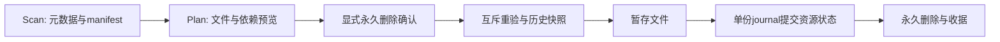

# 工作区存储管理

## 职责与接口

`scan` 盘点工作区；`plan` 根据资源 ID 计算精确删除集合和依赖阻断；`apply` 仅执行已持久化计划。
App 与 CLI 使用 `WorkflowRequest::Storage { request: Scan | Plan | Apply }`，经过同一个服务任务槽、worker、取消和结果持久化流程。
`Rpc::StorageInventory` 读取上次扫描的资源摘要，`Rpc::StorageHistory` 读取清理收据。服务协议44；存储清单、计划、日志、历史视图格式均为1。
从协议43升级只需同步更新服务、App和CLI；已有数据与模型格式没有变化，无需数据转换。首次扫描生成新存储清单。未知清单、计划、事务及收据格式会明确拒绝，不自动转换或兼容旧版本；工作区移动后旧缓存清单也必须重新扫描。

`types` 定义普通数据接口；`inventory` 根据现有生产者清单认领文件；`members` 限定生产者的保留文件名和清单成员；`dependencies` 解析完整性、追溯与未决引用；`cleanup` 管理事务；`history` 保存显示快照与能力状态。
底层 `analytics_storage::filesystem` 只读元数据，不依赖 DuckDB 或 Python。查询会话在执行清理前由原 worker 关闭；原生句柄不会传给客户端。

## 统计和保护

分类是互斥的空间归属，归档和临时状态是筛选标签。分类合计按 device/inode 去重；资源明细展示成员文件，因此共享资源明细不能直接相加。
逻辑大小和分配空间分开保存。释放估计按选择集合去重，硬链接未全部纳入删除时，不将其分配空间计为可释放。
文件系统共享块不能精确归属，估计不是磁盘可用空间增量承诺。权限错误、跨挂载点和扫描期间变化均使清单不完整，禁止据此清理。

只按已识别生产者和清单认领文件，不根据任意父目录扩展删除范围。配置、未知文件及未经确认的链接受保护；外部引用只显示，不计入工作区占用。
行情、训练折、样本掩码及年度缓存目录中的未识别文件独立保留。只有树哈希、没有文件成员清单的复合证据包，以及仅有归属标记的临时检查点，首版只统计并保护，不能按整个目录删除。
训练模型包含所需样本证据；共享预测包属于预测回放依赖。保留的预测身份需要训练描述时，只共享该描述，不要求保留已明确释放的模型字节。
市场视图的底层数据是完整性依赖；已完成任务的冻结来源是追溯关系。未决引用阻止清理，不自动级联扩大选择。

## 数据流与恢复



`.jfquant/storage/inventory.json` 保存最近扫描；`plans/UUID.json` 保存计划；`transactions/UUID/journal.json` 是可用性提交的权威记录；`result.json` 是可查询收据；`history/TASK.json` 保存原参数、结果与收益曲线。
原始 catalog、run.json、签名 manifest、特征顺序、schema 哈希和公式版本不改写。数据释放后从可选版本中隐藏，原身份仍在 catalog；历史展示与模型复用、预测回放、原始输入和完整核验分别报告。

同内容重新采集或恢复后，登记为带新身份的可用版本；重复登记保持幂等。原已释放版本不会重新变成可用，旧研究仍指向原身份。已完成清理收据支持工作区移动；移动后重新扫描再生成新计划。

提交前可以取消并回滚。启动恢复在独占租约内执行：未提交暂存回滚，已提交暂存继续删除。
临时事务目录不是回收站。提交后不能取消永久删除；逐项失败保留 `pending_deletion`，任务报告失败，重试同一计划继续剩余删除。完成计划重复执行返回原收据。
永久删除后先同步暂存目录，再持久化完成状态；目录同步失败同样保留待处理状态，启动或重试继续完成。
计划绑定选择文件身份、大小、时间及相关元数据；文件或引用变化使计划失效。工作区迁移后应重新扫描与预览，不能执行原路径下的旧计划。

## 复现与验收

```bash
export DUCKDB_DOWNLOAD_LIB=1
cargo test -p analytics-workflow storage_ --lib
cargo test -p analytics-cli storage_
cargo test -p analytics-desktop storage_
python3 crates/workflow/checks/architecture.py
cargo fmt --all -- --check
cargo clippy -p analytics-storage -p analytics-workflow -p analytics-cli -p analytics-desktop --all-targets -- -D warnings

export JFQUANT_WORKSPACE=/absolute/workspace
jfquant storage scan
jfquant jobs wait SCAN_TASK
jfquant storage list --sort size
jfquant storage list --category models --status archived
jfquant storage plan --resource RESOURCE_ID --resource ANOTHER_RESOURCE_ID
jfquant jobs wait PLAN_TASK
jfquant jobs results PLAN_TASK # 查看 id、blockers、impacts、files 和释放估计
jfquant storage apply --plan PLAN_ID --confirm-permanent
jfquant jobs wait APPLY_TASK
jfquant storage history
```

验收覆盖分类合计、硬链接保留、共享材料、未决引用、数据视图依赖、来源追溯、摘要及曲线保留、计划过期、取消、服务写入互斥、提交前后恢复和待删除文件变化。只使用临时合成工作区；不清理用户真实数据。
