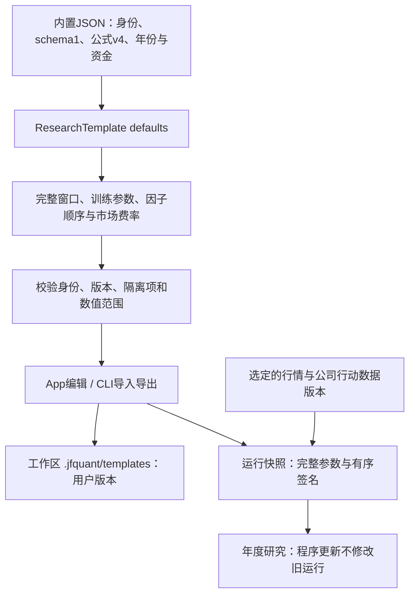

# 内置研究模板与冻结参数

[上级：analytics-workflow](../README.md) · [加载与校验](../src/README.md) · [年度执行](../../ml/src/backtest/README.md)

本目录只存随代码版本管理的内置模板，不存用户模板或运行记录。[gtja191-csi500.json](gtja191-csi500.json)通过`include_str!`进入App/CLI，运行不依赖仓库位置。

## 精简文件为何能生成完整模板

受控JSON保留schema1、固定模板ID、名称、公式版本、首末测试年、资金和股息研究税率。`ResearchTemplate`的serde defaults补齐当前`ResearchConfig`、按registry/audit筛选的有序178因子和最新市场费用；`builtin/read`加载后都校验。导出与提交运行时使用补齐后的完整模板，不以精简文件作为冻结快照。



## 默认与可编辑字段

默认5年训练、1年验证、次年测试，前50只、每5交易日调仓、100万元、最新A股费率及零固定股息预扣研究税率。资金、费用、训练/组合参数和日期可在完整模板中修改；模板ID、schema和公式身份不是可随意覆盖的业务参数。

修改`config.factor_ids`顺序会改变签名；重复、未知、隔离或缺输入因子拒绝。12项隔离公式和缺真实三因子输入的Alpha030不进入真实默认模板。合成演示生成独立的1+1、2009—2010、小因子模板，不改本目录的真实研究默认值。

## 日常操作与开发验收

```bash
jfquant templates default --output recipe.json
jfquant templates validate recipe.json
jfquant templates save recipe.json
jfquant templates import imported-recipe.json
jfquant templates export recipe.json --output exported-recipe.json
jfquant research check --template recipe.json --market MARKET_VERSION --actions ACTION_VERSION
jfquant jobs wait TASK_UUID
```

这些路径相对已选工作区；App用户保存到工作区，禁止改写包内模板或把用户产物提交本目录。更新内置默认值不会覆盖旧用户模板/运行。

从仓库根目录执行，workflow/CLI需要[原生环境](../../README.md#开发与验收)：

```bash
cargo nextest run -p analytics-workflow -E 'test(recipes_validate_order_version_and_parameter_signatures)'
cargo nextest run -p analytics-cli -E 'test(cli_native_research_templates)'
```

修改defaults或JSON时同时核对完整导出的字段、178项顺序、签名变化、往返保存、拒绝未知字段和公式版本。真实公司行动未就绪时research check保持blocked，不因模板校验通过就开始训练。
