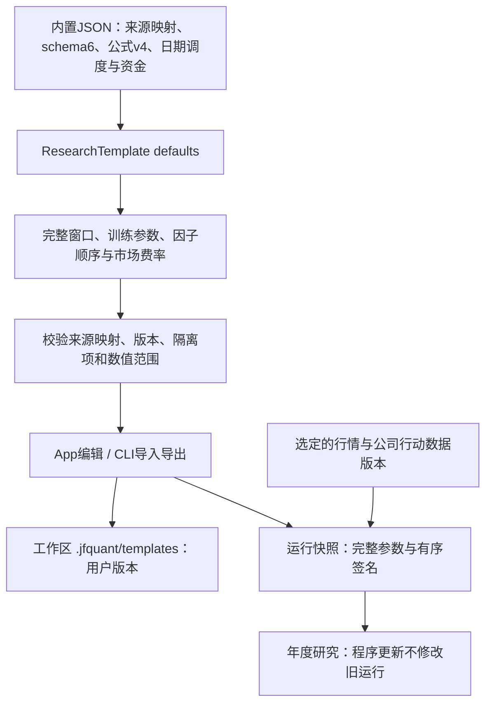
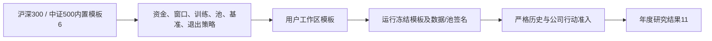
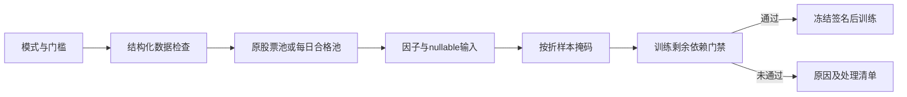
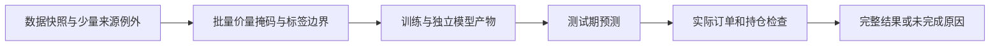

# 内置研究模板与冻结参数

[上级：analytics-workflow](../README.md) · [加载与校验](../src/README.md) · [年度执行](../../ml/src/backtest/README.md)

本目录只存随代码版本管理的内置模板，不存用户模板或运行记录。[gtja191-csi500.json](gtja191-csi500.json)通过`include_str!`进入App/CLI，运行不依赖仓库位置。

## 精简文件为何能生成完整模板

受控JSON保留schema6、模板ID、名称、公式版本、任意日期调度、资金和股息研究税率。`ResearchTemplate`的serde defaults补齐当前`ResearchConfig`、按registry/audit筛选的有序178因子和最新市场费用；`builtin/read`加载后都校验。导出与提交运行时使用补齐后的完整模板，不以精简文件作为冻结快照。



## 默认与可编辑字段

默认5年训练、1年验证、次年测试，前50只、每5交易日调仓、100万元、最新A股费率及零固定股息预扣研究税率。资金、费用、训练/组合参数和日期可在完整模板中修改；模板ID可以命名不同研究；schema必须为3、公式必须为v4。股票池版本、基准证券和退出策略均为显式业务参数。

修改`config.factor_ids`顺序会改变签名；重复、未知、隔离或缺输入因子拒绝。12项隔离公式和缺真实三因子输入的Alpha030不进入真实默认模板。合成演示生成独立的1+1、2009—2010、小因子模板，不改本目录的真实研究默认值。

## 日常操作与开发验收

```bash
jfquant templates default --output recipe.json
jfquant templates validate recipe.json
jfquant templates save recipe.json
jfquant templates import imported-recipe.json
jfquant templates export recipe.json --output exported-recipe.json
jfquant research check --template recipe.json --market MARKET_VERSION --actions ACTION_VERSION
jfquant jobs wait TASK_UUID
```

这些路径相对已选工作区；App用户保存到工作区，禁止改写包内模板或把用户产物提交本目录。更新内置默认值不会覆盖旧用户模板/运行。

从仓库根目录执行，workflow/CLI需要[原生环境](../../README.md#开发与验收)：

```bash
cargo nextest run -p analytics-workflow -E 'test(recipes_validate_order_version_and_parameter_signatures)'
cargo nextest run -p analytics-cli -E 'test(cli_native_research_templates)'
```

修改defaults或JSON时同时核对完整导出的字段、178项顺序、签名变化、往返保存、拒绝未知字段和公式版本。真实公司行动未就绪时research check保持blocked，不因模板校验通过就开始训练。

## 当前双模板

`gtja191-csi500.json` 和 `gtja191-csi300.json` 均为schema6。`pool_version` 默认绑定所选行情版本的builtin:csi500/csi300；自定义组合填写已保存的pool版本ID。基准默认SH000905/SH000300，退出默认next_tradable_day，也可选择next_rebalance。源码模板不引用本地数据路径或生成版本ID。



`jfquant templates default --universe csi300 --output recipe.json` 导出完整默认值。未声明schema或schema1模板拒绝，不自动转换。用户池定义及修改过的模板只保存在工作区。

## 模板6的日期与策略


single示例：`{"mode":"single","fold":{"train":{"start":"2006-02-15","end":"2010-10-29"},"validation":null,"test":{"start":"2012-03-01","end":"2012-09-28"}}}`。rolling包含first、step（count/unit）、expanding和until；manual包含folds数组。具体区间必须由所选数据日历验证，不自动修改显式请求。

## 为什么需要本组件

把已经研究过的配置沉淀为可审阅的参数。模板保存日程、股票池、基准、资金、费用和数据版本。沪深300默认2012年起测，是为了避开5年训练加1年验证所需的主要成员覆盖缺口；756交易日预热仍可能更早，相关未知历史不能回填。

设计依据：2026-10-14接受的当前组件职责、可复现实验与用户研究需求、组件接口及测试。未在代码或证据中确认的历史取舍不推定为既有设计理由；来源、法规或数据格式变化时重新评估。

## 三级研究模式：为什么允许筛选

决定日期2026-10-14，依据是用户接受的三级模式计划。正常预热空值、来源缺失和错误数据是不同问题：全部拒绝会浪费可用样本，全部放行又会混淆因子和真实权益。默认严格检查；另外提供“允许部分数据缺失”和“只用数据合格的股票”。模式是研究输入的一部分，不能作为训练失败后自动切换的兜底。

第二档保持原成员，纯缺失传播null；第三档派生每日合格成员，不改原始成员或证据。不能看到后来缺价而倒删早期股票。账户仍采用原价、整数股、T+1和连续权益；未裁定冲突、损坏、基准缺项及剩余必要依赖仍阻断。默认有效因子比例0表示至少一项有效，最低有标签样本1只表示可执行，不表示样本在统计上充分。所选因子整列无有效值不会被自动删除。

当前模板schema6新增quality_policy，内置沪深300/中证500均默认strict、min_valid_feature_ratio=0、min_labeled_rows=1。用户显式选择allow_missing或qualified_only并保存新模板。工作区模板与内置模板使用同一校验，缺schema或schema4不能被解释为当前模式。

```json
{"strictness":"allow_missing","min_valid_feature_ratio":0.0,"min_labeled_rows":1}
```

这是quality_policy字段值，不能作为完整模板提交。更改模式或门槛改变缓存和模型来源签名，必须重新计算。



## 2026-10-14：直接代码读取与分阶段研究

为什么调整：普通市场代码无需先登记身份；独立目录、审核和权威名录下载增加了研究前置负担。特殊历史代码仍需在快照内明确区间，不能将旧证券行情或权益接到另一证券。训练使用价量和标签，到账／交付资料只在实际账户执行时检查。

当前格式：模板6、需求3、准入4、股票池3、公司行动4、规范行情5、系数3、采集6、服务9、研究结果11；快照内来源映射1、训练产物1。工作区和任务记录1、GTJA191公式v4及默认178项顺序保持。旧格式明确拒绝，不自动转换。

App与jfquant共用后台。research train产出training.json及逐折model.txt/manifest.json；research backtest引用训练任务，不重新训练；research run先训练再回测。补齐支付日不改变训练价量依据，系数或除权参考改变须重训。check只证明训练就绪，账户提示保持not_run；回测失败仍可读取模型及部分账户记录。

```bash
jfquant --workspace "$JFQUANT_WORKSPACE" research train --template recipe.json --market MARKET_ID --actions HISTORY_ACTIONS_ID
jfquant --workspace "$JFQUANT_WORKSPACE" jobs wait TRAIN_JOB_ID --timeout 60
jfquant --workspace "$JFQUANT_WORKSPACE" research backtest --training TRAIN_JOB_ID --actions EXECUTION_ACTIONS_ID
jfquant --workspace "$JFQUANT_WORKSPACE" jobs results BACKTEST_JOB_ID
```



验收：nextest覆盖来源日期边界、三档掩码、训练／回测分离及模型保留；Clippy、Rustdoc、格式、组件文档和包内CLI共同检查。生成数据、模型、运行记录和安装包不提交。另一台Apple Silicon/macOS14实机验收继续待完成。
