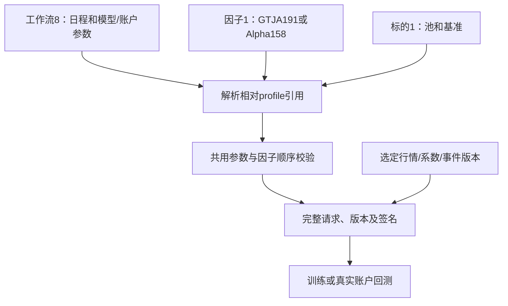

# 可复用流程、因子和标的配置

[公共流程](../README.md) · [文件接口](../src/profiles.rs) · [因子配置](factors/README.md) · [标的配置](targets/README.md)

为什么分离：年度滚动的日期、训练参数和资金不依赖采用GTJA191还是Alpha158；同一套因子也可研究沪深300或中证500。把因子列表和标的嵌在每个工作流中会重复维护并遗漏顺序修改。当前配置拆成三类，只在提交任务时解析并冻结完整参数。

| 文件 | 保存什么 | 不保存什么 |
|---|---|---|
| annual-rolling.json / csi300-annual.json，工作流8 | 日期、模型参数、样本策略、资金费用、组合参数、相对profile引用 | 因子列表、成员历史 |
| factors/*.json，FactorProfile1 | 单一组合、固定公式版本、有序特征、训练价格口径 | 股票池、日期、费用 |
| targets/*.json，TargetProfile1 | 股票池版本或builtin名、基准、移除持仓策略 | 因子列表、训练参数 |

csi300-annual默认2012年起测，5年训练+1年验证；annual-rolling保留中证500默认日期。结束为空时取选定数据最后完整交易日，部分年度明确标注。两个流程都可替换任一因子或标的配置，不为每个组合复制一套参数。GTJA191默认v4/178项，Alpha158默认独立版本/158项；分别756/61交易日预热。



用户保存使用相邻factors/targets子目录，文件按内容SHA256命名，相同profile复用。写入profile后才原子发布流程引用；导出和移动须携带整个目录。单独导出profile使用CLI或App按钮。任务中的ResearchTemplate是解析后的对象，不能把任务JSON直接当工作流文件导入；旧平铺模板拒绝，不自动转换。run --request仍接收完整当前公共TaskRequest，方便AI精确提交冻结参数。

```bash
jfquant templates default --universe csi300 --output research/workflow.json
jfquant templates factors --template research/workflow.json --output research/gtja.json
jfquant templates target --template research/workflow.json --output research/csi300.json
jfquant templates compose --workflow research/workflow.json --factors research/gtja.json --target research/csi300.json --output research/combined.json
jfquant templates validate research/combined.json
jfquant research train --template research/combined.json --market MARKET_ID --price-basis provider --strictness qualified_only
jfquant research train --template research/combined.json --market MARKET_ID --factor-set alpha158 --price-basis provider
```

相对路径以工作区解析；profile内部引用相对工作流文件。显式profile覆盖后再应用命令行组合/口径覆盖：--factor-set重置为该组合完整特征，--price-basis只改变来源口径。App相同操作调用profiles模块。默认verified/strict；provider仅允许可信原Qlib研究价量，不能用于绕过损坏、冲突或真实账户权益缺项。

开发验收：`DUCKDB_DOWNLOAD_LIB=1 cargo nextest run -p analytics-workflow -p analytics-cli`。覆盖共享profile复用、标的替换不改变因子、整体目录迁移、相对引用、旧格式拒绝、错误profile不部分修改当前配置、实际原生训练。受控默认文件不包含本地数据版本，用户模板、证据、模型和运行记录不提交。
