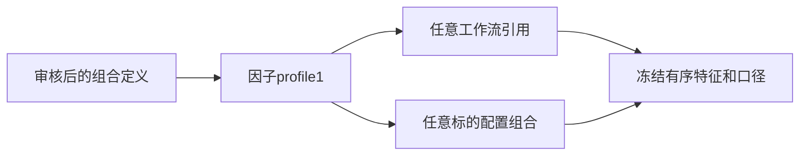

# 独立因子配置

[配置组合](../README.md) · [因子定义](../../../factor/README.md)

为什么存在：特征集合、顺序和研究价量口径共同定义模型输入，换标的不应改变这些值。FactorProfile格式1保存factor_set、formula_version、price_basis和显式有序factor_ids。gtja191.json为v5默认190项，alpha158.json为固定Qlib版本158项。两套不能混选；新增组合必须拥有独立版本与golden。

使用`jfquant templates factors --template research/workflow.json --output research/factors.json`导出；`research train --factor-profile research/factors.json`替换当前流程选择。验证由workflow profiles和FactorRegistry共同完成，重复、隔离、跨组合ID或错误公式版本拒绝。验收执行workflow/cli nextest，并检查factor全列golden；文件可提交，实际因子缓存不提交。

## GTJA191 v5（2026-10-18）

`gtja191.json`为v5默认190项；`gtja191-full.json`为同版本、canonical顺序的全部191项。
12项历史歧义采用显式解释，见[factor审计](../../../factor/FACTOR_AUDIT.md)。
全量配置加入Alpha030，需要所选快照根目录的真实`three_factor_returns.json`；
缺源由输入检查及既有缺失策略处理，不能仅凭模板名称声称输入齐全。
v4模板、缓存与模型不自动转换；需要重新冻结特征顺序、检查、计算及训练。
