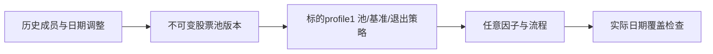

# 独立标的配置

[配置组合](../README.md) · [动态股票池](../../src/pools.rs)

为什么存在：研究范围和基准与因子选择正交，复制因子列表到每个指数模板容易失配。TargetProfile格式1只保存pool_version、benchmark和pool_exit_policy。csi300/csi500分别引用选定行情的历史池和价格指数；自选集合引用工作区不可变pool版本，而非复制成员到模板。

`jfquant templates target --template research/workflow.json --output research/target.json`导出；`research train --target-profile research/target.json`选择。替换只改变标的字段，因子顺序和模型参数保持。配置合法不证明历史池覆盖完整，更不能以当前名单回填过去。验收由split_profiles测试、动态池日期边界和真实研究准入共同完成；成员数据及本地版本记录不提交。
